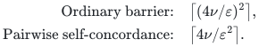

# Primary sources and attribution

Yilin Liu and GPT-6 Astra Pro — curated research source map, 2026-10-26.

## Canonical manuscript

- [Sparsification from self-concordant barriers](manuscripts/self_concordant_sparsification.tex): complete seven-page English research draft, with the existence theorem, proof, dual/face/lift corollaries, and a conditional oracle algorithm. The source preserves the research-package version of 2026-10-26, SHA-256 `e0aeb9e93cced63a452c85de0fe48e2327c5c9f565b96ce5156482fdb61e336a`.
- [Proof reading map](proof.md) identifies the new and imported steps. [Verification scope](verify/README.md) records the internal mathematical audits, not external peer review.

## Essential external results

1. Victor Reis and Thomas Rothvoss, [*Linear-size <code class="math">\ell_1</code> sparsifiers*, arXiv:2606.28147v2](https://arxiv.org/html/2606.28147v2): Lemma 18 (separately convex positivity); Theorem 22 (coordinate-section symmetrization); Theorem 7 (volume-based partial coloring and an oracle-randomized algorithm). These are imported, indispensable results. Lemma 18's proof extends from integer homogeneity to positive real homogeneity as verified in the manuscript.

2. James Saunderson, [*Sparsification of sums with respect to convex cones*, arXiv:2512.21812v1](https://arxiv.org/html/2512.21812v1): Theorems 1.4 and 1.5 give the following respective support bounds:

   <!-- math-display: e8f7491ddd080e3c5b4e9e65
   \begin{aligned}
   \text{Ordinary barrier:}\quad &\left\lceil(4\nu/\varepsilon)^2\right\rceil,\\
   \text{Pairwise self-concordance:}\quad &\left\lceil4\nu/\varepsilon^2\right\rceil.
   \end{aligned}
   -->
   

   The present theorem improves the first dependence from quadratic to linear, not the specialized constant in the second. Lemma 2.3(ii) and Theorem 7.1 also provide barrier facts used here.

3. Nesterov and Nemirovskii, *Interior-Point Polynomial Algorithms in Convex Programming* (SIAM, 1994), and Nesterov, *Lectures on Convex Optimization* (Springer, 2018): background on the standard directional barrier inequality and parameter-preserving barrier duality. The directional estimate is also proved locally.

4. Arpon Basu et al., [*Optimal Sparsifiers for Minkowski Sums and Sums of Seminorms*, arXiv:2609.20238](https://arxiv.org/abs/2609.20238): independent prior results for Minkowski sums, seminorms, hypergraphs and submodular functions. Those should not be relabeled as new consequences here.

5. Alexandr Andoni, Robert Krauthgamer and David P. Woodruff, [*The Sketching Complexity of Graph Cuts*, arXiv:1403.7058](https://arxiv.org/abs/1403.7058): a family-wise weighted cut-sparsifier lower bound, used only for the worst-case PSD optimality comparison.

## New contribution and scope

The research-draft contribution is the zero-extended exponential of the ordinary barrier, its cone-directional convexity, the uniform sign-positivity argument for boundary sums, and the synthesis with the three explicitly attributed Reis--Rothvoss theorems. This avoids an extra pairwise-self-concordance hypothesis.

A targeted primary-source comparison through October 26, 2026 did not identify an already-stated general ordinary-barrier linear-parameter theorem. This does **not** establish historical priority. The randomized construction is only in a strong separation-oracle model with a valid parameter upper bound. No general Turing bit complexity, external refereeing or proof-assistant certificate is claimed.
