# Spectral, norm, and regression summaries under correlated failures

One original-item subset with fixed weights serves every permitted label deletion. Pool and label-code constructions give different time/accuracy/failure-budget tradeoffs.

[Proof](proof.md) · [Sources](sources.md)

**Guarantee**

Simultaneous relative PSD, row-norm, loss, and whole-seminorm preservation, or the stated weak convex-regression solution guarantee. One successful event covers all queries.

**Objective and output**

Fixed nonnegative weights on original items, rows, edges, or top simplices. Weak regression preserves the original objective achieved by a sketched minimizer; it does not claim the same accuracy for every weighted objective value.

**Randomness**

Mixed. Importance pools are Monte Carlo with failure at most <code class="math">\delta</code>; random-code variants have code failure at most <code class="math">\zeta</code>, plus any ordinary sampler failure. One success event covers all allowed failures and later queries. Single-failure PSD/regression and coherence-code PSD alternatives are deterministic. Optimal arbitrary-seminorm support is existence only; its constructive alternative is Monte Carlo with the ordinary backend's high-probability guarantee and lifted-access assumptions.

**Time**

Pool constructions are uniformly polynomial after the full-input gate and require the stated ordinary importance routine. Label-code constructions are Monte Carlo plus an ordinary PSD/norm backend; deterministic coherence codes give a separate tradeoff. Optimal-support PSD bounds use polynomial arithmetic; the explicit rational bit implementation adds the indicated logarithm.

**Space**

The formulas below count retained support. Lifted matrices, codes, and elimination workspace are separate. Arbitrary seminorm construction requires lifted-sum evaluation and roundedness access.

**Parameters**

<code class="math">r</code> is original rank; <code class="math">\Gamma=(h+d)^{h+d}/(h^h d^d)</code>, set to <code class="math">1</code> for <code class="math">hd=0</code>; <code class="math">Q=\sum_{j\le\min\{h,L\}}\binom{L}{j}</code>. <code class="math">L</code> is label count; <code class="math">h</code> is failure budget; <code class="math">d</code> is item-label degree. <code class="math">\rho</code> is fixed-background effective dimension.

**Model and representation**

Real PSD and norm models; rational data for the explicit polynomial-bit claims. Responses come from a supplied subspace. Graph/simplicial labels are sets, and repeated labels do not require a proper coloring.

**Lower-bound scope**

The robust importance multiplier is at least <code class="math">\binom{h+d}{d}</code>; <code class="math">d+1</code> is sharp for <code class="math">h=1</code>. Simple graph spectral summaries require <code class="math">\Omega\!\left(n\binom{h+a+b}{a+b}/\epsilon^2\right)</code> in the stated size regime. No optimal inverse-accuracy claim is made for the code upper bound.

**Review status**

**Ready for review in the stated scope.** The exact rational arbitrary-rank PSD importance core with possibly singular fixed background, deletion monotonicity and effective-dimension accounting, sharper one-label-failure maxima, supplied-pool estimator with separate deterministic mass and probabilistic domination contracts, conservative preflight gates, exact fixed-scenario all-vector embedding checks, and the supplied-response unconstrained ridge realization. Mathematical review includes the weak convex-regression bilinear lemma with its convexity, attainment and nonnegative-penalty hypotheses.

**Dependencies and scope.** The reference does not generate random pools, sample a sparse summary or implement matrix-exponential derandomization. Supplied-pool certificates prove exact score/mass accounting; coverage and simultaneous domination remain separate probability events in the mathematical theorem. Nontrivial planner modes return `weights=None`. The ridge solver implements unconstrained quadratic objectives. General convex constrained/penalized minimization, RIP/coherence codes, graded incidence software, Lewis weights and whole-seminorm backends are outside this implementation and scoped readiness. Their mathematical claims remain separately stated with primary dependencies. Fixed-scenario embedding checks prove PSD inequalities for all real vectors in that scenario, without asserting all-failure sampling success. Exact rational bit lengths and explicit input/certificate matrix dimensions are charged. No external peer review or proof-assistant verification is claimed.

The [verification note](verify/README.md) identifies executable coverage. This status does not claim external peer review or proof-assistant verification.

**Source**

[Complete proof](proof.md) and [canonical manuscript map](sources.md).

## Results

**PSD importance pools**

**Retained support, capped by input size.**

<!-- math-display: b64d4d7a4b6de09420061ad7
O\!\left(\Gamma r\epsilon^{-2}\log(2rQ/\delta)\right)
-->
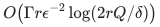

**Algorithm / guarantee.** Monte Carlo, failure at most <code class="math">\delta</code> for one simultaneous all-query/all-failure event; uniform polynomial time without failure enumeration

**One-label-failure PSD**

**Retained support, capped by input size.**

<!-- math-display: cace771187369d34e6eb306f
O\!\left((d+1)r\epsilon^{-2}\log(2r(L+1))\right)
-->
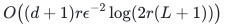

**Algorithm / guarantee.** Deterministic polynomial-bit construction

**Fixed PSD background**

**Retained support, capped by input size.**

<!-- math-display: e255d43a59a2f3050a28cead
O\!\left(\Gamma\rho\epsilon^{-2}\log(2nQ/\delta)\right)
-->
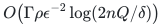

Here <code class="math">n</code> is the ambient matrix dimension, as in the fixed-background theorem; the effective dimension <code class="math">\rho</code> controls the leading factor.

**Algorithm / guarantee.** Monte Carlo pool construction with failure at most <code class="math">\delta</code>; valid for every later background <code class="math">R'\succeq R</code>

**General finite-query nonnegative losses, <code class="math">K_0</code> queries**

**Retained support, capped by input size.**

<!-- math-display: 410782d9b18f7b13d00f13c3
O\!\left(\Gamma S_0\epsilon^{-2}\log(2K_0Q/\delta)\right)
-->
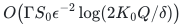

**Algorithm / guarantee.** Monte Carlo, failure at most <code class="math">\delta</code>; requires hereditary ordinary sensitivity bound/routine <code class="math">S_0</code>

**<code class="math">\ell_1</code> row sums, pool construction**

**Retained support, capped by input size.**

<!-- math-display: 4f92f62fac40cfb760a4cafc
O\!\left(\Gamma r\epsilon^{-2}\log(2NQ/\delta)\right)
-->
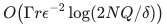

**Algorithm / guarantee.** Monte Carlo pool and Lewis-weight sampling, failure at most <code class="math">\delta</code>; augmented supplied responses allowed

**Fixed <code class="math">1&lt;p&lt;2</code> row sums, pool construction**

**Retained support, capped by input size.**

<!-- math-display: 43dca413baa992530bba9634
O_p\!\left(\Gamma r\epsilon^{-2}\left[(\log(2r))^3\log(2N)+\log(2NQ/\delta)\right]\right)
-->
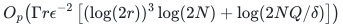

**Algorithm / guarantee.** Monte Carlo pool and fixed-<code class="math">p</code> norm sampling, failure at most <code class="math">\delta</code>

**One label per PSD item, code construction**

**Retained support, capped by input size.**

<!-- math-display: ebf2a189d22362811372bb3f
O\!\left(\frac r{\epsilon^2}\left[1+\min\left\{L,\frac{(h+1)\log(eL/(h+1))+\log(1/\zeta)}{\epsilon}\right\}\right]\right)
-->
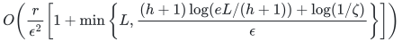

Here <code class="math">K=1+\min\left\{L,O\!\left(\bigl[(h+1)\log(eL/(h+1))+\log(1/\zeta)\bigr]/\epsilon\right)\right\}</code>.

**Algorithm / guarantee.** Monte Carlo code, failure at most <code class="math">\zeta</code> in <code class="math">1\le h&lt;L</code>, followed by deterministic polynomial-arithmetic PSD sparsification; identity-code branch deterministic

**One-label deterministic coherence code**

**Retained support, capped by input size.**

<!-- math-display: 62704468dc320aa57f32780e
O\!\left(r\epsilon^{-2}\min\left\{L+1,(h^2+h/\epsilon)\log(2L)+1\right\}\right)
-->
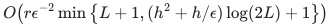

**Algorithm / guarantee.** Deterministic arithmetic; explicit bit version adds <code class="math">\log(2rK)</code>

**At most <code class="math">d</code> labels per item, exterior code**

**Retained support, capped by input size.**

<!-- math-display: 579740e87a1fff05ffcc5fc0
O\!\left(\frac r{\epsilon^2}\sum_{j=0}^{\min\{d,D\}}\binom Dj\right)
-->
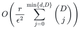

Here <code class="math">K=\sum_{j\le\min\{d,D\}}\binom{D}{j}</code>.

**Algorithm / guarantee.** Monte Carlo code with failure at most <code class="math">\zeta</code>, followed by deterministic PSD sparsification; <code class="math">D</code> as defined below, with fixed <code class="math">d</code> giving <code class="math">h^d</code> up to logarithms

**Graph vertex/edge label degrees <code class="math">a,b</code>**

**Retained support, capped by input size.**

<!-- math-display: 7838d4ff842725db8b848884
O_{a,b}\!\left(rh^{a+b}\log^{a+b}(2L)/\epsilon^{a+b+2}\right)
-->
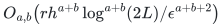

**Algorithm / guarantee.** Monte Carlo code with fixed confidence, followed by deterministic PSD sparsification; fixed <code class="math">a,b</code>, <code class="math">h\ge a+b</code>; exact capped form in proof

**One vertex color, simplicial boundary**

**Retained support, capped by input size.**

<!-- math-display: 89fa4dfaa3356fabad79ff8e
O\!\left(r\epsilon^{-2}\left[1+\min\left\{L,q\bigl[s\log(eL/s)+\log(2/\zeta)\bigr]/\epsilon\right\}\right]\right)
-->
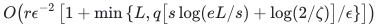

**Algorithm / guarantee.** Monte Carlo code with failure at most <code class="math">\zeta</code>, followed by deterministic PSD sparsification; <code class="math">q</code> distinct colors per top simplex, <code class="math">s=\min\{L,h+q\}</code>; lower skeleton retained

**Weak convex regression, importance pools**

**Retained support, capped by input size.**

<!-- math-display: 512fe283c5846e71f29f8ba6
O\!\left(\Gamma\rho\epsilon^{-1}\log(2(p+q)Q/\delta)\right)
-->
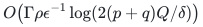

**Algorithm / guarantee.** Monte Carlo, failure at most <code class="math">\delta</code> for all later responses in the supplied subspace, <code class="math">\lambda\ge\lambda_0</code>, convex constraints and nonnegative convex penalties

**One-failure weak convex regression**

**Retained support, capped by input size.**

<!-- math-display: fc30730449efef1ffba7d9d4
O\!\left((d+1)\rho\epsilon^{-1}\log(2(p+q)(L+1))\right)
-->
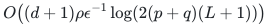

**Algorithm / guarantee.** Deterministic polynomial-bit construction

**One-label weak regression, code route**

**Retained support, capped by input size.**

<!-- math-display: cca7d858cc4320832f5fe90f
O\!\left(\rho D\epsilon^{-1}\log(2nD)\right)
-->
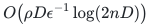

Here <code class="math">D=O\!\left(\bigl[(h+1)\log(eL/(h+1))+\log(1/\zeta)\bigr]/\sqrt{\epsilon}\right)</code>.

**Algorithm / guarantee.** Monte Carlo code with failure at most <code class="math">\zeta</code> when the deterministic lifted PSD routine is used; linear <code class="math">h</code>, <code class="math">\epsilon^{-3/2}</code> up to displayed logs; identity branch needs background padding

**Whole seminorm blocks, existential**

**Retained support, capped by input size.**

<!-- math-display: af750f1c3b9b5fee8223235b
O(rK/\epsilon^2)
-->
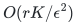

**Algorithm / guarantee.** Existence only at this support bound; choosing deterministic label features does not supply a deterministic optimal seminorm construction

**Whole seminorm blocks, constructive backend**

**Retained support, capped by input size.**

<!-- math-display: 9c82468a25fac972579af7b7
O\!\left(\epsilon^{-2}R\log(2R/\epsilon)[\log(2R)]^{5/2}\right)
-->
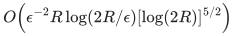

Here <code class="math">R\le rK</code>.

**Algorithm / guarantee.** Monte Carlo with the ordinary seminorm backend's high-probability guarantee, plus code failure <code class="math">\zeta</code> if a random code is used; requires lifted-sum evaluation and roundedness access

For the general exterior code, let <code class="math">s=\min\{h+d,L\}</code> and use the actual rounded dimension <code class="math">D=\min\left\{L, \left\lceil\frac{Cd}{\epsilon} \left[s\log(eL/s)+\log(2/\zeta)\right]\right\rceil \right\}</code>.

If the cap chooses <code class="math">L</code>, use the identity code. Compute the final support target before materializing features; if it reaches the input size, return the original input. The exact arithmetic support bound <code class="math">O(rK/\epsilon^2)</code> has an explicit polynomial-bit implementation with an additional <code class="math">\log(2rK)</code> factor. The sample-confidence and code-confidence probabilities are separate when both stages are randomized.

For regression, <code class="math">\rho\le\mathrm{sd}_{\lambda_0}(A)+q</code>, where <code class="math">q</code> is the supplied response-subspace dimension. The pool route has better inverse-accuracy dependence, while the code route has better failure-budget dependence in some regimes; neither uniformly dominates the other.

**Attribution:** icekylinx and GPT-6 Astra Pro.
