# Common-weight sparsifiers for seminorms under correlated failures

**Abstract.** We transfer ordinary sums-of-seminorms sparsification to a single set of nonnegative item weights valid after all correlated label deletions. A linear feature lift and Gaussian decoding reduce the transfer to ordinary all-query sparsification in dimension <code class="math">rK</code>, yielding <code class="math">O(rK/\epsilon^2)</code> support existentially. For one label per item, the uncapped bound is <code class="math">O(r(h+1)\log(eL/(h+1))/\epsilon^3)</code>. A constructive version retains the evaluation, roundedness, probability, and extra-logarithm requirements of its ordinary seminorm backend.

## 1. Model and statement

Let <code class="math">f_1,\ldots,f_m:\mathbb R^r\to\mathbb R_{\ge0}</code> be seminorms: they are subadditive and satisfy <code class="math">f_e(tx)=&#124;t&#124;f_e(x)</code>. Arbitrary nonnegative input weights can be absorbed into the <code class="math">f_e</code>. The dimension <code class="math">r</code> may be reduced by the common kernel of all input seminorms.

Each original item has a failure-label set <code class="math">\Lambda(e)\subseteq[L]</code> of size at most <code class="math">d</code>. A query chooses <code class="math">F\subseteq[L]</code>, <code class="math">&#124;F&#124;\le h</code>, and removes exactly the items whose label sets intersect <code class="math">F</code>. Write

<!-- math-display: 6c086c1276f5fd91fb72b54a
E_F=\{e:\Lambda(e)\cap F=\varnothing\},\qquad
 N_F(x)=\sum_{e\in E_F}f_e(x).
\tag{N1}
-->
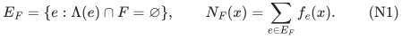

The output is one nonnegative weight vector <code class="math">\omega</code>, chosen before either <code class="math">F</code> or <code class="math">x</code>, satisfying

<!-- math-display: 552d1d71329ca77a16ed32fe
(1-\epsilon)N_F(x)
 \le \sum_{e\in E_F}\omega_e f_e(x)
 \le (1+\epsilon)N_F(x)
 \quad\text{for every allowed }F\text{ and every }x.
\tag{N2}
-->
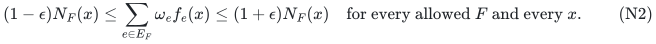

Items are retained and deleted whole. The weights never change between scenarios.

Here is a general feature-based statement.

**Theorem N1.** Suppose unit vectors <code class="math">z_e\in\mathbb R^K</code> and orthogonal projectors <code class="math">Q_F</code> satisfy

<!-- math-display: ae8b444c489b985516fa8835
\|Q_Fz_e\|^2=0\quad(e\notin E_F),\qquad
 1-\kappa\le\|Q_Fz_e\|^2\le1\quad(e\in E_F).
\tag{N3}
-->
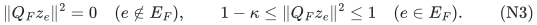

For <code class="math">0&lt;\epsilon&lt;1</code> and <code class="math">\kappa\le\epsilon/4</code>, a vector <code class="math">\omega</code> satisfying (N2) exists with support

<!-- math-display: befae01638a61edf5228b8f4
O\!\left(\min\{m,rK/\epsilon^2\}\right).
\tag{N4}
-->
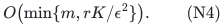

This uses the ordinary seminorm support theorem of Basu--Brakensiek--Chen--Putterman--Reis--Zhang, Theorem 1.2. No polynomial construction from arbitrary seminorm evaluation oracles follows from that paper's stated theorem. A constructive alternative is given in Section 4.

For one label per item, including unlabeled items, the label-vector construction supplies

<!-- math-display: e3fdf17a87bb74f7b4a2bdeb
K=1+\min\!\left\{L,\,
  O\!\left(\frac{s\log(eL/s)}{\epsilon}\right)\right\},
 \qquad s=\min\{h+1,L\},
\tag{N5}
-->
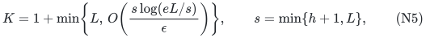

where the short code may be chosen by the probabilistic method. Thus, in the uncapped regime <code class="math">1\le h&lt;L</code>, the support is

<!-- math-display: ef4280198b753086784959bd
O\!\left(\min\left\{m,\,
  \frac{r(h+1)\log(eL/(h+1))}{\epsilon^3}\right\}\right).
\tag{N6}
-->
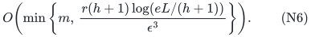

For a sampled code with failure probability at most <code class="math">\zeta</code>, add <code class="math">\log(2/\zeta)</code> inside the numerator determining its dimension. One successful code event already covers every failure set. There is no later union bound over <code class="math">\sum_{j\le h}\binom Lj</code>.

If <code class="math">h=0</code>, <code class="math">d=0</code>, or no labels occur, apply the ordinary theorem directly with <code class="math">K=1</code>. If <code class="math">r=0</code>, all items are zero. Replace <code class="math">h</code> and <code class="math">d</code> by their minima with <code class="math">L</code> when necessary; the identity-code branch covers <code class="math">h\ge L</code>.

## 2. Gaussian decoding proves the transfer

Identify the lifted query space with matrices <code class="math">U\in\mathbb R^{r\times K}</code>. For each original item define

<!-- math-display: fd9475f74df0629abe7551da
g_e(U)=f_e(Uz_e).
\tag{N7}
-->
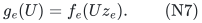

Composition with a linear map preserves the seminorm axioms, so the <code class="math">g_e</code> are seminorms on a space of dimension <code class="math">rK</code>. Apply the ordinary support theorem at accuracy <code class="math">\theta=\epsilon/4</code>. It returns one vector <code class="math">\omega</code> with <code class="math">O(rK/\theta^2)</code> nonzero entries such that

<!-- math-display: 938da02fc62d75cdf58d87b6
(1-\theta)\sum_e g_e(U)
 \le \sum_e\omega_e g_e(U)
 \le (1+\theta)\sum_e g_e(U)
 \quad\text{for all }U.
\tag{N8}
-->
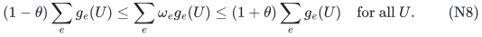

Fix any <code class="math">F</code> and <code class="math">x</code>, only after these weights have been selected. Let <code class="math">g</code> be a centered Gaussian vector with covariance <code class="math">Q_F</code>, and substitute <code class="math">U=xg^T</code> into (N8). Absolute homogeneity gives

<!-- math-display: e5e893557430ca84996be56c
\mathbb E\,g_e(xg^T)
 =f_e(x)\,\mathbb E|\langle g,z_e\rangle|
 =\sqrt{2/\pi}\,\|Q_Fz_e\|\,f_e(x).
\tag{N9}
-->
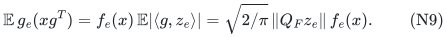

Every quantity is nonnegative and integrable. Integrating the fixed all-<code class="math">U</code> inequality is therefore valid, including when the Gaussian covariance is singular. Put <code class="math">\beta_e=\&#124;Q_Fz_e\&#124;</code> and <code class="math">a=\sqrt{1-\kappa}</code>. Then

<!-- math-display: 09f1cb2f449d2a6853d82bbf
(1-\theta)\sum_{e\in E_F}\beta_e f_e(x)
 \le \sum_{e\in E_F}\omega_e\beta_e f_e(x)
 \le (1+\theta)\sum_{e\in E_F}\beta_e f_e(x),
\tag{N10}
-->
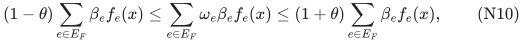

with <code class="math">a\le\beta_e\le1</code>. Positivity on both sides gives

<!-- math-display: d22ed6beebdab08cad6f7fc3
(1-\theta)a\,N_F(x)
 \le \sum_{e\in E_F}\omega_e f_e(x)
 \le \frac{1+\theta}{a}\,N_F(x).
\tag{N11}
-->
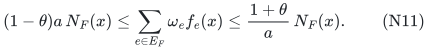

Since <code class="math">a\ge1-\kappa</code>, the choices <code class="math">\theta=\epsilon/4</code> and <code class="math">\kappa\le\epsilon/4</code> imply (N2). The factors <code class="math">\beta_e</code> are used only in the proof; they are never included in the output weights. The argument is pointwise for every <code class="math">F,x</code>, so both may be selected adaptively after seeing the output.

This proof uses only the ordinary all-query inequality and absolute homogeneity. Its seminorm hypothesis is needed to invoke the ordinary backend. It is not a new theorem about sparsifying arbitrary nonhomogeneous losses.

## 3. Overlapping labels and an explicit deterministic code option

For completeness, the label features can be constructed as follows. Choose unit label vectors <code class="math">v_c\in\mathbb R^D</code> with restricted isometry constant <code class="math">\delta_0</code> on every set of at most

<!-- math-display: 101d3e9eb740f8ff8e994d43
s=\min\{h+d,L\}
-->
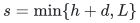

columns. Take <code class="math">\delta_0^2=\epsilon/(64d)</code>. Random signs give such vectors, with failure probability at most <code class="math">\zeta</code>, in dimension

<!-- math-display: 27a98b92f60e52d125de3fbf
D=\min\!\left\{L,\,
 \left\lceil\frac{Cd}{\epsilon}
       \left(s\log\frac{eL}{s}+\log\frac2\zeta\right)\right\rceil
          \right\}.
\tag{N12}
-->
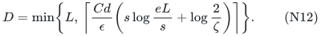

Use the identity matrix whenever the cap selects <code class="math">D=L</code>. No efficient restricted-isometry certification is claimed for a sampled short code.

Use the graded exterior space

<!-- math-display: 8d475aea3eccd129d129ccba
\mathcal E_{\le d}
   =\bigoplus_{j=0}^{\min(d,D)}\bigwedge^j\mathbb R^D,
 \qquad K=\sum_{j=0}^{\min(d,D)}\binom Dj,
\tag{N13}
-->
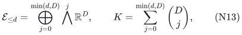

and let <code class="math">z_e</code> be the normalized wedge of its label vectors, in degree <code class="math">&#124;\Lambda(e)&#124;</code>. The empty label set has the scalar unit vector in degree zero. If <code class="math">P_F</code> projects away the span of the failed label vectors, set

<!-- math-display: 1b9732bc883976a19153b800
Q_F=\bigoplus_j\bigwedge^jP_F.
-->
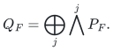

An item with a failed label is annihilated. For a live item, the principal-angle bound from restricted isometry is

<!-- math-display: fe9a767972221c3f5629c015
\|\Pi_{\mathrm{span}V_F}
       |_{\mathrm{span}V_{\Lambda(e)}}\|
 \le\frac{\delta_0}{1-\delta_0}.
-->
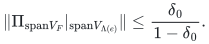

Consequently each squared singular value of the projection on its label span is at least <code class="math">1-4\delta_0^2</code>. Taking the exterior volume gives

<!-- math-display: 5c374d45682ded08d79f9d35
\|Q_Fz_e\|^2\ge(1-4\delta_0^2)^{|\Lambda(e)|}
             \ge1-4d\delta_0^2
             \ge1-\epsilon/16.
\tag{N14}
-->
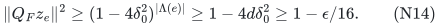

Thus (N3) holds. Equations (N4), (N12), and (N13) give the general bound. For fixed <code class="math">d</code>, <code class="math">h\ge d</code>, and fixed code confidence, an uncapped form is

<!-- math-display: 007c6ccb376dc0d78f5bfec8
O_d\!\left(\min\left\{m,\,
       \frac{r h^d\log^d(2L)}{\epsilon^{d+2}}\right\}\right).
\tag{N15}
-->
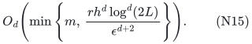

For one label per item there is also an explicit deterministic coherence code, described in the companion label-vector manuscript. It has

<!-- math-display: 8dcb35b66dd025c933bdfcbf
K=1+O\!\left(
      \min\{L,(h^2+h/\epsilon)\log(2L)\}\right).
\tag{N16}
-->
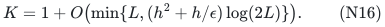

Substituting it into (N4) gives a deterministic choice of decoding features with an existential ordinary seminorm sparsifier. It does not by itself derandomize, or supply an algorithm for, the optimal ordinary seminorm theorem.

## 4. A constructive version with explicit access assumptions

Jambulapati--Lee--Liu--Sidford, Theorem 1.1, gives an ordinary seminorm sparsifier in dimension <code class="math">R</code> with support

<!-- math-display: 93540f3127b6231214e19aef
O\!\left(\epsilon^{-2}R
       \log(2R/\epsilon)\,[\log(2R)]^{5/2}\right).
\tag{N17}
-->
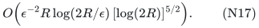

Its algorithm is randomized. For a total seminorm that is <code class="math">(a,b)</code>-rounded on the orthogonal complement of its kernel, the runtime has the form

<!-- math-display: 4084e8c5e96919f044af2576
(m\,\mathrm{polylog}R+\mathrm{poly}R)
    [\log(mb/a)]^{O(1)}T_{\rm eval},
\tag{N18}
-->
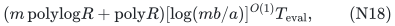

with its stated accuracy dependence and probability contract. The source's full theorem gives logarithmic dependence on the rounding ratio; its abstract states a simpler well-conditioned version.

Apply that theorem to the lifted <code class="math">g_e</code>, with <code class="math">R\le rK</code>, and then use exactly (N9)--(N11). This gives a constructive simultaneous-failure result with the extra logarithms in (N17), provided one supplies the backend's evaluation and rounding access for the **lifted** total <code class="math">\sum_e g_e</code>. One evaluation of <code class="math">g_e(U)</code> consists of computing <code class="math">Uz_e</code> and evaluating <code class="math">f_e</code> there.

Original roundedness is not asserted to imply the needed lifted roundedness automatically. For explicit rational polyhedral seminorms, the lifted common kernel and rational-direction conditioning can be analyzed from their linear forms; that is a concrete application-specific implementation issue. For abstract seminorms provided only as unrestricted evaluation oracles, the sharper existential theorem (N4) is the unconditional claim. No general polynomial-bit algorithm for (N4) is inferred from the September 2026 paper.

More generally, any ordinary seminorm sparsification backend with support <code class="math">S(R,\theta)</code> and an explicit access contract transfers with support <code class="math">S(rK,\epsilon/4)</code>, retaining that contract.

## 5. Applications retaining whole original objects

**Sums of block norms.** An item can be an entire matrix <code class="math">A_e</code> and a seminorm <code class="math">\nu_e</code>, with

<!-- math-display: 443619a6dfda07beaae4a5d2
f_e(x)=\nu_e(A_ex).
-->
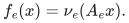

The theorem retains whole blocks, regardless of their row counts or individual ranks. It includes sums of Euclidean residual norms, sums of maximum coordinate deviations, and mixtures of different block seminorms. Fixed affine residuals are included by homogenization: replace <code class="math">x</code> by <code class="math">(x,t)</code> and use <code class="math">\nu_e(A_ex-tb_e)</code>, then restrict to <code class="math">t=1</code>. This costs one additional query dimension.

**Hypergraph and hedge cuts.** For a hedge <code class="math">e</code>, consisting of any collection of edges, define

<!-- math-display: c2a547df235e07e69e4a0f71
f_e(x)=w_e\max_{uv\in e}|x_u-x_v|.
\tag{N19}
-->
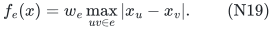

This is a seminorm, and at a Boolean cut vector it equals <code class="math">w_e</code> if the hedge crosses the cut, and zero otherwise. A hyperedge is the special case obtained by taking all pairs among its vertices. Therefore (N2) gives one weighted subset of original hyperedges or hedges preserving every cut after every allowed correlated label deletion. The theorem actually preserves the continuous sum in (N19). Its ordinary no-fault specialization is already covered by the September 2026 seminorm theorem; only the uniform failure transfer is asserted here.

**Sums of symmetric submodular functions.** Let <code class="math">F_e:2^{[n]}\to\mathbb R_{\ge0}</code> be symmetric submodular functions with <code class="math">F_e(\varnothing)=0</code>. Their Lovász extensions are seminorms on <code class="math">\mathbb R^n</code> and agree with <code class="math">F_e</code> on set indicators. Applying (N2) therefore retains and reweights whole functions so that

<!-- math-display: 41aea1a44d3f6e25a6f68bbe
\sum_{e:\Lambda(e)\cap F=\varnothing}F_e(S)
-->
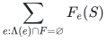

is preserved simultaneously for every set <code class="math">S</code> and every allowed failed-label set <code class="math">F</code>. The output weights serve every post-deletion objective. The ordinary no-fault theorem is an explicit public result, and no new ordinary submodular sparsification claim is made.

The same Gaussian proof extends to absolutely <code class="math">p</code>-homogeneous losses, replacing <code class="math">\beta_e</code> by <code class="math">\&#124;Q_Fz_e\&#124;^p</code>, **if** an appropriate ordinary all-query sparsification theorem exists for their lifted class. The September 2026 seminorm theorem does not provide such a theorem for arbitrary <code class="math">p&gt;1</code>. In particular it must not be cited as a general optimal-support theorem for squared hypergraph energies.

## 6. Public baselines and attribution

1. **Basu, Brakensiek, Chen, Putterman, Reis, Zhang, _Optimal Sparsifiers for Minkowski Sums and Sums of Seminorms_, September 2026.** Theorem 1.2 supplies <code class="math">O(r/\epsilon^2)</code> ordinary seminorm support; Theorems 1.3 and 1.4 state its hypergraph-cut and symmetric-submodular consequences. The full paper states existence, without an oracle-polynomial construction guarantee for arbitrary input seminorms. The ordinary theorem is the support backend; the present contribution is a single-weight-vector transfer to correlated failures. <https://arxiv.org/pdf/2609.20238>.

2. **Jambulapati, Lee, Liu, Sidford, _Sparsifying Sums of Norms_, FOCS 2023.** Theorem 1.1 gives the constructive bound (N17) and the roundedness/evaluation contract (N18); its treatment includes seminorm kernels. It also treats certain sums of powers subject to additional geometric hypotheses, which are not automatic here. <https://homes.cs.washington.edu/~jrl/papers/pdf/norm-sparsify.pdf>.

3. **Quanrud, _Quotient Sparsification for Submodular Functions_, SODA 2024.** An ordinary rank-<code class="math">r</code> integer polymatroid already admits a weighted quotient sparsifier with <code class="math">O(r\log(mr)/\epsilon^2)</code> support in randomized oracle-polynomial time. This independently covers ordinary whole-block linear-code predicates, so those are not claimed as a new consequence of our research. <https://kentq.s3.amazonaws.com/submodular-sparsification.pdf>.

4. **Chandrasekaran, Chekuri, Wang, Zhu, _Hedgegraph Polymatroids_, 2025/2026.** Theorem 7 gives ordinary arbitrary weighted hedgegraph partition sparsifiers with <code class="math">O(n\log n/\epsilon^2)</code> original hedges. Thus removing a component-count factor from ordinary hedge sparsification was already known before the September optimal seminorm result. <https://arxiv.org/html/2510.25043v1>.

The new transfer should be evaluated against these ordinary baselines and the separate literature on robust/fault-tolerant summaries. Its key distinction is one common nonnegative weight vector for every allowed correlated deletion, obtained without multiplying the support by the number of scenarios.
