# A label-failure compiler for nonnegative sensitivity sampling

**Abstract.** A hereditary bound on ordinary loss sensitivity implies a bound on total worst-case sensitivity under correlated label deletions. Random label pools construct common dominating scores without enumerating failure scenarios. Applying an appropriate ordinary sensitivity sampler yields one original-item weighted summary for every allowed deletion.

## 1. Hereditary sensitivity assumption

Let E be N original items, with nonnegative loss functions f_e:X→R_{≥0}. For a subset A⊆E put

<!-- math-display: fb05faa0f0fcadb4d9222c45
L_A(x)=\sum_{e\in A}f_e(x),\qquad
 s_e(A)=\sup_{x:L_A(x)>0}\frac{f_e(x)}{L_A(x)}\quad(e\in A).
-->
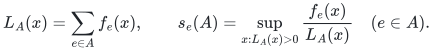

Define the sensitivity to be zero when all relevant losses vanish. Assume that every subset A satisfies

<!-- math-display: 21e8f75d126ec61436d10911
\sum_{e\in A}s_e(A)\le S_0.       \tag{1}
-->
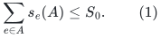

For construction, suppose an ordinary sensitivity routine computes safe upper bounds u_e(A)≥s_e(A), with total at most S_0, in polynomial time. A constant-factor bound can be absorbed into S_0. The assumption must hold for every pool generated by the algorithm; a bound established only for the original full input is insufficient.

Each item carries at most d labels from an explicit universe of L labels. A query fails a set F of at most h labels and retains E_F={e:Λ(e)∩F=∅}. Clip h at L and d at the actual maximum label degree. Put

<!-- math-display: cf036735e18a4d7a4cb725f1
Q=\sum_{j=0}^{h}\binom Lj,\qquad
 \Gamma=\frac{(h+d)^{h+d}}{h^h d^d}
-->
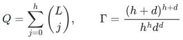

when h,d>0, and Γ=1 when h=0 or d=0.

## 2. Total robust sensitivity

Define

<!-- math-display: 7118a2eb3e496bdfe768447e
\sigma_e=\max_{F:\ |F|\le h,\ e\in E_F}s_e(E_F).
-->
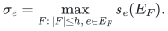

Then

<!-- math-display: a740c2920686f67293487a9b
\sum_e\sigma_e\le\Gamma S_0.     \tag{2}
-->
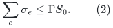

Indeed s_e(A) is deletion-monotone: if e∈A⊆B, each denominator in A is at most the corresponding denominator in B, and hence s_e(A)≥s_e(B). Include each label independently in a pool R with probability a=d/(h+d), and put A_R={e:Λ(e)⊆R}. For a chosen worst-case failure F_e, the event Λ(e)⊆R and F_e∩R=∅ has probability at least 1/Γ. On this event, e∈A_R⊆E_{F_e}, so s_e(A_R)≥σ_e. Summing and taking expectations proves (2) using (1). The maximization over F is over a finite family; no attainment of the supremum over X is required.

For the more specialized leverage/Lewis masses, exact rank conservation sharpens Γ to d+1 when h=1. That sharper identity should not be automatically applied to arbitrary loss sensitivities satisfying only (1).

## 3. Polynomial construction of dominating scores

For h,d>0 draw

<!-- math-display: 4756b06420a70b871a1530b6
J=\left\lceil8\Gamma\log\frac{2NQ}{\delta}\right\rceil
-->
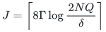

independent pools. There are at most NQ admissible item/failure pairs. Chernoff's inequality and a union bound imply that, with probability at least 1−δ/2, every pair is separated by at least J/(2Γ) pools. This event is not enumerated or checked by the algorithm.

Compute the ordinary upper sensitivities on each pool and on E, and set

<!-- math-display: 053989780760298ec9595c50
\widehat\sigma_e=u_e(E)+\frac{2\Gamma}{J}
             \sum_{j:e\in A_j}u_e(A_j).
-->
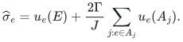

On the coverage event, these scores dominate σ_e simultaneously for all e. On every outcome, including failed ones, their total obeys

<!-- math-display: d9b7ee306a7860958fb58d36
T:=\sum_e\widehat\sigma_e\le(1+2\Gamma)S_0.
\tag{3}
-->
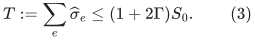

The original-input term ensures that any item with a nonzero loss has positive sampling probability. If all these upper scores vanish, every loss is zero and the empty summary is valid.

Whenever a conservative upper bound on the requested sample size is at least N, return all original items with weight one. Otherwise Γ is polynomially bounded by N, because a nonzero loss family has S_0≥1. Thus the number of pools is polynomial, even when h and d are part of the input. Computing Q or an upper bound on log Q takes polynomial bit arithmetic and does not enumerate Q sets. The runtime additionally contains the assumed cost of the ordinary sensitivity routine; no input-sparsity-time bound is implied.

## 4. A fully explicit finite-query theorem

If the query family X is finite of size K, draw independently

<!-- math-display: d9f3d832975806539985dd39
k=\left\lceil C T\epsilon^{-2}\log\frac{4KQ}{\delta}\right\rceil
-->
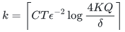

items with replacement, using probabilities p_e=\widehatσ_e/T. Aggregate copies of an item e into one weight ω_e=n_e/(kp_e). For sufficiently large absolute C, with probability at least 1−δ,

<!-- math-display: 7076c161bb6571b5ad7bc08d
(1-\epsilon)L_{E_F}(x)
 \le \sum_{e\in H\cap E_F}\omega_e f_e(x)
 \le (1+\epsilon)L_{E_F}(x)
\tag{4}
-->
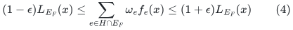

for every x∈X and every allowed F. The retained size is

<!-- math-display: 2ca0bcc04521fff9c89e3009
O\!\left(\min\left\{N,
       \Gamma S_0\epsilon^{-2}\log\frac{2KQ}{\delta}\right\}\right).
\tag{5}
-->
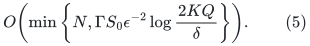

For a fixed positive-loss query, divide each sampled contribution by its true total. Its mean is one and it is bounded by T, since the probabilities dominate that query's sensitivities. Scalar Bernstein/Chernoff gives failure probability at most δ/(2KQ). The union bound proves (4) conditional on a good pool outcome; the independent sampling stage and pool error then total at most δ. A zero-loss query has every contributing term zero and is exact automatically.

The same original-item weights serve every query. After observing the completed summary, an adversary may choose F and x: the success event already covers all of them. This is not a statement about streaming updates to the original input or a sequence of newly defined labels.

## 5. Infinite query families: use the correct nonrobust sampler

Suppose a classical sensitivity-sampling theorem for the given loss class says that upper sensitivities of total T produce a (1±ε) summary with b(T,ε,η) samples and failure probability η, uniformly over all x. Apply that theorem with η=δ/(2Q). The same single sampling experiment is valid for each fixed E_F, because the retained rows of E_F have probabilities dominating its ordinary sensitivities; draws outside E_F contribute zero. A union bound over F completes the reduction.

Thus the correct generic statement is b(O(Γ S_0),ε,δ/(2Q)), subject to the sampler's own precise hypotheses. One should not replace this expression by a universal dimension-free formula for arbitrary infinite loss families. For finite-pseudodimension classes, the standard sensitivity theorem gives the corresponding dimension term. For spectral and ℓ_p row sampling, the companion manuscript uses their stronger specialized concentration theorems instead.

This compiler can be applied to a particular clustering, low-rank approximation, or regression objective only after verifying its hereditary sensitivity bound and the relevant ordinary sampler. It does not claim that applying a loose generic bound beats that problem's best specialized coreset theorem.

## 6. Sharp lower dependence and baseline distinction

The binomial obstruction already appears with one constant loss per item. Take one item for every d-subset A of a label universe of size h+d, assign exactly those labels, and let every f_A(x)=1 for a single query x. Every nonempty ordinary subset has total sensitivity one, so S_0=1. Failing the complement of A isolates that item. Any multiplicative original-item summary with ε<1 must therefore retain all binom(h+d,d) items. Using separate query coordinates gives the same lower factor multiplied by S_0.

Consequently Γ is close to the natural binomial overhead at the sensitivity level. The sample-size logarithm log Q can still contribute a further factor of h, and is kept explicit. The exact binomial robust-sensitivity upper bound is not established here.

In–Li–Woodruff–Wu (ICML 2025) study the trimmed objective obtained by deleting the m largest individual losses for each x, and give a framework with size roughly mT/ε plus a vanilla coreset. That theorem is a relevant public baseline for robust coresets, but has a different query semantics. Here a supplied label can delete arbitrarily many items, the original label identities are retained, and every specified surviving objective is approximated individually. We make no claim to improve their trimmed-objective size in their model.

### Primary background

1. Dan Feldman and Michael Langberg. *A Unified Framework for Approximating and Clustering Data*. STOC 2011. The sensitivity/importance-sampling framework is an inherited ingredient. https://arxiv.org/abs/1106.1379
2. Chansophea Wathanak In, Yi Li, David Woodruff, Xuan Wu. *Robust Sparsification via Sensitivity*. ICML 2025. https://proceedings.mlr.press/v267/in25a.html
3. The companion correlated-failure spectral manuscript gives the complete matrix and Lewis-weight specializations, including deterministic one-failure construction and the precise published sampling bounds used there.

### Close methodological antecedent

In–Li–Woodruff–Wu, *Robust Sparsification via Sensitivity*, ICML 2025, Section 3.1 and Lemma 4.3, already use a Bernoulli subinstance so one contributing function survives while at most m outliers do not, and then evaluate ordinary sensitivity inside that subinstance. The contribution here is correlated overlapping label pools, the Gamma S all-scenario total-importance bound, and the averaged common upper-score estimator. The separation idea itself is not claimed new. Their trimmed-loss objective is different from maintaining one common set of weights for every specified label-deletion query. Primary paper: https://proceedings.mlr.press/v267/in25a.html ; full text: https://raw.githubusercontent.com/mlresearch/v267/main/assets/in25a/in25a.pdf .
