# Simultaneous spectral, norm, and regression summaries

## 1. Model

Each item has at most <code class="math">d</code> labels from an explicit universe of size <code class="math">L</code>. A set <code class="math">F</code>, <code class="math">&#124;F&#124;\le h</code>, deletes every item meeting it. The output is one original-item subset with fixed nonnegative weights; every theorem holds for all allowed failures simultaneously. Define
<!-- math-display: 973905aed25db65a7438a60f
Q=\sum_{j=0}^{\min(h,L)}\binom Lj,\qquad
\Gamma(h,d)=\frac{(h+d)^{h+d}}{h^h d^d},
-->
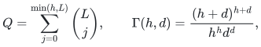
with <code class="math">\Gamma=1</code> when <code class="math">hd=0</code>. Retained support, preprocessing, and workspace are different resources.

## 2. Importance-pool theorem

Suppose masses <code class="math">m_e(X)</code> are nonnegative, increase when the containing set shrinks, and sum to at most <code class="math">S</code> on every set. Let <code class="math">\sigma_e</code> be the largest mass of <code class="math">e</code> after any allowed query where it survives.

**Lemma 2.1.** <code class="math">\sum_e\sigma_e\le\Gamma S</code>.

**Proof.** Fix one maximizing failure witness <code class="math">F_e</code> per item. Put each label in a random pool independently with probability <code class="math">\alpha=d/(h+d)</code>, and retain items whose entire own-label sets lie in the pool. The event that the pool contains <code class="math">\Lambda(e)</code> and avoids <code class="math">F_e</code> has probability at least <code class="math">\alpha^d(1-\alpha)^h=1/\Gamma</code>. On that event the pool is a subset of <code class="math">E_{F_e}</code> containing <code class="math">e</code>, so its mass is at least <code class="math">\sigma_e</code>. Pointwise the sum of protected masses is at most <code class="math">S</code>. Take expectations. <code class="math">\square</code>

For PSD items <code class="math">B_e</code>, use <code class="math">m_e(X)=\mathrm{tr}(B_eM_X^\dagger)</code>, <code class="math">M_X=\sum_{e\in X}B_e</code>. The total is <code class="math">\mathrm{rank}M_X\le r</code>. Deletion monotonicity follows from the quadratic inverse variational identity on the range containing <code class="math">B_e</code>; it requires no global ordering of pseudoinverses.

For one failed label, sum the nonnegative increases over all single-label scenarios. With <code class="math">t_e=m_e(E)</code> and surviving ranks <code class="math">r_c</code>, the sum of per-item maxima is at most
<!-- math-display: 8abed046bf34d3f92f6ae1c5
r+\sum_e|\Lambda(e)|t_e-\sum_c(r-r_c)\le(d+1)r.
-->
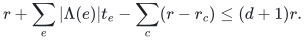
Orthogonal parallel copies indexed by label subsets make this factor sharp.

Take <code class="math">J=O(\Gamma\log(NQ/\delta))</code> independent pools and scores
<!-- math-display: 681fbe39a999888d2c015dab
\widehat\sigma_e=m_e(E)+\frac{2\Gamma}{J}\sum_{j:e\in X_j}m_e(X_j).
-->
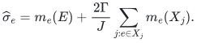
Chernoff and an item/failure-pair union bound give simultaneous domination with high probability. On every pool outcome, their total is at most <code class="math">3\Gamma r</code>. An independent importance sample, followed by matrix concentration in each surviving range, therefore gives
<!-- math-display: f99acf05300a64139bf992fe
(1-\epsilon)M_F\preceq\widehat M_F\preceq(1+\epsilon)M_F
-->
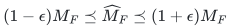
for all failures with support
<!-- math-display: 00988a6be522541c69e73d59
O\left(\min\{N,\Gamma r\epsilon^{-2}\log(2rQ/\delta)\}\right).
-->
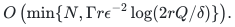
The full-input gate precedes oversized work. For <code class="math">h=1</code>, explicitly compute the <code class="math">L+1</code> scenarios and use trace-exponential derandomization, obtaining deterministic polynomial-bit support <code class="math">O((d+1)r\epsilon^{-2}\log(2r(L+1)))</code>, capped by <code class="math">N</code>.

With fixed PSD background <code class="math">R</code>, replace the rank mass by <code class="math">\rho=\mathrm{tr}(M(R+M)^\dagger)</code>. Centered matrix Bernstein gives the corresponding regularized statement. It remains valid for every later background larger in PSD order.

## 3. Positive label-code decoder

Assign unit features <code class="math">z_e\in\mathbb R^K</code>. Suppose each query has an orthogonal projector <code class="math">P_F</code> killing failed features and leaving survivor squared norms in <code class="math">[1-\kappa,1]</code>. Sparsify <code class="math">B_e\otimes z_ez_e^\top</code> at accuracy <code class="math">\theta</code>, in rank at most <code class="math">rK</code>.

Congruence by <code class="math">I\otimes P_F</code>, followed by partial trace, is positive and sends the item to <code class="math">\alpha_e(F)B_e</code>. Thus the single lifted PSD inequality gives, for every failure,
<!-- math-display: 4c8ac3a0c7d5d2055491902a
(1-\theta)(1-\kappa)M_F\preceq\widehat M_F
\preceq\frac{1+\theta}{1-\kappa}M_F.
-->
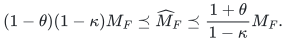
Taking <code class="math">\theta=\epsilon/4</code>, <code class="math">\kappa\le\epsilon/4</code> proves relative error <code class="math">\epsilon</code> using <code class="math">O(rK/\epsilon^2)</code> items. Output weights never depend on the query.

For one label per item, a random sign code with restricted isometry on <code class="math">h+1</code> columns gives, when <code class="math">1\le h&lt;L</code>,
<!-- math-display: 4a3650c10f88a0a670518865
K=1+\min\left\{L,O\left(\epsilon^{-1}
\left[(h+1)\log\frac{eL}{h+1}+\log\frac1\zeta\right]\right)\right\}.
-->
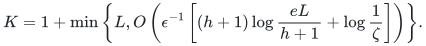
One successful code event covers all failures. No efficient test of optimal-dimensional restricted isometry is assumed.

For label degree <code class="math">d</code>, use normalized exterior products in the graded space
<!-- math-display: c3a83da7d526af6575587050
K=\sum_{j=0}^{\min(d,D)}\binom Dj,\quad
D=\min\left\{L,\left\lceil\frac{Cd}{\epsilon}
\left[s\log\frac{eL}{s}+\log\frac2\zeta\right]\right\rceil\right\},
\quad s=\min\{h+d,L\}.
-->
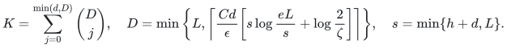
Projection kills failed wedges. Restricted isometry bounds squared loss on a live label span by <code class="math">O(\epsilon/d)</code>; multiplying at most <code class="math">d</code> squared singular values gives <code class="math">O(\epsilon)</code> volume loss. Identity coding handles the cap, while explicit coherence codes give a separate deterministic tradeoff.

The optimal-support PSD backend is stated in the polynomial-arithmetic model. A specified rational polynomial-bit trace-exponential implementation adds <code class="math">\log(2rK)</code> to support.

## 4. Incidence compression

For an incidence matrix, let row labels satisfy <code class="math">R_i\subseteq S_e</code> at every nonzero entry, with deficit <code class="math">&#124;S_e\setminus R_i&#124;\le k</code> and full-column degree <code class="math">&#124;S_e&#124;\le q</code>. Select <code class="math">r</code> independent original rows. In each selected block put the normalized exterior feature of the deficit with its wedge-insertion sign. The lift dimension is
<!-- math-display: 20e6a5fd4ab7e2674cd50059
r\sum_{j=0}^{\min(k,D)}\binom Dj.
-->
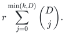
At a query, append the projected row labels. Every incidence of a column now has the same full-column feature. Congruence, partial trace, and reconstruction of the original rows give the positive decoder above. The total degree <code class="math">q</code> controls code accuracy; the smaller deficit <code class="math">k</code> controls the lift exponent.

Graph vertex/edge list degrees <code class="math">a,b</code> have <code class="math">k\le a+b</code>, <code class="math">q\le2a+b</code>. For fixed <code class="math">a,b</code>, fixed confidence, and <code class="math">h\ge a+b</code>, the uncapped support is
<!-- math-display: 0e72be5c7a06efd4b1e8e31d
O_{a,b}\left(rh^{a+b}\log^{a+b}(2L)/\epsilon^{a+b+2}\right).
-->
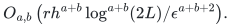
A simplicial boundary with one color per vertex has <code class="math">k=1</code>, including degree zero when the missing color already occurs on its facet. Its support is
<!-- math-display: 1f0e0ecb91e5c26f0a9c986a
O\left(\min\left\{N,\frac r{\epsilon^2}
\left[1+\min\left\{L,\frac q\epsilon
\left(s\log\frac{eL}{s}+\log\frac2\zeta\right)\right\}\right]\right\}\right),
\quad s=\min\{L,h+q\}.
-->
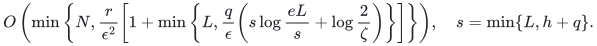
These are fixed-weight spectral guarantees, separate from exact filtration-prefix preservation.

## 5. Weak convex regression

Augment design <code class="math">A</code> by supplied response basis <code class="math">B</code> and fixed background <code class="math">R_0=\mathrm{diag}(\lambda_0I,0)</code>. The effective dimension satisfies <code class="math">\rho\le\mathrm{sd}_{\lambda_0}(A)+\mathrm{rank}B</code>. Pool sparsification at embedding accuracy <code class="math">\eta</code> gives support <code class="math">O(\Gamma\rho\eta^{-2}\log(2(p+q)Q/\delta))</code>.

Allow any later response in that subspace, <code class="math">\lambda\ge\lambda_0</code>, convex feasible set, and nonnegative convex penalty <code class="math">g</code>. Let <code class="math">\widehat X</code> attain the sketched minimum and <code class="math">X_*</code> be any feasible comparator. With regularization rows included, put <code class="math">U=\bar A(\widehat X-X_*)</code>, <code class="math">V=\bar A\widehat X-\bar Y</code>. Optimality along the feasible segment and the uniform bilinear error imply
<!-- math-display: 6db2e5b20112196edd2af722
f(\widehat X)-f(X_*)\le
2\eta\|U\|_F\|V\|_F-\|U\|_F^2
\le\eta^2\|V\|_F^2\le\eta^2f(\widehat X).
-->
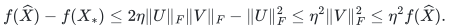
Hence <code class="math">f(\widehat X)\le f(X_*)/(1-\eta^2)</code>. Choose <code class="math">\eta^2=\epsilon/(1+\epsilon)</code> and take the infimum over comparators. This proves the relative solution guarantee with <code class="math">\epsilon^{-1}</code> support dependence. An attained sketched minimizer and nonnegative penalty are explicit hypotheses. The one-label code route gives a separate linear-<code class="math">h</code>, <code class="math">\epsilon^{-3/2}</code> tradeoff with its stated logarithms and background padding.

## 6. Losses, norms, and whole seminorm blocks

Ordinary nonnegative-loss sensitivity is deletion-monotone. A hereditary total bound <code class="math">S_0</code> transfers through Lemma 2.1. For <code class="math">K_0</code> finite queries, scalar concentration yields <code class="math">O(\Gamma S_0\epsilon^{-2}\log(2K_0Q/\delta))</code> support; infinite families need the chosen ordinary sampler's precise uniform-query theorem.

For row <code class="math">p</code>-norms, apply the ordinary subset sampler to <code class="math">a_e\otimes z_e</code>, then integrate its all-vector guarantee against a Gaussian of covariance <code class="math">P_F</code>. A surviving factor is <code class="math">\&#124;P_Fz_e\&#124;^p</code>, giving the same sandwich. The chosen sampler's rank dependence remains in force.

For arbitrary whole seminorm blocks, the Gaussian reduction and ordinary optimal seminorm theorem give existential <code class="math">O(\min\{m,rK/\epsilon^2\})</code> support. Construction instead needs evaluation and roundedness access to the lifted seminorm sum and inherits the larger constructive backend bound. Original-space access alone does not supply that interface.

## Complete proofs

[PSD importance](manuscripts/correlated-failure-spectral-and-regression-summaries.md); [general sensitivity](manuscripts/general-nonnegative-sensitivity-compiler.md); [convex regression](manuscripts/weak-convex-regression-under-correlated-failures.md); [label and norm lifts](manuscripts/label-vector-spectral-and-norm-lifts.md); [graph incidence](manuscripts/correlated-vertex-and-edge-failure-spectral-graphs.md); [simplicial incidence](manuscripts/graded-incidence-and-simplicial-spectral-sparsification.md); [whole seminorms](manuscripts/arbitrary-seminorms-under-correlated-failures.md).

**Attribution:** Yilin Liu and GPT-6 Astra Pro.
