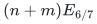
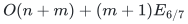

# Decremental strong forest and Gomory-Hu transfer

The complete no-reset strong-forest construction gives a deterministic
decremental distance forest and an exact Gomory–Hu cut-tree application.

**Guarantee**

A strong decremental forest with fixed canonical nodes and original-edge embeddings, and an exact deterministic Gomory–Hu tree obtained by the fully specified application reduction.

**Objective and output**

Maintain the decremental strong-forest interface and use it to output the exact Gomory-Hu cut-tree representation named by the reduction.

**Randomness**

Deterministic strong-forest and cut-tree constructions. The source map identifies the completed no-reset hierarchy, fixed-`k` realization and exact-flow proof. The published-flow capacity adapter is an additional deterministic route.

**Time**

The native decremental forest has total work

<!-- math-display: a4c599ab8736bfc9981621c4
(n+m)E_{6/7}
-->

The separately preprocessed exact Gomory–Hu application has total work

<!-- math-display: 515d9ca505a736ed1604df94
O(n+m)+(m+1)E_{6/7}
-->

Under its additional interfaces, where <code class="math">E_{6/7}=\exp(O(U^{6/7}h^{1/7}))</code>.

**Space**

Polynomial in the maintained graph, forest certificates, and reduction state; no independent space exponent is claimed.

**Parameters**

<code class="math">n</code> is the vertex count; <code class="math">m</code> is the lifetime edge inventory; <code class="math">k</code> is the fixed reduction parameter; <code class="math">U</code> is the master logarithmic scale; <code class="math">h</code> is the iterated logarithmic scale used by the forest envelope.

**Model and representation**

The forest uses a fixed bounded-degree native graph, now allowing nonnegative polynomial-range integer lengths by the fixed perturbation in Section 14.1. Its flat projection may repeat physical edges. The Gomory–Hu application accepts arbitrary-degree undirected multigraphs with nonnegative polynomial-range integer capacities; zero-capacity edges and loops are removed in one scan. It retains the fixed-parameter reduction and named forest/flow interfaces.

**Lower-bound scope**

No lower bound is claimed.

**Review status**

**Ready for review.** The complete accepted no-reset Steiner-pool strong-forest construction, with fixed pools, native identities, ghost ownership and chronological work. The six-sevenths cut-tree composition includes the locally realized fixed-`k` adapter and exact-flow chain. Nonnegative flat-forest and zero-capacity adapters, native input costs and actual-call inventory are explicit. The published-flow capacity-bit construction gives an additional route.

**Dependencies and scope.** The structural expansion, bounded-degree and numerical-range hypotheses remain part of the theorem. Forest routing outputs walks under its stated interface; a simple-path reporting contract is not added. The optional older ported-forest candidate is distinct from the completed no-reset construction. The alternative flow route invokes van den Brand et al., arXiv:2407.10830v1, Theorem 6.17. The earlier four-fifths local flow theorem already had its own proof chain and is not reclassified as an open assumption.

The [verification note](verify/README.md) identifies executable coverage. This status does not claim external peer review or proof-assistant verification.

**Source**

[Complete theorem and proof](proof.md), [dependencies and primary sources](sources.md).

## Exact cut-tree output

The returned tree uses the original vertices. For every pair, the minimum edge weight along its tree path equals the exact minimum-cut value. Disconnected component trees are joined by zero-weight edges; graph loops do not affect cuts.

The reduction charges actual-size degree expansion, finite-precision multiplicative weights, the skeleton, fixed-<code class="math">k</code> guide families, contractions, and all flow calls. Published exact flow and the skeleton have a <code class="math">5/6</code> overhead scale; expander structural quality has a <code class="math">4/5</code> scale. All are absorbed by the stated <code class="math">6/7</code> factor. The [capacity-bit adapter](../../manuscripts/graph-backends/published-flow-capacity-scaling.md) offers a route with fewer local proof dependencies while charging small recursive calls by their actual size. This remains an application of the complete strong-forest interface, including occurrence and retirement accounting.

**Attribution.** Yilin Liu · GPT-6 Astra Pro
