# Strong forests from uncontracted Steiner cores, without recursive degree resets

**Theorem and proof.** The construction combines the
[normalized static provider](../../manuscripts/graph-backends/linear-parameter-static-sparsifier.md),
the native selected-record construction in Sections 1–3, and the
published cover/hopset algorithms identified in [sources.md](sources.md).
Sections 4–13 supply the uncontracted forest lift and its complete
occurrence and update accounting. The generic interfaces remain explicit;
each is supplied by the named local construction or published theorem.

The construction uses native child identities that are subsets of parent identities.
Its no-reset native-child implementation is the accepted construction.

The resulting research bound is deterministic strong decremental
<code class="math">(1+\varepsilon)</code>-SSSP with total work
<!-- math-display: 577eb4b4fef0aa3be29ec9f0
(m+n)\exp O(U^{6/7}h^{1/7}),\qquad
 U=\log_2(N+4),\quad h=\lceil\log_2(U+4)\rceil.\tag{1}
-->
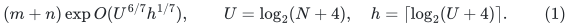
Lengths are positive polynomial-range integers, history is polynomially
bounded by <code class="math">N</code>, and accuracy is constant or inverse polynomial in
<code class="math">U</code>. A Gomory--Hu consequence additionally uses the separately
audited application reduction.
Section 14.1 extends the forest guarantee to nonnegative integer
lengths without an extra dynamic connectivity or SCC primitive.

## 1. Retained provider and three separate bounds

For <code class="math">k=2^x</code> and local repair depth <code class="math">K</code>, put
<!-- math-display: de66b499a0c518fe3621dd09
g=O((p+r)h),\quad f=O(U/p+U/r+r^2h+(p+r)h),\quad
 \log P=O(U/K+g+h).\tag{2}
-->
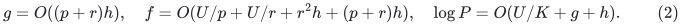
The static quality/work bounds are from
[linear parameter static sparsifier](../../manuscripts/graph-backends/linear-parameter-static-sparsifier.md).
Retain selected-degree cleanup unchanged. Conservatively pay its old
<code class="math">K^2g</code> repair-work term; normalized <code class="math">Kg</code> is not needed for (1).

For native maximum degree <code class="math">\Delta</code>, safe local envelopes are
<!-- math-display: 58f8be74fdfaf8f682223792
P_\Delta=P\Delta^{c_1}U^{c_1},\qquad
 W_\Delta=\exp O(x+f+K^2g+h)\Delta^{c_1},\tag{3}
-->
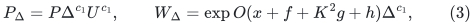
for one fixed constant <code class="math">c_1</code>. They pay scans of <code class="math">k\Delta</code>-
incidence core components, cleanup, and elementary split encodings.
The metric factor remains <code class="math">\rho=\exp O(Kg+h)</code>.
[Joint public retuning for the strong forest: a conservative source audit](../../manuscripts/graph-backends/public-strong-forest-joint-retuning-audit.md) proves the
conservative high-degree accounting: actual selected degree is
<code class="math">\Delta P</code>, while elementary recourse can be <code class="math">\Delta^2P^2</code>.
Enlarging the fixed constant in <code class="math">P</code> absorbs these powers.

The static provider has arbitrary-degree scope. Its stronger ambient
output may be used by the old geometric repair while charging the
older quadratic work. The work/quality separation and computational
budget rescaling do not depend on <code class="math">\Delta</code>. Component and finite-
bit wrappers are retained from the current checkpoint.

Write <code class="math">Q=U^{O(1)}</code> for uniform fixed polynomials, whose exponents
do not depend on growing parameters.

## 2. Native input inventory

A parent period of actual initial size <code class="math">M=&#124;V&#124;+&#124;E&#124;</code> supplies:

1. At most <code class="math">b\le Q</code> stable forests <code class="math">F_i\subseteq G</code>. Within
   the period edges only disappear and new native vertices are
   isolated. Living edges have fixed positive lengths.
2. Selected nonloop core edges with provenance `(core, parent edge
   ID)`, deduplicated across repair-layer ownership. One parent edge
   has at most one selected copy per core; buckets add only <code class="math">b</code>.
3. The current roots of each selected edge's physical endpoints.
   Its stored core length bounds the two root legs plus its real
   parent edge. Logical pivots are stable-forest roots.
4. Pivot-pair upper metric factor <code class="math">\rho</code> in the selected core
   union, with equal physical root aliases identified.
5. Initial active roots/selected records and their chronological
   source transcript bounded through <code class="math">q</code> parent edits by
   <!-- math-display: a293add40634cdb951b811db
   O(MP_\Delta/k+P_\Delta q).\tag{4}
   -->
   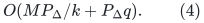
   Stable cuts and active root births are included. Initial credit
   may be spent after initialization and is retained below.

KMG Algorithms 2--4 provide these physical provenances and selected
split logs. Native unsparsified incidences are not all forwarded as
child edge edits. Private loop-only slots are not automatically part
of the exposed inventory in (4).

## 3. Active roots and initially small components

Use the existing disconnected-component wrapper. Large initial
components have at least <code class="math">k</code> edges; their roots and pivots have
total initial budget <code class="math">O(MQ/k)</code>. In a small initial component
<code class="math">C</code>, every stable forest starts as its whole component tree,
using the same stored root <code class="math">r_C</code>. Do not expose all such
private roots merely because they are logical local pivots.

Initially activate the large components. A small initial component
is activated on the first actual native event or explicit forced
promotion touching it. Before forwarding that event, expose
<code class="math">r_C</code> in each core, and then expose every reported new root
and promoted pivot. An explicit anchor promotion is an activation
even if the anchor already equals <code class="math">r_C</code> and causes no forest
cut. One initial anchor activation is affordable when <code class="math">M\ge k</code>.

Before activation, the component has had no native edit. Its stable
forests are whole initial trees, all its core edges are loops, and
selected-degree cleanup has no selected positive edge there.
Other components' ancestor closures cannot reach it. Thus activation
exposes one old root per core, not an arbitrary historical set.
An inserted edge between initial components activates both first.
After activation, reported active roots remain marked for the period.
All later root births are in (4). The number of component activations
is bounded by actual events and forced promotions.

Untouched small components are resolved locally for numerical
queries: two vertices in one use their unchanged exact initial
all-pairs table; a query to another initial component returns
infinity. Their tables and native shortest-path trees together
cost <code class="math">M k^{O(1)}</code>, since each has fewer than <code class="math">k</code> edges.
Once activated, the common pivot is exposed and the ordinary
recursive query applies. No private untouched pivot is queried
through a nonexistent child handle.

The native nearest-pivot forest still includes these untouched
components, without an upper gluing link at their private root.
Full pools also include all their vertices as unused components.
They are not omitted from vertex-occurrence accounting.

## 4. Uncontracted selected edges and compressed stable trees

In core <code class="math">i</code>, mark that core's active roots and logical pivots from
Section 3, and all physical endpoints of selected real edges.
Selected endpoint marks use reference counts; root marks may be
monotone during the period. No cut requires recomputing the root
of every selected endpoint.

For each <code class="math">F_i</code> component take its minimal marked subtree.
Retain marks and unmarked branching vertices and suppress
unmarked degree-two vertices. Each virtual edge has the exact
length of its physical forest path. The independent lemma
[marked steiner compression root audit](../../manuscripts/graph-backends/marked-steiner-compression-root-audit.md) handles a mark change,
physical cut, or isolated vertex birth in polynomial-logarithmic
time with <code class="math">O(1)</code> virtual record changes. It never expands a
long path. A changed path or endpoint retires its virtual edge ID;
the represented physical path is immutable during that lifetime.

The child graph <code class="math">J</code> contains all these virtual edges and all
selected real edges put back at their original physical endpoints,
with original lengths. Identify exposed vertices with the same
actual parent identity. There is no cross-core closure of marks:
an internal path vertex in one core need not be exposed because
another core exposes that vertex.

A compressed forest has <code class="math">O(&#124;Z_i&#124;)</code> records and physical degree
at most <code class="math">\Delta</code> at each retained vertex. One parent vertex
has at most <code class="math">\Delta</code> selected-real incidences per core, by
provenance deduplication. Therefore
<!-- math-display: 56a7760570d47bc9991bdfef
\Delta(J)\le2b\Delta\le Q\Delta.\tag{5}
-->
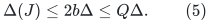
This degree bound has no <code class="math">P</code>. Each source cut or mark event
creates only constantly many virtual changes, so child size and
encoded edits obey (4), enlarged by <code class="math">Q</code>.

Allocate at most one child native identity per parent native vertex
throughout this parent period. If its last child incidence disappears,
keep that identity as an isolated ghost and reuse it on re-exposure.
Its birth is counted in (4). Thus native child identities inject
into native parent identities. There are no recursive port fibers,
no <code class="math">P</code>-sized physical alias set, and no numerical scale <code class="math">H</code>.
Internal native vertices need not be deleted during a period;
old recursive instances retire as whole instances.

Every child edge is a genuine nonempty physical parent path, so
projecting walks proves distance domination. Conversely, the roots
and physical endpoints of a selected core edge are marked; its two
root legs occur in the compressed subtrees. Its expansion has length
at most its stored core length. Replacing all selected core edges
therefore gives, for exposed logical pivots,
<!-- math-display: 7488c39ffd33b60a11e5ef5d
d_G(a,a')\le d_J(a,a')
                          \le\rho d_G(a,a').\tag{6}
-->
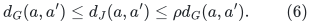
Extra equal-image coincidences can only add valid physical routes.

## 5. Recursive degrees and local envelopes

Starting from degree at most three, (5) gives
<!-- math-display: 919678da316c4435bde8c9d8
\Delta_j\le3Q^j,\qquad\log\Delta_j=O(jh).\tag{7}
-->
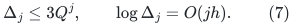
At level <code class="math">j</code> use <code class="math">P_j=P\Delta_j^{c_2}Q</code> and
<code class="math">W_j=W\Delta_j^{c_2}Q</code>, with
<code class="math">\log W=O(x+f+K^2g+h)</code>. All fixed polynomial native-degree
costs are paid, and
<!-- math-display: dbd484e713596bd843a755f2
\sum_{j<d}\log P_j=d\log P+O(d^2h).\tag{8}
-->
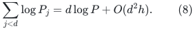
For the parameters below, <code class="math">x</code> exceeds a sufficiently large
constant times <code class="math">\log P+dh</code>. Child sizes shrink until the
actual-size exact base. No absent edges or master-sized graph
are allocated just because the degree cap is <code class="math">Q^j</code>.

## 6. Typed input forests and fixed node identities

Let <code class="math">\mathcal F</code> be a dynamic typed forest over current child
graph <code class="math">J</code>. Each node has a fixed child-vertex image during its
lifetime. An edge is either native-flat, mapped to one living
child edge ID, or typed true-null, with both endpoints mapped to
the same child vertex and no native edge ID. A typed-null edge
has zero physical length.

Let <code class="math">C\ge1</code> bound the living input nodes at any child-vertex
image, including isolated nodes and designated terminals.
Auxiliary and terminal forest-node lifetimes may end. For each
input node <code class="math">y</code>, make a distinct canonical output node
<code class="math">\eta(y)</code>, with that parent physical image and fixed identity
for the lifetime of <code class="math">y</code>. Injectivity of native child names
implies at most <code class="math">C</code> such nodes at one parent image.

Forward an input typed-null edge as a true-null edge between its
canonical nodes. An input selected-real edge becomes one actual
parent-edge copy. A virtual-edge occurrence uses a pool below.
Null input edges never enter a virtual-edge palette.

## 7. Base edge colors and occurrence slots

Each single core's compressed forest has maximum degree
<code class="math">\Delta_j</code>. Properly edge-color it with at most
<code class="math">2\Delta_j-1</code> colors. A new edge chooses a color absent
from its two physical retained endpoints; at most
<code class="math">2\Delta_j-2</code> are forbidden. Remove old virtual edges
before inserting replacements, so intermediate degrees remain
bounded. No surviving edge is recolored. A naive search costs
<code class="math">O(\Delta_j)</code>, paid in (3).

For a single virtual edge, separately assign its occurrences in
<code class="math">\mathcal F</code> distinct slots in <code class="math">1,\ldots,2C</code>.
Those occurrences form a forest on two endpoint fibers with at
most <code class="math">C</code> nodes each, hence at most <code class="math">2C-1</code> edges. This
factor two is needed; an alternating tree can have more than
<code class="math">C</code> edges. A sparse free-slot dictionary uses polynomial-
logarithmic work per insertion/deletion, with no old assignment
change.

A pool index is `(base edge color, occurrence slot)`. There are
<code class="math">O(\Delta_jC)</code> pools per core. Virtual edges used in one
pool form a matching in the compressed forest. Their physical
paths are vertex-disjoint: distinct virtual paths have disjoint
interiors, and same-colored edges cannot share a physical
retained endpoint. Colors are not defined on child port aliases.

Base colors and occurrence slots remain fixed during their
respective lifetimes. The palette is linear in <code class="math">C</code>, and
incoming child-forest edits assign a slot without scanning or
recoloring <code class="math">C</code> other occurrences.

## 8. Full pools, key masks, and the forest invariant

For every core and pool index, copy the entire current native
forest <code class="math">F_i</code>, including every native vertex, unused branch,
and isolated vertex. For each virtual edge <code class="math">b</code>, store a key
physical edge <code class="math">e_b</code> on its path, obtained by a dynamic-tree
first-edge query. The key is fixed during the virtual lifetime.
Different virtual paths are edge-disjoint, so their keys differ.

In a pool, cut <code class="math">e_b</code> exactly when no occurrence of <code class="math">b</code>
is assigned to that pool. An assigned occurrence uses the full
already present physical path, and receives two true-null links
from its pool endpoints to its canonical input nodes
<code class="math">\eta(y),\eta(y')</code>. Activating a path does not reinsert all
its physical edges.

After every unused virtual path has its key cut, a pool component
contains at most one used virtual edge. An outside branch attaches
to at most one point of the minimal marked subtree. Two used
virtual edges do not share a junction, and a path between them
must traverse an unused virtual edge, whose key is cut. Thus
each attached component is one used physical path with possible
hanging branches, and its only canonical attachments are the two
ends of that one input occurrence.

Replacing these path components by abstract edges recovers
<code class="math">\mathcal F</code>, together with disjoint unused forest components.
The whole output is therefore a forest. A canonical-to-canonical
path expands the corresponding input path with its exact parent
length, which does not exceed the child length.

## 9. Count every vertex and initialize every pool

There are <code class="math">b\le Q</code> cores and <code class="math">O(\Delta_jC)</code> pools per
core. Each full pool contains one copy of each current native
parent vertex. Unused and isolated copies are explicitly counted.
Adding the canonical nodes gives
<!-- math-display: 4e4c8bd91b3db24eaf2c27d8
C'\le Q\Delta_j(C+1).\tag{9}
-->
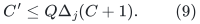
The same bound covers edge congestion: each physical forest edge
occurs once per pool; selected-real occurrences contribute at most
<code class="math">2C</code> per child edge and at most <code class="math">b</code> child provenances per
parent edge. Null links add no extra uncounted vertices.

The previous capacity enters (9) linearly. It is not raised to
a power, and it is not inferred from edge congestion by inserting
the selected root degree <code class="math">P</code>.

Initialize full pools at actual parent size times their palette
capacity. New isolated native vertices receive copies on birth.
Declare capacities from the deterministic remaining-depth bounds
in (7),(9). This avoids repeated capacity changes; alternatively
doubling must charge all newly allocated full forests. There is
no allocation at the numerical master size.

## 10. Dynamic transactions, independent of physical path length

An incoming virtual occurrence insertion activates one key in
one pool, assigns one slot, and adds two null links. Deletion
reverses these operations. A selected-real or typed-null input
edge changes one output edge. A node log changes its canonical
node after its incidences. Each incoming forest edit therefore
has constant output recourse and polynomial-logarithmic work.

A source forest cut is applied to every pool. A virtual edge
birth/death installs/removes one key mask per pool. These events
cost <code class="math">O(Q\Delta_jC)</code> work and records each. The compression
lemma and (4) bound their number. No physical path is traversed
when a virtual record changes.

Retain old paths' key IDs, endpoint images, and lifetime metadata
until all old occurrences are retired. Use a settled transaction:

1. retire old child-forest occurrences and their null attachments;
2. cut newly masked keys and deleted native edges;
3. restore old masked edges only if they survive in the new
   native forest and are unmasked in the new representation;
4. add new occurrences, real copies, and null attachments.

Cuts precede links. After old attachments are removed, the
intermediate pool and unchanged attachments are subgraphs of
the final forest, so restoring a key creates no transient cycle.
Unmasking all old virtual paths before installing replacement
masks would be incorrect.

If a deleted native edge was already masked, retire availability
without reinserting it. Old pool states and key metadata suffice
for cleanup even if the provider has computed its new state.
Numerical child maintenance does not query stale private pools
while producing its retirement log. Child graph edits settle
once; their forest logs are forwarded once. Forwarding a forest
edge does not rerun the child solver.

## 11. Period lifetimes, cover ghosts, and fixed root marks

Within a period each native child name refers to a unique parent
native vertex. An inactive junction remains as at most one
isolated native vertex. It is counted in actual birth history,
and cannot accumulate additional aliases at the same parent
image. Native vertex deletion is unnecessary inside the period.

A parent-period replacement retires its old recursive instances
and private forest families before publishing new ones. Original
root canonical nodes keep their IDs while incident edges and
private nodes are replaced. There is no simultaneous published
union of old and new period families. Thus a period restart does
not multiply current vertex occurrences by the number of past
periods.

For the decremental cover application, the native graph can keep
the cover's birth vertex set. When a vertex leaves the active
cover, delete its incident cover edges and keep its one isolated
native name. The finite-diameter obligation concerns the active
canonical set, not those isolated ghosts. This does not violate
the outer overlap charge: KMG Definition 5.2(1) makes each cover
decremental after birth, and Definition 5.2(3) bounds by
<code class="math">\Delta_{\rm cover}</code>, **over all times**, the number of
covers whose expanded ball contains a given physical vertex.
Every vertex in a cover's birth set belongs to that ball at birth.
Hence even historical birth-cover ghosts have at most
<code class="math">\Delta_{\rm cover}</code> cover owners. This is the literal
historical overlap guarantee, not an assumption about present
membership. The primary reference is
[KMG, arXiv:2311.06402v1, Definition 5.2](https://arxiv.org/abs/2311.06402v1),
printed pages 46–47. Its clause (3) is a historical overlap bound;
a bound only on present cover membership would not suffice here.

All full unused pools remain charged for these ghosts. A ghost
has no real path to another active cover vertex, so it cannot
change any distance between active canonical nodes. Unreachable
but still living original vertices retain their permanent
canonical nodes. No root-domain deletion filter is required for
this decremental strong-forest application.

Typed-null edges remain uncontracted in intermediate lifts.
At the final physical root, contract true-null components only
there, retaining the permanent original canonical node whenever
the component contains it. All its nodes have one physical image,
and there is at most one such permanent root mark. The bounded
root degree and the iterated bound (9) allow a quotient fiber to
be rebuilt in a fixed polynomial of the occurrence cap after a
null split/join. This changes time by at most
<code class="math">\exp O(d^2h)</code>, but does not change occurrence counts or
physical lengths. Canonical nodes need not be leaves.

## 12. Assemble forests only at designated pivot roots

At every hierarchy level use its exact native nearest-pivot
forest <code class="math">N_j</code>. Each nonlocal component has one designated
logical pivot root. Lift the already assembled higher forest,
then join this one root to the corresponding higher canonical
pivot node by one typed-null edge.

Do not identify all equal physical images. In particular, a
higher auxiliary Steiner occurrence is not joined to the local
canonical vertex merely because they have the same image.
Joining only the unique pivot of each native component preserves
acyclicity and the intended root chains. Untouched small
components have no upper join, as in Section 3.

At an actual-size exact base use a shortest-path spanning forest.
Root the anchor component at the anchor; other components have
arbitrary roots. Every actual native vertex, including live
ghost isolates, has one canonical node.

Force a current anchor into every nonbase pivot set. The direct
initial center/root-set interface and charged endpoint promotion
provide this operation. If the active cover removes its anchor,
choose a surviving vertex and promote it at each level before
publication. A promotion in an untouched small component activates
it even if no physical edge is changed.

Let <code class="math">v_{j+1}=p_j(v_j)</code> and let <code class="math">a</code> be the anchor,
whose current native identity persists through the hierarchy.
Nearest-pivot minimality and (6), applied only to pivots, give
<!-- math-display: 7e06c46aae50a6dfc39c10f1
d_j(v_j,v_{j+1})\le d_j(v_j,a),\qquad
 d_{j+1}(v_{j+1},a)\le2\rho d_j(v_j,a).\tag{10}
-->
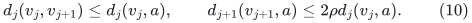
Summing the legs and the exact base path proves logarithmic
diameter inflation
<!-- math-display: be16bc9adf1cad932a49bb82
a=O(dKg+dh).\tag{11}
-->
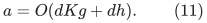
Every vertex under a finite-diameter obligation is in the active
anchor component. Private isolated ghosts have no such obligation.
No all-Steiner-vertex upper metric bound is asserted.

## 13. Occurrence and work recurrences with initialization credit

Let <code class="math">G_j</code> bound edge and vertex occurrences of the assembled
typed forest at level <code class="math">j</code>, including its native nearest-pivot
forest, every unused full pool, and all canonical nodes. The
base has constant occurrence. Equation (9) gives
<!-- math-display: 9ee009180555e05905634637
G_j\le Q\Delta_j(G_{j+1}+1).\tag{12}
-->
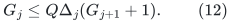
Together with (7),
<!-- math-display: f06996f20ab0240a308660fb
c:=\log(G_0+1)=O(d^2h+h).\tag{13}
-->
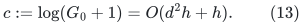
This is an occurrence bound. It does not claim that local forest
recourse is as small as <code class="math">e^c</code>.

Let <code class="math">J_j</code> be normalized initialization work per initial
parent record, and <code class="math">T_j</code> amortized work per parent edit.
Retain all initial credit in (4). Safe recurrences, after
enlarging fixed constants, are
<!-- math-display: c526d5a8cc4967cce7239d2c
\begin{aligned}
 J_j&\le W_j+G_j+(P_j/k)(J_{j+1}+T_{j+1}),\\
 T_j&\le O(kW_j+kP_jG_j)
                 +O(P_j)(J_{j+1}+T_{j+1}).
 \end{aligned}\tag{14}
-->
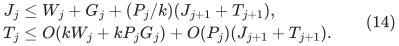
The <code class="math">G_j</code> term pays full actual-size pool initialization.
Source events copied into all pools pay <code class="math">P_jG_j</code>.
Initial child records can become later child updates, explaining
<code class="math">T_{j+1}</code> in the first line. Incoming forest logs have constant
forwarding recourse, so they do not multiply the child solver by
another occurrence-capacity factor.

Set <code class="math">Z_j=J_j+T_j/k</code>. Since
<code class="math">J_{j+1}+T_{j+1}\le kZ_{j+1}</code>,
<!-- math-display: 6fe0db41d562bfad31ec90c4
Z_j\le O(W_j+P_jG_j)+O(P_j)Z_{j+1}.\tag{15}
-->
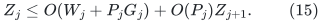
Equations (7),(8),(13) imply logarithmic work and explicit
recourse
<!-- math-display: c19fef10cfdd942ac2167b08
B=O\left(x+f+K^2g+d(U/K+g+h)+d^2h+h\right).\tag{16}
-->
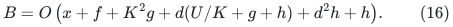
Local exact balls, marked-diameter queries, nearest-pivot logs,
base computation and final root null quotients fit the fixed
polynomial in <code class="math">k</code> and occurrence factors in this bound.
The existing short-period schedule and actual-size exact bases
give <code class="math">d=O(U/x)</code> when <code class="math">x\gg\log P+dh</code>.

Virtual lengths are sums of native tree-path lengths. No
reciprocals or arbitrary rational common denominator is added.
A generous integer bit bound over <code class="math">d</code> levels is <code class="math">O(Ud)</code>.
Fixed polynomial dependence on this bit count belongs to <code class="math">Q</code>.

## 14. Outer composition and the six-sevenths exponent

The source separation between outer copy capacity and local
work is proved in [strong forest mechanism comparison](../../manuscripts/graph-backends/strong-forest-mechanism-comparison.md),
Section 3, using KMG Algorithm 10 and Claims 5.15--5.17.
For cover parameter <code class="math">K_{\rm cov}</code> and scale depth
<code class="math">\Lambda</code>, its condition is
<!-- math-display: 58f739dcfea1847f8546b3f0
K_{\rm cov}\Lambda(a+O(h))\le c_0U,\tag{17}
-->
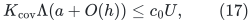
and its total logarithmic work and explicit recourse are
<!-- math-display: b082e7aa98d44bdbd38061f9
B+O\left(U/\Lambda+U/K_{\rm cov}
                 +\Lambda U/K_{\rm cov}+\Lambda c+h\right).\tag{18}
-->
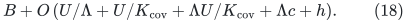
Only vertex occurrence <code class="math">e^c</code> enters the recursive copy
capacity. Local construction and its larger recourse <code class="math">e^B</code>
are paid once and forwarded through those copies. Historical
cover overlap in Section 11 charges all retained birth vertices.

Choose
<!-- math-display: e2a9f76cd9b7ece0a7a73979
\begin{gathered}
 t=(U/h)^{1/7},\quad p=r=\Theta(t),\quad
 x=\Theta(U/t),\quad d=O(t),\\
 K=\Theta(t^2),\quad K_{\rm cov}=\Theta(t^2),
 \quad\Lambda=\Theta(t).
 \end{gathered}\tag{19}
-->
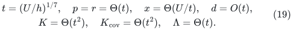
Then <code class="math">U=t^7h</code>, and the logarithmic quantities are

| Quantity | Bound |
|---|---:|
| Static structural factor <code class="math">g</code> | <code class="math">O(th)</code> |
| Static work <code class="math">f</code> | <code class="math">O(t^6h)</code> |
| Selected-record factor <code class="math">\log P</code> | <code class="math">O(t^5h)</code> |
| Conservative repair <code class="math">K^2g</code> | <code class="math">O(t^5h)</code> |
| Metric distortion <code class="math">a</code> | <code class="math">O(t^4h)</code> |
| Vertex and edge occurrence <code class="math">c</code> | <code class="math">O(t^2h)</code> |
| Work and explicit recourse <code class="math">B</code> | <code class="math">O(t^6h)</code> |

The cover product is <code class="math">O(t^7h)=O(U)</code>, with sufficiently
small fixed outer constants. The dominant terms of (18) are
<code class="math">O(t^6h)</code>, giving (1).

For the public path provider, substitute
<code class="math">g=O(qrh)</code>,
<code class="math">f=O(U/q+U/r+r^2h+q^2rh)</code>,
<code class="math">t=(U/h)^{1/8}</code>, <code class="math">q=r=d=\Lambda=\Theta(t)</code>, and
<code class="math">K=K_{\rm cov}=\Theta(t^2)</code>. This same new pool wrapper
would give <code class="math">7/8</code>. That is an ablation with a new construction,
not an already public strong-forest interface. Improved public
baselines are recorded separately.

### 14.1 Nonnegative integer lengths with the same forest guarantee

For root lengths in <code class="math">[0,N^c]</code>, fix an accuracy target
<code class="math">0&lt;\varepsilon\leq1/2</code> (a smaller target suffices if the requested
accuracy is larger). Choose a fixed dyadic
<code class="math">\delta\in(\varepsilon/(128N),\varepsilon/(64N)]</code> and run the
positive-length construction with internal accuracy <code class="math">\varepsilon/8</code>
on <code class="math">L_e=\delta^{-1}\ell_e+1</code>. Constant or inverse-polylogarithmic
accuracy keeps this length range polynomial in <code class="math">N</code>. Store the original
length on every published real edge copy, alongside the internal
perturbed length. Typed nulls retain their null type and zero length.

A finite original distance <code class="math">d</code> has a simple shortest path of fewer
than <code class="math">n</code> edges, so its perturbed distance is at most <code class="math">d+n\delta</code>.
For integer <code class="math">d\geq1</code>, the published forest path has original cost
at most <code class="math">(1+\varepsilon/8)(d+n\delta)&lt;(1+\varepsilon)d</code>.
For <code class="math">d=0</code>, that cost is a nonnegative integer below
<code class="math">(1+\varepsilon/8)n\delta&lt;1</code>, and is therefore exactly zero.
This argument counts repeated physical occurrences in a projected
forest path; dropping each occurrence's perturbation only lowers cost.

The forest topology, flat maps, occurrence bounds and edge recourse
are unchanged. Maintaining two lengths costs constant additional work
per actual record, and the extra length bits fit the same polynomial
logarithmic arithmetic allowance. The perturbation is fixed for the
whole decremental history. The complete local reduction is
[Zero-length edge adapters, Section 1](../../manuscripts/graph-backends/nonnegative-integer-distance-adapters.md).
It makes no additional simple-path reporting claim for the forest's
possibly repeated physical projection.

## 15. Completed construction and review scope

The linked local reviews address the following mathematical obligations:

1. active-root inventory and explicit small-component activation,
   including an anchor promotion that causes no physical cut;
2. deduplicated provenance and the native degree bound (5);
3. full-pool forest connectivity, two-level colors, and counting
   all unused vertices in (9);
4. typed-null recursive inputs, cuts-before-links transactions,
   stable root marks and historical cover ghost ownership;
5. initial-credit recurrence (14), actual-size allocation, and
   constant output recourse per incoming forest log.

The complete local objects are mathematical constructions. This
document does not claim an implementation or external certification.
The parameter table by itself is not a correctness proof.

The first complete independent audit is
[compressed steiner pool independent audit](../../manuscripts/graph-backends/compressed-steiner-pool-independent-audit.md). The root's separate
local arguments are [marked steiner compression root audit](../../manuscripts/graph-backends/marked-steiner-compression-root-audit.md) and
[colored core pool root audit](../../manuscripts/graph-backends/colored-core-pool-root-audit.md). Their scope and final status
should be read together with this primary no-reset construction.
The second focused review is
[steiner pool metric inventory focused audit](../../manuscripts/graph-backends/steiner-pool-metric-inventory-focused-audit.md), including its
final comparison with this main proof. The exact application and
current comparison are recorded in
Sections 14 and 16 of this primary proof. The static provider, native
transcript, local pool lift and published outer covers together establish
the instantiated theorem. Their graph models and parameter ranges
remain explicit in [the source map](sources.md). The linked reviews
cover the complete no-reset construction; they are internal mathematical
reviews rather than external certification.

## 16. Exact deterministic Gomory--Hu trees

For an arbitrary undirected graph, including parallel edges and
disconnected components, with nonnegative polynomial-range integer
capacities on nonloop edges, the deterministic reduction gives an exact
cut-equivalent tree by combining the constructed forest and guide-tree
adapter with the named exact-flow and skeleton theorems, in
<!-- math-display: 9cd2459882c0607d37de52f9
O(n+m)+(m+1)E_6(n+m).
-->
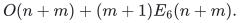
Loops and zero-capacity edges contribute nothing to a cut and are
removed in the initial <code class="math">O(n+m)</code> scan. Apply the positive-capacity
reduction to each nontrivial component of the remaining support.
Their component trees can be joined by zero-weight tree edges.
Thus for every pair of
original vertices, the minimum edge weight on their tree path
equals their exact minimum-cut value, including zero across
different connected components.

The reduction previously consumed the <code class="math">7/8</code> strong-forest
interface only through fixed polynomial powers of its work,
size, occurrence, recourse, and canonical-map bounds. The new
interface supplies the same objects with <code class="math">E_6</code>. The original
application audits still pay for:

* actual-size bounded-degree expansion and artificial root edges;
* multi-source extraction from an explicit flat forest;
* finite-precision multiplicative-weights arithmetic and its
  number of distance/forest operations;
* Li's skeleton size and its cut-value growth, both with the
  explicitly checked <code class="math">5/6</code> scale;
* fixed-<code class="math">k</code> guide trees and the global maximum over all leaf
  gadgets, including the source-arm cases;
* all graph contractions, guide-family inventory, recursion,
  and final exact tree construction.

One choice for the exact-flow calls is Theorem 6.17 of van den Brand and coauthors,
[*Almost-Linear Time Algorithms for Decremental Graphs: Min-Cost Flow
and More via Duality*](https://arxiv.org/html/2407.10830v1), with its
printed leading power <code class="math">5/6</code>. The self-contained
[capacity-bit reduction](../../manuscripts/graph-backends/published-flow-capacity-scaling.md)
ensures that every recursive oracle call satisfies the theorem's
polynomial-range condition in its own actual edge count. It charges
the bit stages and explicit flow/cut output without padding small
instances. This gives an alternative dependency route using the literal
published theorem. The earlier four-fifths flow construction also fits
the application; the capacity-bit route reduces the local proof imports
without repairing a missing proof of that construction.

The skeleton factor also has leading power <code class="math">5/6</code>.
Both factors are asymptotically absorbed by <code class="math">E_6</code>,
even with fixed powers and fixed polylogarithmic factors. The expander
construction's structural quality retains its separate
<code class="math">4/5</code> scale. Replacing the forest interface
therefore introduces no new larger term.

This is a substitution of a fully specified strong forest,
not a claim that faster static maximum flow alone yields the
Gomory--Hu improvement. The relevant existing application notes are
[A quantified Gomory--Hu transfer of the strong forest](../../manuscripts/graph-backends/gomory-hu-seven-eighths-dependency-audit.md),
[finite-mwu-and-li-skeleton-independent-audit.md](../../manuscripts/graph-backends/finite-mwu-and-li-skeleton-independent-audit.md),
[gomory-hu-external-factors-except-fixed-k.md](../../manuscripts/graph-backends/gomory-hu-external-factors-except-fixed-k.md),
[fixed-k-tree-mincut-source-interface-audit.md](../../manuscripts/graph-backends/fixed-k-tree-mincut-source-interface-audit.md),
[fixed-k-global-max-leaf-independent-audit.md](../../manuscripts/graph-backends/fixed-k-global-max-leaf-independent-audit.md), and
[A deterministic fixed-k guide-tree mincut adapter](../../manuscripts/graph-backends/deterministic-fixed-k-tree-mincut-adapter.md).

---

**Attribution:** icekylinx and GPT-6 Astra Pro.

The proofs use their named external interfaces. Finite checks are separate from proof-assistant verification.
