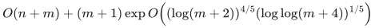

# Degree-constrained subgraphs

**Guarantee**

Finds an exact feasible degree-constrained edge subset, or correctly reports that none exists. A standard-library reference solver and a separate decision/certificate verifier are available.

**Objective and output**

Supports f-factors, interval degree bounds, exact or ranged cardinality constraints, and cardinality optimization; outputs original edge identifiers and treats each parallel edge record as a separate selectable item.

**Randomness**

Deterministic reductions and exact algorithms. The faster bound invokes the proved deterministic general-matching construction and its named published dependencies; the shipped reference solver has its own polynomial cost.

**Time**

Substituting the proved deterministic general-matching construction gives
<!-- math-display: 9ee8fb503d3324f0a3729bbd
O(n+m)+(m+1)\exp O\!\left((\log(m+2))^{4/5}
(\log\log(m+4))^{1/5}\right)
-->

time for feasibility and cardinality optimization, with its named local and published proof dependencies.

The fully local permutation-network reduction has <code>O(m log(m+2))</code> size. An optional [linear-size theoretical selector](linear-selector.md), using the precise Gabber–Galil expansion theorem, reduces construction and auxiliary graph size to <code>O(n+m)</code> and <code>O(m)</code>. Combined with ordinary cubic exact matching, this variant gives <code>O(n+(m+1)^3)</code> feasibility and <code>O(n+(m+1)^3 log(m+2))</code> optimization. Its large fixed constants and scope are stated in that proof.

The shipped standard-library solver uses the Beneš selector: its actual bounds remain <code>O(n+H^3)</code> for feasibility and <code>O(n+H^3 log(m+2))</code> for optimization, where <code>H=1+m log(m+2)</code>. Certificates and native output checks are included.

**Space**

The reference solver uses `O(n+H)` storage, including the explicit reduction and retained certificate, plus the actual label-encoding space. Oversized upper bounds are clipped before any dummy edges are allocated.

**Parameters**

<code class="math">n</code> is the vertex count; <code class="math">m</code> is the explicit edge-record count; <code class="math">g(v)</code> and <code class="math">f(v)</code> are lower and upper degree bounds.

**Model and representation**

Loopless undirected multigraph with capacity one per edge record. The card does not extend the result to arbitrary weighted or binary-multiplicity variants.

**Lower-bound scope**

No new lower bound is claimed; this is a deterministic transfer from the matching backend.

**Review status**

**Ready for review.** The complete sparse reductions for prescribed degrees, degree intervals and exact/ranged cardinality, with extension, native decoding and the fast matching substitution. The shipped native-record solver handles feasibility, minimum and maximum cardinality. Its independent verifier checks YES witnesses and local or matching-based NO/optimality certificates without a matching search. The separate linear-size selector imports the precise Gabber–Galil expansion inequality and proves deterministic network enumeration, degree conversion and matching adaptation.

**Dependencies and scope.** The reference implementation has its own polynomial bounds and shares the proved deterministic reduction builder with the verifier. Input is a loopless multigraph with capacity one per explicit record. Binary multiplicities and arbitrary edge-weight optimization are outside this implementation. The current executable retains its Beneš selector. The linear-size theoretical variant has explicit but large constants and does not claim a linear-time routing algorithm.

The [verification note](verify/README.md) identifies executable coverage. This status does not claim external peer review or proof-assistant verification.

**Source**

[Reference solver and usage](reference/README.md), [certificate proof](reference/correctness.md), [complete reduction theorem](proof.md), [linear-size selector theorem](linear-selector.md), [dependencies and primary sources](sources.md).

**Attribution.** Yilin Liu · GPT-6 Astra Pro
