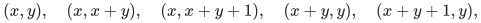
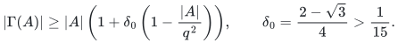
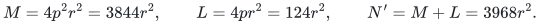
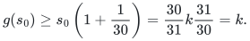
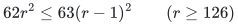
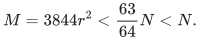

# A linear-size degree selector from a named expander construction

This is a separate theoretical refinement of the repository's degree-to-
matching reduction. The maintained executable continues to use its fully
local Beneš permutation network. The refinement below imports one precise
published expander theorem and proves the superconcentrator, construction
cost, degree conversion, and matching adaptation explicitly. It is not a
claim that the executable already uses this selector.

| Required property | Where it is established |
|---|---|
| Any `t` inputs can reach a fixed set of `t` outputs | Lemma 2, with no prescribed pairing; Section 6 fixes the output set. |
| Directed acyclic network with source inputs and sink outputs | Recursive order in Section 3; preserved by Section 5. |
| Indegree and outdegree at most two before splitting | Central-bottleneck binary trees in Section 5. |
| Simple matching graph of maximum degree three | Port and sink boundary counts in Section 6. |
| Deterministic `O(d)` construction, not only existence | Explicit rounding, modular maps, finite Beneš base, and geometric accounting in Section 4. |
| Remaining mathematical import | The exact Gabber–Galil expansion inequality in Section 1. |

## 1. The primary source and the exact imported fact

Ofer Gabber and Zvi Galil, *Explicit Constructions of Linear-Sized
Superconcentrators*, Journal of Computer and System Sciences 22(3),
407–420 (1981), [DOI 10.1016/0022-0000(81)90040-4](https://doi.org/10.1016/0022-0000(81)90040-4),
is the primary source. Its original-paper text is also available through
the [Publisher Connector/CORE copy](https://core.ac.uk/download/pdf/82074011.pdf)
and this [text mirror of that copy](https://www.academia.edu/130175693/Explicit_constructions_of_linear_sized_superconcentrators).
Section 2, Theorem 2 and the five permutations on page 409 are the only
external mathematical result needed below. Section 3, Lemmas 6–8 and
Theorem 3 give the historical superconcentrator construction; we supply
the routing and enumeration arguments needed for this application.

**Published expansion theorem.** For each positive integer `q`, take two
copies of `(Z/qZ)^2`. Join each left point `(x,y)` to the five right points

<!-- math-display: 8b5759be553de5f6045267d1
(x,y),\quad(x,x+y),\quad(x,x+y+1),\quad
(x+y,y),\quad(x+y+1,y),
-->

with both coordinates reduced modulo `q`. If `A` is a set of left points,
then its right neighbor set satisfies

<!-- math-display: aa5bc4b5b86fb8d536ae6026
|\Gamma(A)|\ge |A|\left(1+\delta_0
  \left(1-\frac{|A|}{q^2}\right)\right),
\qquad \delta_0=\frac{2-\sqrt3}{4}>\frac1{15}.
-->

Repeated arcs do not change the neighbor set. Each map is a permutation,
so the two sides have degree at most five after repetitions are removed.
The strict rational comparison follows from `26^2 > 3*15^2`; no numerical
approximation to the square root enters construction or acceptance.

The source calls its family explicit, but that adjective alone is not our
construction-time argument. The construction and its operation count are
given in Sections 2–4. In particular, Section 5, Problem 8 of the paper
asks about a linear-time **routing** algorithm. We do not import or claim
such an algorithm.

## 2. A bounded concentrator with a concrete size rule

Fix `p=31`. For a positive integer `r`, put

<!-- math-display: 23bdc806134cb4873527a9dc
M=4p^2r^2=3844r^2,\qquad
L=4pr^2=124r^2,\qquad
N'=M+L=3968r^2.
-->

Make a bipartite graph with `N'` inputs and `M` outputs. The first `M`
inputs form the large part. Join them to the outputs by the published
five-map expander with side parameter `q=2pr=62r`. The remaining `L`
inputs form the small part. Small input `i`, for `0<=i<L`, is adjacent to
outputs `i, i+L, ..., i+(p-1)L`. These neighborhoods are pairwise disjoint
and each has size `p`. All arcs point from inputs to outputs.

**Lemma 1.** Every input set `X` with `|X|<=N'/2` has at least `|X|`
distinct output neighbors.

**Proof.** Write `k=|X|`, and let `s,t` count its large- and small-part
inputs. If `pt>=k`, the small inputs alone have enough neighbors. Otherwise
`t<k/p`, so `s>(p-1)k/p`. Put `s0=(p-1)k/p`. Since
`k<=N'/2=(p+1)M/(2p)`, we have `s0<M/2`. The function
`g(z)=z(1+(1-z/M)/15)` is increasing on `[0,M]`: for `z>=w`, its
difference is `(z-w)(16/15-(z+w)/(15M))>=0`. The expansion theorem gives
at least `g(s)>=g(s0)` neighbors, and

<!-- math-display: a93d49fe03727a141562ae5d
g(s_0)\ge s_0\left(1+\frac1{30}\right)
 =\frac{30}{31}k\frac{31}{30}=k.
-->

The empty input set is immediate. ∎

Consequently any prescribed input subset of size at most `N'/2` can be
matched into distinct outputs. Here is the needed form of Hall's argument.
If a largest matching of that subset leaves a free left vertex, exhaust
the alternating search from all such vertices. Reaching a free right
vertex would augment the matching. Otherwise every reached right vertex
has a matched partner among the reached left vertices, whereas at least
one reached left vertex is free. All neighbors of the reached left set
are reached. This contradicts Lemma 1. Thus a saturating matching exists.
This argument establishes existence; the network construction does not
run these searches.

For an arbitrary input count `N` above the fixed cutoff `N0=2^26`, take
the least positive integer `r` with `3968r^2>=N`, build the preceding
graph, and retain the first `N` inputs. Any set of at most `N/2` retained
inputs still satisfies Lemma 1 because `N<=N'`. Call this graph `C_N`.
It has `M` outputs and at most `6M` arcs. In particular, no unspecified
rounding or dense graph search is hidden in this step.

For these sizes `r>=131`. Also `N>3968(r-1)^2`. The elementary inequality

<!-- math-display: b3ac936224c1dc54b9cd5314
62r^2\le63(r-1)^2\qquad(r\ge126)
-->

follows from `r^2-126r+63>=0`. It gives the explicit contraction

<!-- math-display: f0d50e5b68b105280499c9d2
M=3844r^2<\frac{63}{64}N<N.
-->

Thus the first `N` retained inputs contain all `M` large inputs and a
prefix of the small inputs. Source indegrees are zero; input outdegrees
are at most `31`; output indegrees are at most `6`.

## 3. A superconcentrator without a routing-time assumption

A network with `N` designated inputs and `N` designated outputs is a
superconcentrator if every pair of equally sized terminal subsets can
be joined by vertex-disjoint directed paths, with no prescribed pairing.
The lack of a prescribed pairing is exactly what a degree selector needs.

For `N>N0`, create fresh inputs `x_0,...,x_(N-1)` and outputs
`y_0,...,y_(N-1)`. Add the identity arcs `x_i -> y_i`. Make one copy of
`C_N` from the new inputs to `M` inner input terminals. Make a second,
reversed copy from `M` inner output terminals to the new outputs.
Identify those inner terminals with the inputs and outputs of a
recursively constructed `M`-superconcentrator. All arcs move from the new
inputs, through the inner network if used, to the new outputs. The graph
is therefore acyclic. The new terminals have indegree zero or outdegree
zero, respectively.

The raw recursive network already has bounded directed degrees. A terminal
at one level has at most `31` concentrator arcs and one identity arc in
its outgoing or incoming direction, and at most `6` arcs to its parent
level in the other direction. The base's internal degrees are at most two.
Thus both raw directed degrees are at most `32`. Section 5 reduces the
bound to two so that the matching graph is subcubic.

For `1<=N<=N0`, use the repository's proved Beneš network at the next
power-of-two width, designate its first `N` inputs and outputs, and retain
only vertices reachable from a designated input and able to reach a
designated output. This last pruning is two graph searches. The requested
paths survive: a partial bijection between equally sized selected terminal
sets extends to a full permutation, and its selected paths never use a
different input or output internally. The pruning therefore leaves exactly
the designated terminal sets as sources and sinks. For `N=1`, a single
arc with two distinct endpoints also suffices; `N=0` is empty.

**Lemma 2.** The construction is a superconcentrator.

**Proof.** Induct on `N`, the base case having just been established.
Identify input/output terminals by their common indices. Let `S,T` be
equally sized sets of indices. Route `S intersect T` by the identity arcs.
The remaining sets `S\T` and `T\S` have equal cardinality `k` and are
disjoint subsets of an `N`-element set; hence `k<=N/2`. Lemma 1 and its
matching consequence give vertex-disjoint single-arc routes from `S\T`
to `k` distinct inner inputs, and from `k` distinct inner outputs to
`T\S`. The induction hypothesis connects those two inner terminal sets
by `k` vertex-disjoint paths. Concatenate them.

The identity paths use only the common outer terminals, while all other
paths use disjoint remaining outer terminals and the inner network. The
two concentrator matchings and the recursive paths have distinct endpoints
where they join. The full path family is consequently vertex-disjoint.
No prescribed bijection between `S\T` and `T\S` is needed. ∎

## 4. Deterministic linear construction and ordinary bit costs

At a recursive level, generate the five affine maps by nested loops over
`0<=x,y<q`. All modular sums are smaller than `2q+1`, so a constant number
of comparisons and subtractions suffices. A table of row offsets, built
by repeated addition, converts coordinate pairs to indices in constant
time per point. The small-part arcs use fixed-stride indices. Thus the
two concentrators, the identity arcs and all new vertex records can be
enumerated in `O(N)` operations on `O(log(N+2))`-bit index words.

The least `r` can be found by incrementally scanning the multiples of
squares, updating `3968r^2` by `3968(2r+1)` each time. This costs
`O(sqrt(N))`, which is included in the level's `O(N)` work; a constant-time
integer square-root operation is not assumed. Repeated affine-map edges
may be retained as arc records, or deleted by comparing at most five
neighbors at each large input. Both choices have linear cost and the
same routing property.

There is only one recursive child, of size at most `63N/64`. The sum of
the level sizes is at most `64N`. At the base, a power-of-two width `s`
satisfies `s<2N` and `log2(s)<=26`. The explicit Beneš construction has
`(2 log2(s)+1)s` positions and `4s log2(s)` arcs, so its construction,
pruning and output also cost `O(N)` with a fixed constant. All recursive
levels can be managed by an explicit stack. The entire network therefore
has `O(N)` vertices/arcs and is deterministically enumerated in `O(N)`
word operations, with `O(N)` storage.

This is an enumeration bound, not an algorithm for answering arbitrary
routing requests in linear time. No routing request is solved while
building the degree-reduction graph. The later exact matching solver
selects the paths implicitly. In a bit-operation model, charge the
actual `O(log(N+2))`-bit additions, comparisons and indices; the claim is
not a linear bit bound independent of the output encoding.

## 5. Make each directed degree at most two

The preceding family already has bounded degrees, but the matching
adaptation benefits from a generic conversion requiring only linear size.
Let `D` be any directed acyclic network with designated source inputs and
sink outputs. For each vertex `v` with indegree `a` and outdegree `b`,
make two disjoint binary trees:

- An incoming tree has `a` leaves and root `v_inroot`, directed from leaves
  toward the root. For `a=0` or `a=1`, one vertex suffices.
- An outgoing tree has `b` leaves and root `v_outroot`, directed from the
  root toward leaves. For `b=0` or `b=1`, one vertex suffices.

Add the central arc `v_inroot -> v_outroot`. An original arc record
`u -> v` becomes an arc from its own outgoing leaf at `u` to its own
incoming leaf at `v`. Use distinct leaves for distinct arc records,
including parallel records. The new input corresponding to an old source
is its incoming root; the new output corresponding to an old sink is its
outgoing root.

Every directed indegree and outdegree is now at most two. The new inputs
have indegree zero and the new outputs have outdegree zero. A topological
order of the old network expands to one of the new network: order incoming
tree vertices before their root, then the central arc, then outgoing tree
vertices before their descendants. Hence acyclicity is preserved.

**Lemma 3.** For every selected pair of terminal sets, the old and new
networks have the same maximum number of vertex-disjoint connecting paths.

**Proof.** Lift an old path through the unique appropriate incoming-tree
route, central arc, and outgoing-tree route at each visited old vertex.
Disjoint old paths use disjoint vertex gadgets, so their lifts are disjoint.
Conversely, every new terminal-to-terminal path visiting a vertex gadget
must cross its central arc before it can leave that gadget. Contracting
the trees gives an old directed path; the old DAG forbids a repeated
vertex. Two disjoint new paths cannot use the same old vertex because
they would share both endpoints of that vertex's central arc. This proves
both directions, including a zero-length old path when one old vertex
served as both terminals. ∎

The two trees use at most `2a+2b+2` vertices per old vertex. Since the
sum of all indegrees and outdegrees is `2|E(D)|`, the transformed network
has at most `4|E(D)|+2|V(D)|` vertices and at most
`5|E(D)|+|V(D)|` arcs. Binary trees and arc records are enumerated in
linear time. The transformation remains valid if the published network
had unbounded individual degrees; total edge count is sufficient.

## 6. The fixed-output matching selector

Use the degree problem's loopless explicit multigraph model. Parallel
native edge records remain distinct; numeric degree bounds are clipped
or rejected as in the main reduction.

At an original graph vertex `v` with explicit incident degree `d`, let
`f` be its prescribed retained degree and put `t=d-f`. Take the converted
`d`-superconcentrator from Sections 2–5. Assign its `d` designated inputs
to the distinct native incidence ports, and fix any `t` designated outputs,
for example the first `t`. The superconcentrator property supplies
vertex-disjoint paths from **every** `t`-subset of input ports to that
fixed output set. A permutation routing guarantee is unnecessary.

Split every network position `w` into `w^-` and `w^+` joined by an idle
edge. Replace a directed arc `w -> z` by an undirected transition
`w^+ -- z^-`. Join a native incidence port to its input's minus endpoint,
and attach one degree-one sink to each selected output's plus endpoint.

Every resulting degree is at most three. A minus endpoint has its idle
edge and at most two incoming transitions. An input position has no
incoming transition, so its extra port edge keeps its degree at most two.
The symmetric argument applies to plus endpoints and selected output
sinks. Each native port has one cross edge and one selector attachment;
each sink has degree one. Distinct fan leaves make transition endpoint
pairs distinct even if the source network listed parallel arcs. With
distinct incidence ports for parallel original edges, the final matching
graph is simple and subcubic.

In any perfect matching, each split position either uses its idle edge
or uses one nonidle edge at each endpoint. Count matched minus and plus
endpoints in one original-vertex gadget. Transition edges contribute
once to each count and cancel; port attachments contribute only to the
minus count, and the `t` forced sink attachments only to the plus count.
Exactly `t` ports are therefore matched locally. Exactly `f` use their
native cross edges. This proves soundness.

Conversely, a prescribed-degree factor leaves exactly `t` unused native
ports at `v`. Route their inputs to the fixed selected output set using
Lemma 2 and Lemma 3. Match those paths through port attachments,
transitions and sink attachments; use idle edges at all other positions.
Together with the factor's native cross edges, these form a perfect
matching. The argument uses path existence only; the reduction algorithm
does not compute those paths from the factor.

For `t=0` the selector may be omitted, as in the maintained implementation.
Degree-zero vertices are either rejected for a positive requirement or
removed after the input scan. Each nontrivial vertex gadget has `O(d)`
vertices and edges, constructed deterministically in `O(d)` word operations.
Since the sum of explicit incidence degrees is `2m`, the whole reduced
matching graph has `O(m)` vertices and edges after the `O(n+m)` input scan.
Decoding reads only the native cross-edge identifiers, in `O(n+m)` work.

## 7. Interval degrees, cardinality, and scope

The existing interval and cardinality hub reductions add only `O(m)`
explicit records after upper bounds are clipped and impossible lower
bounds rejected. Replacing their final selector by the construction above
therefore gives a deterministic `O(n+m)`-time, `O(m)`-size reduction to
simple subcubic perfect matching for prescribed degrees, interval degrees,
and a specified cardinality interval. Native parallel records remain
distinct throughout.

Combining this theoretical variant with the ordinary exact matching
algorithm yields `O(n+m^3)` word operations for feasibility and
`O(n+m^3 log(m+2))` for minimum/maximum cardinality by the already proved
interval binary search. These are theoretical bounds for this selector
variant. The currently shipped Beneš-based solver retains its documented
`O(n+(1+m log(m+2))^3)` feasibility bound and its corresponding optimization
bound. The original `n`-vertex scan is performed once before optimization;
all later interval decisions reuse the active graph of at most `2m`
vertices. Thus the initial `n` term is not multiplied by the number of
binary-search calls. Changing the selector does not implement the separate
fast maximum-matching algorithm in executable code; that distinction does
not add a premise to the already proved mathematical matching theorem.

The fixed constants are concrete: `p=31`, `N0=2^26=67,108,864`, and a
child-size upper bound `63/64` of its parent. This proof uses no graph
powering. Nevertheless, the finite cutoff, recursive density and fan
conversion produce substantial constants. Below the cutoff the base is
still the Beneš network, whose exact size is proportional to `N log N`;
the asymptotic linear bound there uses `log2 N<=26`. This is a theoretical
size refinement with an explicitly named expansion theorem, not a claim
of practical speedup in the current executable or a benchmark result.

The only external theorem in this selector refinement is the explicitly
stated Gabber–Galil expansion inequality. The smaller-density
Alon–Capalbo construction is not needed, so no finite-ring arithmetic or
unstated neighbor-enumeration cost is imported. The local reduction and
generic degree adapter can be checked on finite examples independently;
such checks do not replace the expander theorem for all sizes.
