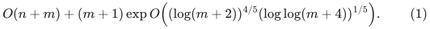
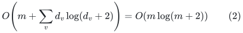
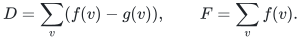
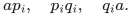
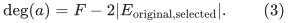
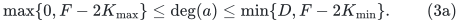
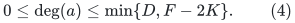
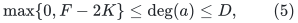
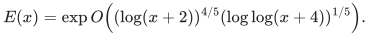

# Exact degree-constrained subgraphs from the general matching backend

**Deterministic reduction and instantiated fast algorithm.**

This note records a second class of transfers that stays within arbitrary
undirected general graphs. Substituting the proved general-matching
construction gives the same four-fifths exponent. The prescribed
degree reduction is already present in Section 10 of the OpenAI matching
preprint; the deterministic consequence must be attributed to replacing its
randomized matching call. The additional hub and parity gadgets below make
the interval-degree and cardinality optimization consequences explicit.

## 1. Problems and scope

The input is a loopless undirected multigraph with `n` vertices and `m`
explicit edge records. Distinct parallel edges may be selected separately,
but each individual record may be selected at most once. All outputs are
edge subsets with original identifiers.

**Theorem 1.1 (exact sparse reduction).** Given integral degree intervals
<code class="math">0\leq g(v)\leq f(v)\leq d_v</code> and an optional integral cardinality interval
<code class="math">K_{\min}\leq &#124;X&#124;\leq K_{\max}</code>, one can construct a simple subcubic
graph with <code class="math">O(m\log(m+2))</code> vertices and edges such that its perfect
matchings decode to exactly the feasible original edge subsets. Every
feasible original subset has a perfect-matching extension. Construction
and decoding take <code class="math">O(n+m\log(m+2))</code> time, with one call to an exact
maximum-cardinality matching solver. This reduction is unconditional and
deterministic. Optimizing cardinality needs <code class="math">O(\log(m+2))</code> calls to the
same solver. Invalid bounds and the edgeless case are handled in the
initial scan; the size statement concerns nonempty inputs. Sections 2–5
prove the theorem.

**Executable corollary.** The repository's
[standard-library degree solver](reference/README.md) implements these
reductions using its exact matching solver. Put
`H=1+m log(m+2)`. Its feasibility bound is `O(n+H^3)`, and either
cardinality optimization takes `O(n+H^3 log(m+2))`; both include checked
NO certificates and native witnesses. The
[implementation proof](reference/correctness.md) covers decoding,
the independently checkable optimality boundary and actual storage.
Its ordinary polynomial cost is separate from the fast research bound.

**Theorem 1.2 (linear-size selector variant).** Under the same input model, the reduction can instead be constructed in <code>O(n+m)</code> word operations with <code>O(m)</code> auxiliary vertices and edges. Its output remains simple and subcubic; all prescribed-degree, interval-degree, cardinality, native-record decoding, and extension guarantees remain valid. The one external mathematical ingredient is the exact expansion inequality in **Theorem 2** of Gabber and Galil's *Explicit Constructions of Linear-Sized Superconcentrators* (1981).

The [complete selector proof](linear-selector.md) states that inequality and derives every further property: deterministic linear enumeration from five modular maps and a geometrically shrinking recursion; a finite Beneš base; vertex-disjoint routes from any chosen input subset to a fixed equally sized output subset; binary fans with a central bottleneck; and the final matching gadget of degree at most three. It distinguishes construction from routing and does not assume a linear-time routing algorithm. Replacing only the selector in Sections 2–5 proves the theorem.

With an ordinary exact cubic matching algorithm, this theoretical variant gives <code>O(n+(m+1)^3)</code> feasibility and <code>O(n+(m+1)^3 log(m+2))</code> cardinality optimization, including matching certificates and native output checks. The original vertex scan is done once; later decisions use the active graph. The explicit constants are substantial: <code>p=31</code>, cutoff <code>2^26</code>, and child size at most <code>63/64</code> of the parent. The maintained executable continues to use Theorem 1.1's local Beneš selector and its stated <code>H</code> bounds.

After substituting the general-matching theorem and its realized cycle-search construction, the
deterministic running-time bound is

<!-- math-display: 3792002223ef0231bd69f826
O(n+m)+(m+1)\exp O\!\left(
 (\log(m+2))^{4/5}(\log\log(m+4))^{1/5}\right) .          \tag{1}
-->

It applies to:

* finding an `f`-factor, or correctly deciding that none exists;
* finding a subgraph with `g(v)<=degree(v)<=f(v)` at every vertex;
* imposing an exact number of selected edges, or any prescribed interval
  of permitted cardinalities, in the same single feasibility call;
* maximizing or minimizing the number of selected edges subject to these
  interval-degree constraints;
* in particular, maximum-cardinality `b`-matching with capacity one per
  edge record, where only the upper vertex-degree bounds are specified.

The capacity model means that a record is either selected or not selected.
It does not impose that the host graph is simple.
The theorem does not encode exponentially many copies of an edge through a
binary edge multiplicity, and it does not optimize arbitrary edge weights.
No bipartiteness, density, regularity, or bounded-degree promise is imposed
on the input.

Upper degree bounds can be clipped to the actual incident degree in a
linear scan. An exact prescribed degree greater than the incident degree
must instead be rejected; likewise reject a lower bound greater than the
clipped upper bound. Required lower or exact degrees are never decreased
to turn an infeasible request into a feasible one. An isolated vertex with
a positive required lower degree makes the instance infeasible; other
isolates can be removed after their input is read. The
active graph then has at most `2m` vertices. This prevents a large isolated
vertex universe from entering the nontrivial matching bound.

Degree inputs occupy ordinary input words in (1). If arbitrary-length
binary integers are supplied instead, also charge their actual encoding
length while comparing them with the incident degrees; after clipping
upper bounds or rejecting impossible required bounds, every retained
numeric degree is at most `O(m)`.

All corollaries inherit the mathematical dependency status of the matching
backend. An independently verified maximum matching of the reduced graph
also makes its NO outcome sound. A valid decoded factor can additionally be
checked by one scan of the original identifiers and degrees.

## 2. A linearithmic prescribed-degree reduction

Suppose first that `0<=f(v)<=d_v`, where `d_v` is the degree of vertex `v`.
For each original incidence `(v,e)` create a distinct port `x_(v,e)`.
For every edge `e={u,v}` join its two ports by a cross edge labeled `e`.
At vertex `v`, exactly `d_v-f(v)` of its ports must be matched locally;
the other ports must use their cross edges.

To implement this requirement sparsely, use a rearrangeable permutation
network with `s_v` inputs and `s_v` outputs, where `s_v` is the least power
of two at least `d_v`. It has `O(s_v log(s_v+2))` positions and arcs,
maximum indegree and outdegree two, and can route every input-output
permutation by vertex-disjoint directed paths.

Assign the actual `d_v` ports to distinct inputs. Select exactly
`b_v=d_v-f(v)` output positions. Split every position `a` into two
vertices `a_in,a_out`, joined by an idle edge. A directed network arc
`a->a'` becomes an undirected transition edge `a_out--a'_in`. Join each
actual port to the in endpoint of its input position. At each selected
output attach one degree-one sink to its out endpoint.

Every constructed graph vertex has degree at most three. In particular,
network input positions have no incoming network arcs, so their extra
port attachment does not add to an indegree-two endpoint. The symmetric
statement holds for the selected output sinks. Ports have degree two.
The one-position network for `s_v=1` obeys the same rule.

All gadget vertices are distinct. Even if the original graph has parallel
edges, their ports and cross-edge endpoint pairs are distinct, so the
constructed matching graph is simple.

### Soundness

In a perfect matching, a split position either uses its idle edge, or
both of its endpoints use non-idle edges. Count the matched in endpoints
and out endpoints in one vertex gadget. Every transition contributes once
to each count and cancels. Every port attachment contributes once to the
in count; each sink attachment contributes once to the out count. All
`b_v` degree-one sinks must be matched. Thus exactly `b_v` ports use
attachments and exactly `f(v)` use cross edges.

The chosen cross-edge labels consequently form an `f`-factor in the
original graph.

### Completeness

Given an `f`-factor, the `b_v` ports not used by its cross edges can be
mapped bijectively to the selected outputs. Extend this partial bijection
to a full permutation on all `s_v` input positions. Route it through the
network, and keep only the `b_v` chosen paths. Match every kept path using
its port attachment, transition edges, and final sink attachment. Match
all unused split positions by their idle edges. Together with the factor's
cross edges, these choices cover every vertex exactly once.

### Size and decoding

Since `s_v<2d_v` for `d_v>0` and `sum_v d_v=2m`, the graph has

<!-- math-display: 28154b4b7c4a4df8785f668d
O\!\left(m+\sum_v d_v\log(d_v+2)\right)
 =O(m\log(m+2))                                        \tag{2}
-->

vertices and edges. Construction and decoding have this bound after the
initial `O(n+m)` scan. A maximum matching of the gadget is perfect exactly
when the factor exists. Decode only cross-edge identifiers.

This is the split-network form of the factor reduction in the OpenAI
source. Its correctness and size do not use randomness; randomness occurs
only in that source's chosen general matching algorithm.

## 3. A direct construction of the permutation network

The network claim in Section 2 can also be checked without a dense
complete bipartite graph. For one input, use one position, both input and
output. For `s>=2`, make `s` new input positions, `s` new output positions,
and two disjoint recursively constructed networks of size `s/2`.

Group the new inputs into pairs. Both positions in input pair `i` have
arcs to input `i` of the upper subnetwork and to input `i` of the lower
subnetwork. Symmetrically, output `j` of each subnetwork has arcs to both
positions in new output pair `j`.

For a requested permutation, form a bipartite multigraph whose left
vertices are input pairs and whose right vertices are output pairs. One
edge represents each input and joins its input pair to the pair containing
its requested output. Every vertex has degree two. Its components are
even cycles, allowing an alternating upper/lower coloring of their edges.
Each pair now sends one input through each subnetwork and receives one
output from each. The induced maps in the two subnetworks are permutations
and can be routed recursively. All positions used by different inputs
are disjoint.

The position and arc counts obey `Q(s)<=2Q(s/2)+O(s)`, giving the claimed
`O(s log(s+2))` construction. This is the classical Benes network argument,
included to identify the exact sparse selector being used.

## 4. Reducing interval degrees to prescribed degrees

Suppose `0<=g(v)<=f(v)<=d_v`. Let

<!-- math-display: 95a5f5cafe5971077ce04c71
D=\sum_v(f(v)-g(v)),\qquad F=\sum_v f(v).
-->

Create a new hub `a`. For every `v`, add exactly `f(v)-g(v)` distinct
parallel edges between `v` and `a`. Prescribe degree `f(v)` at each
original vertex. Selecting `x_v` of these dummy edges leaves original
degree `f(v)-x_v` within the required interval.

Let `A` be the smallest integer at least `D` with `A==F (mod 2)`, so
`A` is either `D` or `D+1`. Prescribe degree `A` at the hub. Add
`floor(A/2)` disjoint pairs of new vertices `(p_i,q_i)`, each prescribed
degree one, and the triangle edges

<!-- math-display: a347161c74c9fa69271293db
a p_i,\quad p_i q_i,\quad q_i a.
-->

Each triangle can contribute either zero to the hub degree by selecting
`p_i q_i`, or two by selecting both incident hub edges. There are no loops.

For any valid original subgraph, put
`X=sum_v(f(v)-degree(v))=F-2|E_selected|`. Then `0<=X<=D` and
`X==F==A (mod 2)`. Fill its missing original degrees with dummy hub edges
and activate exactly `(A-X)/2` triangles. This number is a nonnegative
integer at most `floor(A/2)`: when `A` is odd, `X` is odd and at least
one. The augmented graph has the prescribed factor.

Conversely, a prescribed factor uses at most `f(v)-g(v)` dummy edges
at each original vertex, so deleting all hub and triangle edges leaves
the desired interval-degree subgraph. All triangle choices have degree
one at both of their private vertices, as required.

The degenerate case `D=0` and odd `F` is infeasible, as is any graph whose
prescribed degree sum is odd. The construction reflects this through an
unsatisfiable hub of degree one and may instead reject immediately.

The augmentation adds `O(D+1)=O(m+1)` records. It uses explicit edges,
not a large numeric multiplicity. Applying Section 2 then increases size
only to `O(m log(m+2))`.

## 5. Cardinality constraints and optimization

The hub construction has a useful exact identity. Keep only the first
stage of Section 4: original vertices have prescribed degrees `f(v)`;
there are `f(v)-g(v)` dummy edges from each vertex to a new hub `a`.
Give the hub an **interval** of permitted degrees instead of fixing it.
For every factor of this augmented interval-degree instance,

<!-- math-display: cc83224bce41d4b1eb9f701e
\deg(a)=F-2|E_{\rm original,selected}|.                \tag{3}
-->

It follows that a cardinality interval
<code class="math">K_{\min}\leq &#124;E_{\rm original,selected}&#124;\leq K_{\max}</code> is encoded
exactly by the hub interval

<!-- math-display: 60f34653657f61f926568995
\max\{0,F-2K_{\max}\}\leq\deg(a)
        \leq\min\{D,F-2K_{\min}\}.
\tag{3a}
-->

Intersect the requested cardinality interval with <code class="math">[0,m]</code> first;
reject if that intersection or (3a) is empty. The original vertices
have singleton degree intervals <code class="math">[f(v),f(v)]</code>. Applying Section 4 once
to this augmented interval instance and then Section 2 proves both
directions of the reduction: equation (3) translates its hub degree
back to the exact requested cardinality condition. No search over
cardinalities is needed for a feasibility query. In particular,
<code class="math">K_{\min}=K_{\max}=K</code> imposes exactly <code class="math">K</code> selected original records.
The total explicit edge count of both augmentations is <code class="math">O(m+1)</code>.

Existence with at least `K` edges is the special case

<!-- math-display: a53f225f687ef6f26aaac00b
0\leq\deg(a)\leq\min\{D,F-2K\}.                     \tag{4}
-->

A negative upper endpoint means immediate rejection. Existence with at
most `K` edges is similarly represented by

<!-- math-display: 295e41e4b847c8860d8147af
\max\{0,F-2K\}\leq\deg(a)\leq D,                     \tag{5}
-->

rejecting an empty interval. The prescribed degrees at original vertices
are ordinary singleton intervals. Apply Section 4 to this augmented
instance, and then Section 2. Both augmentations remain linear in `m`.

The at-least predicate (4) is monotone in `K`. Binary search over
`0,...,m` therefore finds the maximum feasible cardinality with
`O(log(m+2))` matching calls. Predicate (5) gives the minimum cardinality
in the same manner. First check unconstrained feasibility, so an infeasible
instance is not mistaken for an optimization boundary. A final successful
call at the optimum supplies the explicit edge subset.

No assumption that exact-cardinality feasible values form an interval is
needed. The binary search predicates are inequalities, and their
monotonicity is immediate.

For ordinary upper-bound `b`-matching take `g=0` and
`f(v)=min(b(v),d_v)`. This provides the claimed maximum-cardinality
corollary even if the originally supplied upper bounds exceed all degrees.

## 6. Quantitative composition and correctness boundary

Write

<!-- math-display: ad4f3c96b5cbfefd26eaae0a
E(x)=\exp O\!\left((\log(x+2))^{4/5}
                    (\log\log(x+4))^{1/5}\right).
-->

Theorem 1.1 produces size <code>O(m log(m+2))</code>, while the optional Theorem 1.2 produces size <code>O(m)</code>. Under either choice, the matching time, the logarithmic number of optimization calls, and all construction/decoding work fit <code>(m+1)E(m)</code>. The initial vertex scan is paid once and separately, proving (1). The linear-size variant reduces the explicit auxiliary graph size and the polynomial reference-algorithm bound; it leaves the displayed four-fifths exponent unchanged.

The matching algorithm must return a checked maximum matching, not merely
an unverified attempt at a perfect matching. Otherwise a failed attempt
could give an incorrect NO or corrupt the binary search. The existing
near-linear independent matching verifier is sufficient and is already
charged in the primary matching construction. Successful decoded outputs
also pass the elementary original-edge degree and cardinality checks.

The fast corollary follows from these deterministic reductions and the proved general-matching theorem, including its named mathematical dependencies. Theorem 1.1 supplies its selector locally; Theorem 1.2 instead uses the explicitly stated published expansion inequality. An output certificate checks a particular solution, while the respective construction and matching proofs establish running time. Neither reduction introduces a weighted-matching optimization oracle.

## 7. Comparison and attribution

The OpenAI preprint's Section 10 already gives the linearithmic
prescribed-degree reduction and an almost-linear **randomized** factor
consequence. The present note credits that reduction and obtains the
deterministic exponent through the proved matching construction. The explicit
interval/cardinality gadgets are elementary consequences, not claimed as
new standalone combinatorial structures.

For a separate public benchmark, Gabow's *Maximum Cardinality f-Matching
in Time O(n^(2/3)m)* gives a deterministic `O(n^(2/3)m)` algorithm for
simple graphs and an `O(min(sqrt(f(V)),n)m)` bound for multigraphs. The present transfer is an asymptotic mathematical result relative to these public combinatorial bounds. The reference implementation and theoretical linear selector carry their separate costs; no benchmark or practical speedup is asserted.

Theorem 1.2 is an additional adaptation of the published Gabber–Galil construction, with its local enumeration and degree-adapter proof written out. The graph property does not by itself supply an implementation of the separate fast matching algorithm. The executable selector remains the local permutation network.

Primary sources:

* OpenAI, *Almost-Linear-Time Maximum-Cardinality Matching in General
  Graphs*, Section 10, source file:
  <https://github.com/openai/math/blob/main/preprints/Almost-Linear-Time-Maximum-Cardinality-Matching-in-Sparse-General-Graphs-September-24-2026/build/sections/10-f-factors.tex>.
* Gabber and Galil, *Explicit Constructions of Linear-Sized Superconcentrators*, Theorem 2 and the five modular maps in Section 2; the complete adaptation and source links are in [the linear selector proof](linear-selector.md).
* Gabow, *Maximum Cardinality f-Matching in Time O(n^(2/3)m)*,
  <https://arxiv.org/abs/2311.14236>.
* The current matching assembly and its source audit:
  [quantitative matching 4 5 composition](../../manuscripts/graph-backends/quantitative-matching-4-5-composition.md) and
  [oai baseline and imports](../../manuscripts/graph-backends/oai-baseline-and-imports.md).

---

**Attribution:** Yilin Liu and GPT-6 Astra Pro.

The proofs use their named external interfaces. Finite checks are separate from proof-assistant verification.
