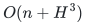
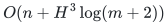
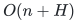
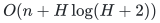

# Executable degree-constrained subgraphs

This standard-library Python solver finds an exact subgraph with prescribed
or interval degrees, optionally constrains its edge count, and minimizes or
maximizes that count. It returns original input IDs and a separately
checkable decision. Parallel records remain distinct selectable edges.

The implementation is unconditional. It constructs the proved sparse
matching reduction and calls the repository's ordinary exact matching
solver. Its polynomial bound is separate from the faster mathematical
research theorem.

## Run a request

From the repository root, using Python 3.10 or later:

```bash
python3 problems/degree-constrained-subgraphs/reference/degree_subgraph.py \
  problems/degree-constrained-subgraphs/reference/example.json > degree-result.json
python3 problems/degree-constrained-subgraphs/reference/verify_degree.py \
  problems/degree-constrained-subgraphs/reference/example.json degree-result.json
```

The example is a star with a parallel record and an isolated vertex.
With upper degree one, its maximum feasible cardinality is one. The
result includes a native selected edge and an independently checked
matching certificate excluding cardinalities two through four. The
verifier runs no matching search.

The solver also reads a JSON request from standard input when its input
argument is `-` or omitted. The request fields are:

| Field | Meaning |
|---|---|
| `n` | Nonnegative integer vertex count; vertices are `0,...,n-1`. |
| `edges` | Explicit endpoint pairs for a loopless undirected multigraph. |
| `edge_ids` | Optional distinct integer or string IDs; defaults to input indices. |
| `lower` | Optional nonnegative integer lower degrees; defaults to zero. |
| `upper` | Optional nonnegative integer upper degrees; defaults to incident degrees. |
| `cardinality` | Optional pair `[minimum, maximum]`, intersected with `[0,m]`. |
| `objective` | `feasible` (default), `minimum` or `maximum`. Optimization respects the supplied cardinality interval. |

Set `lower` and `upper` to the same array for an exact factor. Setting both
cardinality endpoints to the same integer prescribes the exact number of
selected records. Negative degree bounds, loops, malformed endpoints and
repeated IDs are rejected. Impossible required degrees and empty
cardinality intervals return a certified `NO`. Upper degree bounds are
clipped to actual incident degrees; required lower degrees are never
reduced. Integers and strings are distinct ID types, so `1` and `"1"`
may both be used. Boolean IDs and bounds are rejected.

## Python interface

The implementation lives in [degree_subgraph.py](degree_subgraph.py).
When its directory is on Python's import path:

```python
from degree_subgraph import degree_subgraph
from verify_degree import verify_degree_result

edges = [(0, 1), (0, 1), (2, 3)]
lower = upper = [2, 2, 1, 1]
ids = [101, 102, "tail"]
result = degree_subgraph(4, edges, lower, upper, ids)
report = verify_degree_result(4, edges, result, lower, upper, ids)
```

This example selects both parallel records and the edge with ID `"tail"`.
The selected records retain their native index, ID, and input endpoint
order. A `YES` result also gives the full original degree vector. A `NO`
has an empty selected list, null cardinality and null degrees.

## What the certificate establishes

A feasible `YES` is checked directly against the original records, degree
intervals and cardinality interval. For a `NO`, the verifier either
rechecks a local impossibility bound or reconstructs the deterministic
matching reduction and checks a certificate that its maximum matching is
not perfect. It imports only the independent matching verifier; it does
not invoke a matching solver.

For a minimum or maximum result of size `k`, the verifier additionally
checks an infeasibility certificate for every strictly better permitted
cardinality, expressed by one interval. If `k` is already the relevant
endpoint of the requested interval, the native witness suffices. This
does not assume that feasible exact cardinalities form an interval.

[degree_reduction.py](degree_reduction.py) is shared deterministic
construction code used by both solver and verifier. Thus the verifier is
independent of matching search, not an independent second implementation
of the reduction. The reduction has a complete local proof, and the
finite test suite compares the executable outputs with original-edge
subset enumeration. Statistics are informational and are never accepted
as certificate evidence.

## Cost and limits

Put `H=1+m log(m+2)`, where `m` counts the original explicit edge records.
Feasibility takes

<!-- math-display: f7f5736b6bd66f560b05d31e
O(n+H^3)
-->

 ordinary operations; either optimization
objective takes

<!-- math-display: c43c29b1dbaf8f38473f6fc6
O(n+H^3\log(m+2))
-->

. Construction, matching certificates
and native output checks are included. Space is

<!-- math-display: 4e4b0765281f4bd38c6fa2fa
O(n+H)
-->

, including the
retained decision certificate. The verifier takes
<!-- math-display: b7ec696a95781fcec9383861
O(n+H\log(H+2))
-->

 operations and

<!-- math-display: 4e4b0765281f4bd38c6fa2fa
O(n+H)
-->

 space.

The initial scan removes harmless isolates from all nontrivial matching
calls. Input and output still cost

<!-- math-display: 0117325c4f4e755b5b40c665
O(n+m)
-->

. The bounds treat vertex
indices and numeric degrees as ordinary input words and count ID
comparisons; arbitrary-length numeric or string representations carry
their actual reading, arithmetic and comparison costs. Large upper
degrees are clipped before constructing any unit edge records.

This implementation supports capacity one per explicit record. It does
not support graph loops, binary-encoded edge multiplicities or arbitrary
edge-weight optimization. The sparse selector can have a substantial
constant factor; this is a correctness-oriented reference solver.

See [the correctness and certificate proof](correctness.md), the
[full sparse reduction](../proof.md) and the
[matching implementation](../../general-matching/reference/README.md).
Run the [finite original-subset oracle checks](../verify/check_reference.py)
with:

```bash
python3 -B problems/degree-constrained-subgraphs/verify/check_reference.py
```

**Attribution:** Yilin Liu · GPT-6 Astra Pro.
