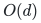

# Verification and proof scope

## Ready for review: the reduction theorem

Theorem 1.1 is an unconditional deterministic reduction to exact general
matching. It includes exact or ranged cardinality with one feasibility
call; optimization uses a logarithmic number of calls. The selector is
built explicitly by the recursive permutation network, so it needs no
unimplemented sparse-selector oracle.

Run from the repository root:

```bash
python3 -B problems/degree-constrained-subgraphs/verify/check_reductions.py
```

The standard-library checker independently solves local bipartite
selector instances and exhaustively enumerates degree states on the
actual augmented multigraphs. It checks 2,580 selector cases, 634
interval-degree instances and 5,260 exact/ranged cardinality reductions.
The latter include all simple graphs through three vertices with all
valid degree intervals, plus explicit parallel-edge cases. Both sides
are compared with enumerated original edge subsets. These are finite
checks of the specified gadgets, not a substitute for the general proof.

## Ready for review: the linear-size theoretical selector

[Theorem 1.2 and its complete proof](../linear-selector.md) reduce selector size to

<!-- math-display: 08eab5cd7b88276cab54b5e1
O(d)
-->

 by a deterministic construction using the explicitly named Gabber–Galil expansion theorem. It proves the required DAG, source/sink boundary degrees, vertex-disjoint routing property, linear enumeration cost, and simple subcubic matching adaptation. The executable degree solver still uses the Beneš selector.

Run <code>python3 -B problems/degree-constrained-subgraphs/verify/check_linear_selector.py</code> from the repository root. The scoped finite suite checks 1,171 networks and 9,467 terminal-set pairs, including 3,694 infeasible pairs. It compares the generic degree adapter and matching gadget with independent exact disjoint-path tests. It also checks 160 modular maps, 66,066 finite expansion subsets, 601 exact rounding/size sequences, and four rejected network descriptions. Python optimized mode is refused.

These tests validate finite expander instances and local adapters. The all-size expansion inequality remains the named published theorem, and the linear enumeration bound is proved analytically. They are not a claim that the production degree solver now constructs the theoretical selector or uses the fast matching implementation.

## Ready for review: the unconditional executable solver

The [reference implementation](../reference/README.md) constructs the
actual sparse reduction and invokes the repository's exact matching
solver. Native parallel records preserve their IDs. Every failed
perfect-matching call is checked by the independent matching certificate
verifier, and final native degrees and cardinality are checked directly.
Optimization carries one certified interval excluding all better sizes.

```bash
python3 -B problems/degree-constrained-subgraphs/verify/check_reference.py
```

The default suite checks 8,292 requests against independently enumerated
original subsets, using 5,341 exact matching calls. It includes every
valid interval-degree request on all simple graphs through three
vertices plus two parallel-record graphs, their full cardinality ranges,
all simple four-vertex graphs with additional requests and 120 seeded
native instances. It checks 3,364 constructed graphs for simplicity and
maximum degree three. It also exercises long encodings and isolates,
rejects 15 malformed requests and 15 corrupted certificates, and runs
both production CLIs under `python -O` to check their explicit rejection
conditions. The finite checker itself refuses `-O`.

The external degree verifier runs no matching search. It shares only
the deterministic input/reduction builder and invokes the independent
matching certificate checker. Its meaning and polynomial cost are
proved in the [certificate note](../reference/correctness.md).

## Ready for review: the fast running-time corollary

The proof gives both selector variants and the interval-degree reductions,
including parity, original-edge recovery and cardinality optimization. Its
fast running-time corollary invokes the matching theorem, whose Section 11.6
realizes the deterministic cycle-search interface with the linked local
constructions and named published inputs. The reduction's proof and that
realization together establish the corollary. The shipped implementation
uses its separately analyzed polynomial solver.

Cap normalization, loop/parallel-edge conventions and actual output length
must be read with the theorem. A matching optimality verifier can validate the
auxiliary solution without establishing the claimed backend running time.
The finite checker does not implement the complete fast matching solver.

Read the [main proof](../proof.md) with its [source map](../sources.md). Repository checks validate links, mathematical syntax and catalogue coverage; they do not certify the asymptotic theorem. No proof-assistant verification or external peer review is claimed.
