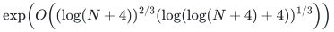
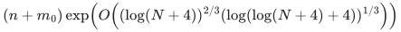

# Dynamic minimum spanning forest baseline

**Guarantee**

Maintains an exact minimum spanning forest in a fully dynamic weighted graph under the stated deterministic reduction.

**Objective and output**

Maintain the exact forest with original edge identifiers and publish its changes after each settled update. Enumerating the whole forest additionally costs its output size; connectivity queries use the maintained forest.

**Randomness**

Deterministic derived public baseline using deterministic decomposition and pruning in the stated worst-case MSF reduction.

**Time**

Worst-case per-update work is

<!-- math-display: c14ac834f3272904ca7b0490
\exp\!\left(O\!\left((\log(N+4))^{2/3}(\log(\log(N+4)+4))^{1/3}\right)\right)
-->

This is a derived public baseline, not a single-source theorem statement.

Initialization costs

<!-- math-display: ccbe48b90d47f3a11903bc8c
(n+m_0)\exp\!\left(O\!\left((\log(N+4))^{2/3}(\log(\log(N+4)+4))^{1/3}\right)\right)
-->

Where <code class="math">m_0</code> is the initial edge count. Connectivity queries cost a polynomial logarithm.

**Space**

Actual weighted-edge inventory, hierarchy certificates, retired records, and pruning state; no master-cap padding is materialized.

**Parameters**

<code class="math">n</code> is the fixed vertex count; <code class="math">m</code> is the current edge count; <code class="math">N</code> bounds vertices, initial edges and subsequent update records; <code class="math">U</code> is log of <code class="math">N</code> plus a constant; <code class="math">h</code> is log of <code class="math">U</code> plus a constant.

**Model and representation**

Deterministic fully dynamic weighted multigraph with adaptive edge updates and immutable edge-ID tie breaking. The public decomposition, pruning, contraction and child-forest certificate interfaces are named in the source map. Weight comparison is constant-time in the comparison model, or uses polynomially many bits in <code class="math">\log N</code>.

**Lower-bound scope**

No lower bound is claimed. The displayed point is a baseline and should not be advertised as an improvement over the cited public reduction.

**Review status**

**Ready for review.** The full deterministic weighted MSF public-baseline composition: local exchange/contraction proofs, connectivity adapter, finite pruning horizons, decomposition parameters and recursive worst-case cost.

**Dependencies and scope.** The external theorems are Chuzhoy–Gao–Li–Nanongkai–Peng–Saranurak Corollary 6.1, Meierhans–Probst Gutenberg–Saranurak Theorem 6.4, and Nanongkai–Saranurak–Wulff-Nilsen Theorem 7.1 and Section 9. This is a derived public result; a full executable implementation is not supplied.

The [verification note](verify/README.md) identifies executable coverage. This status does not claim external peer review or proof-assistant verification.

**Source**

[Complete theorem and proof](proof.md), [dependencies and primary sources](sources.md).

**Attribution.** icekylinx · GPT-6 Astra Pro
