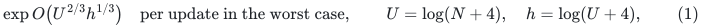
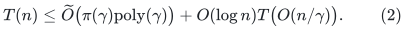
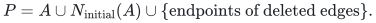
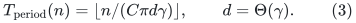
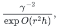
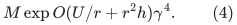
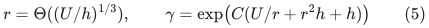
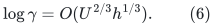
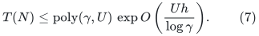

# A deterministic two-thirds worst-case minimum-spanning-forest baseline

**Theorem and proof.** All algorithmic conclusions use the explicitly stated interfaces and computational models.

The formal interface proof is
[Formal pruning substitution in the public NSW MSF framework](../../manuscripts/graph-backends/dynamic-msf-formal-pruning-substitution-audit.md).
The bound below is derived from the named public results. It uses NSW's actual
weighted certificate and formal worst-case reduction. CGLN's informal
residual-connectivity sketch, read in isolation, would not suffice.

A deterministic fully dynamic exact minimum spanning forest bound

<!-- math-display: f7730ea6bdefe44b320267bf
\exp O\bigl(U^{2/3}h^{1/3}\bigr)
 \quad\text{per update in the worst case},\qquad
 U=\log(N+4),\quad h=\log(U+4),                            \tag{1}
-->

is already a derived consequence of the older public MSF reduction,
the public deterministic balanced-cut construction, and the 2025
worst-case pruning theorem. The October 2026 MSF reduction is not
needed to obtain this quantitative point. The derivation below is
new accounting of these sources; it is not claimed to be a displayed
theorem in any one of them.

Use a fixed vertex set and a declared master cap <code class="math">N</code> covering its
size, the initial edge inventory and the subsequent edge-update
records. Edge insertions and deletions may depend on all previous
answers. Parallel edges have distinct immutable IDs, loops can be
discarded, and a weight replacement is a deletion followed by an
insertion. All tuning parameters use this one cap.

The initial construction costs
<code class="math">(n+m_0)\exp O(U^{2/3}h^{1/3})</code>, conservatively including the
initial MSF and sorting. Each settled update publishes changes to the
maintained exact forest. Enumerating the entire current forest is an
additional output-size operation; it is not part of the per-update
claim.

## 1. Primary sources and their roles

The proof uses the following pinned source versions.

| Source | Exact role |
|---|---|
| [CGLNPS, arXiv:1910.08025v2](https://arxiv.org/html/1910.08025v2), Corollary 6.1 and Section 6.2, equations (4)--(5) | Deterministic decomposition and a parameterized deterministic reading of the NSW MSF reduction |
| [NSW, arXiv:1708.03962v2](https://arxiv.org/pdf/1708.03962), Theorem 7.1, Section 9.3, especially Lemma 9.28 | Explicit worst-case batch-insertion/contraction reduction and its recursive time calculation |
| [MGS, arXiv:2504.00544v1](https://arxiv.org/html/2504.00544v1), Theorems 1.3 and 6.4 | Deterministic pruning with worst-case work and vertex recourse <code class="math">\widetilde O(\phi^{-2})</code> |
| [MPG, arXiv:2510.08297v1](https://arxiv.org/html/2510.08297v1), Sections 3.5--3.7 | New connectivity framework; its deamortization discussion is brief |
| [MPGY, arXiv:2610.00491v1](https://arxiv.org/html/2610.00491v1), Sections 3, 4, and 6 | Recent randomized polylogarithmic worst-case MSF/2-edge-connectivity result with static decomposition as its only randomized ingredient |

Only the first three rows enter the derivation. The later two rows
are comparisons and can be removed without changing (1). A randomized
polylogarithmic worst-case result does not itself establish a
deterministic bound. Deterministic polylogarithmic **amortized** MSF
is a different, classical guarantee and is not improved by (1).

## 2. The formal public reduction separates pruning from decomposition

Let <code class="math">\gamma&gt;1</code>. The conservative weighted-decomposition adapter
in the formal audit constructs NSW's hierarchy in
<code class="math">n\mathrm{poly}(\gamma)</code> time. It has depth
<code class="math">O(\gamma)</code>, total reweighted-edge inventory <code class="math">O(n/\gamma)</code>,
and conductance <code class="math">\phi_0=\Omega(\gamma^{-5})</code> in every
non-root cluster requiring pruning. Let <code class="math">\pi</code> bound worst-case
pruning work and publication. With a sufficiently short decremental
period, the resulting recurrence is

<!-- math-display: 6a1a77526cff27a2dcc77085
T(n)\le\widetilde O\bigl(\pi(\gamma)
                     \mathrm{poly}(\gamma)\bigr)
       +O(\log n)T\bigl(O(n/\gamma)\bigr).                \tag{2}
-->

NSW Theorem 5.1 asks for a monotone published set <code class="math">P</code>, initially
empty, and existence of <code class="math">P'\subseteq P</code> whose complement induces
a connected graph. This applies only to **non-root large clusters**.
The root need not expand. The amount of new publication per deletion
and its computation time are bounded by <code class="math">\pi</code>.

This weak connectivity statement supports the actual weighted
certificate, not an arbitrary union of an initial MST and edges
incident to <code class="math">P</code>. Definition 9.5 additionally retains the three
compressed-cluster MSFs, original versions of reweighted edges, and
retired edges. Claims 9.18 and 9.19 use the hereditary child-MSF
invariant and contraction monotonicity to prove that this certificate
contains the exact MSF. Claim 9.19 also justifies publishing a
superset of the unknown witness <code class="math">P'</code>.

NSW Theorem 7.1 and Lemma 9.28 have fixed polynomial dependence on
batch size, preprocessing factor, and the finite update horizon.
Batch insertions contribute to the local charge, whereas only
logarithmically many recursive calls are made for a deletion. Thus
<code class="math">\pi</code> is not raised to the number of recursion levels in (2).
CGLN's deterministic decomposition removes the randomized branch of
this named worst-case construction.

## 3. Modern pruning, isolated vertices, and a short supported period

MGS Theorems 1.3 and 6.4 deterministically maintain an increasing
vertex set <code class="math">A</code>. During its supported deletion interval, the
positive-volume remainder is a
<code class="math">\Omega(\phi/\log^4 m)</code>-expander. Each deletion costs
<code class="math">\mathrm{polylog}(m)/\phi^2</code> worst-case work and adds
at most that many vertices. Linear times a fixed polynomial in
<code class="math">1/\phi</code> and <code class="math">U</code> suffices as its initialization allowance.

Conductance conventions can ignore zero-volume vertices, so direct
connectivity is not inferred from that statement alone. In a native
degree-three cluster publish

<!-- math-display: 7bfcb85b9168060798e884bb
P=A\cup N_{\rm initial}(A)
       \cup\{\text{endpoints of deleted edges}\}.
-->

This adds only a constant factor to vertex publication. These extra
vertices are **not** fed as deletions to the pruning algorithm.
Every newly isolated residual vertex lies in <code class="math">P</code>, and positive-
volume residual vertices form one connected component. If that
component exists, remove <code class="math">A</code> and the residual isolates as the
existential witness. If all residual vertices are isolated, then
<code class="math">P=V</code>, and retain any singleton. Thus the literal NSW interface
holds even in this boundary case.

The MGS deletion horizon is at least <code class="math">c\phi_0m_C/Q</code>, for a
fixed polynomial <code class="math">Q=\mathrm{poly}(U)</code>. Every non-root
large cluster has <code class="math">m_C\ge n/(C\gamma)</code>, so its supported
period is at least <code class="math">c'n/(\gamma^6Q)</code>. Inflate the declared
publication/work factor to <code class="math">\pi=\gamma^{12}Q'</code>, and choose

<!-- math-display: d9f37cf2fb188d82dd428d5b
T_{\rm period}(n)=
   \left\lfloor n/(C\pi d\gamma)\right\rfloor,
 \qquad d=\Theta(\gamma).                                \tag{3}
-->

Actual pruning costs only <code class="math">\gamma^{10}\mathrm{poly}(U)</code>.
The declared factor is still a fixed polynomial in <code class="math">\gamma</code>,
and (3) expires well before any local pruning horizon. No
whole-instance publication at the end of a horizon, or gradual
completion device, is needed. Actual-size polynomial bases handle
floors and zero-length periods. The total published inventory remains
<code class="math">T_{\rm period}\pi d=O(n/\gamma)</code>, exactly as used by
NSW's compressed certificate and recursive sparsification.

## 4. Deterministic decomposition with the required gamma

Use CGLNPS Corollary 6.1 with parameter <code class="math">r</code> and crossing budget
<code class="math">\epsilon=\gamma^{-2}</code>. Its output expansion is at least

<!-- math-display: af7a9840940722089ac704d2
\frac{\gamma^{-2}}{\exp O(r^2h)},
-->

and its time, on an actual <code class="math">M</code>-edge instance, is at most

<!-- math-display: 207cd79650522c886c36bece
M\exp O(U/r+r^2h)\gamma^4.                               \tag{4}
-->

Choose

<!-- math-display: f1cbc1afeda1eb094ee64ac4
r=\Theta((U/h)^{1/3}),\qquad
 \gamma=\exp\bigl(C(U/r+r^2h+h)\bigr)                     \tag{5}
-->

for a sufficiently large fixed <code class="math">C</code>. The contracted output
expansion is then at least <code class="math">\gamma^{-3}</code>, and (4) is
<code class="math">M\mathrm{poly}(\gamma)</code>. Expanding protected blocks
of size <code class="math">\Theta(\gamma)</code> loses a further fixed power, giving
the safe native-cluster bound <code class="math">\phi_0=\Omega(\gamma^{-5})</code>.
Also

<!-- math-display: 8f13a87d8661174fd6a35db2
\log\gamma=O(U^{2/3}h^{1/3}).             \tag{6}
-->

At each hierarchy step first remove the current weight band and then
decompose, while preserving the initial MSF block trees. This order
ensures that returned children have the stated expansion. NSW's
contraction lemma and the protected-tree weight argument give the
hereditary child-MSF property. The full construction, including
unbounded-degree contracted inputs and all actual-size cutoffs, is in
the operative formal audit.

Only this displayed, fully public decomposition interface is needed;
the slightly sharper Section 5.1 output-quality tradeoff is optional.
In particular the tagged-triangle demand gadget plays no role in this
baseline.

There is no master-size padding. Stop the dynamic recursion and use
an exact small-graph implementation once its actual size is at most
<code class="math">\gamma^{c_1}</code> for a fixed constant <code class="math">c_1</code>. Its polynomial
cost is within <code class="math">\mathrm{poly}(\gamma)</code>. Above this
threshold, the source restriction <code class="math">r=O(\log M)</code> holds with
room to spare. Alternatively use the local cutoff
<code class="math">r_M=\min\{r,c_2\log(M+2)\}</code>; the same global upper bound
in (4) follows. The usual bounded-degree reduction is already part
of the named MSF framework.

## 5. Solving the worst-case recurrence

Use one master upper bound <code class="math">\gamma</code> from (5) in the recurrence;
the exact base handles the range in which <code class="math">n/\gamma</code> is too
small for another reduction. There are
<code class="math">O(U/\log\gamma)</code> nonbase levels. Equations (2) and (3) give

<!-- math-display: dfa1f2918c91f64b50c9f0aa
T(N)\le
   \mathrm{poly}(\gamma,U)\,
   \exp O\left(\frac{Uh}{\log\gamma}\right).              \tag{7}
-->

The second logarithmic term is
<code class="math">O(U^{1/3}h^{2/3})</code>, smaller than (6). Hence (7) proves (1),
using the named public worst-case reduction throughout. Exact MSF
edge changes are the output of that reduction. The result also
supports connectivity queries through the maintained forest.

For completeness, the normalized preprocessing recurrence has a
constant branching factor at each of <code class="math">O(U/\log\gamma)</code> levels,
and additive <code class="math">\mathrm{poly}(\gamma,U)</code> work per actual initial
record. Hence its factor is at most
<code class="math">\mathrm{poly}(\gamma,U)\exp O(U/\log\gamma)</code>,
absorbed by the same <code class="math">\exp O(U^{2/3}h^{1/3})</code> envelope.
This pays the initial construction stated above. Deterministic
worst-case dynamic-forest primitives support connectivity queries in
polynomial logarithmic time; an amortized-only replacement for those
primitives would require a separate deamortization argument.

For arbitrary tied weights, use deterministic lexicographic ordering
by weight and immutable edge identity. This selects one exact MSF
without changing the original minimum-weight objective. The time is in a
comparison-RAM model with constant-time weight comparisons, or with
weights having polynomially many bits in <code class="math">\log N</code>, whose arithmetic
cost is absorbed in <code class="math">\mathrm{poly}(U)</code>. Arbitrary
polynomial-in-<code class="math">N</code> bit lengths do not have free comparison cost.

This is a **derived public-framework baseline**. It is not claimed
to optimize all public parameter choices or all dynamic MSF
algorithms. The primary-source search also located the October
2026 randomized polylogarithmic improvement; its randomness prevents
using it as a deterministic bound without a further construction.

---

**Attribution:** icekylinx and GPT-6 Astra Pro.

The proofs use their named external interfaces. Finite checks are separate from proof-assistant verification.
