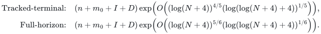
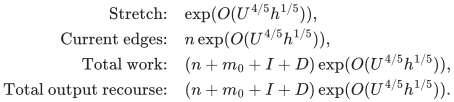
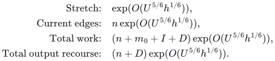

# Dynamic spanners with recourse tradeoffs

Two dynamic-spanner constructions are retained because their recourse contracts differ. Their stretch exponents should not be compared while dropping those assumptions.

**Guarantee**

Maintains a spanner of an arbitrary-degree undirected graph with the stated stretch, size, amortized work, and output-recourse guarantee.

**Objective and output**

Maintain an explicit sparse spanner after settled updates and report its edge changes. Enumerating the complete current set additionally costs its output size.

**Randomness**

Both displayed spanner constructions are deterministic, with the hierarchy, strong-forest and destructive-support interfaces realized by the linked proofs. Randomized public baselines are comparisons only.

**Time**

The total initialization/update work bounds are:

<!-- math-display: 239d850c052c52905bdef7e9
\begin{aligned}
\text{Tracked-terminal:}\quad &(n+m_0+I+D)\exp\!\left(O\!\left((\log(N+4))^{4/5}(\log(\log(N+4)+4))^{1/5}\right)\right),\\
\text{Full-horizon:}\quad &(n+m_0+I+D)\exp\!\left(O\!\left((\log(N+4))^{5/6}(\log(\log(N+4)+4))^{1/6}\right)\right).
\end{aligned}
-->

**Space**

The current spanner has the fixed vertex count multiplied by the chosen stretch factor in edges. The hierarchy pays actual initial edges and actual update history.

**Parameters**

`n` is the fixed vertex count; `m_0` is the initial edge count; `I` and `D` count edge insertions and deletions; `N` is the declared polynomial history cap; `U` is log of `N` plus a constant; `h` is log of `U` plus a constant. `D` is also the deletion term in the full-horizon recourse bound.

**Model and representation**

Unweighted or nonnegative polynomial-range integer-weighted undirected graphs, with distinct identifiers for parallel edge lifetimes and settled external updates. Weighted instances use positive dyadic classes and one unweighted zero-edge class. Both constructions have amortized bounds. Self-loops are discarded.

**Lower-bound scope**

This page records two upper-bound constructions and their incomparable recourse assumptions. It does not claim an optimality lower bound.

**Review status**

**Ready for review.** The complete tracked-terminal four-fifths and full-horizon five-sixths constructions, including the destructive-support realization, hierarchy and strong-forest substitutions. The zero-edge class and dyadic positive-weight wrapper charge initialization, all updates and settled output recourse.

**Dependencies and scope.** The two recourse guarantees have different scopes and are retained separately. Output is measured after a complete external update, with the stated adaptive-history and numerical-range restrictions. The underlying proofs are available even though a full executable implementation is not supplied.

The [verification note](verify/README.md) identifies executable coverage. This status does not claim external peer review or proof-assistant verification.

**Source**

[Complete theorem and proof](proof.md), [dependencies and primary sources](sources.md).

## Two recourse regimes

For the repeated comparisons below, use <code class="math">U=\log(N+4)</code> and <code class="math">h=\log(\log(N+4)+4)</code>. Every exponential factor and actual-history multiplier is written explicitly.

**Tracked original terminals.**

<!-- math-display: c760d49946f142f9cfc7096e
\begin{aligned}\text{Stretch:}\quad&\exp(O(U^{4/5}h^{1/5})),\\\text{Current edges:}\quad&n\exp(O(U^{4/5}h^{1/5})),\\\text{Total work:}\quad&(n+m_0+I+D)\exp(O(U^{4/5}h^{1/5})),\\\text{Total output recourse:}\quad&(n+m_0+I+D)\exp(O(U^{4/5}h^{1/5})).\end{aligned}
-->

**Full-horizon construction.**

<!-- math-display: 3a0d1ddfaa696cbb5b5d5a9b
\begin{aligned}\text{Stretch:}\quad&\exp(O(U^{5/6}h^{1/6})),\\\text{Current edges:}\quad&n\exp(O(U^{5/6}h^{1/6})),\\\text{Total work:}\quad&(n+m_0+I+D)\exp(O(U^{5/6}h^{1/6})),\\\text{Total output recourse:}\quad&(n+D)\exp(O(U^{5/6}h^{1/6})).\end{aligned}
-->

Both conclusions use the constructed flat-forest hierarchy. The full-horizon construction removes cumulative insertions from output recourse, so neither construction dominates the other in every displayed quantity.

Read the [proof](proof.md), [source map](sources.md), and [complexity guide](../../docs/COMPLEXITY.md) for the exact envelopes and recourse accounting.

**Attribution.** icekylinx · GPT-6 Astra Pro
