# A direct dynamic spanner from tracked terminal forests

**Constructed composition theorems.** The two spanner constructions
use the [normalized APSP hierarchy](../apsp-frontier/proof.md),
the [explicit flat witness families](../../manuscripts/graph-backends/destructive-apsp-path-support-extractor.md)
and the [metric forest lift](../../manuscripts/graph-backends/separated-metric-forest-and-strong-sssp.md),
Section 5. The generic observer and batching lemmas retain their stated
interfaces; these linked constructions supply their instantiations.

This note constructs a deterministic fully dynamic spanner with explicit
four-fifths overhead, by using the already maintained flat witness
forests of the numerical APSP hierarchy. Its output recourse depends
on insertions as well as deletions. It therefore complements, rather
than supersedes, the five-sixths low-recourse construction in Part II.

The bound, for an arbitrary-degree unweighted undirected
graph on `n` fixed vertices, is

<!-- math-display: e132af0289ab890953c112dd
\begin{array}{ll}
 \text{stretch}&\exp O(U^{4/5}h^{1/5}),\\
 \text{current output edges}&n\exp O(U^{4/5}h^{1/5}),\\
 \text{initialization and total update work}
   &(n+m_0+I+D)\exp O(U^{4/5}h^{1/5}),\\
 \text{safe total output-recourse bound}
   &(n+m_0+I+D)\exp O(U^{4/5}h^{1/5}).
 \end{array}                                                \tag{T1}
-->
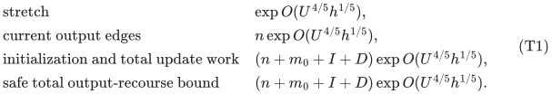

Here `m_0` is actual initial input size, `I,D` are insertions/deletions
over a polynomially bounded history, `N` is its declared master cap,
`U=log(N+4)`, and `h=log(U+4)`. Distinct edge lifetimes and parallel
edges have distinct identifiers. Self-loops can be ignored. Queries
and the output see settled external updates. No worst-case update
claim or recourse bound independent of `I` is made.

Histories may be chosen adaptively from previous published outputs,
provided the deterministic providers satisfy their stated contracts on
that same history. All physical lifetimes and generated records count
toward their announced caps. The maintained output is an explicit edge
set; enumerating its entire current contents costs an additional
<code class="math">\Omega(&#124;E(H_{\rm out})&#124;)</code> output operations when requested.

The construction does not union every edge in every allocated flat
forest. Such a union can depend on the `Theta(m)` native port vertices
in an arbitrary-degree input. Instead it marks only the at most `n`
original query traces at each level and outputs short compressed
paths between their marks.

## 1. Retained hierarchy and forest family

Use the already audited normalized positive-port numerical hierarchy
from [apsp time stretch tradeoff](../apsp-frontier/proof.md). With parameter `t`, it has

<!-- math-display: 63474d33e5ac263b99a89dc6
\begin{aligned}
 p=r&=\Theta(t),\quad K_{\rm repair}=\Theta(t^2),\quad
 k=2^x,\quad x=\Theta(U/t),\quad d=O(t),\\
 B&=O(U/t+t^3h),\qquad
 \log\gamma_{\rm native}=O(t^4h).
 \end{aligned}                                             \tag{T2}
-->
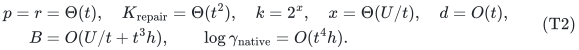

Its arbitrary-degree root adapter is a current-incidence balanced
binary tree for each original vertex. Connectors have length one;
an original unweighted edge has native length `H=poly(U)`, a fixed
power of two. Only the original `n` vertices have permanent query
handles `q_v`. For original endpoints,

<!-- math-display: 207a78220db7a90cefa6206c
d_G(u,v)\le H^{-1}d_{G_0}(q_u,q_v)\le2d_G(u,v).       \tag{T3}
-->
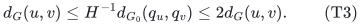

The root native graph can contain `Theta(m+n)` port vertices. That
inventory is paid by initialization and the actual update history,
but it is not used as the spanner's terminal count.

At each level `i`, retain the following native forest families:

1. the exact nearest-pivot forest `N_i`;
2. a shortest-path tree rooted at every native vertex on its strict
   pivot ball, including the root;
3. at an actual-size base, one exact shortest-path forest per source;
4. the exact local shortest-path trees used to answer queries within
   an initially small untouched component.

The last family is explicit even where an untouched component is
answered by a local exact table instead of the ordinary strict-ball
termination. Such a component has fewer than `k` edges, so these
trees cost only another fixed polynomial in `k` locally.

Lift each family from the level where it is born through its ancestors
to the root native graph `G_0`. Keep all typed null edges; do not
contract away different input-vertex handles at an intermediate or
final forest. Each native forest node `y` has a stable current handle
`eta_i(y)` in its flat root forest. The flat forest's other nodes may
include full unused pools and historical isolates. They are all paid
for in working storage and maintenance.

The explicit proof of these families, their pointwise occurrence,
and their full maintenance is
[Destructive path-support extraction from the APSP hierarchy](../../manuscripts/graph-backends/destructive-apsp-path-support-extractor.md), Sections 2--2.2. The extra local exact family
in item 4 has the same `k^{O(1)} poly(U)` bound. Its generic lift
recurrence is `G_parent <= P(G_child+1)`, and each local family is
lifted once from its birth level. The factor `k^{O(1)}` is not
multiplied once per hierarchy depth. Total work and explicit flat
forest edits, including initial credit and all unused pools, fit

<!-- math-display: fbc785db8ad2ce22c3bb1f91
(n+m_0+I+D)\exp O(B).              \tag{T4}
-->
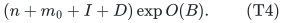

The weights on a flat forest are the lengths of its real `G_0` edge
copies and zero on its typed nulls. They are exact integers. If a
native forest path is born at level `i`, the length of the path
between its lifted endpoint handles is at most its native length
divided by the cumulative inter-level port scale `sigma_i`.
This is the arbitrary-forest metric inequality in
[separated metric forest and strong sssp](../../manuscripts/graph-backends/separated-metric-forest-and-strong-sssp.md), Section 5.

## 2. Track only original-query pivot images

Set

<!-- math-display: 5f79a3bec0b0d6d78fd1b22f
S_0=\{q_v:v\in V(G)\}.        \tag{T5}
-->
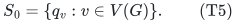

This contains `n` handles, not all root port vertices. For a level
whose nearest-pivot component is active and exposes its pivot in the
child, propagate a tracked native vertex `w` to the child query
handle of `p_i(w)`. Let `S_{i+1}` be the **set** of these propagated
handles. Duplicate images count once. Thus

<!-- math-display: 1d62d32217245f608660b6fe
|S_i|\le n                 \tag{T6}
-->
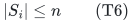

for every level. This is only a query-tracking set. Adding its marks
does not promote new centers, modify native graph edges, or rebuild
the numerical hierarchy.

An initially small untouched component may have a private common
pivot `r_C` with no recursive child handle. Do not propagate it.
Queries involving this component terminate in the appropriate local
exact trees, or return infinity to a different untouched component.
Its first real activation, including a forced activation if used by
the native interface, exposes the old pivot before ordinary updates
and then enables propagation. This is the same small-component rule
as the audited component wrapper, not an assumption that private
handles already exist in the child.

### 2.1 Boolean component aggregates

Maintain a mark at each member of `S_i` in the native nearest-pivot
forest `N_i`. Each component stores the number of such marked
vertices, its designated pivot, and whether the pivot has an exposed
child query handle. Its output contributes exactly one Boolean mark
to `S_{i+1}` when that count is positive and the handle exists.

A single membership insertion/deletion in `S_i` changes only its
component's count. It causes at most one next-level membership event.
A native forest cut, link, root change, singleton birth/death, or
exposure-state change affects only constantly many components and
causes only constantly many next-level events. Ordinary dynamic-tree
component aggregates perform these operations in polynomial-logarithmic
time. Retain handle reference counts if an implementation exposes
coincident aliases; then a contribution changes set membership only
on a zero-to-one or one-to-zero transition.

If `b_i` counts changes to `S_i` and `l_i` is the complete native
nearest-pivot/root/exposure transcript at level `i`, the safe total
propagation bound is

<!-- math-display: e6873f14caba84a6a311d59e
b_{i+1}\le b_i+O(l_i).           \tag{T7}
-->
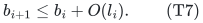

The coefficient on the propagated membership events is one: a set
mark changes only one component count and can toggle only that
component's one output. There is no `k b_i` term. Summing (T7)
over depth loses at most a factor `O(d)`. The native transcripts are
already charged in (T4). A period replacement removes old traces
and initializes new ones from its actual forest inventory, also
charged there. Initial small isolates do not allocate absent child
handles just to propagate a mark.

A native update transcript need not have exactly one pivot in every
intermediate component. For its observer, store both the component's
`S_i` mark count and its minimum currently eligible exposed-pivot ID.
Temporarily use that minimum as the component's one output, or no
output if there is none. Cuts, links and eligibility/root flags change
only constantly many component contributions. A mark toggle still
changes at most one output, since the pivot choice is independent of
that count. At a settled state the nearest-pivot component has its
unique actual pivot, so this temporary rule agrees with the intended
trace. The number of contributing components never exceeds the number
of `S_i` marks, preserving (T6) even during observer processing.

Enable an exposure flag only after the child's query handle and its
observer node exist, and disable it before that handle retires. Local
ball/base source trees may be created later in the same transaction;
their node-birth handler reads the current active-source flag and adds
the corresponding marks then. These are observation events only and
do not feed temporary pivots back into the native algorithm.

## 3. Marks in the flat witness forests

Use the stable handle of each selected native forest node in its own
flat root forest. The active marks are as follows.

* In the lifted nearest-pivot forest born at level `i`, mark every
  vertex of `S_i` and each of their nearest pivots. This has at most
  `2n` distinct marked handles.
* In the strict-ball tree rooted at `w`, activate that tree exactly
  when `w` belongs to `S_i`. If active, mark **all** of its native
  tree vertices at their lifted handles.
* Apply the same rule to a source's exact base tree or exact untouched-
  component tree when that local termination is available.

No distance threshold is used to decide which source is active or
which of its tree vertices is marked. In particular, changing a root
distance does not trigger a bulk search for vertices whose path has
just become short. The length test will be applied to compressed
forest edges instead.

Each strict ball and each local exact component has `k^{O(1)} poly(U)`
vertices. The actual-size base has the same bound. Thus the total
number `Q_mark` of active marked handles, over the disjoint forest
family at all levels, obeys

<!-- math-display: 1a2ff567788d3304f8b738c9
Q_{\rm mark}\le n k^{O(1)}
                                        \mathrm{poly}(U). \tag{T8}
-->
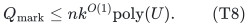

The bound counts marks separately when they occur in different flat
forest copies, even if their physical images agree. Root native ports
that are not on a tracked tree need not be marked. All unused pool
vertices remain allocated and charged as working records; (T8) makes
no assertion that their number is small in terms of `n` alone.

### 3.1 Mark-update work and stable lifted handles

A change of membership in `S_i` activates or deactivates at most
`k^{O(1)} poly(U)` current tree nodes. Iterate the actual tree nodes,
not a padded `k`-sized table. The local forest family is already
maintained for every native source; changing an active source does
not construct an additional recursive hierarchy or alter a native
pivot set. A native tree-node birth/retirement creates/removes one
active mark if its source is active. Ordinary tree-edge changes are
handled by the flat-forest transcript and do not require enumerating
all marked vertices in a component.

The generic forest lift supplies one distinguished root handle for
each living input node. Carry that node's owner tag along this
distinguished handle, not to every auxiliary pool copy. A forest-
period replacement retires old handles and creates new ones through
explicit node records. Remove marks on retiring handles before their
isolated-node retirement; after the current native traces are settled,
insert the required marks at the new current handles. No live marked
node silently changes its image or identity.

Observe **canonical-owner claim and release events** as well as physical
flat-node births and deaths. Releasing an input node's pool index may
leave that pool root allocated as an unused ghost. Its old owner's
mark is removed at release, even though the physical forest-node
record survives. Reusing the index installs the new owner only after
the old mark and tag have been removed. These are constant-size events
already supplied by the input-node lifetime and pool-assignment logs;
they do not require scanning the full pool. Current distinguished
handle lookup through the hierarchy takes `poly(U)` time.

Combining (T7), the native family transcript, and this local cost,
the total active-mark transcript and bookkeeping fit

<!-- math-display: ce59c0613790bfc32677eff0
(n+m_0+I+D)\exp O(B).             \tag{T9}
-->
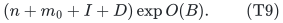

Multiplication by a fixed polynomial in `k` only increases the fixed
coefficient of `x` already in `B`. Propagation depth contributes a
polynomial in `U`. There is no repeated `k` factor for a single mark
at every level. The marks are observers of the maintained numerical
and forest structures, so no feedback loop turns this observer work
into additional native updates.

## 4. Maintain marked Steiner subtrees and expose only short edges

For every flat root forest `T`, maintain the minimal subtree spanning
the active marks in each of its components. Remove unmarked branches
and suppress unmarked degree-two vertices. A compressed edge represents
the full forest path between its retained endpoints. Store its exact
root-native path length.

The local construction and proof are
[dynamic marked forest short path union](../../manuscripts/graph-backends/dynamic-marked-forest-short-path-union.md). They apply to arbitrary
forest cuts, links, mark changes and nonnegative length changes, not
only decremental forests. Each such operation changes `O(1)` compressed
records in polynomial-logarithmic structural work. In particular:

* inserting a mark uses the first previously assigned virtual-edge
  ID on its path to any old mark to locate the attachment point;
* a cut affects at most one old compressed path and its endpoints;
* a link between two marked components is handled by temporarily
  marking its endpoints, linking them, and removing those temporary
  marks; if one side has no marks the old marked subtree is unchanged.

These operations use lazy path IDs and path sums, not traversal of
long unused paths. Zero-length typed-null edges cause no difficulty
for the topological compression. Path enumeration has a separate
physical-edge aggregate and skips all nulls and root port connectors.

Set

<!-- math-display: dc3b7671ca5249a4081a92f2
\Gamma=2\gamma_{\rm native},\qquad
                         R=\lceil H\Gamma\rceil.       \tag{T10}
-->
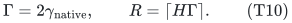

Expose exactly those compressed edges whose root-native length is at
most `R`. Their output lists contain only original physical edge IDs,
not native port connectors. A physical original-edge occurrence has
root-native length `H`, so such a list has at most `R/H` occurrences;
the weaker bound `R` will suffice. Repeated IDs are allowed in a list
and are charged with multiplicity. Typed nulls and port connectors
are skipped without individually enumerating them.

A short record caches its full physical list. Retire that cache using
old metadata before its path disappears or changes. A long record
has no expanded cache. A record crossing the threshold has its old
cache retired and/or its new short path enumerated. Global reference
counts over these lists maintain a literal subgraph `H_out` of the
original graph. Only zero-to-positive and positive-to-zero reference
changes alter the published edge set.

The root forest replica and its compression consume the chronological
flat edge/node logs. They can retain the pre-update state needed to
retire a cache even if the provider has already computed the new
state. No query or output publication occurs midway through that
transaction. Native exposed paths use only currently living physical
edges at the settled state, so `H_out` is then a subgraph of `G`.

## 5. Why every original edge is represented

Fix a living original unweighted edge `uv`. By (T3), the numerical
query on its two root handles has estimate at most

<!-- math-display: b8250711a31940aec7c881be
\widehat d_{G_0}(q_u,q_v)
       \le\gamma_{\rm native} d_{G_0}(q_u,q_v)
       \le2H\gamma_{\rm native}\le R.                  \tag{T11}
-->
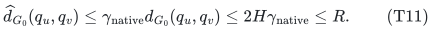

Its witness is a concatenation of native nearest-pivot legs and one
terminal strict-ball, base, or untouched-component exact path. The
appropriate cumulative port scale divides each native leg length.
All contributions are nonnegative. Each constituent's root-flat
path therefore has length at most the total estimate in (T11).

The two endpoints of every constituent are marked:

* every visited pivot-chain vertex is in the corresponding `S_i`;
  its nearest-pivot leg has both endpoints marked in the lifted `N_i`;
* the terminal exact source belongs to `S_i`, and every native node
  of its relevant local tree is marked, including the target.

An untouched-component termination is covered by the explicit local
exact family; no missing child pivot handle is required. Disconnected
pairs are irrelevant to (T11), since `uv` itself is living.

In a forest, the path between two marked vertices lies in their
minimal marked subtree and is a concatenation of whole compressed
edges. Each compressed edge on this path has nonnegative length at
most the entire path length, hence at most `R`. Every one is exposed
by Section 4. Consequently `H_out` contains every original physical
edge in the projected constituent paths.

The constituent root paths have compatible physical endpoints even
when their forest copies use distinct auxiliary handles. Concatenate
their physical projections, delete null/connector steps, and obtain
a `u`-to-`v` walk in `H_out`. Its original length is at most
`R/H`, or at most `Gamma` by using the unrounded bound (T11).
Loop erasure cannot increase this length. Replacing each edge on an
original shortest path proves that `H_out` is a `Gamma`-spanner.

This proof does not require maintaining the actual query answer for
every input edge. It is an existence argument using all marked short
compressed paths, and it works for every current original edge at
the same time.

## 6. Size, actual work, and ordinary recourse

A forest with `q` marks has `O(q)` compressed vertices and edges,
summed over its marked components. Components with no marks contribute
nothing; a component with one mark contributes an isolated vertex.
By (T8), the number of candidate compressed paths is at most
`n k^{O(1)} poly(U)`. Every exposed path contributes at most `R`
physical occurrences before deduplication. Hence

<!-- math-display: 0cebdf608190ec12f2bc9c8a
|E(H_{\rm out})|
                      \le n k^{O(1)}R\mathrm{poly}(U).
                                                               \tag{T12}
-->
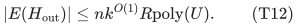

This is where the number `n` rather than the root native port count
enters. Long compressed paths and full unused forest branches are not
expanded into the output. They remain working records whose actual
maintenance was paid in (T4).

Initialize the compression by a linear scan of each actual allocated
flat forest, followed by enumeration of its short compressed paths.
The flat inventory has its already charged `exp O(B)` allowance.
Thereafter each flat-forest or mark operation changes constantly many
compressed records. Updating a short record costs
`(R+1) poly(U)` for cached retirement and current physical enumeration;
updating a long record uses only polynomial-logarithmic structural
work. A change of length has the same bound. Equations (T4) and (T9)
therefore give total work

<!-- math-display: 97b05a6e2cc3f4cd3c27cecf
(n+m_0+I+D)\exp O(B+\log R).               \tag{T13}
-->
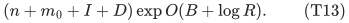

The same expression safely bounds total output recourse, since every
actual edge insertion/deletion in the output is charged to a reference
operation already paid in that work. An initial published output has
only the `n`-based size (T12), but the provider's initial selected
credit may cause forest changes later. Without another amortization
argument, `m_0` must not be removed from the safe total recourse bound.
For an initially empty graph it becomes `(n+I+D) exp O(B+log R)`.

When an entire numerical or forest period is replaced, retire its old
marked handles and cached short records through their old metadata,
then initialize the new actual inventory. Old and new private objects
can be processed sequentially before publication. This replacement is
part of the actual forest/mark transcript; it is not an uncharged
global sweep of every original vertex after each input update.

All labels are exact root-native integer path lengths or zero.
Dynamic-tree path sums use polynomially many bits in `U`, as do all
hierarchy length labels. `R` may be rounded upward to a concrete
integer or power-of-two bound; constants in the approximation absorb
that rounding. Only a physical original-edge occurrence of positive
length contributes to a path cache. Thus no zero-length chain or large
numerical original edge weight creates an uncharged enumeration.

The root degree adapter emits polynomially many elementary changes
per original update. The total generated hierarchy inventory and
transcript are the actual input history times a subpolynomial factor.
A fixed polynomial increase of the master cap covers them; it changes
`U` only by a constant factor. No absent local instance is padded to
the global cap.

## 7. Explicit parameter points

For the family (T2), `log R=O(t^4h+h)` and
`log k=Theta(U/t)`. Both size and work in (T12)--(T13) have
logarithmic overhead

<!-- math-display: 3ebef626217aacb6dda9ac1a
Z=O(U/t+t^4h),                    \tag{T14}
-->
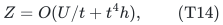

while the logarithmic stretch is `O(t^4h)`. Taking

<!-- math-display: 11164cd6b545c44ee55b655d
t=\Theta((U/h)^{1/5})         \tag{T15}
-->
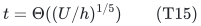

gives `Z=O(U^{4/5}h^{1/5})` and proves (T1).
The source shrink guard has slack: `x=Theta(t^4h)` dominates
`log P=O(t^3h)` for these choices. Its local construction and positive
port parameters are exactly within the previously audited normalized
APSP range. The observer adds only fixed powers of `k`, so it does
not require a deeper or differently parameterized numerical hierarchy.

There is also a finer-stretch point. Put

<!-- math-display: 2d34f2ad0e6085621cbe85e3
A_0=U^{5/7}h^{2/7},\qquad
                  t=\Theta((U/h)^{5/28}).
-->
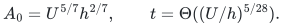

Then logarithmic stretch is `O(A_0)`, and logarithmic time and
output-density overhead are

<!-- math-display: 54bb72f43e8212d66ce93e32
O(U^{23/28}h^{5/28}).          \tag{T16}
-->
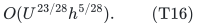

The permitted density is larger than just `n exp O(A_0)`: tracking
all local tree vertices pays `k^{O(1)}`, whose logarithm is
`Theta(U/t)`. That factor must not be hidden when comparing this
direct construction with the deletion-bounded or low-recourse spanner.

## 8. Scope and comparisons

The five-sixths construction has the stronger total recourse bound
`(n+D) exp O(U^{5/6}h^{1/6})`. The present direct construction may
change output edges after an insertion, and claims only the ordinary
total recourse in (T1). It offers a lower balanced time/stretch/density
exponent, with a different recourse contract.

For a fair provider comparison, the same elementary tracked-terminal
and short-compression observer can be applied to the reconstructed
public APSP hierarchy, using its original full-forest copy lift and
the positive inter-level adapters. Its local ball/base families have
the same `k^{O(1)}` occurrence bound. The work recurrence substitutes
the public local repair factor and retains the initial child credit,
giving

<!-- math-display: bee367f074b7ca8e719eccc9
B_{\rm pub}=O(U/t+t^6h),\qquad
                  A_{\rm pub}=O(t^5h).                 \tag{T17}
-->
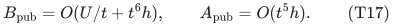

The original KMG arbitrary-forest copy construction supplies a handle
for every input forest-node occurrence, including auxiliary nodes;
its contraction proof preserves their paths. The argument does not
need all those occurrences to be distinct designated original
terminals. Copies and degree-reset aliases are fully counted in the
`P`-per-level lift bound. This comparison does not use the new
uncontracted colored-pool construction to improve public work.

The inter-level port conversion uses an explicitly named **plain-copy
zero-link extension of public Algorithm 5**. Assign every incoming
forest-node occurrence its own `T_v` copy, even when several current
port aliases project to the same native root `v`. A real incoming
edge uses the original physical endpoint attachments. A port connector
or immediate true-null edge becomes a zero-length link between the
two assigned roots. Contracting all assigned trees recovers the
incoming forest exactly, so the result is a forest with the required
path domination. A child edge log changes only `O(1)` connecting
records; a native stable-forest edit is the separate charge of
`P(G+1)` copied records. Releasing an incoming owner promptly frees
its assignment slot and observer mark, even if the unused physical
pool remains allocated. Historical retired aliases are not counted
as new current owners. This is an elementary common observer adapter
spelled out in the present reconstruction, not a claim that the printed
Lemma 3.21 already states the expanded typed-null contract.
The focused completed check is
[tracked terminal spanner public flat comparator audit](../../manuscripts/graph-backends/tracked-terminal-spanner-public-flat-comparator-audit.md).

The public observer's safe overhead is `O(B_pub+A_pub+x)`, which
is minimized at `t=Theta((U/h)^{1/7})`. It yields logarithmic
time and output-density overhead `O(U^{6/7}h^{1/7})`, at
logarithmic stretch `O(A_0)`. At that same stretch scale, (T16)
has the smaller `23/28` time and density envelope. At the looser
balanced four-fifths stretch cap, the public six-sevenths point
also qualifies, although its actual stretch guarantee is finer.
These are derived compositions with the same observer, not printed
spanner theorems or a claim of an optimized public frontier.

The elementary alternative `H_out=G` is already superior whenever
the entire living graph fits the allowed output-size cap. The new
construction is significant in denser regimes, for example a graph
that may contain `n^{1+epsilon}` edges for fixed `epsilon>0`, while
the output is constrained to `n exp O(U^{4/5}h^{1/5})`. The current
primary-source baseline checks are in
[dynamic spanner public baseline audit](../../manuscripts/graph-backends/dynamic-spanner-public-baseline-audit.md); exact stretch, density,
randomness, and update model must remain visible in comparisons.

Positive polynomial-range weighted graphs follow by independent
unweighted dyadic length classes, adding polynomial logarithmic
factors and a factor two in stretch. Clipped root caps and caches
refer to each unweighted class, not to the numerical magnitude of
its original edge weights.

Nonnegative integer lengths use one additional **unweighted zero-edge
class**. Its published edges retain original zero lengths, so it
preserves the current zero-cost connected components by actual paths.
Zero-edge deletions are processed before publication. Summing its work
and recourse with the positive dyadic classes changes only polynomial
logarithmic factors. The full argument is in
[Zero-length edge adapters, Section 3](../../manuscripts/graph-backends/nonnegative-integer-distance-adapters.md).

## 9. Proof dependencies and review scope

The numerical hierarchy, normalized static provider, local source
families and arbitrary-forest lift are the constructed local inputs
identified in Section 1 and the [source map](sources.md).
The new ingredients assembled here are the original-terminal trace
observer, its root mark inventory, and the short compressed-path
union. The local compression proof is separately written in
[dynamic marked forest short path union](../../manuscripts/graph-backends/dynamic-marked-forest-short-path-union.md).

The local tracking and compression arguments specify what the provider
must expose: stable canonical handles, source-tree lifetimes, typed
nulls, physical-edge maps, and a chronological update transcript with
initial credit. A distance-only approximation oracle supplies none of
these obligations automatically; the explicit family and metric-lift
proofs in Section 1 supply them. The separate public-provider
comparison is in the focused audit named above. The linked notes record
internal mathematical reviews only. No end-to-end implementation, formal verification
or performance measurement is claimed. The four-fifths construction
does not establish insertion-independent recourse or an exact matching
bound.

---

## Part II. A deletion-sensitive recourse theorem

### A fully dynamic spanner with explicit five-sixths overhead

**Full-horizon construction.** This part proves the generic batching
and lifetime accounting, then instantiates its single-instance contract
with the constructed hierarchy and clipped-reporting routine.

This note supplies the full update horizon for the clipped-walk spanner
transfer. It reconstructs the batching argument in the published version
of Kyng--Meierhans--Zoecklein (KMZ),
[ICALP 2025, Section 5](https://drops.dagstuhl.de/storage/00lipics/lipics-vol334-icalp2025/html/LIPIcs.ICALP.2025.111/LIPIcs.ICALP.2025.111.html),
with nested integer clocks, initialization, and actual edge lifetimes
made explicit. It then substitutes the numerical hierarchy audited in
[clipped-walk-queries-and-dynamic-spanner.md](../../manuscripts/graph-backends/clipped-walk-queries-and-dynamic-spanner.md).

The conclusion is deterministic maintenance of a spanner of
an arbitrary-degree undirected graph, with

<!-- math-display: 733f2863d40ae1277d777c6c
\begin{array}{ll}
 \text{stretch}&\exp O(U^{5/6}h^{1/6}),\\
 \text{current number of edges}&n\exp O(U^{5/6}h^{1/6}),\\
 \text{total initialization/update work}
     &(n+m_0+I+D)\exp O(U^{5/6}h^{1/6}),\\
 \text{total output recourse}
     &(n+D)\exp O(U^{5/6}h^{1/6}).
 \end{array}                                                \tag{F1}
-->
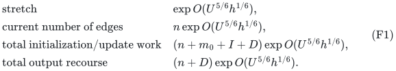

Here `m_0` is the actual initial number of edges, `I,D` count subsequent
insertions and deletions, `N` is a declared polynomial history cap,
`U=log(N+4)`, and `h=log(U+4)`. The vertex set is fixed with size `n`.
Lengths are unweighted, or positive polynomial-range integers handled
by separate unweighted length classes. Nonnegative integer lengths
add the zero-edge class described in Part I, Section 8. Edge IDs distinguish physical
lifetimes and parallel edges. Self-loops are irrelevant and discarded.
All displayed guarantees hold after complete external updates; time
is amortized, not worst case.

The statement does not obtain arbitrary deletion sequences by rebuilding
a dense graph after every `n` deletions. Such a procedure could pay an
unacceptable `m_current D/n` term. The nested clocks below are essential.

## 1. The single-instance contract, without a deletion-horizon assumption

Fix one instance on `n` vertices, congestion cap `K >= 2`, and path
threshold `T=Gamma L`, where `L=2 ceil(log_2(n+4))`. Let
`R=ceil(T)`. The instance uses the algorithm and clipped reporting proof
in [clipped-walk-queries-and-dynamic-spanner.md](../../manuscripts/graph-backends/clipped-walk-queries-and-dynamic-spanner.md), Sections 1--6, but
now sets its saturation cap to the integer `K`.

Suppose this instance receives `F` insertions and `D_0` deletions before
it is retired. Initial edges are inserted into a fresh empty instance
and are included in `F`. No condition `D_0 <= F/K` is required for the
following accounting:

<!-- math-display: 48fff1b7884a399fac24410c
\begin{aligned}
 \#\text{assignments}&\le F+K D_0,\\
 \#\text{blocked edge lifetimes}&\le R(F+K D_0)/K,\\
 |H|&\le c\bigl(n+(R/K)F+R D_0\bigr),\\
 \#\text{insertions into }H
    &\le c\bigl(n+(R/K)F+R D_0\bigr).
 \end{aligned}                                             \tag{F2}
-->
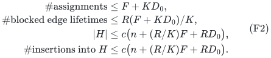

The last line follows because an edge leaves this instance's `H` only
on a genuine input deletion. Increase the absolute constant `c` to
include those `D_0` deletions. The eligible graph has girth greater
than `L` and therefore `O(n)` edges throughout.

With numerical update factor `alpha=exp O(B)`, numerical query cost
`poly(U)`, and clipped report cost `R poly(U)`, its full work is at most

<!-- math-display: e0ca1c9eb87af0b6fd244e53
\mathrm{poly}(U)\left[
   R(F+K D_0)
   +\alpha\bigl(n+(R/K)F+R D_0\bigr)\right].           \tag{F3}
-->
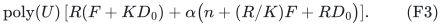

This includes initialization of `n` vertex handles, creation and
retirement of routes and inverse lists, all eligible-graph updates,
and destruction of the instance's actual records. Every stored route
incidence is created and retired at most once. It does not charge a
numerical oracle update for every edge of the instance's dense input.
That input is accessed through numerical queries; only the sparse
eligible graph is the oracle's dynamic graph.

For a public clipped implementation with an additional reporting factor
`Q_path=exp O(dh)`, replace the first term of (F3) by
`Q_path R(F+K D_0)`. It changes the final logarithmic work by `O(dh)`,
not the numerical threshold or the output stretch.

## 2. Capacity and exact rebuild clocks

Let `M >= n` be a known bound on the maximum number of simultaneously
living input edges, also covering the initial graph. It is distinct
from cumulative insertions. For a simple graph one may take
`M=max(n,n(n-1)/2)`; for a multigraph use a declared current-edge cap.
It suffices that `M <= N^{O(1)}`. No `M`-edge padding is allocated.

Choose a power-of-two integer `K >= 2` and define

<!-- math-display: a31611957d04600a30c38f20
s=\max\{1,\lceil\log_K(M/n)\rceil\},\qquad
 M'=nK^s,\qquad t_i=M'/K^i\quad(1\le i\le s).          \tag{F4}
-->
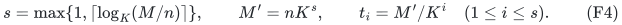

Then `M' >= M`, `M' <= K max(M,n)`, each clock is an integer,
`t_{i-1}=K t_i`, and the final clock is exactly `t_s=n`.
`M'` is a clock bound only; its unused portion is never materialized.

Maintain `H_0=G`, and let layer `i` maintain a spanner `H_i` of
`H_{i-1}` using Section 1. Every ordinary change in `H_{i-1}` is
forwarded to layer `i`. Count **original external deletions only**
in a global integer clock. Whenever that count becomes a multiple of
`t_i`, retire layers `i,...,s`, then rebuild them from the settled
current `H_{i-1}`. Use the smallest such index `i`; the other required
rebuilds are already included. Initialize each replacement instance
empty, then seed it with actual current parent edges.

After a triggering original update, one may first finish ordinary
forwarding and then perform this replacement. Intermediate forests
and spanners are private; publish only the final settled `H_s`.
Retired descendant structures are destroyed without forwarding their
artificial deletions as ordinary input deletions to new instances.
Their actual destruction and replacement work is counted below.

The clocks are nested. Consequently a parent's replacement is always
on a child's replacement boundary. During the lifetime of any one
layer-`i` instance, its parent does not undergo an internal replacement.
Inside that interval parent edges disappear only when the corresponding
physical input edge is externally deleted. Thus layer `i` sees at most
`t_i` genuine input deletions in one lifetime and at most `D` over all
its lifetimes. This remains true when a deletion fails to appear in a
particular parent spanner; it then causes no deletion there.

## 3. Current-size induction

Choose a sufficiently large absolute constant `c_0` and put

<!-- math-display: 9c7609d5fdca33008ebde728
V_i=(c_0R)^i M'/K^i.                \tag{F5}
-->
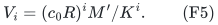

We claim `|H_i| <= V_i` after every settled operation in a layer
lifetime. The base holds because `|G| <= M <= M'`.

Within one layer-`i` lifetime, include its initial seeding in its input
insertion count `F_i^{life}`. Its parent has current size at most
`V_{i-1}`, and within that interval removes edges only on the at most
`t_i` original deletions. The identity
`initial edges + new insertions = final edges + deletions`
therefore gives, for every chronological prefix,

<!-- math-display: 18844061a09ff91649de1bda
F_i^{life}\le V_{i-1}+t_i.        \tag{F6}
-->
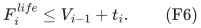

Use (F2), `D_i^{life} <= t_i`, and `n <= M'/K^i` for `i <= s`.
It gives

<!-- math-display: 00da621f8fe35cbc2039026a
|H_i|\le c\left[n+(R/K)V_{i-1}+(R/K)t_i+Rt_i\right]
       \le(c_0R)^i M'/K^i
-->
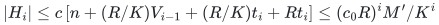

when `c_0` is large enough. The argument applies during initialization
as well: inserting a prefix of the actual seed cannot exceed the same
count. At the final layer,

<!-- math-display: d73996c55dd68cafc0d2f9aa
|H_s|\le n(c_0R)^s.           \tag{F7}
-->
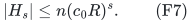

No induction assumes that the number of ordinary insertions is bounded
by a constant times the number of deletions. Arbitrarily many successive
insertions are permitted, subject to the living-edge cap `M`.

## 4. Total initialization, rebuilding, and update work

Write `I_*=m_0+I`. Let `F_i` count all input insertions processed by
all layer-`i` instances, including seeding after every replacement.
Let `O_i` count all insertions into their output spanners, including
outputs constructed privately during initialization. Layer `i` has
exactly `1+floor(D/t_i)` instances. Since `t_i >= n`,

<!-- math-display: e5b8c0a7d094f46667fe074e
n\bigl(1+\lfloor D/t_i\rfloor\bigr)\le n+D.           \tag{F8}
-->
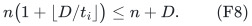

Apply the last line of (F2) to each of these instances and sum. Genuine
deletions total at most `D`, as proved in Section 2. This gives

<!-- math-display: a436945432c200c47d1c04d2
O_i\le c\left[n+D+(R/K)F_i+R D\right]. \tag{F9}
-->
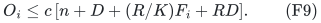

Layer 1 receives the original updates and is additionally seeded from
`G` when its clock fires. Thus

<!-- math-display: 0855a25f7630014fd26eea63
F_1\le I_*+(D/t_1)M\le I_*+DK.      \tag{F10}
-->
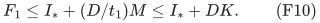

For a subsequent layer, ordinary insertions from its parent are
included in `O_i`. The first initialization can also be charged to
the parent's corresponding initial output insertions. Each later
replacement of the child seeds at most `V_i` edges. Hence the safe
bound, allowing harmless double charges at coincident replacements, is

<!-- math-display: 33181d3edfb0968741b8179c
\begin{aligned}
 F_{i+1}&\le O_i+(D/t_{i+1})V_i\\
        &\le O_i+DK(c_0R)^i.
\end{aligned}
\tag{F11}
-->
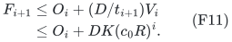

No `+1` times the potentially dense capacity `M` is introduced in
(F10) or (F11). The first input is its actual `m_0` edges; an empty
initial graph seeds no edges. Every later capacity-sized seeding is
charged to a completed interval of genuine original deletions.

Choose a sufficiently large absolute `c_1`. Induction using
(F9)--(F11) proves

<!-- math-display: 2f36193ed706cee5c190f461
F_i\le(c_1R)^i(I_*+n+DK).             \tag{F12}
-->
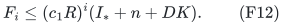

For example, the coefficient `(cR/K)` in (F9) is at most `cR`, and
both `c_0R` and this coefficient are dominated by a sufficiently
smaller fixed fraction of `c_1R`. The remaining `O(R(n+D))` is
paid by the initial `I_*+n+DK` allowance. Summing over layers loses
only another fixed power of `(c_1R)^s`.

Equations (F3), (F8), and (F12) now imply

<!-- math-display: 316fee4e2e0384803907de4c
\begin{split}
 T_{\rm total}
   &\le (I_*+n+DK)(c_2R)^{c_2s}
             (\alpha+Q_{\rm path})\mathrm{poly}(U)\\
   &\le (n+m_0+I+D)K(c_2R)^{c_2s}
             (\alpha+Q_{\rm path})\mathrm{poly}(U).
 \end{split}                                             \tag{F13}
-->
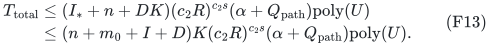

The constant `c_2` is absolute. In the new positive native hierarchy,
`Q_path=poly(U)`; in the public positive-port implementation it is
`exp O(dh)`. All `n`-vertex oracle initializations and their retirements
are included in (F8). All actual route-list retirement is included in
(F3). The clocks are numbers, not instructions to initialize artificial
edges up to their caps.

An inner numerical oracle is run only on the eligible subgraph of its
one spanner instance. It always has `O(n)` active edges. Instance input
edges that are not in that eligible graph incur numerical queries and
stored routes, not an insertion into the inner oracle. This is why
(F13) does not contain the current dense edge capacity multiplied by
every ordinary numerical update factor.

## 5. Output stretch and recourse

At every settled state, `H_i` is a subgraph and an `R`-spanner of
`H_{i-1}`. The hierarchy therefore gives stretch at most `R^s`.
Equation (F7) bounds the final size by `n(c_0R)^s`.

The last layer is replaced after every `n` original deletions.
Between successive replacements, its output loses edges only on those
at most `n` physical deletions. Its ordinary insertions are at most
its maximum size plus those deletions. At a replacement the change
between the old and new published edge sets is at most the sum of
their sizes. Repeated physical edge IDs need not actually change,
but charging both is safe. Consequently

<!-- math-display: 259643e474666f6df146fec8
\mathrm{recourse}(H_s)
        \le (n+D)(c_3R)^s.                              \tag{F14}
-->
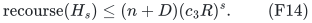

Physical graph edges retain their IDs through all layers. A copy of
an eligible edge in an inner degree adapter is not an additional
output edge of `H_s`. Different parallel physical edges may be
selected, but the eligible graph contains no parallel pair forming a
short cycle, so the girth and sparsity proof remains valid. No output
edge other than a current input edge is introduced.

For weighted inputs, maintain this complete hierarchy separately in
each dyadic length class. The final union has twice the unweighted
stretch and a polynomial-logarithmic factor in the other quantities.
Clipping occurs in each unweighted class graph. It never enumerates
`Gamma` times the numerical value of a large original edge weight.
An additional unweighted instance for zero-length edges preserves
their current connected components by zero-cost output paths. Its
local deletion count is included in <code class="math">D</code>; summing (F14) over all
classes gives <code class="math">(O(n\log N)+D)\exp O(U^{5/6}h^{1/6})</code>.

## 6. Quantitative substitution

Put `z=log K`. Since `log(M/n)=O(U)`, (F4) gives
`s=O(1+U/z)`. Let `A=log Gamma`, so `log R=O(A+h)`.
Equations (F7), (F13), and (F14) give the separate logarithmic bounds

<!-- math-display: 6c9e7a253cf56c02d964bc91
\begin{aligned}
 Z_{\rm time}&=O\left(B+z+(1+U/z)(A+h)+h\right),\\
 Z_{\rm stretch}, Z_{\rm size}, Z_{\rm recourse}
      &=O\left((1+U/z)(A+h)\right).
 \end{aligned}                                           \tag{F15}
-->
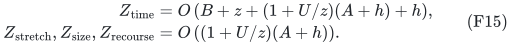

The public reporting factor `O(dh)` is added to the first line if
needed; it is smaller than the displayed terms at the comparisons
below. The literal threshold still uses the actual `Gamma`.

For the main new conclusion it is enough to use the conservative,
already audited no-reset hierarchy from
[decremental strong forest proof](../decremental-strong-forest/proof.md). With
`p=r=d=Theta(t)`, local repair depth `K_repair=Theta(t^2)`, and
`x=Theta(U/t)`, it has

<!-- math-display: f1b0931f141c04ad43fb3b2c
B=O(U/t+t^5h),\qquad A=O(t^4h).       \tag{F16}
-->
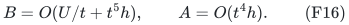

The `t^5 h` term is the old `K_repair^2 g` repair work. Thus the
main five-sixths conclusion does **not** require strengthening the
repair recurrence to its normalized `K_repair g` version. That
version would only lower a non-dominating term here.

Choose

<!-- math-display: 4295e831772dd1b8731a029e
t=\Theta((U/h)^{1/6}),\qquad
 z=\Theta(U/t),\qquad K=2^{\lceil z\rceil}.             \tag{F17}
-->
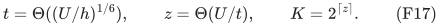

Then `U=Theta(t^6h)`, `B=O(t^5h)`, `A=O(t^4h)`, and
`s=O(t)`. Therefore every bound in (F15) is at most

<!-- math-display: 83b8c2eafe1abeb719b64379
O(t^5h)=O(U^{5/6}h^{1/6}).     \tag{F18}
-->
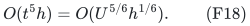

The hierarchy's inner shrink guard has slack: `x=Theta(t^5h)`
dominates `log P=O(t^4h)` and all `O(dh)` degree charges. The
outer cap `K` eventually exceeds every needed fixed multiple of `R`.
All finitely many small values are handled directly. The represented
integers and clocks have polynomial bit length in `U`.

The total encoded history and intermediate inventories are at most
the input history times `exp O(U^{5/6}h^{1/6})`. A fixed polynomial
increase of the declared history cap covers these records and the
positive root degree adapters. It changes `U` by only a fixed constant
factor. This is a bound on actual records, not padded instances.

Equations (F13), (F14), and (F18) prove conclusion (F1) after substituting
the constructed provider and clipped-reporting routine. The batching
lemma applies to any provider satisfying its generic contract; the
local hierarchy supplies the displayed five-sixths instantiation.
Actual seeding, retirement and output changes are included.

## 7. Public comparison at the same output guarantees

The jointly reconstructed public APSP provider has the family

<!-- math-display: 5650b88d63188b0561448826
B_{\rm pub}=O(U/t+t^6h),\qquad
             A_{\rm pub}=O(t^5h),                      \tag{F19}
-->
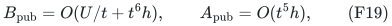

proved in [public-apsp-joint-retuning-audit.md](../../manuscripts/graph-backends/public-apsp-joint-retuning-audit.md) and independently
audited there. The positive-port clipped-report lemma from Section 8
of the companion note supplies its missing application-level accounting:
the reporting factor is `exp O(dh)`, which is smaller than the terms
in (F19). Thus this public hierarchy can be used in the same batching
proof. It is not excluded merely because its first theorem was stated
for numerical queries.

Taking `t=Theta((U/h)^{1/7})` and `z=Theta(U/t)` gives a fully
dynamic public composite whose time, stretch, density, and recourse
overheads all have logarithm `O(U^{6/7}h^{1/7})`. This is a derived
composition from public ingredients, not a printed six-sevenths
spanner theorem.

There is a more precise matched comparison. Require the common output
stretch, size overhead, and recourse overhead to have logarithm

<!-- math-display: 0e45b3dbf901b3fa996c519a
S_0=U^{5/6}h^{1/6}.
-->
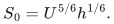

In the public family choose

<!-- math-display: dd36576d94b8001637c40457
t_{\rm pub}=\Theta((U/h)^{5/36}),\qquad
 z_{\rm pub}=\Theta(U/t_{\rm pub}).
-->
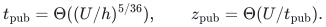

Then `s=O(t_pub)`, its output logarithmic stretch is `O(t_pub^6 h)
= O(S_0)`, and its logarithmic work is

<!-- math-display: 0db2f977413c4455487b07d8
O(U/t_{\rm pub}+t_{\rm pub}^6h)
                     =O(U^{31/36}h^{5/36}).             \tag{F20}
-->
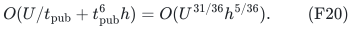

| Construction | Logarithmic time overhead | Common logarithmic stretch, density and recourse overhead |
|---|---|---|
| Reconstructed public APSP plus public batching | `O(U^(31/36) h^(5/36))` | `O(U^(5/6) h^(1/6))` |
| Research provider plus positive witnesses and the same batching proof | `O(U^(5/6) h^(1/6))` | `O(U^(5/6) h^(1/6))` |

Both rows support arbitrary edge insertions and deletions throughout
the same polynomial history, the same fixed vertex set, physical edge
IDs, and arbitrary input degrees. Their work is amortized. Choosing
fixed constants against a sufficiently large common allowed stretch
envelope makes the comparison on that scale; hidden stretch constants
are not claimed numerically equal without this adjustment.

There is also an elementary baseline that must not be omitted. If the
entire living-edge cap already satisfies `M <= n exp O(S_0)`, keeping
`H=G` gives stretch one, constant work per input edit, and recourse
`m_0+I+D <= M+2D`. It already meets the permitted output density and
recourse scale. A new maintenance theorem at that density is useful
on inputs whose living graph can be denser. In particular, for
`M=n^{1+epsilon}` with fixed `epsilon>0`, the target
`n exp O(U^{5/6}h^{1/6})` is asymptotically smaller than `M` under
the standard polynomial-history convention. That is a substantive
dense-graph regime of the comparison. No improvement over `H=G`
is claimed in its valid sparse regime.

The primitive five-sixths exponent is not itself a new exact matching
exponent. The new application here is a dynamic sparse subgraph with
explicit multiplicative distance stretch and low output recourse.
The new proof contribution is the quantitative witness/batching
composition. The batching operations themselves are public KMZ ideas.

## 8. What nonuniform tuning can and cannot change in this accounting

These calculations optimize specified positive-charge formulas. They
are not algorithmic lower bounds and do not prove that an upper-bound
term must be incurred by every implementation.

For these worst-case parameter comparisons take `N=n^{Theta(1)}`,
so the oracle's root logarithm is comparable to `U`, and consider
polynomially dense allowed inputs. This qualification is needed:
a small actual graph or a loose much larger history cap does not
force `Omega(U)` useful density reduction.

For the public hierarchy, Section 6 of
[same-stretch-apsp-comparison-and-root-audit.md](../../manuscripts/graph-backends/same-stretch-apsp-comparison-and-root-audit.md) proves, even with
nonuniform inner parameters while local log-size remains comparable
to `U`, that a work budget `B` dominates charges satisfying

<!-- math-display: 0adc00f69a51bc7229df5d56
B^7\gtrsim U^6h,\qquad
              A_{\rm charge}\gtrsim U^5h/B^5.           \tag{F21}
-->
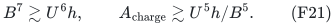

In an outer reconstruction with logarithmic density reduction `z`,
the number of layers is `Omega(U/z)` on a worst-case polynomially
dense input. With a time budget `Z` paying both `B` and `z`, and a
claimed logarithmic output metric budget `S`, the charged formula
therefore requires

<!-- math-display: b70e38180ec0335b79fb3e86
S\gtrsim U^6h/Z^6,
 \qquad
 Z\gtrsim\max\{U^{6/7}h^{1/7},\ U(h/S)^{1/6}\}.        \tag{F22}
-->
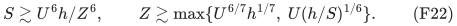

For `S=S_0`, the second term gives precisely `U^(31/36)h^(5/36)`.
The balanced choice `S=Z` gives `Z^7 >= Omega(U^6h)`.

The same comparison survives varying the outer parameters between
layers, within the same accounting. Suppose the successive logarithmic
density reductions are `z_i`, each charged at most `Z`, and they
sum to `Omega(U)` before reaching near-linear size. Then there are
`j=Omega(U/Z)` layers. Each uses an `n`-vertex oracle with the
comparable root logarithm `U` on such a worst-case instance, and its
inner work is at most `Z`. Equation (F21) gives
`A_i >= Omega(U^5 h/Z^5)` for every one. Summing the metric charges
again gives `S >= Omega(U^6h/Z^6)`. Small final levels or a sublinear
`o(U)` saving in the target density do not remove the initial
`Omega(U)` total reduction obligation.

For the research provider, the corresponding inner metric charge from
[nonuniform-parameter-budget-frontiers.md](../../manuscripts/graph-backends/nonuniform-parameter-budget-frontiers.md) is

<!-- math-display: 475fd9085746889ff86356fb
A_i\gtrsim U^4h/B_i^4.         \tag{F23}
-->
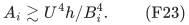

The same outer argument yields `S >= Omega(U^5h/Z^5)`.
The displayed work formula also pays the cumulative metric charge,
so balancing all overheads requires `Z^6 >= Omega(U^5h)`. This
reproduces the five-sixths point within the chosen composition,
including nonuniform clocks and inner parameter choices. It does not
rule out a different maintenance rule that avoids the cumulative
metric cost, a different provider, or an application-specific path
selection argument.

The uniform families already certify the sufficient curves

<!-- math-display: 74d45264cb13f9746107b187
\begin{aligned}
 Z_{\rm new}(S)&=O\left(
       \max\{U^{5/6}h^{1/6},\ U(h/S)^{1/5}\}\right),\\
 Z_{\rm pub}(S)&=O\left(
       \max\{U^{6/7}h^{1/7},\ U(h/S)^{1/6}\}\right),
 \end{aligned}                                           \tag{F24}
-->
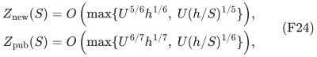

for `h << S = o(U)`, in the parameter range where the respective
source shrink and uniformity guards hold. If a larger `S` is allowed,
one may keep the smaller balanced output stretch; the formulas do
not force using all of the allowed stretch budget.

## 9. Source and status boundary

The primary batching source is the **published** ICALP 2025 paper,
Section 5 and Theorem 18. Its earlier arXiv v1 does not contain this
extension. Sections 1--5 above are a direct counted reconstruction,
so no unexamined indexing convention in a rebuild sentence is needed.
The single-instance counting specializes its Corollary 10 and Lemma 11.

[dynamic-spanner-public-baseline-audit.md](../../manuscripts/graph-backends/dynamic-spanner-public-baseline-audit.md) separately checks newer
primary results, including the parameter domain of Chuzhoy--Parter
and the randomized status of the MGS/BvdBPG+ route. Those checks must
remain attached to any final novelty summary. This note establishes
a comparison with the explicitly reconstructed public composition;
it does not claim to have optimized every public spanner framework.

The normalized native hierarchy, positive internal lengths, finite-bit
operations and small-component cases are supplied by the local
constructions named in [the source map](sources.md). Sections 1–6
combine them with clipped reporting and batching, including
initialization and output recourse. The resulting theorem is ready
for review. No complete executable dynamic provider or spanner is
supplied here.

---

**Attribution:** icekylinx and GPT-6 Astra Pro.

The proofs use their named external interfaces. Finite checks are separate from proof-assistant verification.
