# Exact single-failure preservers

Sparse original-element restrictions and output-sensitive reporting for exact weighted matroid intersection and rooted arborescences.

The [ordinary reference backend](reference/README.md) initializes the optimum
for two ordinary independence-oracle matroids, builds the compressed exchange
reporter and returns exact fixed-rank single-deletion answers. It also
initializes the rooted arborescence HLD backend. Its polynomial preprocessing
is separate from the manuscript's faster graph implementation; the valuated
extension remains outside this software scope.

[Proof](proof.md) · [Sources](sources.md)

**Guarantee**

Preserve a minimum-cost prescribed-rank solution after every deletion of one original element, and the no-failure optimum; report infeasibility when that rank becomes unavailable.

**Objective and output**

An exact common basis, a rooted spanning arborescence, or an infeasibility answer. Reporting makes no independence or valuation calls.

**Randomness**

Deterministic preprocessing and reporting in the stated oracle model, including the valuated and arborescence variants. Randomness is not required by the distance-preserver reporting construction.

**Time**

Deterministic polynomial preprocessing. Beyond a baseline common optimum, the independence/value-test bound is:

<!-- math-display: 719e7435107ff08c8699684d
O(Nk)
-->
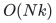

The additional arithmetic-work bound is:

<!-- math-display: 05b182418d78dd4dd1c505cb
O(Nk^2+k^3)
-->
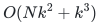

Arborescence arithmetic preprocessing takes:

<!-- math-display: b9d235996578dfc5ca86cac1
\widetilde O(mn)
-->
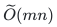

Query work is respectively:

<!-- math-display: e9540ae1ed1bf27fec33357b
O(k)
-->
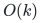

or, for arborescences:

<!-- math-display: 387008096a415eb2a5c95f1d
O(n)
-->
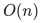

**Space**

<!-- math-display: 11c83083961424dd8796ecad
O(k^{3/2})
-->
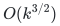
 retained original elements and reporting records;

<!-- math-display: 975ee40c8b70041b0eef8aa8
O(n^{3/2})
-->
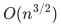
 for arborescences. Exact values are charged by their actual bit length.

**Parameters**

<code class="math">N</code> is original ground size; <code class="math">k</code> is prescribed common rank; <code class="math">n,m</code> are directed vertex and arc counts. All costs and valuations remain fixed between independent queries.

**Model and representation**

Ordinary matroids use independence oracles. Valuated matroids additionally require one supplied finite-valued basis per effective domain, or independence access obtaining it, as well as rational value evaluations. Graph costs are nonnegative rational numbers.

**Lower-bound scope**

Inherited directed-distance constructions give

<!-- math-display: 09cd561d4fdef2940d197a7e
\Omega(k^{4/3})
-->
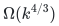
 for weighted two-matroid restrictions and

<!-- math-display: 2368a87d8a45a190a549c448
\Omega(n^{4/3})
-->
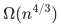
 for arborescences. Two failures require quadratic original support; approximation lower bounds allow the stated exponential cost aspect ratio.

**Review status**

**Ready for review in the stated scope.** The complete ordinary fixed-rank two-matroid single-element-deletion construction with signed rational costs: certified baseline initialization from original independence callbacks, compressed replacement-cycle value identity and minimum-hop literal update, deterministic distance/hub support and reporting, original-ID infeasibility answers and actual rational encoding costs. Also covers the automatically initialized nonnegative rooted-arborescence HLD realization and its prior supplied-baseline component.

**Dependencies and scope.** The canonical ordinary weighted-intersection primitive is a paid polynomial initializer; the reference computes and checks its baseline certificate and discards the ground-sized potential/cut before returning. The ordinary callback predicates must be valid matroid independence oracles. The generic reference uses conservative polynomial initialization and `O(Nk)` additional independence tests with `O(Nk^2+k^3)` post-initialization work. The graph wrapper retains the nonnegative graph model and does not implement the manuscript’s faster arborescence preprocessing. Final record/support and reporting bounds are separate from temporary workspace and actual rational/original-ID bit lengths. This scope does not cover the valuated implementation, rank-drop client or lower-bound transfers. Those retain their linked mathematical statements and dependencies. Finite exact checks and independent internal review are not proof-assistant verification or external peer review.

The [verification note](verify/README.md) identifies executable coverage. This status does not claim external peer review or proof-assistant verification.

**Source**

[Complete proof](proof.md) and [canonical manuscript map](sources.md).

## Results

**Minimum-cost common <code class="math">k</code>-set, two arbitrary matroids**

**Retained support / records.**

<!-- math-display: 11c83083961424dd8796ecad
O(k^{3/2})
-->

**Query output.**

<!-- math-display: e9540ae1ed1bf27fec33357b
O(k)
-->

**Additional scope.** Fixed linear costs; one element deletion

**Two fixed-rank valuated matroids**

**Retained support / records.**

<!-- math-display: 11c83083961424dd8796ecad
O(k^{3/2})
-->

**Query output.**

<!-- math-display: e9540ae1ed1bf27fec33357b
O(k)
-->

**Additional scope.** Effective-domain initialization is supplied; no smaller-rank valuation is inferred

**Rooted minimum-cost spanning arborescence**

**Retained support / records.**

<!-- math-display: 975ee40c8b70041b0eef8aa8
O(n^{3/2})
-->

**Query output.**

<!-- math-display: 387008096a415eb2a5c95f1d
O(n)
-->

**Additional scope.** Directed graph, one arc deletion;

<!-- math-display: b9d235996578dfc5ca86cac1
\widetilde O(mn)
-->

 preprocessing

**Minimum-cost maximum-cardinality common set**

**Retained support / records.**

<!-- math-display: 8f76e5fc3815261559ccdeb2
O(r^{3/2})
-->
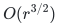

**Query output.**

<!-- math-display: 9653abd03124a149b1bfb543
O(r)
-->
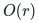

**Additional scope.** Union of the <code class="math">r</code> and <code class="math">r-1</code> constructions; ordinary linear costs

**Two-failure exact matching/arborescence obstruction**

**Retained support / records.**

<!-- math-display: d1c380c6224384cac00b8905
\Omega(r^2)
-->
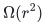
 /

<!-- math-display: 9f3d25ce6928a2832032ffff
\Omega(n^2)
-->
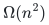

**Query output.** Lower bound

**Additional scope.** Retained original elements/arcs

**Two-failure approximate arborescence obstruction**

**Retained support / records.**

<!-- math-display: 9f3d25ce6928a2832032ffff
\Omega(n^2)
-->

**Query output.** Lower bound

**Additional scope.** Every fixed multiplicative factor; polynomial-bit costs with exponential aspect ratio

**Attribution:** Yilin Liu and GPT-6 Astra Pro.
