# Exact single-failure preservers and output-sensitive oracles for minimum-cost arborescences and two-matroid intersection

**Abstract.** We reduce exact one-element failure sensitivity for two matroids to directed pairwise distance preservation. The reduction gives sparse original-element preservers and output-sensitive reporting oracles. The common-base polytope and the distance-preserver theorem are classical ingredients; the exchange-cycle and reporting reductions are proved below. The failure model is deletion of one original element or arc.

## 1. Main statement

Let two matroids <code class="math">M_1,M_2</code> share a finite ground set <code class="math">E</code>, with a fixed rational cost function <code class="math">w:E\to\mathbb Q</code>. Suppose a common independent set of size <code class="math">k\ge1</code> exists. There is a deterministically constructible set

<!-- math-display: 5858fb0104f8ae6ed0fd7b22
S\subseteq E,\qquad |S|=O(k^{3/2}),
\tag{D1}
-->
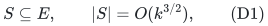

such that, after deletion of any one element <code class="math">f</code>, whenever a size-<code class="math">k</code> common independent set still exists, <code class="math">S\setminus\{f\}</code> contains one of minimum original cost. The no-failure optimum is also retained. Moreover, an associated **<code class="math">O(k^{3/2})</code>-record deterministic sensitivity oracle reports an optimum solution in <code class="math">O(k)</code> time**, or reports infeasibility, after any one deletion. It makes no independence-oracle calls at query time. Construction is polynomial with independence oracles. No linear representation, genericity assumption, or random isolation is needed.

In particular, a directed graph on <code class="math">n</code> vertices, a designated root, and arbitrary nonnegative rational arc costs admit an **exact single-edge-failure minimum-cost spanning-arborescence preserver with <code class="math">O(n^{3/2})</code> original arcs**, together with an **<code class="math">O(n^{3/2})</code>-record oracle reporting an optimal arborescence in <code class="math">O(n)</code> time**. Deterministic preprocessing takes <code class="math">\widetilde O(mn)</code> arithmetic operations. If a failure destroys all spanning arborescences, the oracle reports that fact. The query bound includes writing all <code class="math">n-1</code> output arcs.

Dey--Kavitha (May 2026), Theorem 1.1, construct <code class="math">O(n^{3/2})</code>-arc preservers with approximation factor two; their Section 5 explicitly asks whether sparse exact preservers exist. The reduction in Sections 2–6 gives an affirmative answer with the same size exponent and exact objective value. The reporting oracle additionally improves their <code class="math">O(n^{3/2})</code> query bound to <code class="math">O(n)</code>, while preprocessing is within logarithmic factors of their <code class="math">O(mn+n^2\log n)</code> bound.

Space counts records containing an original element ID, a pointer, or an exact cost; this is a word-space bound when those objects fit in words. Arithmetic-operation bounds treat comparisons and additions of exact costs as unit operations. For a bit-complexity statement, let <code class="math">\beta</code> bound the bit length of input costs and of every finite value returned by an independence/optimization oracle; the exact rational operations below then have polynomial bit complexity in the explicit input size and <code class="math">\beta</code>. No machine-word bound for arbitrary rational costs is intended. A no-failure query simply reports the stored baseline optimum.

## 2. A compressed exchange graph

Fix a minimum-cost size-<code class="math">k</code> common independent set <code class="math">B</code>. Equivalently, truncate both matroids to rank <code class="math">k</code>, so that <code class="math">B</code> is a common basis. All exchange tests below are unchanged by this truncation.

Construct a directed graph <code class="math">D</code> with vertex set <code class="math">B</code>. For each ordered pair <code class="math">a,b\in B</code>, including <code class="math">a=b</code>, consider the candidates

<!-- math-display: 0c28ebeaf32ebba13ac53433
X_{a,b}=\{e\in E\setminus B:
 B-a+e\in\mathcal I_1,
 B-b+e\in\mathcal I_2\}.
\tag{D2}
-->
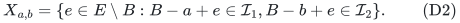

If this set is nonempty, choose a minimum-cost candidate <code class="math">e_{a,b}</code>, breaking ties arbitrarily but consistently, and include one arc <code class="math">a\to b</code> with label <code class="math">e_{a,b}</code> and length

<!-- math-display: 78cf6816fc9b53ef748e9101
\ell(a,b)=w(e_{a,b})-w(a).
\tag{D3}
-->
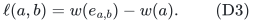

Thus <code class="math">D</code> has <code class="math">k</code> vertices and at most <code class="math">k^2</code> arcs. Lengths may be negative. A label can occur on several arcs; this causes no difficulty in the argument below.

For a simple directed cycle <code class="math">C</code> of <code class="math">D</code>, let <code class="math">m_C(e)</code> be the number of its arcs labeled by <code class="math">e</code>. Define a vector <code class="math">d_C\in\mathbb R^E</code> by

<!-- math-display: a9bf8b3945a1ff99fc368398
d_C(e)=m_C(e)\quad(e\notin B),\qquad
 d_C(a)=-\mathbf1[a\in V(C)]\quad(a\in B).
\tag{D4}
-->
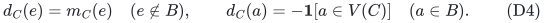

A loop is a simple cycle with one vertex. We have

<!-- math-display: c1a461771ded9dd3941baaaf
d_C(E)=0,\qquad w\cdot d_C=\ell(C).
\tag{D5}
-->
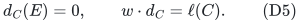

The multiplicities in (D4) are deliberate: a simple cycle in the compressed graph can repeat an outside-element label.

## 3. The tangent-direction lemma

Let <code class="math">P</code> be the common-base polytope of the two rank-<code class="math">k</code> truncations:

<!-- math-display: 8a2b6c4b48b89df0ce1c4d93
P=\{x\ge0:\ x(E)=k,\ x(A)\le r_i(A)
       \text{ for every }A\subseteq E,\ i=1,2\}.
\tag{D6}
-->
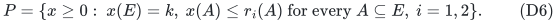

Here <code class="math">r_i</code> denotes the truncated rank function. The matroid-intersection polytope theorem says that <code class="math">P</code> is the convex hull of the indicators of size-<code class="math">k</code> common independent sets.

**Lemma.** For every simple directed cycle <code class="math">C</code> in <code class="math">D</code>,

<!-- math-display: aa2173fc8886c5d0bf4833b3
\mathbf1_B+\varepsilon d_C\in P
 \quad\text{when }\varepsilon=1/(k+1).
\tag{D7}
-->
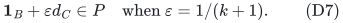

**Proof.** Write <code class="math">t=&#124;C&#124;\le k</code>. In the base polytope of the first rank-<code class="math">k</code> truncation, the desired point has the explicit convex decomposition

<!-- math-display: 419f5e028498152fc7f2db42
\mathbf1_B+\varepsilon d_C
   =(1-t\varepsilon)\mathbf1_B
     +\varepsilon\sum_{(a,b)\in E(C)}
          \mathbf1_{B-a+e_{a,b}}.
\tag{D8}
-->
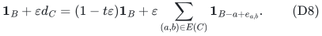

Every displayed exchanged set is a basis of the first matroid, by (D2). The coefficients are nonnegative and sum to one. For the second matroid, use the same formula with <code class="math">B-b+e_{a,b}</code> instead. Because the cycle's heads and tails are the same vertex multiset, the resulting vector is again exactly <code class="math">\mathbf1_B+\varepsilon d_C</code>. Thus this point lies in both base polytopes, hence in their intersection (D6). Repeated outside labels are counted by their multiplicities in these sums; they require no distinctness assumption. This proves the lemma.

Since <code class="math">B</code> minimizes the objective over <code class="math">P</code>, the lemma immediately implies

<!-- math-display: 9793da0b0f6bd38920b40ffa
\ell(C)\ge0
                 \quad\text{for every cycle }C.
\tag{D9}
-->
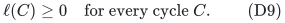

Thus the compressed graph has no negative directed cycle, despite possibly having negative arcs.

## 4. Exact replacement value equals a shortest-cycle value

For <code class="math">f\in B</code>, let <code class="math">\delta_f</code> be the minimum length of a directed cycle of <code class="math">D</code> containing <code class="math">f</code>, or <code class="math">+\infty</code> if no such cycle exists. Let <code class="math">\mathrm{OPT}_{-f}(k)</code> be the minimum cost of a size-<code class="math">k</code> common independent set avoiding <code class="math">f</code>, with the same infinity convention. Then

<!-- math-display: c265bd9772272c4ccd40cba9
\mathrm{OPT}_{-f}(k)=w(B)+\delta_f.
\tag{D10}
-->
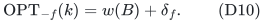

Moreover, if <code class="math">C</code> is a minimum-length cycle through <code class="math">f</code>, an optimum in (D10) exists using only <code class="math">B</code> and the outside-element labels on <code class="math">C</code>.

### From a cycle to a replacement

Decompose the point in (D7), using integrality of <code class="math">P</code>, as a convex combination of common-basis indicators:

<!-- math-display: 71aee975bbb15be099d17b03
\mathbf1_B+\varepsilon d_C
                  =\sum_J\lambda_J\mathbf1_J.
\tag{D11}
-->
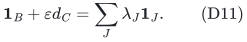

Every positive-coefficient <code class="math">J</code> is contained in <code class="math">B</code> together with the labels of <code class="math">C</code>: all other outside coordinates in (D11) are zero. It also contains <code class="math">B\setminus V(C)</code>, whose coordinates are one.

The <code class="math">f</code>-coordinate of (D11) is <code class="math">1-\varepsilon</code>, so the total coefficient of bases avoiding <code class="math">f</code> is exactly <code class="math">\varepsilon</code>. Every basis has cost at least <code class="math">w(B)</code>. Taking objectives in (D11), the total weighted cost increase is <code class="math">\varepsilon\ell(C)</code>. Hence at least one positive-coefficient basis avoiding <code class="math">f</code> has cost increase at most <code class="math">\ell(C)</code>. This establishes both the upper inequality in (D10) and the claimed support restriction.

At this point the argument establishes existence within the cycle's labels. An additional minimum-hop choice below will make the entire cycle a valid explicit update.

### From a replacement to a cycle

Let <code class="math">J</code> be any size-<code class="math">k</code> common independent set avoiding <code class="math">f</code>. The standard basis-exchange matching lemma gives, separately in each matroid, a perfect matching between <code class="math">B\setminus J</code> and <code class="math">J\setminus B</code>, using feasible single-element exchanges. Write <code class="math">a_i(e)</code> for the element of <code class="math">B\setminus J</code> matched to <code class="math">e\in J\setminus B</code> by the matching for <code class="math">M_i</code>. For every outside element <code class="math">e</code>, form the directed arc <code class="math">a_1(e)\to a_2(e)</code> and label it by <code class="math">e</code>. Since both <code class="math">e\mapsto a_i(e)</code> are bijections, these arcs form a permutation of <code class="math">B\setminus J</code>, and therefore decompose into vertex-disjoint directed cycles, one containing <code class="math">f</code>.

Compress each outside element on one of these cycles to an arc on <code class="math">B</code>. Before minimizing arc labels as in (D2), each cycle's length is its added cost minus removed cost. Each such length is nonnegative by the same tangent-direction argument as above. Their sum is <code class="math">w(J)-w(B)</code>. The cycle containing <code class="math">f</code> therefore has length at most that sum. Replacing each of its labels by the stored minimum-cost candidate can only decrease its length and gives a cycle of <code class="math">D</code>. Consequently

<!-- math-display: 099fc161bfba26dacf601db8
\delta_f\le w(J)-w(B).
\tag{D12}
-->
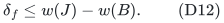

Together these arguments prove (D10). They also prove that <code class="math">\delta_f&lt;\infty</code> exactly when a same-cardinality replacement exists. No uniqueness or perturbation assumption was used.

### Minimum-hop optimum cycles give explicit valid updates

Among cycles through <code class="math">f</code> of weight <code class="math">\delta_f</code>, choose one <code class="math">C</code> with the fewest arcs, and put <code class="math">t=&#124;C&#124;</code>. Let <code class="math">u\le t</code> be its number of distinct outside-element labels. The cycle-to-replacement argument provides an optimum <code class="math">J</code> avoiding <code class="math">f</code>, supported on <code class="math">B</code> and these labels, and containing <code class="math">B\setminus V(C)</code>. Write <code class="math">q=&#124;J\setminus B&#124;</code>. Then <code class="math">q\le u\le t</code>.

Apply the replacement-to-cycle argument to this <code class="math">J</code>. Its alternating cycle through <code class="math">f</code> uses some <code class="math">s\le q</code> outside elements. Compressing and minimizing its labels gives a cycle through <code class="math">f</code>, with <code class="math">s</code> arcs and weight at most <code class="math">w(J)-w(B)=\delta_f</code>. By the definition of <code class="math">\delta_f</code>, this weight equals <code class="math">\delta_f</code>; by the minimum-hop choice of <code class="math">C</code>, we have

<!-- math-display: 39e0d6245ea7d9331fa44b25
t\le s\le q\le u\le t.
-->
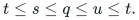

Every inequality is therefore an equality. In particular, the labels of <code class="math">C</code> are all distinct, <code class="math">J</code> contains all of them, and <code class="math">J</code> removes all <code class="math">t</code> elements of <code class="math">V(C)</code>. Consequently

<!-- math-display: b552faa485e423ef89fc12e9
J=(B\setminus V(C))\cup\{e_{a,b}:(a,b)\in E(C)\}
-->
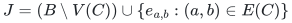

is an exact optimum after deleting <code class="math">f</code>. This proves explicit update feasibility without a unique-optimum hypothesis. The minimum-hop condition is essential to this argument; an arbitrary minimum-weight compressed cycle was not assumed to be directly toggleable.

## 5. From all shortest cycles to ordinary pairwise distance preservation

Split every <code class="math">a\in B</code> into <code class="math">a^-</code> and <code class="math">a^+</code>. Add a zero-length arc <code class="math">a^-\to a^+</code>. Replace each compressed arc <code class="math">a\to b</code> by an arc <code class="math">a^+\to b^-</code> of the same length and with the same outside-element label. Call the resulting graph <code class="math">D^{\mathrm{split}}</code>.

For each <code class="math">f\in B</code>, introduce the ordered demand pair

<!-- math-display: cdc9aa6e50875293f991ee79
(f^+,f^-).
\tag{D13}
-->
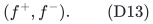

The direction of this pair excludes a trivial zero-length split arc. A simple path from <code class="math">f^+</code> to <code class="math">f^-</code> is exactly a directed cycle through <code class="math">f</code> in <code class="math">D</code>, with the split arcs inserted. Therefore

<!-- math-display: a6d9506d0ac81cdd58c05295
\mathrm{dist}_{D^{\mathrm{split}}}(f^+,f^-)=\delta_f.
\tag{D14}
-->
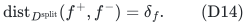

There are <code class="math">2k</code> vertices and at most <code class="math">k</code> finite demands. For reporting, give each compressed arc the lexicographic length <code class="math">(\ell(a,b),1)</code>, and each split arc length <code class="math">(0,0)</code>. We minimize weight first and the number of compressed arcs second. Every directed cycle has nonnegative first coordinate and strictly positive second coordinate. Thus every shortest walk is simple, and a shortest demand path yields exactly the minimum-weight, minimum-hop cycle used above. The primary arc lengths may be negative; when a shortest-path implementation requires nonnegative reduced lengths, compute a Bellman--Ford potential from a super-source (there is no negative directed cycle) and apply the usual reduced-cost transformation while retaining the ordered-pair tie coordinate. All arithmetic consists of rational primary coordinates and integer secondary coordinates.

The directed weighted pairwise distance-preserver theorem of Coppersmith--Elkin, restated and given a simplified proof by Bodwin, provides a distance preserver <code class="math">Q</code> with

<!-- math-display: 76f9dc25d0be49a49a9e1012
|E(Q)|=O((2k)\sqrt{k})=O(k^{3/2}).
\tag{D15}
-->
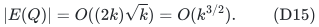

The elementary construction below applies verbatim to lexicographic lengths, so it preserves both coordinates without an assumption about generic costs. Define <code class="math">S</code> to contain <code class="math">B</code> and every outside-element label appearing on a nonsplit arc of <code class="math">Q</code>. For <code class="math">f\in B</code> with a feasible replacement, <code class="math">Q</code> contains a shortest path for (D13), hence the labels of a minimum-weight, minimum-hop cycle through <code class="math">f</code>. Its explicit update from Section 4 is an optimum replacement in <code class="math">S\setminus\{f\}</code>. If <code class="math">f\notin B</code>, the original optimum <code class="math">B</code> survives. This proves (D1).

### Deterministic construction of the distance preserver

The standard hitting argument can be made deterministic without a logarithmic size loss. In a phase with <code class="math">p</code> remaining demands on <code class="math">N</code> vertices, fix one lexicographically shortest simple path for each demand using a deterministic predecessor tie-break, and set <code class="math">L=\lceil N/\sqrt p\rceil</code>. Include every path of at most <code class="math">L</code> arcs. For the others, greedily select vertices meeting the largest number of still-unhit paths. At most <code class="math">\lceil N/L\rceil</code> selections hit a constant fraction: after each selection the unhit count falls by a factor at most <code class="math">1-L/N</code>. Include shortest-path in- and out-trees at the selected vertices. This phase costs <code class="math">O(pL+N^2/L)=O(N\sqrt p)</code> arcs and satisfies at least a constant fraction of all remaining demands. Repeat; the geometric sum of <code class="math">\sqrt p</code> gives <code class="math">O(N\sqrt{p_0})</code>. This is the slack-to-complete construction in Bodwin's proof, with greedy coverage replacing sampling.

### Path reporting within the same space bound

Store the actual short paths retained in each phase. At every chosen hub, store an in-tree and an out-tree of lexicographic shortest paths, using <code class="math">O(N)</code> parent-pointer and arc-ID records; different hubs may store separate copies. For a long demand whose fixed shortest path is first hit at hub <code class="math">h</code>, store a pointer to that hub's two trees. The shortest path from its source to <code class="math">h</code>, followed by the shortest path from <code class="math">h</code> to its target, has exactly the optimum lexicographic demand distance. This follows because <code class="math">h</code> lies on the fixed shortest demand path, and shortest-path distances satisfy subpath optimality. This concatenation cannot repeat a vertex: deleting the resulting directed cycle would strictly improve its lexicographic length. Thus it has at most <code class="math">N-1</code> arcs and can be reported by following at most two tree paths in <code class="math">O(N)</code> time.

The phase's stored lists and tree records total <code class="math">O(pL+N^2/L)</code>; summing over phases gives <code class="math">O(N\sqrt{p_0})</code> records. Demand descriptors take only <code class="math">O(p_0)</code> additional records. With <code class="math">N=2k</code>, an oracle query for <code class="math">f\in B</code> reports its shortest cycle and performs the valid update above in <code class="math">O(k)</code> time. The cycle labels are distinct by the minimum-hop lemma. A sorted dictionary for the <code class="math">k</code> baseline element IDs determines whether <code class="math">f\in B</code> in <code class="math">O(\log(k+1))</code> time, absorbed by the <code class="math">O(k)</code> output bound; if not, the oracle returns <code class="math">B</code>. Infeasible baseline failures have stored infinity flags. No matroid oracle or optimization algorithm is invoked after preprocessing.

## 6. Construction costs and the arborescence specialization

For general independence-oracle matroids, the compressed graph can be built after <code class="math">B</code> is known using <code class="math">O(&#124;E&#124;k)</code> independence tests and <code class="math">O(&#124;E&#124;k^2)</code> elementary processing: for each outside element, list its feasible exchanges in each matroid, and update all eligible ordered pairs. Distance computations and the deterministic sparsifier construction on the <code class="math">O(k)</code>-vertex graph take polynomial time; dense shortest-path routines give an additional conservative <code class="math">O(k^3)</code> arithmetic-operation bound. Rational arithmetic has polynomial bit complexity. A standard weighted matroid-intersection algorithm supplies <code class="math">B</code>.

For rooted arborescences, remove arcs entering the root. Take <code class="math">M_1</code> to be the graphic matroid of the underlying undirected multigraph, keeping opposite arcs as different elements. Take <code class="math">M_2</code> to be the partition matroid allowing at most one incoming arc at each nonroot vertex. A common independent set of size <code class="math">n-1</code> is an undirected forest with <code class="math">n-1</code> edges and therefore gives exactly one incoming arc at every nonroot vertex. A component not containing the root would then have indegree at least one at every vertex and hence contain a directed cycle, contradicting the underlying forest. Thus these common bases are exactly the root-spanning arborescences.

### A sparse auxiliary exchange graph for arborescences

Given a baseline arborescence <code class="math">T</code>, an outside arc <code class="math">e=(u,v)</code> has exactly one possible exchange in <code class="math">M_2</code>, namely the current tree arc <code class="math">b_v</code> entering <code class="math">v</code>. Its feasible <code class="math">M_1</code> exchanges are the tree arcs on the undirected <code class="math">u</code>-to-<code class="math">v</code> path in <code class="math">T</code>. We represent these path-to-point transitions without materializing a dense compressed graph.

Take a heavy-light decomposition of <code class="math">T</code>, with tree edges assigned positions in one global base array. Build one segment tree on those positions, with zero-length arcs directed from a child toward its parent. There are <code class="math">O(n)</code> segment-tree nodes and arcs. Make a normal node <code class="math">a</code> for each tree arc, and connect it to its corresponding segment-tree leaf with length <code class="math">-w(a)</code>.

For each outside original arc <code class="math">e=(u,v)</code>, cover the tree-edge path <code class="math">P_T(u,v)</code> by <code class="math">O(\log^2 n)</code> canonical segment-tree intervals. For each covering interval node <code class="math">c</code>, add an arc <code class="math">c\to b_v</code>, of primary length <code class="math">w(e)</code>, labeled by <code class="math">e</code>. Give precisely these labeled arcs secondary length one; all other arcs have secondary length zero. A directed transition between consecutive normal nodes <code class="math">a,b_v</code> exists exactly when <code class="math">a\in P_T(u,v)</code>, and its lexicographic length is <code class="math">(w(e)-w(a),1)</code>. This is precisely the compressed exchange transition, with all labels retained instead of just the cheapest parallel candidate.

The resulting auxiliary graph has

<!-- math-display: e13deb2822141acdf9ea083f
N=O(n)\text{ nodes},\qquad
              M=O(n+m\log^2 n)\text{ arcs}.
\tag{D20}
-->
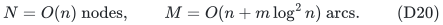

Its segment-tree portion is acyclic, so every directed cycle contains a normal node and at least one labeled arc, and projects to a closed exchange walk. Section 3 implies that every such cycle has nonnegative primary length; its positive secondary length makes it strictly positive lexicographically. Split only the normal nodes into minus and plus copies: arrivals terminate at the minus copy, departures start at the plus copy, and a <code class="math">(0,0)</code>-length arc joins minus to plus. The demands are again <code class="math">(f^+,f^-)</code>.

Every exchange cycle realizes an auxiliary closed walk, and every auxiliary demand path projects to a nonempty exchange walk through <code class="math">f</code>. A realization could initially repeat segment-tree nodes, but deleting strictly positive closed subwalks improves its lexicographic length. These two directions show that the minimum auxiliary demand distance equals the lexicographically minimum exchange-cycle length through <code class="math">f</code>. A shortest auxiliary demand path projects to a minimum-weight, minimum-hop exchange cycle. Applying the construction and path-reporting scheme of Section 5 directly to this <code class="math">O(n)</code>-node auxiliary graph therefore retains only <code class="math">O(n^{3/2})</code> labeled original arcs and stores <code class="math">O(n^{3/2})</code> records. Include the baseline tree as before.

Lexicographic shortest-path potentials take <code class="math">O(NM)</code> arithmetic operations by Bellman--Ford. After reweighting, shortest-path trees from and to all auxiliary nodes can be computed deterministically in <code class="math">\widetilde O(NM+N^2)</code> time. The demanded simple paths have total length <code class="math">O(n^2)</code>. The phased greedy hitting implementation also takes <code class="math">\widetilde O(n^2)</code> time: maintain vertex-to-unhit-path incidence lists and a maximum-count heap; when a path is first hit, decrement the count at each of its vertices once. Across phases the demand counts decrease geometrically. Including the chosen tree records and mapping retained labeled arcs back to original IDs is within the same bound.

Thus the complete deterministic preprocessing takes

<!-- math-display: 78475f3a73c4f01e452525c6
\widetilde O(mn)
\tag{D21}
-->
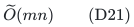

arithmetic operations, including the initial arborescence computation, since an instance with a spanning arborescence has <code class="math">m\ge n-1</code>. Working storage may include <code class="math">O(n^2)</code> shortest-path information and <code class="math">O(m\log^2n)</code> auxiliary arcs; the final oracle retains only <code class="math">O(n^{3/2})</code> records and original-arc IDs.

For a query, report the stored auxiliary shortest path in <code class="math">O(n)</code> time, read its visited normal nodes and labeled arcs, and apply the feasible cycle update proved in Section 4. This outputs an optimal arborescence in <code class="math">O(n)</code> time with no new optimization call. The output is a list of original arcs. The simpler certificate-only variant may instead run the usual minimum-cost arborescence algorithm on the <code class="math">O(n^{3/2})</code>-arc retained graph, taking <code class="math">O(n^{3/2})</code> arithmetic operations per query; the path-reporting oracle gives the stronger headline bound.

This is a general directed result. It assumes neither acyclicity, bounded degree, unit costs, nor special failure positions. The certificate consists only of original arcs, and all failures use the same fixed original cost function.

## 7. Maximum-cardinality solutions when rank can fall

Let <code class="math">r</code> be the maximum common-independent-set size. Deleting one element lowers it by at most one, since a maximum set with that element removed still has size <code class="math">r-1</code>. Construct the certificate and reporting oracle for sizes <code class="math">r</code> and <code class="math">r-1</code>, interpreting the latter as the empty optimum when <code class="math">r=1</code>. Their union still has <code class="math">O(r^{3/2})</code> elements and records. A query uses the rank-<code class="math">r</code> oracle if a same-cardinality solution remains feasible, and otherwise the rank-<code class="math">(r-1)</code> oracle. This reports an exact minimum-cost maximum-cardinality common independent set in <code class="math">O(r)</code> time, without oracle calls. The case <code class="math">r=0</code> is constant space and time.

Thus the theorem also applies to exact minimum-cost maximum-cardinality bipartite matching under one edge failure. This is a mathematical specialization; priority for the weighted matching formulation has not yet been checked exhaustively. A cost-only query can store the optimum costs for each baseline failure in each oracle, using <code class="math">O(r)</code> additional cost records, and return the relevant value after the <code class="math">O(\log(r+1))</code> membership lookup.

## 8. Equivalence to pairwise distance preservation and two sharp boundaries

### A reverse reduction already using bipartite perfect matching

Let <code class="math">G</code> be a directed graph on <code class="math">N</code> vertices with nonnegative costs at most <code class="math">W</code>, and let <code class="math">P=\{(s_i,t_i):i\in[p]\}</code>, <code class="math">p\le N</code>, be reachable nontrivial demands. Self-loops may be removed. Choose a positive rational <code class="math">K&gt;(N-1)W</code>. Add one vertex <code class="math">q_i</code> per demand and the arcs

<!-- math-display: 9aa1b547b66070dc5c8b9828
t_i\to q_i\text{ of cost }K,
       \qquad q_i\to s_i\text{ of cost }0.
\tag{D16}
-->
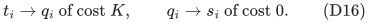

Call the augmented graph <code class="math">A</code>. Every cycle through <code class="math">q_i</code> pays its own cost-<code class="math">K</code> arc. A shortest original <code class="math">s_i</code>-to-<code class="math">t_i</code> path is simple and costs less than <code class="math">K</code>, so a cycle through <code class="math">q_i</code> of cost less than <code class="math">2K</code> exists. Any cycle through another query vertex pays at least <code class="math">2K</code>. It follows that the minimum cycle through <code class="math">q_i</code> visits no other query vertex and has cost

<!-- math-display: b0c17f9a4f085ff87c149754
K+\mathrm{dist}_G(s_i,t_i).
\tag{D17}
-->
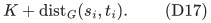

Encode <code class="math">A</code> as a bipartite perfect-matching instance: create a left and a right copy of each vertex; include every diagonal edge <code class="math">x_Lx_R</code> at cost zero; and, for each arc <code class="math">x\to y</code> of <code class="math">A</code>, include edge <code class="math">x_Ly_R</code> with the arc's cost. The rank of this assignment instance is <code class="math">R=N+p\le2N</code>. The all-diagonal matching is optimum.

After the diagonal at <code class="math">q_i</code> fails, every perfect matching includes a permutation cycle through <code class="math">q_i</code>. Other permutation cycles have nonnegative cost and can be replaced by their zero-cost diagonals. Therefore the exact optimum after this one failure is precisely (D17). Any optimum retained by a fault-tolerant matching subgraph must contain a minimum-cost <code class="math">q_i</code>-cycle, and that cycle contains an original <code class="math">G</code> shortest path for demand <code class="math">(s_i,t_i)</code>. Consequently the original-<code class="math">G</code> edges represented in any such matching subgraph form a distance preserver for every demand in <code class="math">P</code>.

Let <code class="math">\mathrm{DP}(N,p)</code> denote worst-case directed nonnegative weighted pairwise-preserver size, and <code class="math">\mathrm{MI}(k)</code> denote worst-case exact one-failure retained-element size for two-matroid size-<code class="math">k</code> intersection. The two reductions give

<!-- math-display: e3d081214212479bd83431f9
\mathrm{MI}(k)\le k+\mathrm{DP}(2k,k),
 \qquad
 \mathrm{MI}(N+p)\ge\mathrm{DP}(N,p)
 \quad(p\le N).
\tag{D18}
-->
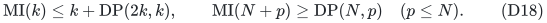

The lower reduction already uses two partition matroids. Thus the general weighted one-failure problem has, up to constant rescaling of rank, the same size-exponent question as <code class="math">\Theta(N)</code>-pair directed weighted distance preservation. In particular, the classical <code class="math">\Omega(N^{4/3})</code> distance-preserver lower bound transfers to

<!-- math-display: 3748f0a5254f844aa8386d31
\mathrm{MI}(R)=\Omega(R^{4/3})
\tag{D19}
-->
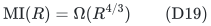

along an infinite family, already for nonnegative weighted bipartite perfect matching. The inherited distance lower bound is not new. This particular assignment reduction concerns two partition matroids; the next independent reduction establishes the arborescence counterpart.

### Arborescences also inherit the distance-preserver lower bound

Bodwin--Grandoni--Parter--Vassilevska Williams (2017), Lemmas 4.5--4.6, already prove that exact one-failure preservation of a single directed weighted <code class="math">s</code>-to-<code class="math">t</code> distance has, up to constant factors and vertex rescaling, the same worst-case size as preserving <code class="math">\Theta(N)</code> ordinary directed weighted demand pairs. That replacement-path equivalence is a classical antecedent to the equivalence above.

There is a particularly simple transfer from their problem to arborescences. Given a nonnegative weighted directed graph <code class="math">G</code> and distinct vertices <code class="math">s,t</code>, delete arcs leaving <code class="math">t</code> and add a zero-cost arc <code class="math">t\to v</code> for every <code class="math">v\notin\{s,t\}</code>. Root this graph <code class="math">A</code> at <code class="math">s</code>. Deleting the old outgoing arcs of <code class="math">t</code> changes no simple <code class="math">s</code>-to-<code class="math">t</code> path. For any failure set <code class="math">F</code> of other original arcs, every rooted spanning arborescence contains an <code class="math">s</code>-to-<code class="math">t</code> path, so its cost is at least <code class="math">\mathrm{dist}_{G-F}(s,t)</code>. Conversely, a shortest simple <code class="math">s</code>-to-<code class="math">t</code> path, together with the zero arcs <code class="math">t\to v</code> for vertices outside that path, is a spanning arborescence of exactly that cost. Consequently

<!-- math-display: 6a03bf7b7d23004b866e3474
\mathrm{OPT}_{A-F}(\text{arborescence})
                  =\mathrm{dist}_{G-F}(s,t),
-->
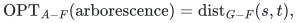

with equality of infeasibility as well.

An exact arborescence preserver must therefore retain, after every such failure, an <code class="math">s</code>-to-<code class="math">t</code> path of the original optimum distance. Its root-to-<code class="math">t</code> tree path uses none of the added completion arcs. Thus the classical one-failure directed distance lower bound gives an <code class="math">\Omega(n^{4/3})</code> lower bound for exact one-failure arborescence preservers, already in simple directed graphs with nonnegative rational costs. Together with the <code class="math">O(\mathrm{DP}(O(n),O(n)))</code> upper reduction, the arborescence size-exponent question is equivalent to the same directed pairwise distance-preserver question. This transfers an existing distance lower bound; it does not improve that bound.

### Two failures already force quadratically many matching edges

Take <code class="math">K_{r,r}</code>, put cost zero on its diagonal edges and cost one on every off-diagonal edge. The no-failure optimum is the unique all-diagonal perfect matching. If diagonal edges <code class="math">i_Li_R</code> and <code class="math">j_Lj_R</code> fail, the optimum has cost two and uniquely uses <code class="math">i_Lj_R,j_Li_R</code>, together with all other diagonals. Any cost-two matching must be precisely this transposition: at least the two failed diagonal positions must move, and two off-diagonal edges in a permutation form a two-cycle.

Varying <code class="math">i,j</code> forces all <code class="math">r(r-1)</code> off-diagonal edges into an exact two-failure preserver; the no-failure query forces all diagonals. Every one of the <code class="math">r^2</code> original edges is therefore necessary. This rules out an <code class="math">o(r^2)</code> universal bound for two-matroid intersection with two failures. This particular example proves a retained-subgraph lower bound for matching. A separate arborescence example follows.

### Two failures force quadratic size for arborescences as well

The zero-cost completion transfer works for any original failure set. It therefore also transfers the quadratic two-failure weighted replacement-path lower bound of Bodwin--Grandoni--Parter--Vassilevska Williams, Theorem 4.4. For clarity, the following directed instance gives the complete argument.

Take zero-cost directed paths <code class="math">s=s_0\to s_1\to\cdots\to s_L</code> and <code class="math">t_L\to t_{L-1}\to\cdots\to t_0=t</code>. Add <code class="math">x_0,\ldots,x_{L-1}</code> and <code class="math">y_0,\ldots,y_{L-1}</code>. The arcs <code class="math">s_i\to x_i</code> and <code class="math">y_j\to t_j</code> have costs <code class="math">K(L-i)</code> and <code class="math">K(L-j)</code>; include every <code class="math">x_i\to y_j</code> at cost one. On failing <code class="math">s_i\to s_{i+1}</code> and <code class="math">t_{j+1}\to t_j</code>, a surviving <code class="math">s</code>-to-<code class="math">t</code> path can choose only cross indices <code class="math">a\le i</code> and <code class="math">b\le j</code>. Its cost is <code class="math">K(2L-a-b)+1</code>, uniquely minimized at <code class="math">a=i,b=j</code>. Thus each one of the <code class="math">L^2</code> cross arcs is required by a query. The zero-cost completion from <code class="math">t</code> makes this an arborescence instance on <code class="math">4L+2</code> vertices with the same exact optimum for every query. Every exact two-arc-failure arborescence preserver requires <code class="math">\Omega(n^2)</code> arcs.

The same construction also gives a quadratic *bit-space* lower bound for arbitrary exact cost oracles with two failures. Give cross arc <code class="math">x_i\to y_j</code> cost <code class="math">1+b_{ij}</code>, with independently chosen <code class="math">b_{ij}\in\{0,1\}</code>, and set <code class="math">K=3</code>. The prescribed cross arc remains uniquely cheapest, and the query answer is <code class="math">3(2L-i-j)+1+b_{ij}</code>. All <code class="math">L^2</code> bits can be recovered from the query answers. This is the arborescence transfer of the classical replacement-path incompressibility argument, not a new distance-oracle lower bound.

The same topology gives a stronger retained-subgraph boundary for approximation. Fix any finite multiplicative factor <code class="math">\alpha\ge1</code>, choose an integer <code class="math">A&gt;\alpha</code>, put cost zero on the two backbones and all spokes, and give cross arc <code class="math">x_i\to y_j</code> cost

<!-- math-display: 1de3ae34547237de60c4f181
A^{\,2L-i-j}.
-->
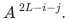

Under the same pair of failures indexed by <code class="math">i,j</code>, every reachable cross has indices <code class="math">a\le i,b\le j</code>. The corner <code class="math">(i,j)</code> has optimum cost <code class="math">A^{2L-i-j}</code>, while every other reachable cross costs at least <code class="math">A</code> times as much. Hence every <code class="math">\alpha</code>-approximate surviving <code class="math">s</code>-to-<code class="math">t</code> path must use this particular cross arc. After zero-cost completion from <code class="math">t</code>, any <code class="math">\alpha</code>-approximate arborescence must also contain it, because its root-to-<code class="math">t</code> path costs no more than the whole arborescence. Varying the two failures again forces all <code class="math">L^2=\Omega(n^2)</code> cross arcs.

Thus **for every fixed factor <code class="math">\alpha\ge1</code>, two edge failures preclude a universally subquadratic-size multiplicative-approximation arborescence preserver**. This uses nonnegative integer costs with exponential aspect ratio, but only <code class="math">O(n\log A)</code> bits per cost; it is not asserted for polynomially bounded aspect ratio. The preceding exact lower bounds already use polynomially bounded costs.

A variant also rules out subquadratic-bit *self-contained deterministic approximate cost oracles*, with no access to the original input during queries. Independently choose bits <code class="math">b_{ij}</code> and set cross cost <code class="math">A^{2L-i-j+b_{ij}}</code>. For the query indexed by <code class="math">i,j</code>, write <code class="math">w_{ij}=A^{2L-i-j}</code>. The corner costs <code class="math">w_{ij}A^{b_{ij}}</code>, while every other reachable cross costs at least <code class="math">Aw_{ij}</code>. Hence the optimum is exactly <code class="math">w_{ij}</code> if <code class="math">b_{ij}=0</code>, and <code class="math">Aw_{ij}</code> if <code class="math">b_{ij}=1</code>. Any answer satisfying <code class="math">\mathrm{OPT}\le\widehat c\le\alpha\mathrm{OPT}</code> distinguishes these cases because <code class="math">A&gt;\alpha</code>. The <code class="math">2^{L^2}</code> bit matrices therefore require distinct oracle states, proving <code class="math">\Omega(n^2)</code> bits. This does not rely on requiring a retained subgraph. The topology and transfer are explicit; priority for this multiplicative-distance formulation has not been established.

### Cardinality alone has a linear certificate

When all element costs are zero, <code class="math">D</code> has zero arc lengths and only the existence of a cycle through each baseline element matters. In each nontrivial strongly connected component, retain an in-tree and an out-tree rooted at one vertex; in a singleton component, retain its loop if it has one. At most <code class="math">2k</code> compressed arcs suffice, so their labels together with <code class="math">B</code> give at most <code class="math">3k</code> original elements. If a deletion lowers maximum cardinality, <code class="math">B-f</code> already attains the new maximum. Hence arbitrary two-matroid maximum-cardinality intersection admits a linear-size one-element-failure certificate. The weighted lower bound (D19) explains why this elementary linear construction cannot preserve general exact costs. The unweighted bipartite matching specialization was already proved by Banerjee--Gupta--Raman--Saurabh (CSR 2022).

## 9. Baselines and proof dependencies

Huang--Sellier, *Robust Sparsification for Matroid Intersection with Applications* (SODA 2024; Mathematics of Operations Research, 2026), construct density-constrained subsets of size <code class="math">O(r/\varepsilon)</code> preserving a <code class="math">3/2+\varepsilon</code> approximation of maximum cardinality. Their robustness supports one-way communication and random-order streaming, including unknown future elements. The present static exact weighted single-deletion guarantee is different; it does not improve that unknown-future guarantee.

Choudhary--Kumar--Saggi (September 2026) give randomized algebraic sensitivity oracles for linear-matroid and graph optimization problems under multiple updates. The present oracle is deterministic, covers arbitrary oracle matroids, and also supplies a retained subinstance of original elements, while its failure scope is only one deletion. Banerjee--Gupta--Raman--Saurabh (CSR 2022) preserve unweighted matching cardinality under faults; the exact weighted objective here is a different requirement.

The contribution is the rank-size reduction from exact single-failure two-matroid intersection to ordinary directed pairwise distance preservation, its output-sensitive reporting form, and its consequence for exact arborescence preservers and oracles. It does not claim a new pairwise distance-preserver bound or a new weighted matroid-intersection algorithm.

The reduction pattern has the explicit classical antecedent of Bodwin--Grandoni--Parter--Vassilevska Williams (2017), who relate weighted directed single-pair replacement paths to ordinary pairwise distance preservation. The additional step here is the exchange-cycle reduction for arbitrary two-matroid intersection and the resulting exact arborescence theorem, together with the lower-bound transfers above.

Agarwala--Alekseev--Vinciguerra (ITCS 2026), Lemma 30, state a closely related minimum exchange-cycle characterization for flipping one element's membership under a unique optimum. Sections 3--4 above prove the support-and-value statement directly from the integral common-base polytope, initially permit repeated compressed labels, and require no unique optimum. The added minimum-hop argument then proves distinctness and valid explicit update rather than assuming them.

The earlier correlated-color reachability direction has a different boundary: Parter--Petruschka's *Preserving Distances in Faulty Colored Graphs*, Theorem 1.6, already gives exponential dependence on the number of failed individual edges represented by the color classes. The present theorem is specifically for one original element failure; it does not overcome that color-failure obstruction.

### Primary references

1. Dipan Dey, Telikepalli Kavitha. *Low-Cost Arborescence Under Edge Faults*. arXiv:2605.13800v1, 13 May 2026. Theorem 1.1 and Section 5. https://arxiv.org/html/2605.13800v1
2. Greg Bodwin. *A Note on Distance-Preserving Graph Sparsification*. arXiv:2001.07741v3, 7 May 2021; Information Processing Letters, 2022. Theorem 3 and Lemma 1; Theorem 3 is attributed there to Coppersmith--Elkin. https://arxiv.org/pdf/2001.07741
3. Don Coppersmith, Michael Elkin. *Sparse Sourcewise and Pairwise Distance Preservers*. SIAM Journal on Discrete Mathematics 20(2), 463--501, 2006. DOI 10.1137/050630696. The directed weighted bound is explicitly restated in reference 2.
4. Michel X. Goemans. *Lecture Notes on Matroid Intersection*, 18.453, 2 May 2017. Basis-exchange matching, common-independent-set polytope, and the graphic/partition arborescence formulation. https://math.mit.edu/~goemans/18453S17/matroid-intersect-notes.pdf
5. Aryan Agarwala, Yaroslav Alekseev, Antoine Vinciguerra. *Linear Matroid Intersection Is in Catalytic Logspace*. ITCS 2026, Article 3, Section 5.1, Lemma 30. https://drops.dagstuhl.de/storage/00lipics/lipics-vol362-itcs2026/html/LIPIcs.ITCS.2026.3/LIPIcs.ITCS.2026.3.html
6. Merav Parter, Asaf Petruschka. *Preserving Distances in Faulty Colored Graphs*. arXiv:2504.17868v1, 24 April 2025, Theorem 1.6 and Section 5. https://arxiv.org/html/2504.17868v1

7. Gary Hoppenworth, Yinzhan Xu, Zixuan Xu. *New Separations and Reductions for Directed Preservers and Hopsets*. SODA 2025; arXiv:2411.08151v2, Table 1 records the directed weighted upper and lower bounds used in (D18)--(D19). https://arxiv.org/html/2411.08151v2
8. Niranka Banerjee, Manoj Gupta, Venkatesh Raman, Saket Saurabh. *Output Sensitive Fault Tolerant Maximum Matching*. CSR 2022, 115--132. The abstract explicitly distinguishes unweighted matching cardinality. https://link.springer.com/chapter/10.1007/978-3-031-09574-0_8
9. Keerti Choudhary, Amit Kumar, Lakshay Saggi. *Sensitivity Oracles for Matroid Packing, Matroid Covering, and Matching Problems with Applications*. arXiv:2609.01283v1, 1 September 2026. https://arxiv.org/pdf/2609.01283

10. Chien-Chung Huang, François Sellier. *Robust Sparsification for Matroid Intersection with Applications*. SODA 2024, 2916--2940, DOI 10.1137/1.9781611977912.104; Mathematics of Operations Research 51(3), 2643--2666, 2026, DOI 10.1287/moor.2024.0562. Full preprint, Theorems 4, 8, 9: https://arxiv.org/pdf/2310.16827

11. Greg Bodwin, Fabrizio Grandoni, Merav Parter, Virginia Vassilevska Williams. *Preserving Distances in Very Faulty Graphs*. ICALP 2017; arXiv:1703.10293v1. Lemmas 4.5--4.6 give the directed weighted one-failure single-pair equivalence; Theorem 4.4 gives the two-failure quadratic preserver and oracle lower bounds. https://arxiv.org/pdf/1703.10293
