# Valuated matroid intersection: exact single-failure summaries and output-sensitive queries

**Abstract.** We extend the exact single-failure exchange-cycle reduction to two fixed-rank valuated matroids. A joint convex-decomposition lemma and a valued exchange-matching bound yield sparse optimal supports and output-sensitive reporting. Classical valuated-matroid optimization and directed distance preservation supply the optimization and sparsification subroutines.

## 1. Statement and conventions

Let omega_1 and omega_2 be rational-valued **minimization-convention valuated matroids** of the same rank k on an explicitly listed ground set E of size N. Their effective domains are the basis families of matroids M_1 and M_2; the value of every other subset is +infinity. Thus for bases A,B in the domain of omega_i and any a in A minus B, some b in B minus A satisfies

<!-- math-display: 990394c2fa9c061ad0cd624b
\omega_i(A)+\omega_i(B)\ge
\omega_i(A-a+b)+\omega_i(B-b+a). \tag{V1}
-->
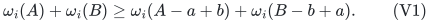

Assume at least one common basis exists. Write

<!-- math-display: 6d8971a715360a2c096ec83c
\Omega(J)=\omega_1(J)+\omega_2(J).
-->
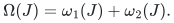

An additional arbitrary linear element cost can be absorbed into either valuation without changing (V1). The query deletes a single original element and restricts these same fixed valuations to surviving bases.

**Oracle interface.** Preprocessing receives one finite-valued basis of each valuation, or independence oracles for the effective-domain matroids from which such bases can be found. A bare oracle returning a value on full bases and +infinity elsewhere does not provide this initialization: a matroid with one hidden basis would require an exhaustive basis search. Every finite oracle answer is a binary rational; its encoding length is charged separately from the number of evaluations.

**Theorem.** There is a deterministic polynomial-time construction, using value-oracle access to the two valuations and a supplied feasible basis in each effective domain, of a restriction S contained in E with

<!-- math-display: d06bf951d1e6cf75b9e7334f
|S|=O(k^{3/2}),
-->
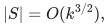

such that after every one-element deletion f, if a surviving common rank-k basis exists, S-f contains one minimizing Omega. In addition, a path-reporting data structure with O(k^{3/2}) records returns the k element identifiers of such an optimum in O(k) word operations, with no valuation or independence queries at query time. Infeasibility can be reported as well.

This is a fixed-rank statement. An arbitrary basis valuation has no specified objective on smaller independent sets, so rank-drop objectives are not silently inferred. If suitable objectives on two consecutive ranks are separately supplied, the ordinary companion's union argument may be applied to those two well-defined problems.

## 2. Two basic facts from the exchange axiom

### Local optimality is global optimality

For any price vector p, omega-p is again a valuated matroid. If a basis B has no improving single-element exchange for omega-p, then B minimizes it globally.

Indeed, suppose a better basis J exists, choosing such a J with the smallest symmetric difference from B. Apply (V1) to B,J and a in B-J. Local optimality says the exchanged B-basis is no better than B. Hence the corresponding exchange toward B does not increase the value of J, producing a closer better basis, a contradiction.

### Minimizing bases form an ordinary matroid

For any fixed p, the minimizers of omega-p form the bases of an ordinary matroid. If two bases both attain the minimum alpha, (V1) supplies a symmetric exchange whose two new values sum to at most 2 alpha. Each is at least alpha, so both are minimizers. This proves the basis-exchange axiom for the minimizing family.

These are classical properties of valuated matroids; the short arguments are included to fix signs and conventions.

## 3. A joint convex-decomposition lemma

For i=1,2, let the lower convex closure of omega_i on its base polytope be

<!-- math-display: 4db6af0fa9fc4f2142704cd9
\bar\omega_i(x)=
\min\left\{\sum_B\lambda_B\omega_i(B):
 \lambda_B\ge0,\ \sum_B\lambda_B=1,
 \sum_B\lambda_B\mathbf1_B=x\right\}.
-->
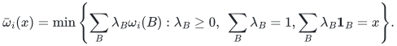

**Lemma 1.** Every x in P(M_1) intersect P(M_2) has a convex decomposition into common bases J such that

<!-- math-display: 780deb4e3e491fb83c389d93
x=\sum_J\lambda_J\mathbf1_J,
\qquad
\sum_J\lambda_J\Omega(J)
=\bar\omega_1(x)+\bar\omega_2(x). \tag{V2}
-->
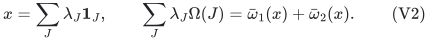

**Proof.** Choose a supporting affine function for each lower convex closure at x. Equivalently, by the dual of the finite linear program defining the convex closure, choose a vector p_i and scalar alpha_i such that

<!-- math-display: 093c70a66079f59132970afe
\omega_i(B)\ge\alpha_i+p_i(B)
-->
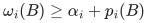

for every basis B, with equality on the supporting bases and

<!-- math-display: 990d62d74852246be298656d
\bar\omega_i(x)=\alpha_i+p_i\cdot x.
-->
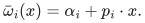

The supporting bases minimize omega_i-p_i, so by Section 2 they form the basis family of an ordinary matroid N_i. An optimal decomposition defining the convex closure uses only supporting bases, whence x belongs to P(N_i).

The ordinary matroid-intersection polytope theorem makes P(N_1) intersect P(N_2) integral. Decompose x into their common-basis indicators. Every such J is a basis of both original matroids and satisfies omega_i(J)=alpha_i+p_i(J) for each i. Taking expectations gives (V2). QED.

In particular, the sum of the two separate lower convex closures is the lower convex closure of the sum on common bases. The proof uses ordinary matroid-intersection integrality and initial/minimizer matroids; no additional integrality assertion for arbitrary sums of convex functions is assumed.

## 4. A valued exchange-matching bound

Fix bases B,J of one valuated matroid omega. On the bipartition B-J and J-B, put an edge a e whenever B-a+e is a basis, with cost

<!-- math-display: cd385f03f3956f24ffc6c8c2
\gamma(a,e)=\omega(B-a+e)-\omega(B).
-->
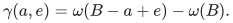

**Lemma 2.** There is a perfect matching mu in this exchange graph with

<!-- math-display: bbf729e53f83532cf3eb9a87
\sum_{ae\in\mu}\gamma(a,e)
\le\omega(J)-\omega(B). \tag{V3}
-->
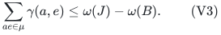

**Proof.** The ordinary basis-exchange matching lemma ensures at least one perfect matching. Let its minimum cost be m. By assignment linear-programming duality there are numbers alpha_a and beta_e such that

<!-- math-display: e89b671010792ea744741918
\alpha_a+\beta_e\le\gamma(a,e)
-->
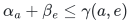

on every feasible edge and

<!-- math-display: bf65d9168b5f966845cd73f8
m=\sum_{a\in B-J}\alpha_a+
  \sum_{e\in J-B}\beta_e.
-->
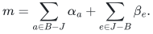

Contract B intersect J and delete everything outside B union J. The resulting valuated matroid has the two disjoint bases B-J and J-B, with values inherited by adjoining the contracted common set. Define prices p_a=-alpha_a on B-J and p_e=beta_e on J-B. The dual inequalities say precisely that no feasible single exchange improves omega-p at B-J. Section 2 gives global optimality, in particular relative to J-B. Thus

<!-- math-display: 512c74a671b59c0e90e47849
\omega(J)-\omega(B)\ge p(J-B)-p(B-J)=m.
-->
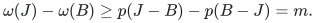

Choose a minimum-cost matching. This proves (V3). QED.

The argument does not assert a simultaneous basis exchange for the whole matching. It only gives a matching of valid individual exchanges and a bound on their total incremental value.

## 5. Compressed exchange graph and cycle inequality

Fix a common basis B minimizing Omega. For each outside element e and each a in B, compute

<!-- math-display: 82294050c6dd40aed3b00288
\gamma_i(a,e)=\omega_i(B-a+e)-\omega_i(B),
-->
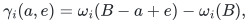

using +infinity when the exchanged set is outside the effective domain.

The compressed digraph D has the k elements of B as vertices. For each ordered pair a,b, including a=b, keep an outside element e minimizing

<!-- math-display: 0d361b8d61ba48cc2a75bb46
\ell(a,b;e)=\gamma_1(a,e)+\gamma_2(b,e), \tag{V4}
-->
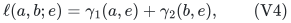

among elements for which both terms are finite. Label the arc a to b by this e and give it length (V4). The chosen label can depend on the ordered pair; it is not necessarily the globally cheapest outside element under a linear cost.

For a simple directed cycle C of length t, let d_C add each outside label with its number of occurrences and subtract each cycle vertex of B once. With any 0<epsilon<=1/t, the point

<!-- math-display: e3d6969f4cc525ecd160135e
x=\mathbf1_B+\varepsilon d_C
-->
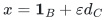

is simultaneously the following two convex combinations:

<!-- math-display: 3703a0f4ccb35471c13dc470
x=(1-t\varepsilon)\mathbf1_B+
\varepsilon\sum_{a\to b\in C}\mathbf1_{B-a+e_{a,b}}
\quad\text{in }P(M_1),
-->
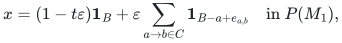

<!-- math-display: 90c5e5ea590a14481aee0a3e
x=(1-t\varepsilon)\mathbf1_B+
\varepsilon\sum_{a\to b\in C}\mathbf1_{B-b+e_{a,b}}
\quad\text{in }P(M_2).
-->
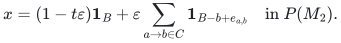

The two vectors coincide because the cycle tails and heads are the same multiset. Repeated outside labels are allowed in this intermediate argument. Convexity gives

<!-- math-display: 9e4706e1fee59fac15fc7cbb
\bar\omega_1(x)+\bar\omega_2(x)
\le\Omega(B)+\varepsilon\ell(C). \tag{V5}
-->
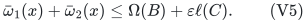

By Lemma 1, x decomposes into common bases with average Omega equal to the left side. Since B is optimal among common bases, every component has value at least Omega(B). Therefore every directed cycle has nonnegative length.

## 6. Exact failure optimum and a minimum-hop cycle

For f in B, let delta_f be the minimum directed-cycle length through f, with +infinity if there is none. Then

<!-- math-display: 12151f6011a0045ab615ada7
\boxed{\min_{J\text{ common basis},\ f\notin J}\Omega(J)
=\Omega(B)+\delta_f.} \tag{V6}
-->
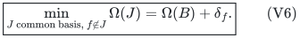

The two directions mirror the ordinary companion, with Lemmas 1 and 2 replacing linear-objective identities.

**Cycle to replacement.** Decompose x from Section 5 by Lemma 1. Its zero coordinates force every used common basis to lie in B plus the distinct labels of C. Its coordinates equal to one force inclusion of B outside V(C). For f in V(C), its coordinate 1-epsilon makes the total coefficient of common bases avoiding f exactly epsilon. Every common basis has nonnegative gap above Omega(B). By (V5), the average gap over bases avoiding f is at most ell(C), so one such basis has gap at most ell(C).

**Replacement to cycle.** Given any common basis J avoiding f, apply Lemma 2 separately to omega_1 and omega_2. For each outside element e in J minus B, let a_1(e) and a_2(e) be its matched B-elements in the two matchings, and form the arc a_1(e) to a_2(e) labeled by e. These arcs decompose into permutation cycles, one containing f. Their total valued arc cost is at most Omega(J)-Omega(B). Each cycle has nonnegative cost by the same convex-combination argument, so the f-cycle costs at most that gap. Choosing the stored minimum-cost labels of (V4) only decreases its cost. This proves the reverse inequality in (V6), including the infeasibility convention.

**Lemma 3 (literal minimum-hop update).** Among cycles of minimum length delta_f through f, choose one C with the fewest arcs t. Then its outside labels are all distinct and

<!-- math-display: 8cd7652d3d11d69c517feb26
J_C=(B\setminus V(C))\cup\{\text{labels of }C\}
-->
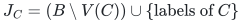

is an optimal common basis avoiding f.

**Proof.** The cycle-to-replacement argument supplies an optimum J avoiding f supported on B plus the labels of C, and containing B outside V(C). Let q=|J-B| and let u be the number of distinct labels on C. Then q<=u<=t. Applying the replacement-to-cycle argument to this J gives a cycle through f with at most q arcs and cost at most delta_f, including after minimum-label compression. Its cost must equal delta_f. Minimum hop count of C therefore implies

<!-- math-display: e8acd81a204fe2a09926a296
t\le\text{number of arcs of the new cycle}\le q\le u\le t.
-->
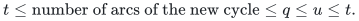

All quantities are equal. Hence q=u=t, the removed elements are exactly V(C), and the added elements are exactly its distinct labels. This proves the stated literal update. QED.

Thus minimum hop count resolves both the repeated-label issue and the need for a separate optimization call after receiving the cycle. No uniqueness perturbation of the basis optimum is required.

## 7. Sparsification and O(k) reporting

Split each a into a-minus and a-plus, add the zero split arc a-minus to a-plus, and replace each arc a to b of D by a-plus to b-minus. For every f in B, ask to preserve the distance from f-plus to f-minus. There are 2k vertices and k demands.

Use lexicographic arc weights consisting of the original valued length followed by a secondary hop count: one on labeled exchange arcs and zero on split arcs. Every directed cycle has nonnegative primary cost and strictly positive secondary cost. Hence a lexicographically shortest path is simple, and the demanded paths represent minimum-length, minimum-hop cycles through f.

Apply the directed weighted O(N_graph sqrt(p))-edge distance-preserver construction, with the deterministic phased hitting implementation in the ordinary companion. It consists of explicit short demand paths and shortest-path in-trees and out-trees for O(sqrt(k)) chosen hubs across all phases, plus O(k) demand records. The total representation has O(k^{3/2}) arcs/records. Lexicographic weights are handled by exact ordered-pair arithmetic; no perturbation is needed and no randomness is required.

For a demand served by a hub lying on one of its lexicographically shortest paths, concatenate its stored shortest path into the hub and the stored shortest path out of the hub. The concatenation has exactly the required lexicographic distance. It cannot repeat a vertex: deleting the resulting directed cycle would strictly decrease its lexicographic length. Thus it reports at most O(k) arcs. An explicitly stored short path is reported directly.

Retain B and all outside labels occurring in the preserver. Lemma 3 converts the reported minimum-hop cycle to the optimum common basis using O(k) operations. A fault outside B is answered by B. An unreachable demand indicates infeasibility at rank k. The optimum value may also be stored as Omega(B)+delta_f; evaluating the reported basis is not needed at query time.

## 8. Complexity and baseline provenance

Iwamasa and Takazawa, *Optimal matroid bases with intersection constraints: Valuated matroids, M-convex functions, and their applications*, arXiv:2003.02424v3 (2021), Lemma 7, give the standard baseline-valuated-intersection runtime

<!-- math-display: dfcccbe610d20fa6e1f1bb83
O(Nk^2\gamma+Nk\log N),
-->
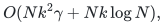

where gamma is the time needed to evaluate a valuation. For a bit-model
statement, let beta_val bound the bit length of every finite valuation returned
by the oracle and beta_in bound input labels; the exact rational operations
then have polynomial bit complexity in the explicit input size, beta_val, and
beta_in. With the initialization interface specified in Section 1, this supplies the initial optimum B. The costs of obtaining initial domain bases, if they are not supplied, are additional. The same paper explicitly uses
the fact that minimizing bases of a valuated matroid form an ordinary matroid.
Primary full text: https://arxiv.org/pdf/2003.02424 .

After B is known, the gamma_i tables use O(Nk) valuation evaluations, and the
minimum-label compressed arcs can be formed by O(Nk^2) arithmetic comparisons.
Dense shortest-path processing and the deterministic path-reporting preserver
fit within a conservative additional O(k^3) arithmetic-operation bound. An
oracle-call count alone does not claim a polynomial bound on returned-value
length.

The underlying valuated matroid intersection and cycle criteria are classical;
see Kazuo Murota, *Valuated Matroid Intersection I: Optimality Criteria*,
SIAM J. Discrete Math. 9 (1996), 545-561, DOI
10.1137/S0895480195279994, and Part II, DOI 10.1137/S0895480195280009. The
directed distance-preserver ingredient should be applied with its stated
weight assumptions: the compressed graph may have negative arcs even though
every directed cycle has nonnegative primary value. If the cited theorem
requires nonnegative edge lengths, first compute a Bellman--Ford potential from
a super-source and use reduced costs, retaining the exact ordered-pair tie
coordinate. The cited source is the Coppersmith-Elkin theorem restated as
Theorem 3 of Greg Bodwin, *A Note on Distance-Preserving Graph Sparsification*,
https://arxiv.org/pdf/2001.07741 .

The claimed incremental step is the transfer of the companion's sparse **single-failure support and path-reporting guarantee** to arbitrary pairs of valuated matroids. It is not a claim to have introduced valuated matroid intersection, its initial-matroid property, or its exchange-cycle framework. The restriction preserves the two fixed input valuations under one original element deletion; arbitrary later valuations, arbitrary contexts, and simultaneous multi-element or correlated-label failures are outside this statement.
