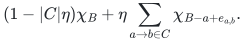
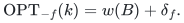

# Exact single-failure preservers and reporting

## 1. Theorem

Two independence-oracle matroids on an explicit ground <code class="math">E</code>, with fixed rational costs and a common independent <code class="math">k</code>-set, admit a deterministic polynomial construction of an <code class="math">O(k^{3/2})</code>-element restriction and reporting structure. After one element deletion it reports a minimum-cost common <code class="math">k</code>-set in <code class="math">O(k)</code> operations, or infeasibility, with no query-time matroid-oracle calls.

For a directed rooted graph with nonnegative rational arc costs, this gives <code class="math">O(n^{3/2})</code> original arcs and records, <code class="math">\widetilde O(mn)</code> arithmetic preprocessing, and <code class="math">O(n)</code> optimum-arborescence output. Record counts and arithmetic costs include actual value lengths when interpreted in the bit model.

## 2. Exchange cycles

Truncate both matroids to rank <code class="math">k</code>, and fix an optimum common basis <code class="math">B</code>. For <code class="math">a,b\in B</code>, keep the cheapest outside label <code class="math">e</code> with <code class="math">B-a+e</code> a first-matroid basis and <code class="math">B-b+e</code> a second-matroid basis. Its arc <code class="math">a\to b</code> has length <code class="math">w(e)-w(a)</code>. Loops are allowed.

**Lemma 2.1.** For a simple cycle <code class="math">C</code>, let <code class="math">d_C</code> remove every cycle vertex once and add outside labels with multiplicity. Then <code class="math">\chi_B+\eta d_C</code> is in both base polytopes for <code class="math">0&lt;\eta\le1/&#124;C&#124;</code>, and <code class="math">\ell(C)\ge0</code>.

**Proof.** In the first base polytope use
<!-- math-display: 6743bb2f50d7567b7d240e76
(1-|C|\eta)\chi_B+\eta\sum_{a\to b\in C}\chi_{B-a+e_{a,b}}.
-->

In the second use the heads <code class="math">b</code> instead of the tails <code class="math">a</code>. Both vectors agree because the cycle has the same head and tail multiset. Common-base integrality decomposes their common point into common bases. Since <code class="math">B</code> is optimal, its expected objective increment <code class="math">\eta\ell(C)</code> is nonnegative. <code class="math">\square</code>

**Lemma 2.2 (replacement identity).** If <code class="math">\delta_f</code> is the shortest cycle length through <code class="math">f\in B</code>, with infinity when none exists, then
<!-- math-display: a25a7b8dbe020dd968a15959
\mathrm{OPT}_{-f}(k)=w(B)+\delta_f.
-->

**Proof.** In Lemma 2.1's decomposition for a cycle through <code class="math">f</code>, bases avoiding <code class="math">f</code> have total coefficient <code class="math">\eta</code>. All component gaps above <code class="math">w(B)</code> are nonnegative and their average is <code class="math">\eta\ell(C)</code>. Some avoiding basis therefore has gap at most <code class="math">\ell(C)</code>. Its support uses only <code class="math">B</code> and cycle labels, and it contains <code class="math">B\setminus V(C)</code>.

Conversely, for a common basis <code class="math">J</code> avoiding <code class="math">f</code>, the basis-exchange matching lemma separately matches <code class="math">J\setminus B</code> to <code class="math">B\setminus J</code> in the two matroids. Pair the matchings into directed permutation cycles. Each cycle has nonnegative cost by the same convex-decomposition argument, and their sum is <code class="math">w(J)-w(B)</code>. The <code class="math">f</code>-cycle costs no more than that total. Replacing its outside labels by the cheapest compressed choices cannot increase cost. These two directions prove the identity and its feasibility convention. <code class="math">\square</code>

**Lemma 2.3 (literal update).** A minimum-cost cycle through <code class="math">f</code>, chosen with the fewest arcs, has distinct outside labels. Replacing its vertices by its labels is an optimum avoiding <code class="math">f</code>.

**Proof.** Let it have <code class="math">t</code> arcs and <code class="math">u\le t</code> distinct labels. The previous proof supplies an optimum <code class="math">J</code> supported there, retaining <code class="math">B\setminus V(C)</code>. Write <code class="math">q=&#124;J\setminus B&#124;\le u</code>. Reverse exchange decomposition supplies an optimal cycle through <code class="math">f</code> with at most <code class="math">q</code> arcs. Minimal hop count gives <code class="math">t\le q\le u\le t</code>. Equality forces precisely the stated removals and insertions. <code class="math">\square</code>

## 3. Sparse reporting

Split each baseline vertex into incoming and outgoing copies, with a zero arc between them. For each <code class="math">f</code>, a cycle becomes an outgoing-to-incoming demand path. Give exchange arcs secondary length one, and minimize (cost, hop count) lexicographically. There are <code class="math">2k</code> vertices and at most <code class="math">k</code> finite demands; every directed cycle is strictly positive in this order.

The classical directed distance-preserver theorem keeps <code class="math">O(N\sqrt p)</code> arcs for <code class="math">p</code> demands on <code class="math">N</code> vertices. A deterministic reporting implementation stores short paths explicitly and long paths through hubs, each with an in-tree and out-tree. At threshold <code class="math">N/\sqrt p</code>, a greedy hitting set of <code class="math">O(\sqrt p)</code> hubs serves a constant fraction of demands using <code class="math">O(N\sqrt p)</code> records. Remaining demand counts decrease geometrically, proving the total bound without a logarithmic loss.

A hub concatenation has the optimum lexicographic distance and cannot repeat a vertex: removing its strictly positive cycle would improve it. Reporting takes <code class="math">O(N)</code>, and Lemma 2.3 converts it to a basis in <code class="math">O(k)</code>. Failures outside <code class="math">B</code> return <code class="math">B</code>; unreachable demands are marked infeasible.

## 4. Arborescence and valuated specializations

Arborescences are common bases of the underlying graphic matroid and the partition matroid allowing one incoming arc per nonroot vertex. For an outside arc <code class="math">u\to v</code>, the partition removal is the tree arc entering <code class="math">v</code>; graphic removals lie on the undirected tree path from <code class="math">u</code> to <code class="math">v</code>. Heavy-light path intervals and a segment tree encode these transitions in <code class="math">O(n)</code> vertices and <code class="math">O(n+m\log^2 n)</code> arcs. The same reporting construction proves the graph bounds.

For two fixed-rank valuated matroids, use the sum of the two single-exchange valuation increments as the arc length. The complete valuated proof establishes the joint convex decomposition and valued exchange-matching inequality, after which Lemmas 2.2–2.3 apply. Preprocessing requires one supplied finite-valued basis in each effective domain, or independence access obtaining it, as well as value evaluations. A bare extended-value oracle cannot initialize a hidden unique basis efficiently.

For ordinary linear costs, the union of constructions at maximum ranks <code class="math">r</code> and <code class="math">r-1</code> handles rank drops. Arbitrary valuations have no implicit smaller-rank objective. The weighted lower bounds <code class="math">\Omega(k^{4/3})</code> and <code class="math">\Omega(n^{4/3})</code> are explicit transfers of classical distance-preserver lower bounds; two failures force quadratic support in the full manuscript's examples.

## Complete proofs and references

- [Exchange cycles, arborescence implementation, and lower bounds](manuscripts/exact-single-failure-arborescences-and-matroid-intersection.md).
- [Valuated extension and oracle interface](manuscripts/valuated-matroid-intersection.md).
- Goemans, [Matroid Intersection](https://math.mit.edu/~goemans/18453S17/matroid-intersect-notes.pdf).
- Bodwin, [A Note on Distance-Preserving Graph Sparsification](https://arxiv.org/pdf/2001.07741).

**Attribution:** Yilin Liu and GPT-6 Astra Pro.
