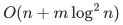

# Verification and scope

[Main proof](../proof.md) · [Source dependencies](../sources.md)

## Executable finite exchange checks

Run the [exact exchange checker](../../../tools/verify_sensitivity_certificates.py) from the repository root:

~~~sh
python3 tools/verify_sensitivity_certificates.py
~~~

The exchange section enumerates every subgraph of <code class="math">K_{3,3}</code> under five integer cost profiles, including signed costs and an all-zero profile with ties. For each feasible prescribed rank from one through three, it finds the baseline and every failed-element optimum by direct enumeration, independently of the compressed exchange calculation.

| Finite domain or outcome | Count |
|---|---:|
| Unweighted bipartite graphs | 512 |
| Integer cost profiles | 5 |
| Feasible fixed-rank instances | 6,180 |
| Single-failure queries | 11,040 |
| Queries with a feasible exact repair | 7,530 |
| Infeasible queries | 3,510 |
| Simple compressed cycles examined | 10,804 |

The replay checks that cycle costs are nonnegative, repair existence agrees with direct feasibility, and minimum-cost/minimum-hop repairs have the exact optimum gap, distinct outside labels, and a literal feasible toggle. These are finite instances of two partition matroids. They do not establish the theorem for arbitrary matroids, valuated matroids, or the arborescence implementation.

## Exchange and oracle boundaries

The common-base convex decomposition includes multiplicities when outside labels repeat. The replacement-value identity first establishes the existence of a supported optimum. A separate minimum-hop argument establishes distinct labels and a literal feasible toggle; the value identity alone does not supply that conclusion.

The valuated extension requires initial finite-domain bases, or independence access that supplies them. A bare extended-value oracle may hide its only feasible basis and does not justify the initialization time. Exact arithmetic and the bit lengths of rational oracle answers remain part of the stated access model.

## Arborescence implementation

The sparse exchange representation has

<!-- math-display: 387008096a415eb2a5c95f1d
O(n)
-->

 vertices and

<!-- math-display: 8349033980bbe479c40ba0e0
O(n+m\log^2 n)
-->

 arcs. Heavy-light path intervals encode the graphic exchanges; the partition exchange is the unique baseline arc entering the outside arc's head. The lexicographic cost/hop lengths and feasible-potential transformation retain the shortest-path order and exclude nonpositive directed cycles.

The construction uses

<!-- math-display: b9d235996578dfc5ca86cac1
\widetilde O(mn)
-->

 arithmetic operations. The final original-arc and reporting storage is

<!-- math-display: 975ee40c8b70041b0eef8aa8
O(n^{3/2})
-->

, and an explicit query report has

<!-- math-display: 387008096a415eb2a5c95f1d
O(n)
-->

 size. Temporary workspace and rational bit complexity are distinct quantities.

## Executable supplied-baseline arborescence reporting

Run the [independent arborescence checker](check_arborescence_reporting.py):

```sh
python3 problems/exact-failure-preservers/verify/check_arborescence_reporting.py
```

The [reference backend](../reference/README.md) implements the actual
heavy-light/segment-tree auxiliary graph and deterministic phased short-path
and hub-tree reporting from a supplied optimum directed rooted baseline.
The [realization proposition](../manuscripts/reference-arborescence-reporting.md)
matches its transitions, lexicographic shortest paths and literal original-ID
updates to the companion's proved construction. It uses dense exact
Floyd–Warshall preprocessing. It does not claim the optimized arithmetic
preprocessing bound displayed above or compute the initial optimum baseline.

The checker enumerates all root-entering-arc-free loopless directed graphs
on four labeled vertices at a fixed root, under five nonnegative integer or
rational cost profiles. One profile is all zero. It enumerates rooted
directed spanning arborescences independently to supply baseline optima and
every failure optimum. Each HLD transition row is compared against a direct
graphic-forest exchange test; the partition endpoint is checked separately.
Reports must be spanning directed trees, avoid the failed original ID, attain
the independently enumerated value, use only retained support, and minimize
the number of added outside labels among optimal repairs.

Six bidirected-path fixtures on ten, twenty-five and sixty-five vertices,
with zero or rational outside costs, exercise actual hub-tree reports.
Their failure optima follow independently by forced root-to-failure paths;
they are not supplied by an exponential baseline search. Boundary fixtures
cover a single vertex, a nonzero root, parallel original arcs, ignored loops
and root-entering arcs. Nine malformed or suboptimal-baseline inputs are
rejected. Two additional checks delete the caller's input list and disable
all preprocessing functions before reporting.

| Finite domain or outcome | Count |
|---|---:|
| Four-vertex graph topologies | 512 |
| Cost profiles | 5 |
| Feasible four-vertex profile instances | 1,520 |
| Profile instances without a spanning baseline | 1,040 |
| Directly checked baseline transition rows | 4,754 |
| Ordinary query comparisons | 11,491 |
| Feasible ordinary queries | 9,090 |
| Infeasible ordinary queries | 2,401 |
| Queries using stored hub trees | 171 |
| Queries using stored explicit paths | 2,184 |
| Larger path fixtures | 6 |
| Other boundary fixtures | 2 |
| Largest auxiliary graph vertex count | 255 |

The executable scope of that checker is the supplied-baseline arborescence
component. The initialized ordinary construction is checked separately below.
Finite graph checks do not establish arbitrary-matroid or valuated exchange
theorems, the optimized preprocessing implementation, or lower-bound
reductions. Those retain the linked mathematical proofs and primary
dependencies. No proof-assistant verification is claimed.

## Initialized ordinary matroid and arborescence reports

```sh
python3 problems/exact-failure-preservers/verify/check_matroid_reporting.py
```

The [ordinary reference](../reference/README.md) now computes its baseline
using the canonical weighted-intersection primitive and verifies its
potential/cut certificate before constructing the compressed reporter.
The [realization proof](../manuscripts/reference-ordinary-matroid-reporting.md)
states the full signed-cost fixed-rank contract and its polynomial
preprocessing costs. Initializer records and original callbacks are
discarded before returning the compact oracle. Its graph wrapper computes
the nonnegative rooted baseline before invoking the existing HLD component.

The new checker independently enumerates all common independent sets in
each finite fixture. It compares initial feasibility, baseline cost, every
no-failure/single-failure/unknown-ID query, literal independence, retained
support and the minimum number of outside labels among optimum repairs.
It covers every subgraph of the complete three-by-three bipartite graph
under three zero/signed integer/rational cost profiles, arbitrary binary
represented matroid pairs, and two clients of one explicit sparse-paving
matroid whose augmentation axioms are independently checked in full.
These finite opaque-oracle clients are distinct from the proof for
arbitrary matroids.

| Finite mechanism or outcome | Count |
|---|---:|
| Bipartite graph topologies | 512 |
| Fixed-rank ordinary constructions | 8,687 |
| Initial common-rank infeasibilities | 2,849 |
| Ordinary query comparisons | 39,311 |
| Feasible ordinary queries | 36,949 |
| Failure queries becoming infeasible | 2,362 |
| Ordinary queries using hub trees | 131 |
| Ordinary queries using explicit paths | 5,041 |
| Binary represented matroid pairs | 160 |
| Sparse-paving augmentation axioms | 8,377 |
| Sparse-paving cost/client profiles | 6 |
| Additional hundreds-of-bits signed/rational cost profile | 1 |
| Automatically initialized graph/profile instances | 1,024 |
| Graph instances initially infeasible | 416 |
| Initialized graph query comparisons | 4,441 |
| Graph boundary fixtures | 2 |
| Additional long signed-cycle hub queries | 33 |
| Queries with callbacks/producers disabled and input cleared | 5 |
| Malformed input rejections | 5 |

The graph comparator enumerates original rooted directed spanning trees,
including no-initial-tree cases. Boundary cases include arbitrary roots,
parallel arcs, ignored loops and root-entering arcs. Long signed matching
cycles at ranks eight and twenty-five force full-cycle literal repairs
through stored hubs. A ground of 1,024 original elements at rank two keeps
only three support IDs and fewer than fifty reporting records; its original
callbacks and optimization/shortest-path producers are disabled after the
caller cost list is cleared. A requested rank with a hundred-digit encoding
on an empty ground is rejected without a numerical rank loop.

That checker covers ordinary fixed-rank single deletion. The separately
checked valued and rank-drop interfaces are described below. Lower-bound
transfers and optimized graph
preprocessing retain their separate mathematical statements and evidence.
These exact finite checks do not assert proof-assistant verification or
external peer review.

**Attribution:** icekylinx and GPT-6 Astra Pro.


## Certified valuated and ordinary rank-drop reports

```sh
python3 problems/exact-failure-preservers/verify/check_valuated_rank_drop.py
```

The [new realization proof](../manuscripts/reference-valuated-and-rank-drop.md)
and [native API](../reference/README.md) cover a supplied common valued
baseline, independent split-price optimality verification and compact
fixed-rank reporting; and initialized ordinary maximum-cardinality reporting
through two consecutive ranks. The full bounded valuated companion proof
and the ordinary rank-drop corollary are audited. No native valuated baseline
search or cross-rank valuation is assumed.

The independent checker supplies:

- 164 finite valuation tables validated directly through 9,754 minimization-
  convention exchange axioms, including a genuinely nonlinear assignment
  valuation and signed rational values. There are 82 common-domain pairs,
  84 explicitly certified optimal supplied baselines and additional all-zero
  tied baselines.
- 376 original fixed-rank valued failure queries, including 27 independently
  infeasible cases; and rejection of 276 nonoptimal common baselines. The
  original optimum is obtained from complete common-basis enumeration,
  independently of prices, compressed arcs or paths.
- 33 long original partition-domain valued queries, all requiring complete
  cycle replacement and all using actual hub-tree reports. Signed rational
  increments and stored valued optimums are checked from their forced bases.
- 84 ordinary maximum-cardinality instances, 294 no-failure/deletion queries
  and 50 actual rank drops, plus a forced signed/rational lower-rank optimum.
  Every cardinality and minimum cost is compared with exhaustive original
  common sets.
- A producer-disabled original price-certificate verifier, four forged
  price/value certificates, and a 1,024-element preprocessing/query isolation
  fixture. Its valued rank-two reporter retains three original support IDs
  and fewer than fifty records; original valuations are disabled during
  reporting. The maximum-cardinality wrapper also keeps a bounded final
  record count on that ground.
- Fixed-rank zero valuation constants and six malformed-input rejections.

Assignment tables are not simply assumed to be valid valuated matroids:
the finite checker tests their complete exchange axioms before use. Long
partition domains have their ordinary matroid/linear-valuation proof rather
than an infeasible exhaustive basis-table validation. Finite examples do
not establish the general valuated theorem or asymptotic record bounds.

The standalone certificate verifier evaluates the original baseline and
its finite single exchanges; it calls neither the certificate producer,
compressed graph nor optimizer. Its sufficiency is the valuated local-to-
global theorem with two opposite prices. This verifies optimality conditional
on valid input valuations, not the input oracles' global exchange axioms.
The ordinary rank initializer likewise assumes valid independence callbacks.

Original-ground prices and initializer evidence are discarded before returning
the compact reporters. A separately retained price certificate is not counted
as compact reporting storage. Native valued preprocessing has the stated
exchange-table and cubic-rank arithmetic costs plus actual rational answer
lengths; the mathematical baseline initializer is the separately named primary
algorithm. Lower-bound transfers, multiple failures and optimized graph
preprocessing remain outside this incremental review. No external peer review
or proof-assistant verification is claimed.
