# Exact flow, matching, and price sensitivity

Original-subinstance certificates and reporting structures for independent single failures or single price changes.

[Proof](proof.md) · [Sources](sources.md)

**Guarantee**

Exact surviving optimum or cardinality for each model below; each result has its own failure/change semantics and parameters.

**Objective and output**

Minimum-cost unit flows and path packings; exact cardinality matchings; common independent sets; and exact prescribed-rank price-change optima.

**Randomness**

Deterministic preprocessing and queries in each stated flow, matching, matroid and price-sensitivity model; the required exact optimization and independence oracles retain their specified costs.

**Time**

Flow and vertex-disjoint paths have deterministic arithmetic preprocessing:

<!-- math-display: b9d235996578dfc5ca86cac1
\widetilde O(mn)
-->

General matching and oracle matroids have deterministic polynomial preprocessing. Price sensitivity beyond a baseline optimum uses the following independence-test and arithmetic-work bounds, respectively:

<!-- math-display: a4b92db27a7c3741e7c55533
O(Nr)
-->
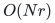

<!-- math-display: bc7b53cdc64e0cad4c090d30
O(Nr^2+r^3)
-->
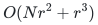

The [exact unit-flow reference](reference/README.md) implements a separate polynomial preprocessing bound for loopless unit-capacity multigraphs:

<!-- math-display: 24c232c6e03b5febe31ca710
O\!\left(n(m+1)(n+m+1)\right).
-->
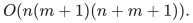

For simple input, its preprocessing specializes to:

<!-- math-display: 596429906c9b112a27c6fe9e
O\!\left(n^2(m+1)\right).
-->
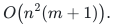

These counts use exact-arithmetic and hash-table operations; the reference proof accounts separately for bit length and Python dictionary behavior. Query bounds are listed separately.

**Space**

Support and reporting records are listed below. Rational values occupy their actual bit length; construction workspace and external oracle storage are separate.

**Parameters**

<code class="math">n,m</code> are graph sizes; <code class="math">\lambda</code> is a feasible flow value; <code class="math">s_x</code> is a fixed optimum flow support; <code class="math">\mu</code> is graph matching number; <code class="math">N,r</code> are matroid ground size and prescribed rank.

**Model and representation**

Simple directed unit-capacity graphs with nonnegative rational costs for the uniform flow exponent; loopless undirected general graphs for cardinality matching; independence-oracle matroids for intersection. All queries are independent relative to the preprocessed input.

**Lower-bound scope**

General-matching certificates preserve cardinality, not every increased replacement cost. Integrality alone does not imply a linear certificate: the manuscript gives a quadratic retained-vertex obstruction for maximum independent set even in perfect graphs.

**Review status**

**Ready for review in the stated scope.** The exact nonnegative rational unit-flow and internally vertex-disjoint path components: fixed-value and minimum-cost maximum queries, residual replacement, support-sensitive original-record preservers, compact reports and simple-input support specializations. The native path wrapper proves unit-gate deletion semantics, original-ID recovery and zero-cost-cycle-safe packing output. Both local realizations prove their own polynomial preprocessing and bit-cost contracts. The independent original-input certificate component proves signed-cost reduced-cost optimality, maximum-value and infeasibility cuts, and a binary-input cost-blind general-balance constructor. The signed unit-flow realization completes native minimum-cost initialization for arbitrary integral balances, negative cycles and loops, and compact fixed-balance and maximum-value deletion reporting with deterministic decoding. The complete ordinary fixed-rank price-change and supplied-catalog insertion identity, minimum-hop literal recovery and all-pairs reporting alternative are audited and implemented with native certified ordinary initialization.

**Dependencies and scope.** Parallel original records are supported under the support-sensitive bound; the uniform flow-value-dependent support exponent additionally requires a simple original digraph. Queries are independent single-record deletions, not cumulative updates. The native path wrapper requires simple directed input and one independent original-arc or internal-vertex failure. Terminal deletions and simultaneous failures are excluded. Its full packing output uses linear record work. The original nonnegative flow references use exact fractions and Python hash tables. Signed-flow and ordinary price reporters use deterministic dense decoding. All charge actual rational bit work and polynomial preprocessing separately from faster research bounds. General-matching and unweighted matroid support companions, specialized arborescence price machinery and valuated price software remain outside this reviewed component scope. Independent certificates scan the full surviving original graph, with separately charged production and verification; these costs do not inherit the compact oracle query bound. The general-balance constructor ignores costs. The separate signed optimizer initializes its own optimum; final signed reporting bounds use actual baseline support including negative cycles, not flow value. The native price backend handles ordinary matroid independence oracles, one independent cost increment or one inactive supplied-catalog insertion, and a prescribed common rank. It realizes the stated `O(N+r^2)` record alternative with `O(r)` output work, not the stronger pair-preserver record bound. It does not implement valuated prices, arbitrary uncatalogued arborescence insertion or an insertion-induced rank increase.

The [verification note](verify/README.md) identifies executable coverage. This status does not claim external peer review or proof-assistant verification.

**Source**

[Complete proof](proof.md) and [canonical manuscript map](sources.md).

## Results

**Fixed optimal unit flow of support <code class="math">s_x</code>, general balances/signed costs**

**Retained support / records.**

<!-- math-display: 3a09f62c7a0bb75bc7183be9
O(s_x+n\sqrt{s_x})
-->
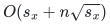

**Query time or report.**

<!-- math-display: 387008096a415eb2a5c95f1d
O(n)
-->

 difference;

<!-- math-display: 88c9ddccc2cd958f07ccc845
O(s_x+n)
-->
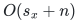
 full support

**Min-cost <code class="math">\lambda</code>-flow, simple nonnegative-cost digraph**

**Retained support / records.**

<!-- math-display: d82a2260a3e36bb3b398e7fd
O(n^{3/2}\lambda^{1/4})
-->
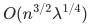

**Query time or report.**

<!-- math-display: 387008096a415eb2a5c95f1d
O(n)
-->

 difference;

<!-- math-display: 58df2e79a68a8cf86014b14a
O(n\sqrt{\lambda})
-->
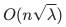
 full support

**Cost-only <code class="math">\lambda</code>-flow sensitivity**

**Retained support / records.**

<!-- math-display: 58df2e79a68a8cf86014b14a
O(n\sqrt{\lambda})
-->

**Query time or report.**

<!-- math-display: 0597cb37fc3e679e65c4032d
O(\log(n+1))
-->
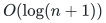

**Min-cost maximum flow**

**Retained support / records.**

<!-- math-display: f96afbbeaf324f6be44adfca
O(n^{3/2}\lambda^{1/4})\le O(n^{7/4})
-->
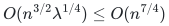

**Query time or report.** Two consecutive flow-value structures

**Min-cost maximum internally vertex-disjoint <code class="math">s</code>–<code class="math">t</code> paths**

**Retained support / records.**

<!-- math-display: 975ee40c8b70041b0eef8aa8
O(n^{3/2})
-->

**Query time or report.**

<!-- math-display: 387008096a415eb2a5c95f1d
O(n)
-->

 full output; one arc or one internal vertex failure

**General matching, one edge failure**

**Retained support / records.** At most

<!-- math-display: 8b090888e66c816523358c74
4\mu+2
-->
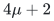
 edges

**Query time or report.**

<!-- math-display: dab72c5931a0273f931fca0c
O(\mu)
-->
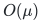
 via one blossom-aware augmentation

**General matching, one edge or one vertex failure**

**Retained support / records.** At most

<!-- math-display: 4494dc0845f619e3a92df197
6\mu+2
-->
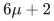
 edges

**Query time or report.**

<!-- math-display: dab72c5931a0273f931fca0c
O(\mu)
-->

; alternative single failures

**Two arbitrary matroids, cardinality only**

**Retained support / records.** At most

<!-- math-display: a101744e438eed74bc326c4d
2r+k\le3r
-->
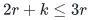
 elements

**Query time or report.** Optimize on retained ground using original oracles; <code class="math">k</code> avoidable baseline elements

**One-element price change, two matroids**

**Retained support / records.**

<!-- math-display: 7d06dadd0a7ae0930e58445b
O(N+r\sqrt{\min\{N,r^2\}})
-->
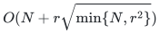

**Query time or report.**

<!-- math-display: 9653abd03124a149b1bfb543
O(r)
-->

 exact output, no query oracle calls

**Arbitrary new arborescence arc, prescribed spanning size**

**Retained support / records.**

<!-- math-display: e472ec35ce3fd8855fe02827
O(n^2)
-->
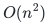
 records

**Query time or report.**

<!-- math-display: 3d8ce6ecd5b8d017cf5606e0
O(\log^2 n)
-->
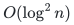
 gap evaluation;

<!-- math-display: 5908ab3b82a6373bc5945393
O(n+\log^2 n)
-->
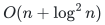
 full output

The weighted two-matroid and arborescence single-deletion theorems have their own [preserver card](../exact-failure-preservers/). Supplied-catalog insertion in the price structure keeps rank fixed; it does not handle an insertion that increases maximum rank.

## Independent original-input certificates

A separate [exact verifier and feasibility backend](reference/flow_certificates.py),
with a [complete local proof](manuscripts/independent-flow-certificates.md),
checks minimum-cost, maximum-value and infeasibility certificates on the full
surviving graph. Signed rational costs and general integral balances are
allowed for verification; the constructive general-balance routine is
cost-blind. The separate [signed flow backend](reference/signed_flow.py)
constructs the signed optimum itself and supplies compact fixed-balance and
maximum-value deletion reports. Its [complete proof](manuscripts/reference-signed-balance-flow.md)
includes isolated negative cycles, loops, parallel arcs and deterministic
report decoding. Storage depends on actual optimal support size; native
polynomial preprocessing is separate from the fast theorem.

## Native fixed-rank price and catalog queries

The [ordinary price backend](reference/price.py) computes an exact original
common-matroid baseline and reports minimum-cost common sets after one
independent rational cost change or one supplied-catalog insertion. Its
[complete proof](reference-price-realization.md) realizes the quadratic
all-pairs storage alternative and linear reporting, without query-time
oracle calls. Cardinality stays prescribed; rank-increasing insertion and
uncatalogued arcs remain separate interfaces.

**Attribution:** icekylinx and GPT-6 Astra Pro.
