# Compact reporting for one-element price changes in matroid intersection

**Abstract.** We prove a forced-element exchange-cycle identity and combine it with directed pairwise distance preservation. The resulting compact data structure reports an exact common-matroid optimum after one independent rational price change. Fixed-rank insertion and rooted-arborescence reporting follow from the same identity.

## 1. Statement and antecedents

Let two arbitrary matroids on a common <code class="math">N</code>-element ground set have a feasible common independent set of prescribed cardinality <code class="math">r\ge1</code>. Let <code class="math">w</code> be rational costs and <code class="math">B</code> a minimum-cost common <code class="math">r</code>-set. No linear representation is assumed.

Deterministic polynomial oracle preprocessing gives a self-contained structure using

<!-- math-display: aec79c3ed45b08e4a642433d
O\!\left(N+r\sqrt{\min\{N,r^2\}}\right)
\tag{1}
-->
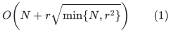

records. A query changes one original element's cost by an arbitrary rational amount <code class="math">\Delta</code>, and reports a minimum-cost common <code class="math">r</code>-set in <code class="math">O(r)</code> time, with no subsequent matroid-oracle calls. The simpler all-pairs-path implementation uses <code class="math">O(N+r^2)</code> records. Queries are independent changes relative to the original costs.

If <code class="math">r</code> is maximum common cardinality, cost-only changes do not affect it, so this also handles minimum-cost maximum-cardinality optimization. Records contain identifiers, rational values and pointers. Bit space includes their actual encoding lengths; the record count is not a claim that arbitrarily long costs fit into fixed machine words.

Brezovec, Cornuéjols, and Glover (1986) explicitly discuss weight sensitivity through exchange graphs. Camerini and Hamacher (1989) use condensed border graphs and shortest paths for ranking intersections. Neither sensitivity itself nor graph condensation is claimed new. The concrete contribution here is the forced-element identity with a repeated-label proof, followed by classical pair-distance preservation to obtain the reporting bound (1). Its priority needs comparison with the complete classical papers. [1–3]

## 2. Compressed exchange graph

Truncate both matroids to rank <code class="math">r</code>. For <code class="math">e\notin B</code>, let

<!-- math-display: ed997e6e90d016db426924be
A_e=\{a\in B:B-a+e\text{ is a base of }M_1\},\qquad
C_e=\{b\in B:B-b+e\text{ is a base of }M_2\}.
-->
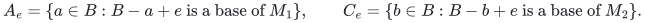

For every <code class="math">a\in A_e,b\in C_e</code>, introduce an arc <code class="math">a\to b</code>, labelled <code class="math">e</code>, of cost

<!-- math-display: d0032730a1fbf63d49da8866
w(e)-w(a).
\tag{2}
-->
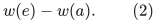

Let <code class="math">D</code> retain the cheapest labelled arc for each ordered pair of baseline elements. Ties are deterministic. Every arc has secondary length one, and all paths/cycles minimize (cost, number of arcs) lexicographically.

Two facts from the companion manuscript are recalled. First, every directed exchange cycle has nonnegative cost. For a simple cycle <code class="math">C</code> of <code class="math">t</code> arcs, let <code class="math">d</code> remove each cycle vertex once and add outside labels with multiplicity. For <code class="math">0&lt;\eta\le1/t</code>,

<!-- math-display: 4176e7891f3ef281629effcb
\chi^B+\eta d
=(1-t\eta)\chi^B+
\eta\sum_{a\to b\text{ on }C}\chi^{B-a+e}
-->
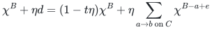

belongs to the first base polytope. Replacing each tail <code class="math">a</code> by its head <code class="math">b</code> proves membership in the second. The common-base polytope is integral, and optimality of <code class="math">B</code> implies nonnegative cycle cost.

Second, for any common base <code class="math">J</code>, basis-exchange matchings in the two matroids decompose <code class="math">B\triangle J</code> into labelled exchange cycles with total cost <code class="math">w(J)-w(B)</code>. Each outside element occurs exactly once. Replacing an unprotected arc by the cheapest corresponding arc of <code class="math">D</code> cannot increase cost.

## 3. Forcing an outside element

Fix <code class="math">e\notin B</code>. A candidate consists of one explicit eligible <code class="math">e</code>-arc <code class="math">a\to b</code>, followed by a shortest path from <code class="math">b</code> to <code class="math">a</code> in <code class="math">D</code>. A loop starter <code class="math">a=b</code> uses the empty return path. Otherwise the secondary hop objective makes the return path simple, so the candidate is a nonempty simple compressed cycle.

Define

<!-- math-display: de7003b0842f3ac1a43a1985
\delta_e^+
=\min_{a\in A_e,\ b\in C_e}
\bigl[w(e)-w(a)+\mathrm{dist}_D(b,a)\bigr],
\tag{3}
-->
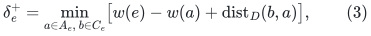

with infinity when no candidate exists. Among minimum-cost candidates choose one of minimum hop count.

**Forced-element identity.**

<!-- math-display: d6e605e36c7c58492ce05195
\min_{\substack{J\text{ common base}\\e\in J}} w(J)
=w(B)+\delta_e^+.
\tag{4}
-->
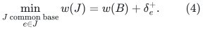

Moreover the chosen candidate can be toggled literally: its distinct baseline vertices leave and its distinct outside labels enter.

The return path may initially use the label <code class="math">e</code> again. This requires a proof, not an assumption. If a candidate <code class="math">C</code> uses <code class="math">e</code> with multiplicity <code class="math">q_e\ge1</code>, the fractional point from Section 2 has coordinate <code class="math">x_e=q_e\eta</code>. In an integral decomposition this is the total probability of bases containing <code class="math">e</code>. All decomposed bases cost at least <code class="math">w(B)</code>, while the expected cost increase is <code class="math">\eta\ell(C)</code>. Hence some base containing <code class="math">e</code> has increase at most

<!-- math-display: 06c3d64f0e164af65784f8f1
\ell(C)/q_e\le\ell(C),
-->
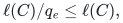

where nonnegative cycle cost justifies the last step.

Conversely, an optimum base containing <code class="math">e</code> has one exchange-decomposition cycle containing that label. All other cycles have nonnegative cost. Keep its one <code class="math">e</code>-arc explicit and compress the other arcs into <code class="math">D</code>; replacing the return route by a shortest path yields a candidate no more expensive than the optimum increase. This proves (4).

For literal feasibility, let the selected candidate have <code class="math">t</code> arcs and <code class="math">u\le t</code> distinct outside labels. Conditional decomposition gives an optimum <code class="math">e</code>-containing base <code class="math">J</code> supported on these labels and <code class="math">B</code>, retaining every baseline element outside the cycle. Put <code class="math">q=&#124;J\setminus B&#124;\le u</code>. Reverse exchange decomposition gives an <code class="math">e</code>-candidate of cost at most <code class="math">\delta_e^+</code> and at most <code class="math">q</code> arcs. Equation (4) makes its cost exactly <code class="math">\delta_e^+</code>. Minimum hop count forces

<!-- math-display: ee7a385ef6db2870dd43111e
t\le q\le u\le t.
\tag{5}
-->
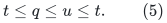

Thus all outside labels are distinct, <code class="math">J</code> uses all of them, and it removes all cycle vertices. This includes zero-cost and nonunique-baseline cases.

## 4. Excluding a baseline element and answering a price change

For <code class="math">f\in B</code>, the companion deletion theorem identifies

<!-- math-display: 39b6b5946b7b6b23ef4b04da
\delta_f^-=
\min_{\substack{J\text{ common base}\\f\notin J}}
w(J)-w(B)
-->
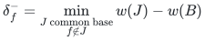

with the shortest nonempty exchange-cycle cost through <code class="math">f</code>. It can be computed from all-pairs distances by choosing a starter arc:

<!-- math-display: 29fcb7dd5dbc70c7517b708c
\delta_f^-=
\min_{f\to b\in E(D)}
\bigl[\ell(f,b)+\mathrm{dist}_D(b,f)\bigr].
\tag{6}
-->
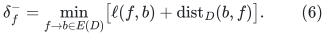

Again minimize total hop count among ties. The support-and-minimum-hop proof makes this cycle a literal optimum toggle.

When <code class="math">w(e)</code> changes by <code class="math">\Delta</code>:

- If <code class="math">e\notin B</code>, compare <code class="math">w(B)</code> with <code class="math">w(B)+\delta_e^++\Delta</code>. These are the best solutions excluding and containing <code class="math">e</code>.
- If <code class="math">e\in B</code>, compare <code class="math">w(B)+\Delta</code> with <code class="math">w(B)+\delta_e^-</code>.

Ignore infinite alternatives and return the corresponding toggle or <code class="math">B</code>. The comparison is valid for either sign and any magnitude of the price change.

## 5. Compact path storage

Compute <code class="math">D</code>, lexicographic all-pairs shortest paths, and one optimal starter descriptor per original element: (6) for baseline elements and (3) for outside elements. A descriptor specifies its starter, the return pair <code class="math">(b,a)</code>, and the optimum gap.

There is at most one demanded return pair per element. After deduplication,

<!-- math-display: 5267a80b4318e05f03d6abf3
p\le\min\{N,r^2\}.
-->
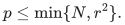

The classical deterministic directed weighted pair-distance construction, in the path-reporting form developed in the companion manuscript, stores these paths in <code class="math">O(r\sqrt p)</code> records. Adding the <code class="math">O(N)</code> descriptors gives (1). All-source shortest-path trees give the simpler <code class="math">O(N+r^2)</code> alternative.

Vertex splitting is unnecessary: every descriptor supplies a real starter arc, so an empty return path represents a one-arc exchange loop, never an empty exchange cycle. The pair-preserver uses the same secondary hop objective. Its reported return paths remain lexicographically shortest. Each has at most <code class="math">r-1</code> arcs; the starter plus return path is the literal toggle already proved. Full output takes <code class="math">O(r)</code> time.

Beyond computing <code class="math">B</code>, a direct implementation uses <code class="math">O(Nr)</code> independence tests for exchange eligibility and <code class="math">O(Nr^2+r^3)</code> arithmetic work to build <code class="math">D</code>, compute distances, and choose descriptors. The deterministic path structure uses polynomial preprocessing. These time bounds are not claimed optimal.

## 6. Fixed-rank insertion from a supplied catalog

Suppose only an active subset is initially available, <code class="math">B</code> is optimal among its common <code class="math">r</code>-sets, and inactive candidate elements are supplied for preprocessing. Build <code class="math">D</code> using only active outside elements.

For an inactive candidate <code class="math">e</code>, (3) remains valid and may be negative. Its return path cannot contain <code class="math">e</code>, so <code class="math">q_e=1</code>. Every decomposed base not containing <code class="math">e</code> uses only active elements and costs at least <code class="math">w(B)</code>. Conditioning therefore gives an <code class="math">e</code>-containing base of increase at most the candidate length without requiring that length to be nonnegative. Reverse exchange and the minimum-hop argument are unchanged.

Thus one descriptor supports inserting that candidate at its specified or query-adjusted price, with <code class="math">O(r)</code> reporting. The cardinality is prescribed: an insertion that raises maximum common cardinality from <code class="math">r</code> to <code class="math">r+1</code> is not covered here. Every insertion query activates one candidate relative to the original active set.

## 7. Valuated and arborescence corollaries

For two valuated matroids with an additional linear price vector, use the companion valuated tangent and exchange-matching lemmas. Replace (2) by the sum of the two single-exchange valuation increments and the linear-price increment. Conditional mass, reverse exchange, and minimum-hop proofs then give the same bounds for changing one linear price.

For a rooted directed spanning arborescence <code class="math">T</code>, a new arc <code class="math">e=(u,v)</code> has the unique partition-removal choice <code class="math">b_v</code>, the tree edge entering <code class="math">v</code>. Its graphic-removal choices are the tree edges on the undirected path <code class="math">P_T(u,v)</code>. Therefore its forced-arc gap is

<!-- math-display: 552e52f4e64487b9e02f1cc9
w(e)+\min_{a\in P_T(u,v)}
\left[\mathrm{dist}_D(b_v,a)-w(a)\right].
\tag{7}
-->
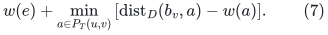

For each <code class="math">b</code>, store a range-minimum structure on a heavy-light decomposition of <code class="math">T</code> for the values <code class="math">\mathrm{dist}_D(b,a)-w(a)</code>, breaking cost ties by return-path hop count. All <code class="math">b</code>'s use <code class="math">O(n^2)</code> records, as do all-source return-path trees. An arbitrary new arc specified at query time is evaluated in <code class="math">O(\log^2 n)</code> time, and the resulting optimum arborescence is reported in <code class="math">O(n+\log^2 n)</code>. Discard self-loops and arcs entering the root. For parallel original arcs, identities and original prices are retained as needed for price-change queries.

Directed-tree reoptimization through weighted matroid intersection is established work, including Jiang–Wang 2026. This is a static reporting-data-structure consequence, not a first dynamic directed-tree or sensitivity claim. [4]

## References

1. Carl Brezovec, Gérard Cornuéjols, and Fred Glover. **Two Algorithms for Weighted Matroid Intersection.** Mathematical Programming 36 (1986), 39–53. <https://link.springer.com/article/10.1007/BF02591988>
2. Paolo M. Camerini and Horst W. Hamacher. **Intersection of Two Matroids: (Condensed) Border Graphs and Ranking.** SIAM Journal on Discrete Mathematics 2 (1989), 16–27. <https://epubs.siam.org/doi/10.1137/0402002>
3. Don Coppersmith and Michael Elkin. **Sparse Sourcewise and Pairwise Distance Preservers.** SIAM Journal on Discrete Mathematics 20 (2006), 463–501. The directed weighted <code class="math">O(n\sqrt p)</code> bound is also stated in later primary literature, including <https://arxiv.org/pdf/2001.07741>.
4. Jiang and Wang. **Optimization of Directed Spanning Trees Using Weighted Matroid Intersection.** July 2026 preprint / Discrete Applied Mathematics, DOI 10.1016/j.dam.2026.07.027. <https://arxiv.org/abs/2607.25238> The comparison here uses the reported problem scope; the full paper's detailed time and space guarantees have not been independently verified in this manuscript.
