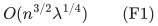
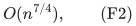
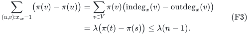
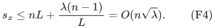
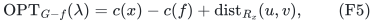
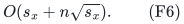
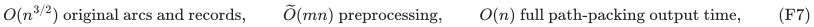

# Exact one-failure minimum-cost flow preservers from a sparse acyclic support

**Abstract.** We express every relevant single-arc failure of a fixed optimal unit-capacity flow as a distance demand in one residual graph. Combining this reduction with classical pairwise distance preservation and the acyclic-flow support bound gives exact sparse preservers, difference reporting, and cost oracles. Vertex splitting yields an output-sensitive analogue for internally vertex-disjoint paths.

## 1. Statement

Let <code class="math">G=(V,E)</code> be a simple directed graph on <code class="math">n</code> vertices and <code class="math">m</code> arcs, with capacity one on every arc, nonnegative rational arc costs, and fixed terminals <code class="math">s\ne t</code>. Self-loops may be discarded: with nonnegative costs they are never needed in a minimum-cost flow, before or after a failure. For a feasible integer flow value <code class="math">\lambda\ge1</code>, there is a deterministic exact one-edge-failure minimum-cost <code class="math">\lambda</code>-flow preserver containing

<!-- math-display: 58bd9364bfa56056bcb44fa3
O(n^{3/2}\lambda^{1/4})
\tag{F1}
-->

original arcs. The preserver contains an optimum flow in <code class="math">G-f</code> whenever value <code class="math">\lambda</code> remains feasible, for every individual original arc <code class="math">f</code>, and also contains a no-failure optimum.

The same asymptotic number of pointer/ID records supports a reporting oracle. It reports the change from a stored optimum in <code class="math">O(n)</code> time, or the full surviving optimum as a sparse list of used arcs in <code class="math">O(n\sqrt\lambda)</code> time. If only the optimum cost and feasibility are needed, the stored path structure can be discarded: **<code class="math">O(n\sqrt\lambda)</code> cost/ID records and <code class="math">O(\log(n+1))</code> query time suffice**. The oracle has no access to the original graph at query time.

All preprocessing is deterministic and takes <code class="math">\widetilde O(mn)</code> arithmetic operations. Exact rational arithmetic has polynomial bit complexity; the records are a word-space bound when identifiers, pointers, and stored cost values fit in words.

If <code class="math">\lambda</code> is the original maximum-flow value, take the union of the constructions for values <code class="math">\lambda</code> and <code class="math">\lambda-1</code>. A single unit-capacity edge deletion lowers maximum flow by at most one. This gives the same bounds for an **exact minimum-cost maximum-flow oracle after any one edge failure**. The zero-flow case is trivial.

In a simple graph, <code class="math">\lambda\le n-1</code>. Thus (F1) is always

<!-- math-display: aefe2e0fc88b36477bb749c4
O(n^{7/4}),
\tag{F2}
-->

including when the original maximum flow is large. Both nonnegative costs and simplicity matter for this unconditional exponent. The more general support-sensitive statement below remains valid without those two assumptions.

## 2. Acyclic unit flows have only <code class="math">O(n\sqrt\lambda)</code> support arcs

This support bound is due to Karger--Levine (STOC 1998). We include a direct topological-span proof to make its application to directed minimum-cost flows explicit.

Fix an integral minimum-cost <code class="math">\lambda</code>-flow <code class="math">x</code>. Because all original costs are nonnegative, every directed cycle in its positive support has cost zero: otherwise cancelling one unit around that cycle would reduce the objective. Cancel such zero-cost cycles until the support is acyclic, without changing its value or cost.

Write <code class="math">s_x=&#124;\{e:x_e=1\}&#124;</code>. Take any topological ordering <code class="math">\pi:V\to[n]</code> of its support. The sum of its positive arc spans telescopes using flow conservation:

<!-- math-display: 68787b9ab7e67fd613a8b395
\begin{aligned}
 \sum_{(u,v):x_{uv}=1}\bigl(\pi(v)-\pi(u)\bigr)
 &=\sum_{v\in V}\pi(v)
       \bigl(\mathrm{indeg}_x(v)-\mathrm{outdeg}_x(v)\bigr)\\
 &=\lambda\bigl(\pi(t)-\pi(s)\bigr)
 \le \lambda(n-1).
\end{aligned}
\tag{F3}
-->

For any integer <code class="math">L\ge1</code>, simplicity bounds the number of support arcs with span less than <code class="math">L</code> by <code class="math">nL</code>: for each tail there are fewer than <code class="math">L</code> possible heads in that range. Equation (F3) bounds the number with span at least <code class="math">L</code> by <code class="math">\lambda(n-1)/L</code>. Setting <code class="math">L=\lceil\sqrt\lambda\rceil</code> gives

<!-- math-display: 49377adbe732bb0d99b252ee
s_x\le nL+\frac{\lambda(n-1)}L
                         =O(n\sqrt\lambda).
\tag{F4}
-->

This is stronger than the immediate <code class="math">O(\lambda n)</code> bound from decomposing the flow into <code class="math">\lambda</code> paths. The proof uses only an acyclic integral unit flow in a simple digraph; it is independent of how the optimum was computed.

## 3. Every relevant failure is an ordinary residual-distance demand

Construct the residual graph <code class="math">R_x</code>. For an unused original arc <code class="math">a=(u,v)</code>, include <code class="math">u\to v</code> of length <code class="math">c(a)</code>, labeled as adding <code class="math">a</code>. For a used arc <code class="math">a=(u,v)</code>, include its reverse <code class="math">v\to u</code> of length <code class="math">-c(a)</code>, labeled as removing <code class="math">a</code>. Distinct original arcs retain distinct IDs even if residual arcs become parallel. Optimality of <code class="math">x</code> implies that <code class="math">R_x</code> has no negative directed cycle.

If a failed arc <code class="math">f</code> is unused, <code class="math">x</code> remains optimum. Consider a used arc <code class="math">f=(u,v)</code>. The key identity is

<!-- math-display: 75842642db1022294610c4ee
\mathrm{OPT}_{G-f}(\lambda)
        =c(x)-c(f)+\mathrm{dist}_{R_x}(u,v),
\tag{F5}
-->

with the convention <code class="math">+\infty</code> for infeasibility.

**A residual path gives a feasible repair.** A simple residual <code class="math">u</code>-to-<code class="math">v</code> path cannot use the residual reverse <code class="math">v\to u</code> of the failed arc: it would visit its terminal <code class="math">v</code> before finishing, or revisit its source <code class="math">u</code>. Delete <code class="math">f</code> from the flow, then augment one unit along this residual path. Original unused arcs on the path become used, and used arcs traversed in reverse become unused. All capacities remain respected. The endpoint imbalances caused by deleting <code class="math">f</code> are exactly repaired. Its cost is the right side of (F5).

**An optimum repair gives a residual path.** For any integral feasible <code class="math">\lambda</code>-flow <code class="math">y</code> avoiding <code class="math">f</code>, orient the signed difference <code class="math">y-x</code> as a circulation in <code class="math">R_x</code>. It decomposes into directed cycles, including one that contains the reverse of <code class="math">f</code>. All these cycles have nonnegative cost. Removing the reverse of <code class="math">f</code> from its cycle gives a residual <code class="math">u</code>-to-<code class="math">v</code> path of cost at most <code class="math">c(y)-c(x)+c(f)</code>. This proves the other inequality and the feasibility equivalence.

Thus all failures reduce to at most <code class="math">s_x</code> ordinary ordered-pair distance demands in the *same* residual graph. In particular, the residual graph need not be modified separately for each failed edge.

## 4. Preserving and reporting the repairs

Apply the classical directed weighted <code class="math">p</code>-pair distance-preserver bound <code class="math">O(n\sqrt p)</code>, with <code class="math">p\le s_x</code>, to the demands in (F5). Keep the baseline support and every original arc whose forward or reverse residual copy is retained. The resulting original-arc subgraph has size

<!-- math-display: c27dee19482418669e15204b
O(s_x+n\sqrt{s_x}).
\tag{F6}
-->

By (F5), it contains an optimum after every relevant failure; failures outside the baseline support keep <code class="math">x</code> feasible and optimum. Substituting (F4) proves (F1).

For constructive reporting, use the deterministic phased short-path/hub construction from the companion two-matroid manuscript. Give each residual arc the lexicographic length <code class="math">(\ell,1)</code>. Every directed cycle is strictly positive in this order: its first coordinate is nonnegative and its second is positive. Consequently every lexicographically shortest demand walk is simple. Store explicit short demand paths and, for each selected hub, an in-tree and an out-tree of shortest paths, with a demand pointer to an appropriate hub. The total number of records is <code class="math">O(s_x+n\sqrt{s_x})</code>; a demand path is reported in <code class="math">O(n)</code> time.

Its signed original-arc labels, together with removal of <code class="math">f</code>, are the complete update from <code class="math">x</code>. This reports a difference of at most <code class="math">n</code> original arcs. To output a full optimum, scan the stored support, omit its removed arcs, and append the added arcs. The result has at most <code class="math">s_x+n</code> used arcs and is produced in <code class="math">O(s_x+n)</code> time. Per-query timestamps on the baseline support, with positions recorded in the path labels, avoid scanning the full original ground set. A query for an unused arc is handled by the baseline dictionary.

Store the value in (F5) or an infinity flag for every used baseline arc. A cost query needs only dictionary lookup and the stored answer. If no path or flow output is requested, discard all paths and trees and retain only this <code class="math">O(s_x)</code>-record table and the baseline cost. This is the elementary relevant-failures-table consequence of the support bound. It does not claim a faster baseline minimum-cost-flow algorithm; it is a static sensitivity representation.

For arbitrary integer balances and signed rational costs, the residual reduction and (F6) still hold for any fixed optimal integral unit-capacity flow of support size <code class="math">s_x</code>. Nonnegative <code class="math">s</code>-to-<code class="math">t</code> costs and simplicity are what supply the stronger uniform bound (F4).

## 5. Preprocessing and maximum-flow value changes

A deterministic successive-shortest-augmenting-path algorithm computes the minimum-cost flow of every feasible value up to <code class="math">\lambda</code> using <code class="math">O(\lambda(m+n\log n))</code> arithmetic operations with potentials. To obtain an acyclic optimum directly, use the lexicographic original-arc objective <code class="math">(c(e),1)</code>: first minimize original cost, then total used-arc count. Every support cycle has a strictly positive lexicographic cost and could be cancelled, so none occurs in such an optimum. The second criterion does not change the primary optimum. Here <code class="math">\lambda\le n-1</code> and also <code class="math">\lambda\le m</code>, so construction is <code class="math">\widetilde O(mn)</code>. For the maximum-flow objective, retain optima at the last two feasible values. Alternatively, the cycle cancellation described in Section 2 makes an arbitrary optimum acyclic within the same preprocessing budget.

For each of the at most two baseline flows, Bellman--Ford potentials and all-source shortest paths in its residual graph use <code class="math">\widetilde O(mn)</code> arithmetic operations. Isolated vertices need not enter the residual shortest-path computation; the number of incident vertices is at most <code class="math">2m</code>, so the apparent additional all-source <code class="math">n^2</code> term is absorbed by <code class="math">O(mn)</code>. The at most <code class="math">s_x</code> demanded paths have <code class="math">O(ns_x)\subseteq O(nm)</code> total incidence size.

The phased greedy hitting construction can maintain vertex-to-unhit-path incidence lists and coverage counts. Each path is removed once in a phase, and the number of remaining demands decreases geometrically. This costs <code class="math">\widetilde O(ns_x)</code>, within the same bound. Final stored tree records and retained original arcs satisfy (F6).

If the original maximum flow is <code class="math">\lambda</code>, removing a single used arc from an integral flow loses at most one of its path units; equivalently, every cut loses at most one unit of capacity. Thus the new maximum value is either <code class="math">\lambda</code> or <code class="math">\lambda-1</code>. The rank-<code class="math">\lambda</code> reporting oracle determines feasibility and supplies the optimum when feasible. Otherwise the separately constructed value-<code class="math">(\lambda-1)</code> oracle supplies the new exact minimum-cost maximum flow. This argument does not treat a single edge of capacity larger than one as a unit-capacity failure.

## 6. Vertex-disjoint path packings: <code class="math">O(n^{3/2})</code> space for both arc and vertex faults

Consider the minimum-total-cost maximum collection of internally vertex-disjoint directed paths from a fixed <code class="math">s</code> to a fixed <code class="math">t</code>, with nonnegative rational costs, in a simple directed graph. The number of paths is unrestricted and is determined by the instance. There is an exact sensitivity preserver and reporting oracle with

<!-- math-display: da2042237bf9ecd6836a20a0
O(n^{3/2})\text{ original arcs and records},\qquad
         \widetilde O(mn)\text{ preprocessing},\qquad
         O(n)\text{ full path-packing output time},
\tag{F7}
-->

handling either one original arc failure or one internal vertex failure in the same oracle.

Use the classical vertex-splitting reduction. Replace every internal vertex <code class="math">v</code> by <code class="math">v^{\mathrm{in}},v^{\mathrm{out}}</code> and its unit-capacity gate <code class="math">v^{\mathrm{in}}\to v^{\mathrm{out}}</code>; original arcs go from the appropriate out-copy to the appropriate in-copy. Give gates zero cost and every original arc capacity one. Keep <code class="math">s,t</code> unsplit, discard arcs entering <code class="math">s</code> or leaving <code class="math">t</code>, and keep the possible direct <code class="math">s\to t</code> arc at capacity one. Integral acyclic flows are precisely collections of internally vertex-disjoint paths.

An acyclic optimum packing uses each internal vertex in at most one path. Its original arcs number at most <code class="math">n-2+\lambda=O(n)</code>, and its gates number at most <code class="math">n-2</code>, because <code class="math">\lambda\le n-1</code>. Therefore its full split-network support has <code class="math">s_x=O(n)</code>, independently of the packing size. Apply the support-sensitive formula (F6) to this <code class="math">O(n)</code>-vertex split graph, giving <code class="math">O(n^{3/2})</code> retained arcs and records. The support-sensitive proof does not need the generic bound (F4) here.

Failure of an original arc is failure of one corresponding unit arc. Failure of an internal vertex is failure of its one gate. In a feasible nonnegative flow, deleting that gate forces all incident original-arc flow at the vertex to zero by conservation at the in-copy and out-copy, so this is exactly the original vertex-deletion requirement. Relevant arc and gate queries together form only <code class="math">O(n)</code> residual-distance demands.

Removing one arc or one vertex destroys at most one path of a vertex-disjoint packing. Hence maximum packing size falls by at most one, and the union of two consecutive-value constructions handles the maximum-cardinality objective with minimum total cost as its secondary objective. A reported residual repair changes <code class="math">O(n)</code> split arcs. Its original-arc support is <code class="math">O(n)</code>; any zero-cost directed cycles can be discarded, and the remaining paths can be enumerated, in <code class="math">O(n)</code> time. Positive-cost cycles cannot occur in an optimum.

The endpoint pair is fixed; this does not solve prescribed multi-commodity disjoint-path problems. The standard simple-graph assumption also rules out arbitrarily many parallel direct <code class="math">s\to t</code> arcs, which would otherwise permit arbitrarily large output without using any internal vertices. With <code class="math">d</code> such parallel arcs retained as separate objects, an <code class="math">O(n)</code> output bound would require an additional dependence on <code class="math">d</code>.

## 7. Baselines and the scope of the increment

The <code class="math">O(n\sqrt p)</code> directed weighted pairwise-preserver ingredient is classical. Bodwin's simplified construction explicitly attributes it to Coppersmith--Elkin; the deterministic phased implementation and path-reporting records follow the companion manuscript.

For <code class="math">\lambda=1</code>, the flow problem is ordinary weighted <code class="math">s</code>-to-<code class="math">t</code> replacement-path preservation. Bodwin--Grandoni--Parter--Vassilevska Williams (ICALP 2017), Lemmas 4.5--4.6, already relate that problem to ordinary pairwise distance preservation, yielding the <code class="math">O(n^{3/2})</code> upper bound. The <code class="math">O(n\sqrt\lambda)</code> support lemma is likewise classical, due to Karger--Levine (STOC 1998). The contribution here is the general unit-flow residual-demand application and its composition with that lemma, leading to <code class="math">O(n^{3/2}\lambda^{1/4})</code> exact failure support and the universal <code class="math">O(n^{7/4})</code> consequence.

Bansal--Choudhary--Dhanoa--Wardhan (ISAAC 2024) preserve single-source bounded **flow value** under <code class="math">h</code> faults with <code class="math">O(\lambda 2^h n)</code> arcs; the requirement covers all targets but does not preserve an exact cost objective. Ahi--Choudhary--Pande--Pushpraj--Saggi (ITCS 2026) give compact oracles for unweighted maximum-flow and minimum-cut queries. Their cardinality-only guarantees are not being improved here.

Bilò et al. (STACS 2022) construct minimum-cost <code class="math">p</code>-disjoint-path preservers from one source to all targets in the no-failure model, with <code class="math">p(n-1)</code> edges, and state an extension to vertex-disjoint paths. Their multipath guarantee fixes the cost optimum before faults; it does not assert that the surviving graph contains a new exact cost optimum after an arbitrary arc or vertex deletion. Formula (F7) concerns one fixed terminal pair and fault-sensitive exact optimality.

Choudhary--Kumar--Saggi (September 2026), Theorem 4.5, give randomized algebraic min-cost maximum-flow sensitivity oracles for an arbitrary number <code class="math">f</code> of updates and integer costs bounded by <code class="math">W</code>, with <code class="math">\widetilde O(W(fn)^3)</code> preprocessing, <code class="math">O(W(fn)^3\log n)</code> space, and <code class="math">\widetilde O(f^{3\omega+1}Wn)</code> cost-query time. The present one-deletion construction is deterministic, uses arbitrary nonnegative rational costs, retains original arcs, and supports direct solution reporting. It has a narrower update model. This comparison is a concrete distinction from that general-purpose oracle, not a claim that every previous single-failure flow representation has been ruled out.

### Primary sources

1. Greg Bodwin. *A Note on Distance-Preserving Graph Sparsification*, Theorem 3 and Lemma 1. https://arxiv.org/pdf/2001.07741
2. Don Coppersmith, Michael Elkin. *Sparse Sourcewise and Pairwise Distance Preservers*. SIAM Journal on Discrete Mathematics 20(2), 463--501, 2006. DOI 10.1137/050630696.
3. Greg Bodwin, Fabrizio Grandoni, Merav Parter, Virginia Vassilevska Williams. *Preserving Distances in Very Faulty Graphs*. ICALP 2017, Lemmas 4.5--4.6. https://arxiv.org/pdf/1703.10293
4. Shivam Bansal, Keerti Choudhary, Harkirat Dhanoa, Harsh Wardhan. *Fault-Tolerant Bounded Flow Preservers*. ISAAC 2024, Article 9. https://drops.dagstuhl.de/entities/document/10.4230/LIPIcs.ISAAC.2024.9
5. Mridul Ahi, Keerti Choudhary, Shlok Pande, Pushpraj, Lakshay Saggi. *Maximum-Flow and Minimum-Cut Sensitivity Oracles for Directed Graphs*. ITCS 2026, Article 5. https://drops.dagstuhl.de/storage/00lipics/lipics-vol362-itcs2026/html/LIPIcs.ITCS.2026.5/LIPIcs.ITCS.2026.5.html
6. Keerti Choudhary, Amit Kumar, Lakshay Saggi. *Sensitivity Oracles for Matroid Packing, Matroid Covering, and Matching Problems with Applications*. arXiv:2609.01283v1, Theorem 4.5. https://arxiv.org/pdf/2609.01283
7. Jeff Erickson. *Algorithms, Lecture 25½: Minimum Cost Flows*. University of Illinois, Spring 2016. Residual cycle optimality and successive shortest augmenting paths. https://courses.grainger.illinois.edu/cs473/sp2016/notes/25bis-mincostflow.pdf
8. David R. Karger, Matthew S. Levine. *Finding Maximum Flows in Undirected Graphs Seems Easier than Bipartite Matching*. STOC 1998, 69--78, DOI 10.1145/276698.276714, Theorem 3.1. The acyclic <code class="math">O(n\sqrt\lambda)</code>-support bound is a general simple-graph flow lemma used by their undirected-flow algorithms. https://people.csail.mit.edu/karger/Papers/stoc98.pdf . Accessible full-text mirror: https://kam.mff.cuni.cz/~matousek/cla/karger-levine-floweasierthanmatching.pdf
9. Davide Bilò, Gianlorenzo D'Angelo, Luciano Gualà, Stefano Leucci, Guido Proietti, Mirko Rossi. *Single-Source Shortest <code class="math">p</code>-Disjoint Paths: Fast Computation and Sparse Preservers*. STACS 2022, Article 12. https://drops.dagstuhl.de/entities/document/10.4230/LIPIcs.STACS.2022.12
