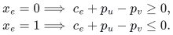
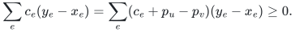
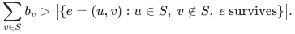
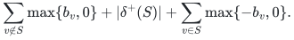
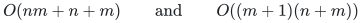

# Independent certificates for unit-capacity flows and balance feasibility

[Verifier](../reference/flow_certificates.py) · [Producer and feasibility backend](../reference/certify_flow.py) · [Independent checks](../verify/check_flow_certificates.py)

## Input and certificate contract

The input is the **full original** directed graph, with explicit unit-capacity arc records and exact signed rational costs. Loops, parallel records and opposite arcs are allowed. An optional failed original record is deleted. Vertices and arc IDs are original integer positions. Prescribed outward balances are integers summing to zero. The reference rejects floats, Boolean IDs, repeated support IDs and malformed dimensions.

A feasible flow is a tuple of distinct surviving original IDs; its indicator is denoted by <code class="math">x</code>. The divergence convention is outflow minus inflow. A cost certificate contains this support, its exact total cost, and one rational potential <code class="math">p_v</code> per vertex. The verifier scans every surviving original record, including records omitted by a preserver. Thus it certifies optimality against the full surviving instance, rather than just the retained subgraph.

The certificate producer accepts a supplied optimal support. It does not solve a signed-cost optimization problem. The separate balance-feasibility backend finds a feasible support or a violated cut, ignoring costs. Neither interface changes the nonnegative-cost input restriction of the compact sensitivity oracle.

## 1. A complete cost certificate

**Theorem 1.** A feasible unit flow is minimum-cost for its prescribed balances if and only if it admits potentials satisfying the following conditions on every surviving record <code class="math">e=(u,v)</code>:

<!-- math-display: 8b3b9ef3331d6a42525e0250
\begin{aligned}
x_e=0&\implies c_e+p_u-p_v\ge0,\\
x_e=1&\implies c_e+p_u-p_v\le0.
\end{aligned}
-->

**Proof of sufficiency.** Let <code class="math">y</code> be any other feasible flow, even a fractional flow within unit capacities. For an unused record the product of its reduced cost with <code class="math">y_e-x_e</code> is nonnegative. For a used record both factors are nonpositive, so the product is again nonnegative. The equal divergences cancel the potential contribution. Therefore

<!-- math-display: df0cabae19fa45da5f4a5926
\sum_e c_e(y_e-x_e)
=\sum_e(c_e+p_u-p_v)(y_e-x_e)\ge0.
-->

The verifier also checks every capacity, original ID, divergence and the claimed cost, so the displayed inequality proves exactly its acceptance claim.

**Proof of necessity.** Give each unused surviving record a forward residual arc of cost <code class="math">c_e</code>, and each used record a reverse residual arc of cost <code class="math">-c_e</code>. A negative residual simple cycle can be flipped: each original record has exactly one residual direction, so flipping preserves binary capacities and balances while strictly reducing cost. This includes negative loops and cycles in components disconnected from any designated terminals. An optimal support therefore has no negative residual cycle.

Add a conceptual super-source with zero-length arcs to every vertex. Shortest distances from this source are finite: any repeated vertex in a walk bounds a nonnegative cycle that may be removed, leaving a simple path. Let these distances be <code class="math">p</code>. For every residual arc they satisfy <code class="math">p_v\le p_u+c_e</code>, precisely the required inequalities in the original orientation. This proves necessity and certificate existence. The producer realizes the argument by initializing every distance to zero and using Bellman--Ford relaxation; it rejects a relaxation in the final detection pass. It does not restrict the search to the source component. <code class="math">\square</code>

Potentials are not normalized or unique. The verifier accepts every valid one, and does not compare a witness to the producer's particular output.

## 2. Maximum value and infeasibility

**Theorem 2.** A minimum-cost certificate for a nonnegative source-to-target value, together with a source-containing, target-excluding vertex set whose outgoing surviving capacity equals that value, certifies a minimum-cost maximum flow.

**Proof.** Sum divergence over the set. Any feasible source-to-target flow has value equal to outgoing flow minus incoming flow, hence at most the outgoing capacity. The certified flow attains this upper bound and Theorem 1 proves its minimum cost at that value. Conversely, if a maximum flow had a residual source-to-target path, augmenting along a simple such path would raise its value by one. Thus the target is unreachable. The vertices reachable from the source form a cut with all outgoing records used and all incoming records unused, so its capacity equals the value. The producer constructs this cut by residual reachability. Circulations, signed costs and loops do not alter the argument. <code class="math">\square</code>

**Theorem 3.** For prescribed integral balances <code class="math">b</code>, a vertex set <code class="math">S</code> certifies infeasibility whenever

<!-- math-display: 9699de49dbf4dbf8300fe3c2
\sum_{v\in S} b_v
> \bigl|\{e=(u,v):u\in S,\ v\notin S,\ e\text{ survives}\}\bigr|.
-->

Every infeasible unit-capacity balance instance has such a cut.

**Proof.** Necessity follows by summing divergence over <code class="math">S</code>; outgoing flow is at most the displayed capacity and incoming flow is nonnegative. To prove completeness, add a super-source with capacity <code class="math">b_v</code> into each positive-balance vertex, and a super-sink with capacity <code class="math">-b_v</code> from each negative-balance vertex. Keep the original surviving unit capacities. Write <code class="math">B</code> for the sum of positive balances. Saturating all source arcs is equivalent to the required original balances, because total source and sink capacities both equal <code class="math">B</code>.

Start with zero auxiliary flow and repeatedly augment along a residual super-source-to-super-sink path. Integer capacities keep every flow integral. If the target becomes unreachable before value <code class="math">B</code>, let <code class="math">S</code> be the reachable original vertices. No positive residual edge leaves the reachable auxiliary set, so its cut capacity is the attained value, strictly less than <code class="math">B</code>. The cut capacity is

<!-- math-display: 27586b5ca97321d299eeeb59
\sum_{v\notin S}\max\{b_v,0\}
+ |\delta^+(S)|
+ \sum_{v\in S}\max\{-b_v,0\}.
-->

Subtracting this expression from <code class="math">B</code> yields the strict inequality in the theorem. This also proves that the implemented search produces a checkable witness on every infeasible instance. <code class="math">\square</code>

## 3. A binary-input feasibility backend

`balance_feasibility` returns either `(used_ids, None)` or `(None, violated_cut)`. Its auxiliary capacities are numerical integers; it never constructs one object per supply unit. If the positive-balance sum exceeds the number of surviving records, the positive-balance vertices themselves immediately give a violated cut. Otherwise the sum is at most that record count, so integral augmentations terminate after at most that many successful iterations. The final original support has the required balances; costs are deliberately irrelevant to this routine. In particular, a zero-balance empty support may have higher cost than a nonempty negative-cost circulation.

## 4. Work, space and bit accounting

Let <code class="math">n</code> and <code class="math">m</code> count original vertices and arc records. Verification of any of the three witness types uses

<!-- math-display: 0117325c4f4e755b5b40c665
O(n+m)
-->

arithmetic and hash-table operations and linear auxiliary storage. This includes reading the full original input and certificate. A certificate has at most <code class="math">m</code> support IDs, <code class="math">n</code> potentials and <code class="math">n</code> cut IDs. The signed-cost producer and balance-feasibility backend respectively use

<!-- math-display: 3c7983d8744b04178370cbdf
O(nm+n+m)\qquad\text{and}\qquad O((m+1)(n+m))
-->

arithmetic operations with linear auxiliary storage. The first bound includes at most <code class="math">n</code> residual relaxation scans; the second includes at most <code class="math">m</code> integral augmentations and a final failed search. Maximum-value certificate generation additionally performs a linear residual reachability search.

These are arithmetic-operation bounds, not unit-cost claims for arbitrary rationals. If each input rational has at most <code class="math">L</code> numerator/denominator bits, simple-path potentials have <code class="math">O(n(L+\log(n+1)))</code> bits under a conservative common-denominator bound; exact total costs have <code class="math">O(m(L+\log(m+1)))</code> bits. The verifier charges the actual supplied potential lengths, which may exceed those of a generated certificate. Auxiliary balance capacities retain their original binary bit lengths. Python set operations count as hash-table operations; no deterministic worst-case hash lookup guarantee is asserted.

## 5. Relation to the compact oracle

The fixed and maximum nonnegative-cost sensitivity oracles already return original supports for each independent single deletion. Passing one such answer to the producer creates an independently verifiable certificate for that query. Certificate production and full-input verification are separately charged operations; they do not preserve the compact oracle's constant-time cost-query or output-sensitive reporting bound. An infeasible fixed-value answer can be checked by supplying balances for that value and running the balance-feasibility backend to obtain its violated cut.

The signed/general-balance statements in this note concern exact certificate verification and cost-blind feasibility. They do not claim signed/general-balance minimum-cost initialization, a signed compact sensitivity oracle, multiple simultaneous failures, or the faster research preprocessing bound.

**Attribution:** icekylinx and GPT-6 Astra Pro.
