# Linear single-fault certificates for maximum matching in general graphs

## Theorem and scope

The central statement is about arbitrary undirected graphs, including nonbipartite graphs. It preserves exact maximum cardinality under a single original edge failure. The construction uses the full matching polytope and therefore retains the odd-set constraints that invalidate a direct ordinary-path reduction.

**Theorem.** Let <code class="math">G=(V,E)</code> be a finite loopless undirected graph, let <code class="math">\mu=\nu(G)</code>, and fix a maximum matching <code class="math">M</code>. There is a deterministic polynomial-time construction of a subgraph <code class="math">H\subseteq G</code>, containing <code class="math">M</code>, with at most
<!-- math-display: 8b090888e66c816523358c74
4\mu+2
-->

edges such that
<!-- math-display: 415124867e99d35f1afb6ece
\nu(H-f)=\nu(G-f)\qquad\text{for every }f\in E.
-->
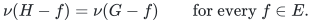
The graph can be stored using <code class="math">O(\mu)</code> original edge and vertex identifiers. After one edge failure, an exact maximum matching can be reported in <code class="math">O(\mu)</code> time using a classical linear-time general-graph augmentation algorithm. The existence proof uses rational polyhedral optimization; a polynomial construction can use only ordinary matching computations. No near-linear preprocessing bound is asserted.

The same construction can support one edge failure **or** one vertex failure in a single certificate of at most <code class="math">6\mu+2</code> edges. These are alternative single-failure queries, not simultaneous edge-and-vertex failures.

Banerjee, Gupta, Raman, and Saurabh (CSR 2022) give a linear-size single-edge-failure certificate for bipartite graphs, an <code class="math">O(\mu^2+\mu f)</code>-edge certificate for general graphs, and explicitly ask whether the single-edge-failure bound in general graphs can be <code class="math">O(\mu)</code>. Their work already treats vertex failures more strongly when <code class="math">f=1</code>. A separate 2026 algebraic sensitivity-oracle line supports arbitrary numbers of updates, with different space and output guarantees. [1, 4]

**Current baseline qualification.** Xiaoling He's September 2026 theorem bounds a minimal matching-covered nonbipartite graph by <code class="math">5(n-2)/2</code> edges. Together with the <code class="math">O(\mu)</code>-vertex kernel in [1], it already implies an <code class="math">O(\mu)</code>-edge single-failure certificate; the reduction is explained in Section 6. Therefore this manuscript does **not** claim the first asymptotic resolution of the CSR 2022 question. Its contribution is an independent short polyhedral proof, the explicit <code class="math">4\mu+2</code> bound directly in the original graph, and the general sparse-support lemma with additional linear constraints. [5]

## 1. Fractional caps express separate repairability

The case <code class="math">\mu=0</code> is immediate. Assume <code class="math">\mu\ge1</code>.

Only failures of edges in <code class="math">M</code> can require a different maximum matching. Let
<!-- math-display: 6f6986a33ecb219759aa5744
Q=\{f\in M:\nu(G-f)=\mu\},\qquad k=|Q|.
-->
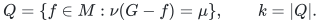
For each <code class="math">f\in Q</code>, choose a maximum matching <code class="math">M_f</code> avoiding <code class="math">f</code>. Put
<!-- math-display: 23aa5ff6e5dac1401d4e150f
\varepsilon=\frac1{2(\mu+1)(k+1)}.
-->
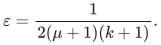
If <code class="math">k=0</code>, return <code class="math">M</code>. Otherwise the convex combination
<!-- math-display: 081d0d0d81b58b3896db9054
\bar x=(1-k\varepsilon)\chi^M+
\varepsilon\sum_{f\in Q}\chi^{M_f}
-->
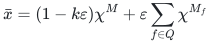
is a fractional maximum matching satisfying <code class="math">\bar x_f\le1-\varepsilon</code> for every <code class="math">f\in Q</code>. It also satisfies
<!-- math-display: aeea2f1c7c03a798d83f6a97
\bar x(E\setminus M)\le\varepsilon k\mu<1/2.
-->
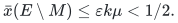

Let <code class="math">P(G)</code> be the matching polytope. By Edmonds' theorem it is given by
<!-- math-display: c46a0598c57e566fdb51a8e0
\begin{aligned}
x_e&\ge0 &&(e\in E),\\
x(\delta(v))&\le1 &&(v\in V),\\
x(E(S))&\le\frac{|S|-1}{2}
&&(\text{odd }S\subseteq V,\ |S|\ge3).
\end{aligned}
\tag{1}
-->
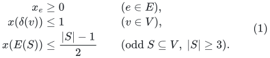
Consider the nonempty capped face
<!-- math-display: b8ca43294fd2bbf2537b0b8b
K=\left\{x\in P(G):
x(E)=\mu,\quad x_f\le1-\varepsilon\ (f\in Q),\quad
x(E\setminus M)\le1/2\right\}.
\tag{2}
-->
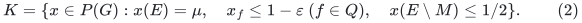
The crucial point is that a cap is a condition on an average of matchings. It does not require one matching to avoid all edges in <code class="math">Q</code> simultaneously.

The last inequality keeps the point near the original matching. For every <code class="math">x\in K</code>,
<!-- math-display: 94cbbb3ede3b128d771b8342
x(M)\ge\mu-1/2.
-->
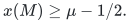
Since each <code class="math">x_f\le1</code> and <code class="math">M</code> has <code class="math">\mu</code> edges, this implies <code class="math">x_f\ge1/2</code> for every <code class="math">f\in M</code>. Thus the positive support automatically contains <code class="math">M</code>.

We will prove that <code class="math">K</code> contains a point with at most <code class="math">4\mu+2</code> positive coordinates.

## 2. A support bound with extra linear constraints

It is useful to isolate the polyhedral statement.

**Support lemma.** Suppose a nonempty polytope <code class="math">K'</code> is obtained by intersecting the cardinality-<code class="math">\mu</code> face of <code class="math">P(G)</code> with <code class="math">k</code> additional rational linear inequalities. Then <code class="math">K'</code> contains a point supported on at most
<!-- math-display: ed85392181a3ee2e7a0b8655
3\mu+k+1
\tag{3}
-->
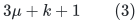
original edges.

For the algorithmic application, the added inequalities have <code class="math">0/1</code> coefficients. The existence proof works for arbitrary rational added rows; their number, rather than their sparsity, controls (3).

### 2.1 A generic objective

Maximize <code class="math">c^\top x</code> over <code class="math">K'</code>, where <code class="math">c</code> is chosen outside the span of every rank-deficient subset of its finite constraint normals. Nonnegativity normals, degree normals, odd-set normals, the cardinality normal, and the added normals are included in this collection.

Such a rational vector exists and can be chosen with polynomial encoding length when the constraint rows have polynomial encoding length. In the <code class="math">0/1</code>-row application, enumerate the <code class="math">m</code> edges, take
<!-- math-display: 2a2f61e15c4836181726e531
B=4(m+1)^m,\qquad c=(1,B,B^2,\ldots,B^{m-1}).
\tag{4}
-->
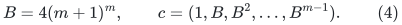
To see why this works, any proper subspace spanned by <code class="math">0/1</code> and signed unit rows has a nonzero integer normal vector <code class="math">z</code> whose entries are bounded by a Hadamard cofactor bound, at most <code class="math">m^{m/2}</code>. The largest nonzero term of <code class="math">\sum_i z_iB^i</code> dominates all preceding terms. Therefore <code class="math">c\cdot z\ne0</code>. Each coordinate in (4) has polynomial bit length. For rational added rows, clear row denominators and increase <code class="math">B</code> according to the resulting cofactor bound.

Let <code class="math">x</code> be an optimum. Take an optimum dual. Its variables are nonnegative multipliers <code class="math">y_v</code> for degree inequalities, <code class="math">z_S</code> for odd-set inequalities, and multipliers for the added inequalities; the cardinality equality has a free multiplier <code class="math">\tau</code>.

### 2.2 Uncrossing still works in the presence of the added rows

Leave the multipliers of all added rows and the cardinality equality fixed during uncrossing. Among optimal dual solutions, choose one lexicographically minimizing
<!-- math-display: bbf9f58cb7f79c040b39f6e1
\left(
\sum_S z_S|S|(n-|S|),\
\sum_S z_S|S|
\right),\qquad n=|V|.
\tag{5}
-->
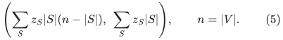
Both quantities are nonnegative linear functions on the optimal-dual polyhedron, so minima are attained.

Suppose two odd sets <code class="math">A,B</code> with positive <code class="math">z_A,z_B</code> cross. Let <code class="math">I=A\cap B</code>, <code class="math">U=A\cup B</code>, and <code class="math">\eta=\min(z_A,z_B)&gt;0</code>.

If <code class="math">&#124;I&#124;</code> is odd, subtract <code class="math">\eta</code> from <code class="math">z_A,z_B</code> and add it to <code class="math">z_I,z_U</code>. The dual objective is unchanged because the right-hand sides satisfy
<!-- math-display: 3bd99debf39077620347bfb4
\frac{|A|-1}{2}+\frac{|B|-1}{2}
=\frac{|I|-1}{2}+\frac{|U|-1}{2}.
-->
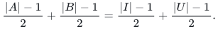
The edge coefficients only increase, by <code class="math">\eta</code> on edges between <code class="math">A\setminus B</code> and <code class="math">B\setminus A</code>; hence the dual remains feasible. The first potential in (5) decreases by
<!-- math-display: f3cbc6affee4a11d45c1bd3f
2\eta\,|A\setminus B|\,|B\setminus A|>0.
-->
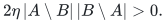

If <code class="math">&#124;I&#124;</code> is even, replace the same amount of <code class="math">z_A,z_B</code> by multipliers on the odd sets <code class="math">A\setminus B,B\setminus A</code>, and add <code class="math">\eta</code> to <code class="math">y_v</code> for each <code class="math">v\in I</code>. Again the dual objective is unchanged. Its edge coefficients only increase, this time on edges between <code class="math">I</code> and <code class="math">V\setminus U</code>. The first potential decreases by
<!-- math-display: a6b507960139cf26faee664d
2\eta\,|I|\,(n-|U|).
-->
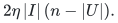
If this quantity is zero, the second potential decreases by <code class="math">2\eta&#124;I&#124;&gt;0</code>.

Odd singleton rows have both zero coefficients and zero right-hand sides and are simply omitted; omitting them can only further decrease the potentials. Thus either uncrossing contradicts (5). The sets with positive <code class="math">z_S</code> form a laminar family <code class="math">\mathcal L</code>.

### 2.3 Counting the tight rows

Complementary slackness gives <code class="math">x(\delta(v))=1</code> whenever <code class="math">y_v&gt;0</code>. Since
<!-- math-display: 8ec5f8f9a39c2a2dde50c279
\sum_v x(\delta(v))=2x(E)=2\mu,
-->
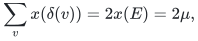
there are at most <code class="math">2\mu</code> such degree rows.

Also, every <code class="math">S\in\mathcal L</code> is tight:
<!-- math-display: a47f0468bc3276c5a4257d98
x(E(S))=(|S|-1)/2.
\tag{6}
-->
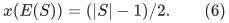
The maximal members of <code class="math">\mathcal L</code> are pairwise disjoint. For each maximal member <code class="math">R</code>, complete its laminar inclusion tree by adding singleton leaves. Every internal node has an odd number of children and, because it is a proper set containing at least three vertices, at least three children. Consequently the number of members of <code class="math">\mathcal L</code> contained in <code class="math">R</code> is at most
<!-- math-display: 3cbcc27a652414dd828c6f45
(|R|-1)/2=x(E(R)).
-->
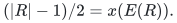
Summing over the disjoint maximal roots yields
<!-- math-display: 476ac7b5a118c610dd090511
|\mathcal L|\le\sum_Rx(E(R))\le\mu.
\tag{7}
-->
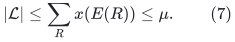

Let <code class="math">s=&#124;\mathrm{supp}(x)&#124;</code>. The dual equality expressing <code class="math">c</code> consists of at most <code class="math">2\mu</code> positive degree rows, at most <code class="math">\mu</code> positive laminar odd-set rows, at most <code class="math">k</code> added rows, the cardinality row, and dual-slack unit vectors on zero coordinates. There are at most <code class="math">m-s</code> of the latter. If
<!-- math-display: d3a10d56c82ebf30867624e7
s>3\mu+k+1,
-->
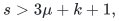
these rows span a proper subspace of <code class="math">\mathbb R^m</code>, contradicting the generic choice of <code class="math">c</code>.

This proves (3). This use of a generic objective is deliberate: the existence of a laminar optimal dual alone does not imply that its positive rows span the entire minimal face.

## 3. From fractional support to an exact single-fault certificate

Apply the support lemma to (2). There are <code class="math">k\le\mu</code> avoidance caps and one outside-mass cap, so choose <code class="math">x\in K</code> with
<!-- math-display: bbb39b11d5eb3710fe161553
|\mathrm{supp}(x)|\le4\mu+2.
-->
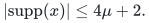
Return
<!-- math-display: 09b325b035a1620909e0ae02
E(H)=\mathrm{supp}(x).
-->
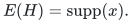
The outside-mass cap proves <code class="math">M\subseteq E(H)</code>, and <code class="math">&#124;E(H)&#124;\le4\mu+2</code>.

Because <code class="math">x\in P(G)</code>, it is a convex combination of matching incidence vectors. Because <code class="math">x(E)=\mu</code>, every matching with positive coefficient in this combination has cardinality exactly <code class="math">\mu</code>. Every such matching uses only edges of <code class="math">\mathrm{supp}(x)</code>.

For <code class="math">f\in Q</code>, the inequality <code class="math">x_f&lt;1</code> implies that at least one matching in this combination avoids <code class="math">f</code>. Therefore <code class="math">\nu(H-f)=\mu=\nu(G-f)</code>.

For <code class="math">f\in M\setminus Q</code>, the matching <code class="math">M-f</code> has size <code class="math">\mu-1=\nu(G-f)</code> and lies in <code class="math">H-f</code>. For <code class="math">f\notin M</code>, the original <code class="math">M</code> survives. These cases exhaust all edge failures.

The linear dependence on <code class="math">\mu</code> is optimal up to constants, since even the no-failure query must retain <code class="math">\mu</code> matching edges.

## 4. One vertex or one edge, in the same structure

Only vertices covered by <code class="math">M</code> need a nontrivial vertex-failure response. Let
<!-- math-display: b3232b8d80b2166b8cb06ff8
Q_V=\{v\in V(M):\nu(G-v)=\mu\}.
-->
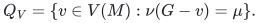
Add the caps
<!-- math-display: 7cc10bb0bec2d6b4c33c608d
x(\delta(v))\le1-\varepsilon\qquad(v\in Q_V),
\tag{8}
-->
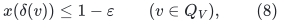
along with the edge caps and the outside-mass cap. There are at most <code class="math">2\mu</code> vertex caps and <code class="math">\mu</code> edge caps. Take <code class="math">\varepsilon=1/[2(\mu+1)(k+1)]</code>, where <code class="math">k</code> is their total number, and put mass <code class="math">\varepsilon</code> on one maximum-matching witness for each avoidance cap, with the remaining mass on <code class="math">M</code>. This proves feasibility exactly as before.

The support lemma gives at most <code class="math">6\mu+2</code> positive edges, already containing <code class="math">M</code>. In the convex decomposition, a degree expectation strictly below one guarantees a matching leaving that vertex uncovered. The remaining vertex-failure cases are handled by <code class="math">M</code> or by deleting its unique incident matching edge.

## 5. Deterministic construction and output queries

Compute <code class="math">M</code> and test the at most <code class="math">\mu</code> edge failures, or at most <code class="math">3\mu</code> combined edge/vertex failures, that meet <code class="math">M</code>. This determines the designated scenarios and supplies their witness matchings.

One construction optimizes the generic objective over the capped matching polytope by rational linear programming with a separation oracle for the matching polytope. Polynomial-time weighted matching optimization, and the standard optimization/separation equivalence, supply the required oracle. The construction is deterministic and polynomial in input encoding length. Its proof does not require constructing a convex decomposition.

There is also a construction using only ordinary maximum-matching computations. Start with the union of <code class="math">M</code> and one witness matching for each designated scenario; this contains <code class="math">O(\mu^2)</code> edges. Process edges outside <code class="math">M</code> in a fixed order, deleting an edge whenever every designated scenario still admits a size-<code class="math">\mu</code> matching. A single pass suffices: once deleting an edge would break a scenario, further deletions cannot restore that scenario.

At termination, apply the support theorem to the retained graph itself, with the same <code class="math">M</code> and the same designated scenarios. It supplies a smaller preserving subgraph with at most <code class="math">4\mu+2</code> edges, or <code class="math">6\mu+2</code> in the combined case, containing <code class="math">M</code>. If the terminal graph exceeded the bound, an edge outside this smaller subgraph would still be deletable, contradicting termination. Thus greedy deletion attains the same support bound. It uses <code class="math">O(\mu^3)</code> ordinary maximum-matching calls after the initial witnesses; no fast preprocessing claim is needed.

Store <code class="math">H</code>, <code class="math">M</code>, and original identifiers. On a query, remove the failed edge or vertex and at most one edge of <code class="math">M</code>. The resulting matching is at most one below the new optimum. A single general-graph augmenting-path search therefore either restores cardinality <code class="math">\mu</code> or certifies that the current <code class="math">\mu-1</code> matching is maximum.

A linear-time search can be obtained from the classical skew-symmetric regular-reachability algorithm. Goldberg and Karzanov state the <code class="math">O(m)</code> regular-reachability bound in Theorem 2.2 and give the matching reduction in Section 2.1. This is the appropriate general-graph augmentation primitive; ordinary directed reachability does not suffice. Since <code class="math">H</code> has <code class="math">O(\mu)</code> edges and active vertices, the full query, including writing the matching, takes <code class="math">O(\mu)</code> time and <code class="math">O(\mu)</code> space. Identifier lookup can use a sorted dictionary; its logarithmic cost is absorbed by the output bound. [3]

## 6. The recent matching-covered baseline and the weighted boundary

Here is the inference from [1, 5] that prevents an unsupported first-result claim. Use [1] to obtain a one-edge-fault certificate <code class="math">K</code> on <code class="math">n'=O(\mu)</code> active vertices, with matching number <code class="math">\mu</code>. Add <code class="math">n'-2\mu</code> new dummy vertices, each adjacent to every original vertex, with no edges between dummies. The augmented graph has a perfect matching exactly when the original graph has a matching of size <code class="math">\mu</code>; the same equivalence holds after any original edge failure.

Remove edges that lie in no perfect matching of the augmented graph. Each remaining connected component is matching covered. A two-vertex component may contain a forced edge. Every larger matching-covered component has no forced edge: if an edge occurred in every perfect matching, each endpoint would have no other allowed incident edge, contradicting connectedness. Replace every larger component by a minimal spanning matching-covered subgraph. The bounds of He and the classical bipartite theorem give <code class="math">O(n')</code> retained edges; small components and parallel-edge cases require only constant-size handling. Each resulting larger component still has no forced edge, so perfect-matching existence after every single edge deletion is preserved. Project retained original edges back to <code class="math">K</code> and add <code class="math">M</code> to handle the cases where the optimum drops to <code class="math">\mu-1</code>. This yields <code class="math">O(\mu)</code> original edges. This is a consequence of the cited ingredients, not a theorem attributed verbatim to either paper.

The theorem preserves exact **cardinality**. It does not prove an <code class="math">O(n^{3/2})</code> exact replacement-cost preserver for arbitrary weighted nonbipartite matching.

The fractional-cap argument does extend to a fixed optimal face. For example, intersect with <code class="math">w^\top x=\mathrm{OPT}</code>, and cap only baseline edges that some original minimum-cost maximum matching avoids. One additional row changes the support bound by at most one. This preserves whether a failure can be repaired without increasing the original optimum cost. It does not preserve the potentially larger optimum after every failure.

A direct alternating-walk reduction for the stronger weighted question fails. Take two zero-cost triangles <code class="math">a_1a_2a_3</code> and <code class="math">b_1b_2b_3</code>, joined only by an edge <code class="math">a_3b_3</code> of cost one. The unique perfect matching is
<!-- math-display: 2bb49d2ec56830edf5c57260
M=\{a_1a_2,b_1b_2,a_3b_3\}.
-->
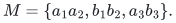
In the naive transition digraph, a nonmatching edge <code class="math">uv</code> gives an arc <code class="math">u\to\mathrm{mate}_M(v)</code> of length <code class="math">w(uv)-w(v\mathrm{mate}_M(v))</code>. It contains the directed cycle
<!-- math-display: 84d93b9431d3b1e8d1a7dcb7
a_3\to a_2\to b_3\to b_1\to a_3
-->
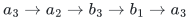
of length <code class="math">-2</code>. Nevertheless <code class="math">M</code> is optimum, and deleting <code class="math">a_3b_3</code> leaves no perfect matching. The corresponding fractional direction removes the bridge twice and violates the odd-cut constraint of either triangle. Setting the bridge cost to zero gives the same infeasibility counterexample with every raw transition length zero, so merely arranging nonnegative arc lengths cannot fix the reduction. Thus the ordinary no-negative-cycle and pair-distance-preserver route cannot simply be reused. The weighted extension would require a new argument preserving legal blossom-aware paths or alternating cycles.

## 7. Integrality alone does not give a linear certificate

The following scope boundary is an elementary construction, without a priority claim. Even maximum independent set in perfect graphs may require <code class="math">\Omega(\alpha^2)</code> retained original vertices to preserve its exact cardinality after one vertex failure, where <code class="math">\alpha</code> is the original independence number.

Let <code class="math">B=C\cup U</code> be independent, with <code class="math">&#124;C&#124;=q</code> and <code class="math">U=\{u_1,\ldots,u_p\}</code>. For each <code class="math">i</code>, add an independent block <code class="math">A_i</code> of <code class="math">q+1</code> vertices. Put every edge between different <code class="math">A_i</code> blocks. Join every vertex of <code class="math">A_i</code> to all of <code class="math">C</code> and to <code class="math">u_i</code>, and to no other vertex of <code class="math">B</code>.

An independent set either lies in <code class="math">B</code>, or uses only one block <code class="math">A_i</code> and vertices of <code class="math">U\setminus\{u_i\}</code>. Thus <code class="math">\alpha=p+q</code>, and the maximum independent sets are exactly
<!-- math-display: 9c74346caf6e7087a3c89d43
B,\qquad J_i=A_i\cup(U\setminus\{u_i\}).
-->
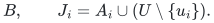
After deleting <code class="math">u_i</code>, the unique maximum independent set is <code class="math">J_i</code>. Any retained-vertex certificate must therefore contain all <code class="math">p(q+1)</code> vertices in the <code class="math">A_i</code> blocks. Taking <code class="math">p=q</code> gives the quadratic bound.

For completeness, every induced subgraph is perfect. Give each nonempty <code class="math">A_i</code> block its own color, and let their number be <code class="math">s</code>. If a vertex of <code class="math">C</code> is present, the clique number and a valid coloring both use <code class="math">s+1</code> colors. If <code class="math">C</code> is absent and <code class="math">s\ge2</code>, every remaining <code class="math">u_i</code> can use a block color different from that of <code class="math">A_i</code>; this uses <code class="math">s</code> colors, matching the clique number. The cases <code class="math">s\le1</code> are immediate, with a second color needed exactly when an edge is present. The same argument applies to every induced subgraph.

This is a lower bound for retained original vertices, not for an arbitrary encoded value oracle. It illustrates why the laminar-dual or tight-rank dimension argument is substantive: polynomial optimization and an integral feasible-set polytope alone do not imply linear single-fault sparsification.

## References

1. Niranka Banerjee, Manoj Gupta, Venkatesh Raman, and Saket Saurabh. **Output Sensitive Fault Tolerant Maximum Matching.** CSR 2022, pp. 115–132. The publisher abstract states both the general-graph quadratic bound and the linear-size single-edge-failure open question. <https://link.springer.com/chapter/10.1007/978-3-031-09574-0_8>
2. Jack Edmonds. **Maximum Matching and a Polyhedron with 0,1-Vertices.** Journal of Research of the National Bureau of Standards, Section B, 69B (1965), 125–130. The matching-polytope theorem is classical; the uncrossing and support argument needed here is supplied above. See also the original polyhedral algorithmic framework in Grötschel, Lovász, and Schrijver, *Geometric Algorithms and Combinatorial Optimization*, Section 8.5: <https://www.zib.de/userpage/groetschel/pubnew/paper/groetschellovaszschrijver1988.pdf>
3. Andrew V. Goldberg and Alexander V. Karzanov. **Maximum Skew-Symmetric Flows and Matchings.** Mathematical Programming 100 (2004), 537–568. Theorem 2.2 and Section 2.1. <https://arxiv.org/pdf/math/0304290> Their regular-path algorithm originates in **Path Problems in Skew-Symmetric Graphs**, Combinatorica 16 (1996), 353–382.
4. Keerti Choudhary, Amit Kumar, and Lakshay Saggi. **Sensitivity Oracles for Matroid Packing, Matroid Covering, and Matching Problems with Applications.** September 2026 preprint. Arbitrary-update algebraic sensitivity oracles, distinct from the single-deletion sparse original-edge certificate considered here. <https://arxiv.org/abs/2609.01283>
5. Xiaoling He. **The Maximum Number of Edges in Minimal Matching Covered Graphs.** September 2026 preprint, Theorem 1.2. <https://arxiv.org/html/2609.30978v2> The paper also recalls the Lovász–Plummer 1977 bound for minimal bipartite matching-covered graphs.
