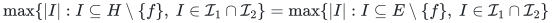
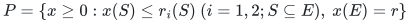
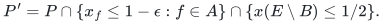
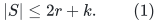
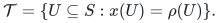
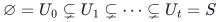
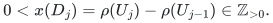
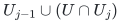
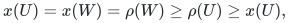
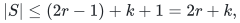

# Linear exact single-deletion certificates for two arbitrary matroids

**Abstract.** Fractional avoidance caps and the tight-set lattice of two matroid base polytopes give exact single-deletion certificates with at most three times the common rank in original elements. The proof also gives the refined bound in terms of the number of avoidable baseline elements and a construction using ordinary matroid-intersection calls.

## Statement

Let M_1 and M_2 be two matroids on the same finite ground set E, supplied by independence oracles. Let r be their maximum common-independent-set cardinality. If r>0, deterministic polynomial oracle preprocessing produces a set H of at most 3r original elements such that

<!-- math-display: 5177337433a261b6d3f67971
\max\{|I|:I\subseteq H\setminus\{f\},\ I\in\mathcal I_1\cap\mathcal I_2\}
 =
 \max\{|I|:I\subseteq E\setminus\{f\},\ I\in\mathcal I_1\cap\mathcal I_2\}
-->

for every f∈E, as well as for no deletion. For r=0 the empty set suffices. No linear representation is assumed.

This is an original-element certificate. In the oracle model, subsequent optimization on H still uses the original matroid independence oracles restricted to H; the statement does not encode arbitrary matroids into O(r) machine words.

## 1. Capping all avoidable baseline elements

Fix a maximum common independent set B, |B|=r. Truncate each matroid to rank r. The common-base polytope

<!-- math-display: b4aa385a84be51e793779298
P=\{x\ge0:x(S)\le r_i(S)\ (i=1,2;S\subseteq E),\ x(E)=r\}
-->

is the convex hull of incidence vectors of maximum common independent sets, by the matroid intersection theorem.

Let A⊆B consist of the elements f that can be avoided by another maximum common independent set B_f. These sets and A can be found with at most r ordinary matroid-intersection computations. Put k=|A| and ε=1/[2(r+1)(k+1)], and define

<!-- math-display: a1123c800e82991380c56eee
P'=P\cap\{x_f\le1-\epsilon:f\in A\}\cap\{x(E\setminus B)\le1/2\}.
-->

The convex combination (1−kε)χ_B+εΣ_{f∈A}χ_{B_f} belongs to P': every own witness supplies the needed ε deficit, and its total mass outside B is at most εkr<1/2. Thus P' is nonempty. Compute any vertex x of P'. Let S=supp(x). We prove

<!-- math-display: 3a13d7f4a7cb28c25e7620c7
|S|\le 2r+k.                 \tag{1}
-->

Every decomposition of x into common bases uses only elements of S, since all coordinates outside S vanish. For each f∈A, x_f<1 implies that at least one base in this decomposition avoids f. Thus S contains a maximum solution after every avoidable baseline deletion. The outside-mass cap also implies x(B)≥r−1/2. Since |B|=r and every coordinate of a common-base point is at most one, each f∈B has x_f≥1/2; hence B⊆S. The output H=S therefore handles every f∉B, since B survives. If f∈B\A, the optimum drops exactly to r−1 and B−f already attains it. Equation (1) gives |H|≤2r+k≤3r.

The simultaneous edge and vertex interpretation in the companion matching manuscript is a separate use of the matching polytope. It is not an assertion that arbitrary vertex deletion in a matroid is one element deletion.

## 2. Tight rank rows have dimension at most r

Fix either truncated matroid, with rank function ρ, and restrict every row to the positive support S. Define the family of tight subsets of S by

<!-- math-display: 2dff5932907b30c9839065a2
\mathcal T=\{U\subseteq S:x(U)=\rho(U)\}.
-->

The entire set S is tight: x(S)=r, while ρ(S)≤r and feasibility gives ρ(S)≥r. The empty set is tight as well. If U,V are tight, modularity of x and submodularity of ρ show that U∩V and U∪V are tight, with equality throughout the rank submodularity inequality.

Take an inclusion-maximal chain

<!-- math-display: 1621401511c103393d096a40
\varnothing=U_0\subsetneq U_1\subsetneq\cdots\subsetneq U_t=S
-->

in this finite lattice. Its successive differences D_j=U_j\U_{j−1} partition S. Because every coordinate of x on S is strictly positive,

<!-- math-display: 7213c632e3848811da5d39e6
0<x(D_j)=\rho(U_j)-\rho(U_{j-1})\in\mathbb Z_{>0}.
-->

Their total is r, so t≤r.

Every tight set U is a union of entire blocks D_j. Indeed, the set

<!-- math-display: 998765cb5752ac8146fe58e2
U_{j-1}\cup(U\cap U_j)
-->

is tight by lattice closure and lies between two consecutive chain members. Maximality of the chain forces it to be one endpoint, so U either contains all of D_j or none of it. Consequently the incidence vectors of tight sets lie in the t-dimensional span of the block indicators, equivalently the chain indicators.

This also controls tight rows originally indexed by subsets W⊆E rather than S. If x(W)=ρ(W), let U=W∩S. Then

<!-- math-display: 8897b681b0e44c01340da75f
x(U)=x(W)=\rho(W)\ge\rho(U)\ge x(U),
-->

so U is tight and the restricted row is already covered by the preceding argument.

Applying this independently to the two matroids gives two row spaces, each of dimension at most r. Both contain the all-ones row on nonempty S, because S is tight for both. Their combined dimension is therefore at most 2r−1.

## 3. Vertex support count and construction

At a vertex of P', the active constraint normals restricted to positive coordinates must span R^S. Otherwise a nonzero direction orthogonal to all active rows could be followed a sufficiently small distance in both signs. There are finitely many inequalities; inactive inequalities have positive slack, and positive coordinates remain positive under a small perturbation. This would contradict extremality.

Nonnegativity constraints outside S impose no additional rows on R^S. The cardinality equality is already in both tight-rank row spaces. The additional possible rows come from the at most k coordinate caps and the one outside-mass cap. Their contribution to the dimension is at most k+1. Thus

<!-- math-display: 1af018f56f59a0eb44118119
|S|\le(2r-1)+k+1=2r+k,
-->

as asserted.

For construction, rank inequalities admit polynomial separation in the independence-oracle model: minimize the submodular function ρ(U)−x(U), evaluating ranks by greedy independence queries. Add the explicit caps and cardinality equality. Standard rational linear programming with separation, followed by lexicographic coordinate optimization if needed, finds a vertex in deterministic polynomial oracle time. All right-hand sides have polynomial bit length. This is a polynomial-preprocessing existence and construction theorem; no near-linear preprocessing claim is made.

There is also a construction using only ordinary matroid-intersection calls. Start with B together with one witness B_f for every f∈A. Repeatedly delete an element outside B if all k designated avoidable-deletion scenarios still admit a common independent set of size r. One pass in an arbitrary fixed order suffices: once deletion of an element would break a scenario, further deletions cannot repair that defect. At termination, apply the support theorem just proved to the two matroids restricted to the retained ground set, with the same B and the same k surviving scenarios. It supplies a preserving subset of size at most 2r+k containing B. If the terminal set were larger, an element outside that smaller subset would still be deletable, a contradiction. Thus this greedy construction achieves the same bound, without implementing submodular separation or linear programming. Its starting pool has at most r(k+1) elements, and it makes a polynomial number of ordinary matroid-intersection calls; no faster running-time guarantee is asserted.

## 4. Scope and comparisons

The certificate preserves exact maximum cardinality after one element deletion. It does not preserve the minimum cost of a new optimum when deleting an element destroys every original minimum-cost optimum. The companion exact weighted two-matroid construction has an O(r^(3/2)) bound and addresses that stronger objective.

Huang and Sellier's robust matroid-intersection sparsification addresses substantially broader unknown future restrictions, approximation, communication, and streaming settings. Its approximation ratio and robustness model should not be compared as if they were the same one-deletion exact task. The present proof only needs one deletion and polynomial preprocessing.

The lower bound Ω(r) is immediate because even a no-failure maximum solution has r elements. The constant 3 is not claimed optimal. The proof applies to arbitrary independence-oracle matroids; it does not extend to three arbitrary matroids merely by writing three rank systems, because the resulting intersection polytope need not be integral.

### Primary background

1. Jack Edmonds, matroid intersection integrality and the common-base polytope. A concise exposition is Michel X. Goemans, *Matroid Intersection*, MIT 18.453 lecture notes (2017): https://math.mit.edu/~goemans/18453S17/matroid-intersect-notes.pdf .
2. Chien-Chung Huang and François Sellier, *Robust Sparsification for Matroid Intersection with Applications*, SODA 2024 / Mathematics of Operations Research 2026: https://arxiv.org/pdf/2310.16827 .
3. The companion general-matching manuscript supplies the capped matching-polytope application and its separate CSR 2022 comparison. Neither its blossom proof nor its general-graph reporting routine is needed for the tight-lattice argument above.
