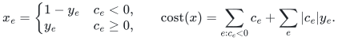
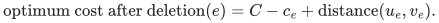
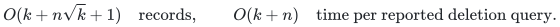
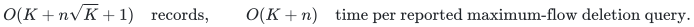

# Native signed-cost balance optimization and deletion reporting

The [reference module](../reference/signed_flow.py) removes the supplied-optimum
requirement for unit-capacity flow with fixed integral outward balances and
arbitrary signed rational costs. Original loops and parallel records are
retained. It also returns minimum-cost maximum source flow and builds a compact
single-original-arc deletion oracle for a fixed balance vector. The existing
[original-input verifiers](../reference/flow_certificates.py) check optimization
certificates independently of this producer.

## 1. Original model and exact negative-arc complementation

Every original arc has capacity one; a flow chooses an original-ID subset.
Its divergence is outflow minus inflow and must equal the supplied integral
zero-sum balance vector. The cost includes all selected arcs, including cycles
and loops. This convention matters with signed costs: deleting an isolated
negative cycle from an otherwise feasible solution may destroy optimality.

First the canonical cost-blind feasibility routine either supplies a feasible
support or an original violated balance cut. The latter is checked independently
and returned as an infeasibility certificate. Numerical supplies remain residual
capacities, not lists of units.

For optimization, initially select every negative-cost arc. Reverse such an
arc and use the complement of its original variable; keep every other arc's
orientation and variable. If the initial selected negative arcs have divergence
called the negative baseline, the transformed demand is the original balance
minus that divergence. This is a bijection of the two unit-box feasible sets:

<!-- math-display: 65401a5cba6dd1c649fd3a09
x_e=\begin{cases}1-y_e&c_e<0,\\y_e&c_e\ge0,\end{cases}
\qquad
\mathrm{cost}(x)=\sum_{e:c_e<0}c_e+\sum_e|c_e|y_e.
-->

All transformed forward costs are nonnegative. The transformation includes
negative loops, whose baseline divergence is zero. It is applied to every
surviving component, whether or not it is reachable from a chosen terminal.
Add numerical super-source and super-sink capacities for the transformed
positive and negative balances. Saturating their total is equivalent to
restoring every original balance.

## 2. Shortest augmentation with a global potential

Initially zero transformed flow is optimal at value zero and the zero
potential makes every residual reduced cost nonnegative. At each augmentation,
Dijkstra computes shortest reduced cost with hop count as a secondary key.
Every secondary increment is positive, so its selected path is simple even
when primary costs are zero. Let the sink distance be the cap distance.
Update every vertex potential by its distance truncated at that cap; unreachable
vertices receive the cap increment.

For a residual edge, nonnegative reduced cost and the distance triangle
inequality imply the corresponding inequality after truncation. Thus all old
residual edges still have nonnegative reduced cost after the potential update.
Every selected shortest-path edge is tight, so each newly enabled reverse edge
has zero reduced cost. Augmentation therefore preserves the global potential
invariant, including components unreachable from the super-source.

Every simple auxiliary source/sink path contains an original unit-capacity
arc: a vertex cannot simultaneously have positive and negative transformed
balance, and revisiting a terminal is excluded by simplicity. Its integral
bottleneck is consequently one. Moreover, a feasible transformed unit flow
uses at most the original number of arcs, so its total positive divergence
is at most that number. There are at most that many augmentations; no loop
is bounded by an unbounded numerical supply.

After full saturation, undoing the negative-arc complements gives original
unit variables and their prescribed balances. Its original residual graph is
exactly the transformed residual graph on the original vertices, with the same
costs. The restricted potential therefore certifies nonnegative reduced costs
on the **full surviving original input**. Every other feasible flow differs
by a residual circulation. Decomposing it into directed cycles shows that its
cost cannot be smaller. This proves global minimum cost, including isolated
cycles and loops. The returned original support, exact cost and potential are
checked by `verify_flow` before return.

## 3. Signed minimum-cost maximum flow

For distinct original terminals, feasible nonnegative integer flow values form
an initial interval: removing paths from an integral source/sink decomposition
realizes every smaller value, and cycles do not change the value. Binary search
with the cost-blind original balance test finds the greatest value; the original
arc count plus one is an infeasible upper bound. Apply the preceding optimizer
at that value to obtain the least signed cost, including any beneficial cycles.

The final residual reachability set is a maximum-flow cut. The combined
certificate is checked by `verify_maximum`, which validates both minimum cost
at the claimed value and the original surviving cut capacity. No source-only
negative-cycle assumption is made.

## 4. Fixed-balance single-arc deletion identity

Let the initialized optimum support have actual cardinality `k`. Its residual
has no negative-cost cycle. An original arc outside that support can fail
without changing the optimum: the original optimum remains feasible in a
smaller feasible set.

For a used arc from one endpoint to the other, delete that arc and find a
minimum-cost, minimum-hop residual path from its tail to its head. A simple
such path never uses the failed arc's reverse: that would revisit an endpoint.
For a loop the empty path applies. Toggling the other path records repairs the
balances and respects every original unit capacity.

Conversely, the difference from the baseline to any feasible post-deletion
flow is a residual circulation containing the reverse of the failed arc. A
cycle decomposition supplies a path between these two endpoints; all other
residual cycles have nonnegative cost. With `C` the baseline cost and
`u_e`, `v_e` the original endpoints, the exact new optimum is

<!-- math-display: 18277254dece95fe22fbacf3
\mathrm{optimum\ cost\ after\ deletion}(e)=C-c_e+\mathrm{distance}(u_e,v_e).
-->

If no path exists, the original balance problem after deletion is infeasible.
Otherwise the shortest-path toggle attains the displayed lower bound. Hop
minimization makes all stored paths simple. Hub-tree prefix/suffix concatenation
is also simple: a repeated vertex would give a positive lexicographic cycle,
contradicting shortestness.

## 5. Compact records and deterministic decoding

The implementation reuses the canonical phased short-path and hub-tree
construction on the initialized residual. For a negative residual step it
stores a **dense baseline position**; for a positive residual step it stores
an **original insertion ID**. These are separate internal tag spaces. Every
baseline ID is retained, and the support additionally includes all positive
original IDs appearing in stored paths or trees.

After construction, demand descriptors become a tuple indexed by dense baseline
position. A failure lookup uses binary search in the sorted original baseline.
The decoder marks removals in a baseline-sized Boolean array, streams positive
insertion IDs along the reported path and emits surviving baseline IDs followed
by those insertions. It neither sorts a full answer nor uses a query hash table.
It retains no original graph, balance vector, full cost list, all-pairs table or
initial optimization potential. Unknown integer IDs have no effect.

The resulting final record bound and explicit reporting time are

<!-- math-display: f6df0dd01e89332ebd12c19a
O(k+n\sqrt{k}+1)\quad\text{records},\qquad
O(k+n)\quad\text{time per reported deletion query}.
-->

The empty baseline has constant storage and queries. Exact original-ID and
rational bit lengths are charged separately. Crucially, the parameter is the
**actual baseline support size**, not the source flow value. A zero-value
signed optimum may contain arbitrarily many negative loops or cycles, so the
nonnegative-cost flow-value support bound cannot be transferred to this model.
`BalanceOracle` fixes the balance vector. The separate `MaximumBalanceOracle`
initializes the maximum feasible value and, when positive, the preceding value.
Deleting one unit-capacity arc reduces every cut capacity by at most one;
therefore maximum flow drops by at most one. Equivalently, remove the at most
one source-to-sink path using that arc from an integral path decomposition.
The upper level is queried first. If it becomes infeasible, the lower level
is feasible and its independently optimized signed cost is the new optimum.
At value zero, the empty flow always ensures feasibility; beneficial cycles
are still optimized by the upper level. The wrapper retains only these two
compact structures and their support union. With `K` the sum of their actual
baseline support sizes, its bounds are

<!-- math-display: 8f25ca258d383b6270e7eedc
O(K+n\sqrt{K}+1)\quad\text{records},\qquad
O(K+n)\quad\text{time per reported maximum-flow deletion query}.
-->

This follows by adding the two fixed-level bounds and applying the elementary
square-root sum inequality. No post-query optimization or original graph
storage is needed.

## 6. Preprocessing and executable evidence

With `m` original arcs, the native optimizer uses at most `m` shortest
augmentations on `O(n+m)` auxiliary records. Each uses a binary heap and exact
rational comparisons. The cost-blind feasibility pass and original certificate
checks have polynomial cost. Maximum-value search adds `O(log(m+1))` feasibility
calls. In particular the implementation does not depend linearly on a supplied
balance magnitude or cost numerator. All potentials and path costs have
polynomial encoding in the original rational input.

The compact reporter separately pays the canonical dense Bellman--Ford and
phased-hub preprocessing. All-source paths, explicit temporary demand paths,
and repeated hub-tree construction have a conservative polynomial bound in
`n`, `m` and `k`; temporary storage includes the full residual and all-pairs
records. This is not the optimized preprocessing bound of the faster research
construction. Only the final report structure has the displayed compact bound.

The [independent checker](../verify/check_signed_flow.py) enumerates all original
unit-flow subsets on small signed graphs, deriving balances and exact objective
values directly. It checks fixed balances, infeasibility cuts, minimum-cost
maximum values and every compact deletion result against those original optima.
A forty-vertex negative cycle with sparse original IDs and a positive shortcut
forces long hub reports in both internal tag spaces. Additional cases cover
isolated negative cycles, loops, parallel records, a much larger original ground
than retained support, disabled optimization producers during queries and
100-digit signed costs, denominators and supplies. Finite evidence supplements
the proofs above; it is not formal verification or external peer review.

**Attribution:** Yilin Liu and GPT-6 Astra Pro.
