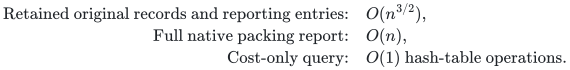

# Native internally disjoint paths after one failure

[Implementation](../reference/vertex_paths.py) · [Independent finite checker](../verify/check_vertex_paths.py) · [Unit-flow realization](reference-unit-flow-realization.md)

This note completes the executable vertex-splitting client of the
[flow and path theorem](exact-min-cost-flow-and-vertex-disjoint-paths.md).
Its backend is the repository's exact-rational compact unit-flow reference.
It supplies the native reduction, failure interpretation, path recovery and
resource accounting; it makes no claim to implement the faster preprocessing
of the research theorem.

## Input and output

The input is a simple loopless directed graph with nonnegative rational arc
costs and distinct terminals. Vertices are integers in `range(n)`. An original
arc ID is its position in the supplied sequence of `unit_flow.Arc` objects.
Opposite arcs are distinct and permitted; repeated ordered endpoint pairs
are rejected. Integer costs and `Fraction` costs are accepted, but floats,
Boolean endpoints/costs and negative costs are rejected.

A packing is a family of distinct simple directed source-to-target paths
whose internal vertices are pairwise disjoint. The same direct terminal arc
cannot be used twice. A query independently deletes either one original arc
or one internal vertex. Terminal failures, a simultaneous arc-and-vertex
failure, and cumulative updates are outside the contract.

The public interfaces are:

```python
from unit_flow import Arc
from vertex_paths import fixed_paths, MaximumPathsOracle

arcs = [Arc(0, 1, 0), Arc(1, 3, 0), Arc(0, 2, 1), Arc(2, 3, 0)]
fixed = fixed_paths(4, arcs, 0, 3, 1)
answer = fixed.query(failed_vertex=1)
assert answer.value == 1 and answer.cost == 1
assert answer.paths[0].vertices == (0, 2, 3)
assert answer.paths[0].arc_ids == (2, 3)
assert fixed.cost(failed_arc=0) == 1

maximum = MaximumPathsOracle(4, arcs, 0, 3)
assert maximum.query().value == 2
assert maximum.query(failed_vertex=1).value == 1
```

`fixed_paths` returns `None` if the original requested cardinality is
infeasible. Zero is permitted. Once constructed, its `cost` and `query`
methods return `None` exactly when that cardinality becomes infeasible.
`MaximumPathsOracle.query` always returns a `Packing`, possibly empty.
It maximizes path count and minimizes cost among those maximum packings.
Each answer includes original vertex lists and original arc-ID lists.
The oracle's `retained` dictionary supplies the corresponding original
records. Queries consult neither the caller's input nor an optimization
routine. These are solver interfaces, not adversarial certificate verifiers.

## Split reduction and exact optimum

**Lemma 1.** Minimum-cost integral unit flow in the constructed split graph
has the same fixed-value optimum as the native path-packing problem.

**Proof.** First discard every original arc entering the source or leaving
the target. No simple source-to-target path can use one, so this preserves
all native packings and their costs. An eventual failure of a discarded
record is still accepted and leaves the answer unchanged.

For each internal vertex, make an incoming copy and an outgoing copy joined
by a zero-cost unit-capacity gate. Replace each retained original arc by the
arc from its tail's outgoing copy to its head's incoming copy; unsplit
terminals use their unique active copies. The implementation reserves two
indices per original vertex and leaves one terminal copy unused. It thus
uses at most `2*n` split vertices and `m+n-2` split arc records. Each split
original record remembers its native ID during preprocessing.

A native packing gives a split integral flow of the same value and cost.
Conversely any integral split flow decomposes into source-to-target paths
and directed cycles. Remove all cycles. Nonnegative costs ensure that this
does not increase cost. The gate capacity makes each internal vertex appear
in at most one remaining path. Simple path decomposition eliminates repeated
vertices, and the direct terminal arc has unit capacity. Projection therefore
gives a valid native packing of the same value. These two directions prove
equality of the minimum costs. Every deleted positive-cost cycle would
strictly improve an optimum, so any cycles in an optimal split flow have
zero cost. This observation also justifies native recovery below. ∎

The fixed-value constructor invokes `fixed_flow` on this explicit split
instance. Its baseline minimizes cost and then used split-record count.
The backend proof establishes both optimality and acyclic baseline support.
No new flow-optimization dependency is introduced by the wrapper.

## Original arc and internal-vertex failure semantics

**Lemma 2.** Failure of an original arc that survives terminal cleanup is
represented by deleting its split record. A previously discarded entering-source or leaving-target arc
is inert. An internal-vertex failure is represented by deleting its gate.
These reductions preserve the exact feasible packing values and costs.

**Proof.** Original-record deletion is immediate from Lemma 1. An internal
incoming copy has only its gate as an outgoing arc, while its outgoing copy
has only that gate as an incoming arc. After the gate is deleted, conservation
forces all positive flow on incident original records to zero. Conversely,
a native packing avoiding the failed vertex uses neither its gate nor those
records. The same flow/path projection proves equality after either type
of deletion. ∎

For a fixed oracle, only a record or gate used by its baseline can affect
that baseline's feasibility. A deletion outside the baseline cannot lower
the optimum and leaves an optimum feasible, so its cost and answer are
unchanged. The wrapper therefore retains failure maps only for baseline
original arcs and baseline gates. It validates every query in original
coordinates, including IDs omitted by the preserver, then either maps it
to one backend failure ID or uses the unchanged baseline. This avoids a
persistent full-input-sized translation table. Gate lookup excludes the
terminals explicitly; integer and Boolean IDs are distinguished.

**Lemma 3.** One allowed failure decreases maximum packing cardinality by
at most one.

**Proof.** An original arc lies on at most one path of a simple internally
disjoint packing. If it touches an internal vertex, that follows from
internal disjointness; the direct terminal arc is unique and used once.
An internal vertex likewise lies on at most one path. Delete that path
if present. All other paths remain feasible. Deletion cannot increase
maximum cardinality, so the only possibilities are the old maximum and
one less. ∎

The maximum wrapper retains separate fixed-value oracles for those two
values. It first tests the upper oracle's cost; only if that value is
infeasible does it query the lower one. Each oracle uses its own baseline
failure maps. A zero maximum needs only the empty oracle. The backend
maximum-flow construction computes both required optimal baselines.

## Native path recovery and zero-cost cycles

**Lemma 4.** Recovery reports a valid optimal native packing using only
retained original records, in linear work in the original vertex count.

**Proof.** Request the backend's surviving full support, remove gate records,
and map the remaining split IDs through the retained-ID dictionary. Every
internal vertex has native indegree and outdegree at most one. The number
of arcs leaving the source is exactly the fixed flow value, because all
arcs entering it were removed before splitting. Start one walk at each such
arc, then follow the unique outgoing record until reaching the target.

Such a walk cannot enter an internal cycle: a cycle vertex would then have
two distinct incoming used records. Nor can two walks intersect internally
or return to the source. Conservation therefore makes each walk a simple
source-to-target path, and their internal vertex sets are disjoint. Other
components are directed cycles. Lemma 1 says their total cost is zero;
the implementation checks that the reported path cost equals the backend
optimum. It discards these cycles rather than reporting them as paths.
This matters even with a minimum-hop residual repair: minimizing residual
hops does not minimize the used-record count of the repaired flow.

A simple native packing uses at most `n-2` internal vertices. It has at
most `n-1` paths, including the possible direct terminal path, and hence
at most `n-2+value` original records. Any zero-cost cycles consume additional
internal vertices but preserve the same linear total inventory bound.
The split support adds at most one gate per internal vertex. Thus backend
full-support scanning and native recovery use `O(n)` record/hash operations.
Each record is mapped only once, and the returned ID/vertex lengths are
charged to their actual encodings. ∎

## Retained size, preprocessing and bit accounting

The acyclic split baseline contains at most `2*(n-2)+value` records, hence
at most `3*n-5` for a positive packing. Write `p` for its actual split
support. The unit-flow backend retains `O(p+n*sqrt(p))` records and compact
reporting entries. Substituting `p=O(n)` yields the full path specialization:

<!-- math-display: f50aba406860cb632ef3d0c2
\begin{aligned}
\text{Retained original records and reporting entries:}\quad&O(n^{3/2}),\\
\text{Full native packing report:}\quad&O(n),\\
\text{Cost-only query:}\quad&O(1)\text{ hash-table operations}.
\end{aligned}
-->


The wrapper adds only retained-ID maps, baseline-failure maps and original
records already represented by the compact backend. It does not retain the
input arc list, the full preprocessing translation table, or all-source
shortest-path tables. Two maximum-flow baselines change these bounds only
by a constant factor. Original simplicity also ensures that the split graph
is simple, so the backend's conservative simple-input preprocessing bound
gives `O(n^2*(m+n+1))` arithmetic/record operations. Splitting itself is
linear in explicit input size, using dictionaries/sets for membership tests.
This does not implement the research theorem's faster preprocessing.

Exact arithmetic is inherited from the unit-flow proof. New gate costs are
zero; all other costs are unchanged. Construction adds no large numerical
capacities or expanded unit copies. Rational numerators, denominators,
vertex IDs and output arc IDs retain their charged bit lengths. Python
hash-table operation counts are not deterministic worst-case lookup bounds;
sorted deterministic dictionaries can instead supply logarithmic lookup.

## Verification scope

The independent checker enumerates simple native paths, then uses compatible
internal-vertex masks to compute every cardinality's exact minimum cost.
It does not use splitting, residual distances or the flow solver as an
optimality oracle. Its finite comparisons cover every simple directed graph
on two, three and four vertices under zero and rational cost profiles,
plus seeded larger simple graphs with arbitrary terminal IDs. Every original
arc and every internal vertex is separately failed, alongside no-failure
queries. Output checks include native endpoints, distinct IDs, internal
disjointness, simplicity, exact costs and retained-subinstance membership.

A dedicated case forces a minimum-hop repair to leave a zero-cost cycle,
then checks that native recovery discards it. Another clears the caller's
input and disables search/residual/augmentation functions before querying.
Malformed parameters, terminal failures, mixed failures and parallel
original records are rejected explicitly. These finite checks supplement
the proofs above; they do not establish arbitrary-size asymptotics by
exhaustion. The wrapper does not support signed original costs, simultaneous
failures, terminal deletion, native parallel records or a fast dynamic
update sequence.

**Attribution:** icekylinx and GPT-6 Astra Pro.
