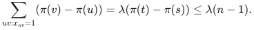
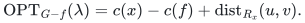
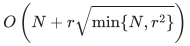

# Exact flow, matching, and price sensitivity

## 1. Unit-capacity flow theorem

For a simple directed graph with unit capacities, nonnegative rational costs, and fixed terminals, feasible flow value <code class="math">\lambda\ge1</code> admits an exact one-arc-failure preserver of <code class="math">O(n^{3/2}\lambda^{1/4})</code> original arcs. Deterministic preprocessing is <code class="math">\widetilde O(mn)</code> arithmetic operations. Reporting takes <code class="math">O(n)</code> for a difference or <code class="math">O(n\sqrt\lambda)</code> for full support. A cost-only structure uses <code class="math">O(n\sqrt\lambda)</code> records and <code class="math">O(\log(n+1))</code> lookup time.

**Lemma 1.1 (acyclic support).** An acyclic integral unit <code class="math">\lambda</code>-flow has <code class="math">O(n\sqrt\lambda)</code> support arcs.

**Proof.** In a topological order <code class="math">\pi</code>, conservation gives
<!-- math-display: 87fe46d09137a9494a06c625
\sum_{uv:x_{uv}=1}(\pi(v)-\pi(u))
=\lambda(\pi(t)-\pi(s))\le\lambda(n-1).
-->

Simplicity bounds arcs of span below <code class="math">L</code> by <code class="math">nL</code>; the rest number at most <code class="math">\lambda(n-1)/L</code>. Take <code class="math">L=\lceil\sqrt\lambda\rceil</code>. A nonnegative-cost optimum is made acyclic by cancelling zero-cost cycles, or minimizing used-arc count secondarily. <code class="math">\square</code>

**Lemma 1.2 (residual identity).** For an optimal integral flow <code class="math">x</code> and used failed arc <code class="math">f=(u,v)</code>,
<!-- math-display: 08530979d311283a296355ac
\mathrm{OPT}_{G-f}(\lambda)=c(x)-c(f)+\mathrm{dist}_{R_x}(u,v).
-->

**Proof.** The residual graph has no negative cycle. A simple residual <code class="math">u</code>-to-<code class="math">v</code> path cannot use the reverse <code class="math">v</code>-to-<code class="math">u</code> of <code class="math">f</code>. Remove <code class="math">f</code> and augment along that path to repair conservation and capacities at the displayed cost. Conversely, decompose any repair difference into residual cycles. Each costs nonnegatively. Remove the reverse of <code class="math">f</code> from its cycle to obtain a path costing at most the repair gap plus <code class="math">c(f)</code>. This proves equality and the infeasibility convention. <code class="math">\square</code>

If <code class="math">s_x</code> is baseline support, all relevant failures give at most <code class="math">s_x</code> demands in this one residual graph. Classical directed pairwise distance preservation keeps <code class="math">O(n\sqrt{s_x})</code> residual arcs. Include their original labels and the baseline, yielding <code class="math">O(s_x+n\sqrt{s_x})</code> original arcs. Lemma 1.1 gives the headline. Lexicographic cost/hop paths are simple and report <code class="math">O(n)</code> changes; full output scans only the stored baseline and changes.

One unit-arc deletion lowers maximum flow by at most one, so two consecutive value constructions handle minimum-cost maximum flow. Since <code class="math">\lambda\le n-1</code>, the uniform bound is <code class="math">O(n^{7/4})</code>. For general balances or signed costs the support-sensitive theorem remains valid, but the acyclic support estimate needs its stated assumptions.

## 2. Internally vertex-disjoint paths

Split each internal vertex into in/out copies with a capacity-one gate. An acyclic packing uses at most <code class="math">n-2</code> internal vertices and <code class="math">n-2+\lambda=O(n)</code> original arcs; its split support is <code class="math">O(n)</code>. A gate deletion forces incident flow to zero by conservation and represents deletion of that internal vertex.

Apply Lemma 1.2 to both gates and original arcs. This gives <code class="math">O(n^{3/2})</code> original arcs and records, <code class="math">\widetilde O(mn)</code> arithmetic preprocessing, and <code class="math">O(n)</code> full path output. A single failure destroys at most one path, so two consecutive values preserve maximum cardinality with minimum total cost. The terminal pair is fixed; simplicity controls direct terminal-to-terminal multiplicity.

## 3. General-graph cardinality matching

For matching number <code class="math">\mu</code> and fixed maximum matching <code class="math">M</code>, one-edge-failure certificates need at most <code class="math">4\mu+2</code> original edges. A joint certificate for one edge **or** one vertex failure needs at most <code class="math">6\mu+2</code>. Deterministic preprocessing is polynomial and queries take <code class="math">O(\mu)</code>.

Impose a small fractional avoidance cap for each baseline edge or covered vertex whose deletion still allows size <code class="math">\mu</code>. A convex combination of its avoiding witnesses with <code class="math">M</code> proves feasibility. Add the outside-mass cap <code class="math">x(E\setminus M)\le1/2</code>, which keeps every edge of <code class="math">M</code> positive.

**Support lemma.** Intersecting the cardinality-<code class="math">\mu</code> matching face with <code class="math">k</code> rational inequalities yields a point with at most <code class="math">3\mu+k+1</code> positive coordinates.

**Proof.** Maximize a rational objective outside every proper span of the finite constraint normals. Uncross an optimal dual, keeping the additional rows fixed, so its positive odd-set rows are laminar. At most <code class="math">2\mu</code> degree rows have positive multipliers, since each is tight and total fractional degree is <code class="math">2\mu</code>. At most <code class="math">\mu</code> laminar odd-set rows are positive: after adding singleton leaves, each internal node has an odd number of children, at least three, and its tree count is bounded by the tight internal matching mass of its root. Disjoint roots have total mass at most <code class="math">\mu</code>.

There are additionally at most <code class="math">k</code> new rows, one cardinality row, and <code class="math">m-s</code> slack unit rows for a support of size <code class="math">s</code>. If <code class="math">s&gt;3\mu+k+1</code>, these rows span a proper subspace, contradicting the objective. The complete proof supplies the uncrossing potentials and polynomial-bit generic objective. <code class="math">\square</code>

At most <code class="math">\mu</code> edge caps plus the outside-mass cap give <code class="math">4\mu+2</code>; at most <code class="math">2\mu</code> additional vertex caps give <code class="math">6\mu+2</code>. Integrality decomposes the point into maximum matchings. Expectation below one at a cap ensures a component avoiding that failure. Other failures use <code class="math">M</code> or <code class="math">M</code> minus one edge.

Start from the union of <code class="math">M</code> and avoiding witnesses, then greedily delete nonbaseline edges whenever all designated scenarios remain feasible. A terminal graph larger than the support bound contradicts the lemma applied to that graph. Queries need at most one blossom-aware augmentation on its <code class="math">O(\mu)</code> edges. Classical skew-symmetric regular reachability supplies linear time; ordinary directed reachability does not.

## 4. Two-matroid cardinality

For two arbitrary matroids with maximum common size <code class="math">r</code>, the analogous caps yield at most <code class="math">2r+k\le3r</code> original elements, where <code class="math">k</code> is the number of avoidable baseline elements.

For each matroid, tight rank rows restricted to positive support form a lattice. A maximal tight chain has at most <code class="math">r</code> increments because each has positive integral rank. Every tight set is a union of chain blocks, so the row-space dimension is at most <code class="math">r</code>. The two spaces share the cardinality row, bounding their combined dimension by <code class="math">2r-1</code>. The <code class="math">k</code> avoidance rows and one outside-mass row give support at most <code class="math">2r+k</code>. Common-base integrality supplies the failure witnesses. Query optimization on this restriction still uses the original oracles.

## 5. One-element price changes

A separate structure for prescribed rank <code class="math">r</code>, fixed rational prices, and <code class="math">N</code> original elements uses
<!-- math-display: 13ee633ad96729367854f472
O\left(N+r\sqrt{\min\{N,r^2\}}\right)
-->

records and reports an optimum in <code class="math">O(r)</code> time after an independent one-element price change.

For an outside element <code class="math">e</code>, take one explicit eligible exchange arc labeled <code class="math">e</code>, followed by a shortest return path in the compressed exchange graph. Conditional convex decomposition gives an <code class="math">e</code>-containing basis of no larger gap; reverse exchange decomposition proves equality. Choosing a minimum-hop optimum cycle forces distinct labels and makes its toggle feasible. Baseline elements use the analogous exclusion gap. A price query compares its best containing and avoiding alternatives.

There is one starter/return-pair descriptor per element and at most <code class="math">\min\{N,r^2\}</code> distinct return pairs. Pairwise distance reporting gives the displayed space and output bound. Supplied-catalog insertion uses the same argument at fixed rank; it does not cover rank-increasing insertion. Arbitrary new arborescence arcs admit the separate <code class="math">O(n^2)</code>-record heavy-light implementation in the complete proof.

## Complete proofs

[Flow and paths](manuscripts/exact-min-cost-flow-and-vertex-disjoint-paths.md); [matching and uncrossing](manuscripts/linear-single-fault-general-matching.md); [two-matroid cardinality](manuscripts/linear-unweighted-two-matroid-certificate.md); [price sensitivity](manuscripts/compact-one-element-price-sensitivity.md).

**Attribution:** icekylinx and GPT-6 Astra Pro.
