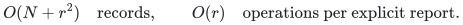
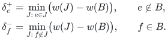
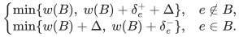

# Native fixed-rank price and catalog-insertion reporting

The [ordinary price backend](reference/price.py) realizes the fixed-rank
ordinary-matroid interfaces of the
[price-sensitivity manuscript](manuscripts/compact-one-element-price-sensitivity.md).
It computes and verifies its original optimum, then reports exact original-ID
answers to independent price changes or supplied-catalog insertions. The final
structure uses the manuscript's all-pairs storage alternative:

<!-- math-display: aef593559b41a8a9d8b57e70
O(N+r^2)\quad\text{records},\qquad
O(r)\quad\text{operations per explicit report}.
-->

The stronger pair-preserver storage bound and the specialized arbitrary-new-arc
arborescence interface are distinct constructions. This backend does not claim
to implement them or the valuated price interface.

## Original active optimum and compressed return graph

Original costs are signed exact rationals. The two independence callbacks
represent ordinary matroids on the complete original catalog. Restrict each
to the original active IDs, treating inactive elements as loops during
initialization. The canonical weighted-intersection constructor finds a
minimum-cost common set of the prescribed rank or proves that this rank is
infeasible. Its original-input certificate is checked before use. Neither
that certificate nor the callbacks are retained in the report structure.

For each original element outside the baseline, evaluate every possible
single exchange with that baseline in each original matroid. These eligibility
sets apply to active elements and to supplied inactive candidates. Only active
outside elements enter the compressed return graph. For each ordered pair
of baseline positions, keep the cheapest eligible original active label,
with a permanent ID tie break. Its primary length is the entering original
cost minus the cost of the removed tail element; its secondary length is one.

The ordinary common-base polytope and baseline optimality make all return
graph cycles nonnegative in primary cost. Every nonempty cycle has positive
secondary length. Exact lexicographic Floyd–Warshall therefore gives simple
minimum-cost, minimum-hop return paths, even when individual primary lengths
are negative. The stored first-edge matrix suffices to stream each chosen
path; distance and last-edge matrices are preprocessing temporaries.

## One starter descriptor per original element

For a baseline element, a starter is an outgoing compressed arc; the return
path ends at that same baseline position. For an outside catalog element,
keep its own explicit eligible starter arc and use the active return graph.
Choose a candidate by total primary cost, then total exchange-hop count.
A self-loop starter uses an empty return path and remains a genuine one-edge
exchange. Missing candidates have an infeasible forced or excluded alternative.

The canonical forced-element and deletion identities give

<!-- math-display: 2e6a3dd5b8365e0cb0acd0b9
\begin{aligned}
\delta_e^+&=\min_{J:\,e\in J}\bigl(w(J)-w(B)\bigr),
 &&e\notin B,\\
\delta_f^-&=\min_{J:\,f\notin J}\bigl(w(J)-w(B)\bigr),
 &&f\in B.
\end{aligned}
-->

Here common sets have the prescribed rank. An outside inactive candidate may
appear together with original active elements only. Its gap can be negative:
the original baseline was optimal on the active restriction, not on that
enlarged catalog instance.

For completeness, a starter plus its simple return path gives a fractional
common-base point by averaging the valid exchanges in each matroid. A basis
polytope decomposition has coordinates forcing every output to use only
baseline elements and the cycle's original labels. Conditional on including
the forced outside element, some common basis costs no more than the candidate
gap. For active elements, every decomposed basis costs at least the baseline,
and nonnegative cycle cost handles repeated occurrences of the protected label.
For an inactive candidate its label is absent from the return graph and occurs
once; all decomposed bases excluding it use active elements, so the same
conditional argument permits a negative gap.

Conversely, exchange matchings from an optimum constrained basis produce a
cycle containing the protected element. Other active cycles have nonnegative
cost. Compress its unprotected arcs and replace the return route by a shortest
path to obtain a no-more-expensive candidate. The two bounds prove the identities.
Finally, a minimum-hop optimal candidate must have distinct outside labels:
a supported optimum using fewer entering labels would yield an equally cheap
candidate with fewer hops. Its removed positions and entering labels therefore
form a literal optimum toggle. This is the reason no query-time optimization
or feasibility callback is needed.

## Exact query comparison and decoding

A query changes the indicated original cost by an exact rational increment.
For an inactive catalog ID, it activates that one candidate at its original
specified cost plus the increment. It never activates another inactive ID.
The best original baseline and the constrained alternative are compared:

<!-- math-display: 9c527a37f26444ce7e0c7157
\begin{cases}
\min\{w(B),\ w(B)+\delta_e^++\Delta\},&e\notin B,\\
\min\{w(B)+\Delta,\ w(B)+\delta_e^-\},&e\in B.
\end{cases}
-->

Infinite alternatives are ignored; ties return the baseline. Queries do not
accumulate. The zero-rank case always returns the empty set and zero cost.
Insertion that increases maximum cardinality is outside the prescribed-rank
contract.

To report the alternative, mark the starter's tail and the successive return
path tails in a baseline-sized Boolean array. Emit every unmarked baseline
ID followed by the entering original labels. The minimum-hop argument makes
these labels distinct and the resulting set feasible and optimal. This is
linear record work with no sorting or hash table during the query. All exact
rational comparisons and printed output bits are charged at their actual
encoding lengths.

## Storage, preprocessing and independent evidence

There is one membership bit and at most one constant-size starter descriptor
per original catalog ID, one baseline, and a quadratic first-edge matrix on
baseline positions. The matrix references at most quadratically many compressed
arcs; the descriptors additionally reference at most one starter per original
ID. This proves the displayed final bound. The structure stores no original
cost list, independence callback, initializer certificate, exchange-eligibility
table or all-pairs distance matrix.

Initialization uses the canonical polynomial weighted-intersection reference.
Afterward there are `O(N*r)` original independence tests,
`O(N*r^2+r^3)` arithmetic operations for compression, distances and descriptor
selection, and polynomial temporary storage. The input matroid axioms are
assumed by the oracle contract. Original oracle cost and rational bit lengths
are separately charged. The all-pairs method trades a quadratic final matrix
for a simpler explicit implementation; it is not a faster preprocessing claim.

The [independent checker](verify/check_price.py) enumerates original common
sets, rather than compressed graph candidates, for signed price changes and
inactive-catalog insertions. It covers infeasible prescribed ranks, rank zero,
parallel exchange choices, positive and negative increments, long forced cycles,
negative insertion gaps and 100-digit costs. Queries still work after clearing
the caller's cost list and disabling initialization and shortest-path producers.
Finite comparisons support the symbolic argument and are not external peer
review or formal verification.

**Attribution:** icekylinx and GPT-6 Astra Pro.
