# Exact general-graph matching

The research theorem constructs a deterministic exact maximum-cardinality
matching algorithm with four-fifths logarithmic overhead. Its
[complete proof](proof.md) connects the matching framework to explicit
routing, cycle-search, repair and finite-arithmetic constructions.
A separate standard-library solver makes exact matching and independent
optimality certificates executable now.

**Guarantee**

Returns an exact maximum-cardinality matching while preserving the original identifier of every selected edge.

**Objective and output**

Maximize the number of matched edges and return the selected edge identifiers after loops and parallel records have been normalized.

**Randomness**

Deterministic exact algorithm, including the uniform parameter search and all locally constructed interfaces. Named published deterministic primitives remain explicit proof dependencies. The separate executable solver and its certificate verification are also deterministic.

**Time**

The [research theorem](proof.md#1-result-contributions-and-proof-scope) gives

<!-- math-display: c167d7229cda5041570021d3
O(n+m)+(m_s+1)\exp\!\left(O((\log(m_s+2))^{4/5}(\log\log(m_s+4))^{1/5})\right).
-->
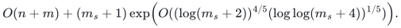

[Theorem 11.6](proof.md#116-deterministic-cycle-search-realization)
instantiates the required cycle-search interface from the checkpoint's
local construction proofs and named source results. The full fast
hierarchy has not yet been implemented end to end.

The [implemented reference solver](reference/README.md), including optional
optimality-certificate generation, takes

<!-- math-display: 6c0fddf87e29fb75109bfdec
O\!\left(n+m\log(m+2)+\sum_i\nu(G_i)^{p_i}\right),
\qquad p_i\in\{5/2,3\}.
-->
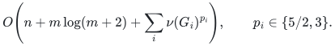

Here <code class="math">G_i</code> ranges over nonempty normalized input components.
The exponent is `5/2` when the component's retained edge kernel is
bipartite and `3` otherwise. Every bipartite input component gets the
improved bound.
Independent verification takes
<!-- math-display: c1dcd78e60b27d06b9a73a98
O(n+m\log(m+2))
-->
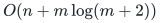
.

**Space**

<!-- math-display: 0117325c4f4e755b5b40c665
O(n+m)
-->
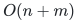
 records for the reference solver and its optional certificate,
plus actual ID-label bytes. The research composition uses polynomial space
in its graph and cycle-search inventory.

**Parameters**

`n` is the vertex count; `m` is the input edge-record count; `m_s` is
the number of distinct nonloop edges. <code class="math">\nu(G_i)</code> is the maximum matching
size in normalized component `i`; it is not supplied as input.
The first retained edge kernel is used to choose the component exponent
`p_i`; no bipartition is required in the input.

**Model and representation**

Arbitrary undirected graphs, including loops, parallel records and isolated
vertices; original selected edge IDs are returned. The reference code is
standalone. Its documented word-operation bounds additionally charge long
ID comparisons and serialization. The research theorem charges actual
integer and rational work, explicit path inventories and edge lifetimes.
Its named source dependencies and parameter ranges are listed separately
from the repository's current code coverage.

**Lower-bound scope**

This card records a deterministic research upper bound and a polynomial
reference implementation. No new matching lower bound is claimed.

**Review status**

**Ready for review.** The complete deterministic four-fifths research theorem, including the cycle-search realization, raw quality and gradient lifting, chronological work, stable retirement, finite-bit realization and uniform search. The separate executable package includes exact matching, independent optimality certificates, the refined `3nu` vertex count for the earlier compression, nonrecursive bipartite phases, and universal mixed-failure kernels with all-cover-subset and context preservation. Layer matching/vertex-cover witnesses certify every permitted failure query without enumeration.

**Dependencies and scope.** Named published deterministic primitives are explicit proof dependencies; the local realization theorem discharges the abstract cycle-search contract. The shipped reference implementation has a separate polynomial bound and does not implement the entire fast research construction. Failure kernels concern a fixed simple graph and native edge/vertex faults; arbitrary cover deletions and attached cover contexts are proved separately. Correlated failure labels and native parallel records are different models. The `O(nu f)` positive-budget vertex order is credited to the published 2022 result. Readiness is a mathematical review invitation, not proof-assistant verification.

The [verification note](verify/README.md) identifies executable coverage. This status does not claim external peer review or proof-assistant verification.

**Source**

[Executable solver and example](reference/README.md),
[matching-size cubic bound and proof](reference/cover-compression-proof.md),
[bipartite refinement and linear certificates](reference/bipartite-proof.md),
[complete research theorem and proof](proof.md),
[dependencies and primary sources](sources.md).

## Matching-size refinement

Let <code class="math">\nu(G)</code> be the maximum matching size. The exact-preserving kernel in the proof retains

<!-- math-display: af2551cab5849cf7c623583b
m_H\le\min\{m_s,O(\nu(G)^2)\}.
-->
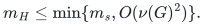

The second term of the research bound may use <code class="math">m_H</code> in
place of <code class="math">m_s</code>, while its word-RAM radix normalization costs
<!-- math-display: 0117325c4f4e755b5b40c665
O(n+m)
-->

. The Python reference uses comparison sorting and charges its
separate

<!-- math-display: feff7b949d3592cdc03862d5
m\log(m+2)
-->
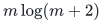
 term. Both restore original selected edge IDs.

For a computed vertex cover of size <code class="math">c</code>, the explicit edge bound is
<!-- math-display: 37bc1bac01d1ae94691280d9
m_H\leq\min\{m_s,\binom c2+c^2\}
-->
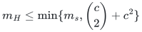
. Processing connected components
separately replaces the solve term by the sum of the corresponding
component costs; no matching-size estimate is supplied as input.

For a fixed simple graph, the [mixed-failure extension](../../manuscripts/graph-backends/matching-size-kernel-corollary.md#4-one-kernel-for-mixed-vertex-and-edge-failures)
retains at most

<!-- math-display: 398bcc6e56ccd2d9cc9b5b40
\binom c2+c(c+f)
-->
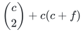
 edges and simultaneously preserves
the exact matching number after every mixture of at most <code class="math">f</code> native
vertex/edge deletions. The
[layered vertex refinement](reference/fault-tolerant-cover-compression.md)
retains at most

<!-- math-display: f2a8e26dd07a0bdb75598e3a
(f+2)c
-->
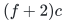
, and with the default cover at most
<!-- math-display: 65f30f4b6c9f34581d50e47f
(f+3)\nu(G)
-->
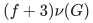
, vertices while preserving that edge bound.
Its [constructor](reference/failure_kernel.py) emits a universal
certificate checked by a [separate verifier](reference/verify_failure_kernel.py)
without a matching search or failure enumeration.  Every matchable cover
subset is preserved, so arbitrary graphs attached through the cover are
also supported.  Each particular query still needs a matching solver.

The

<!-- math-display: 78fa8ed98cba2c8c1465ddca
4\nu
-->
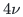
 vertex compression already appears in
the 24 October direct checkpoint's
<em>A linear-vertex refinement of the matching-size kernel</em>
proof. Counting the actual crossing matching now sharpens the same
construction to

<!-- math-display: d20fc3caa5e645ac23de3048
3\nu
-->
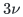
, with no change to the solve algorithm.
The current implementation, certificate extraction and bipartite
refinement are documented separately in the
[source history](sources.md#checkpoint-provenance).

Read the [proof](proof.md), [source map](sources.md), and
[complete index](../../CONTENTS.md) for the construction and its review scope.

**Attribution.** icekylinx · GPT-6 Astra Pro
