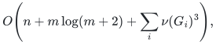

# Exact general-graph matching

An executable deterministic solver returns exact maximum-cardinality
matchings in arbitrary undirected graphs using only Python's standard
library. A separate research theorem gives a faster bound conditional on
the explicitly required cycle-search implementation.

**Guarantee**

Returns an exact maximum-cardinality matching while preserving the original identifier of every selected edge.

**Objective and output**

Maximize the number of matched edges and return the selected edge identifiers after loops and parallel records have been normalized.

**Randomness**

Deterministic executable solver and certificate verification. The faster research composition additionally requires the deterministic cycle-search implementation and named published primitives in the source map.

**Time**

The [implemented reference solver](reference/README.md) takes

<!-- math-display: 78ab04a90d9fbe296ea21ae1
O\!\left(n+m\log(m+2)+\sum_i\nu(G_i)^3\right),
-->

where <code class="math">G_i</code> ranges over nonempty normalized input components.
Optional optimality-certificate generation has the same bound;
independent verification takes
<code class="math">O(n+m\log(m+2))</code>.

The faster research bound requires the
[cycle-search implementation specified in Section 11.6](proof.md#116-explicit-raw-backend-realization-contract):

<!-- math-display: c167d7229cda5041570021d3
O(n+m)+(m_s+1)\exp\!\left(O((\log(m_s+2))^{4/5}(\log\log(m_s+4))^{1/5})\right).
-->

**Space**

<code class="math">O(n+m)</code> records for the reference solver and its optional certificate,
plus actual ID-label bytes. The research composition uses polynomial space
in its graph and cycle-search inventory.

**Parameters**

**n** is the vertex count; **m** is the input edge-record count; **m_s** is
the number of distinct nonloop edges. **ν(G_i)** is the maximum matching
size in normalized component **i**; it is not supplied as input.

**Model and representation**

Arbitrary undirected graphs, including loops, parallel records and isolated
vertices; original selected edge IDs are returned. The reference code is
standalone. Its documented word-operation bounds additionally charge long
ID comparisons and serialization. The faster theorem requires the named
published primitives and the still-unimplemented cycle-search, repair and
edge-lifetime operations in Section 11.6.

**Lower-bound scope**

This card records an unconditional polynomial implementation and a
conditional faster upper bound. No new matching lower bound is claimed.

**Review status**

**Ready for review in the stated scope.** The executable cubic solver with optimality certificates and its independent verifier; the self-contained quadratic certificate-extraction proof; the unconditional sharp c-neighbor and mixed-failure kernels, componentwise composition, and subcubic reduction with its decoder. The cover-side alternating exchange further reduces the default solver, including certificates, to O(n+m log(m+2)+sum_i nu(G_i)^3), while retaining the original independent certificate format.

**Conditions and remaining work.** The four-fifths research running time still requires the cycle-search implementation and named published prerequisites in sources.md. The executable solver has its separately proved cubic bound. The mixed-failure kernel assumes a fixed simple graph; discarded parallel records and correlated labels are outside its scope.

The [verification note](verify/README.md) identifies executable coverage. This status does not claim external peer review or proof-assistant verification.

**Source**

[Executable solver and example](reference/README.md),
[matching-size cubic bound and proof](reference/cover-compression-proof.md),
[complete research theorem and proof](proof.md),
[dependencies and primary sources](sources.md).

## Matching-size refinement

Let <code class="math">\nu(G)</code> be the maximum matching size. The exact-preserving kernel in the proof retains

<!-- math-display: af2551cab5849cf7c623583b
m_H\le\min\{m_s,O(\nu(G)^2)\}.
-->

The second term of the conditional research bound may use <code class="math">m_H</code> in
place of <code class="math">m_s</code>, while its word-RAM radix normalization costs
<code class="math">O(n+m)</code>. The Python reference uses comparison sorting and charges its
separate <code class="math">m\log(m+2)</code> term. Both restore original selected edge IDs.

For a computed vertex cover of size <code class="math">c</code>, the explicit edge bound is
<code class="math">m_H\leq\min\{m_s,\binom c2+c^2\}</code>. Processing connected components
separately replaces the solve term by the sum of the corresponding
component costs; no matching-size estimate is supplied as input.

For a fixed simple graph, the [mixed-failure extension](../../manuscripts/graph-backends/matching-size-kernel-corollary.md#4-one-kernel-for-mixed-vertex-and-edge-failures)
retains at most <code class="math">\binom c2+c(c+f)</code> edges and simultaneously preserves
the exact matching number after every mixture of at most <code class="math">f</code> native
vertex/edge deletions. This is an unconditional deterministic kernel;
each query still needs a matching solver.

Read the [proof](proof.md), [source map](sources.md), and [complete index](../../CONTENTS.md) for the backend contract and audit trail.

**Attribution.** Yilin Liu · GPT-6 Astra Pro
