# Deterministic Exact General Matching through Persistent Integral Carriers and Normalized Routing

**icekylinx · GPT-6 Astra Pro**

**Theorem-and-proof manuscript.** This manuscript constructs a deterministic
exact matching algorithm with four-fifths logarithmic overhead, using the
named source results in Section 2.2 and the local constructions assembled
in Theorem 11.6. The complete mathematical construction and the current
[polynomial reference implementation](reference/README.md) have distinct
implementation coverage.

## Abstract

We construct a deterministic algorithm for exact maximum-cardinality matching in arbitrary undirected graphs around two interfaces: a persistent representation of the actual integral matching ledgers, and a dynamic minimum-ratio circulation algorithm with explicit traversal and lifetime guarantees. The construction uses the carrier representation and its local exposure procedure, an optimum-gap formulation without a perfect-matching promise, exact projection recovery from conserved near-feasible flows, and sequential routing and normalized sparsification with separate structural and construction-work bounds. Theorem 11.6 assembles the local raw-lift, repair, occurrence, retirement and finite-arithmetic proofs into the required cycle-search algorithm. The complete composition gives a single deterministic program with logarithmic overhead exponent <code class="math">4/5</code>, importing only the named source results at their stated interfaces. All returned edges retain their original input identifiers. The repository separately implements and tests a polynomial-time exact solver; it does not yet implement the full fast hierarchy.

## 1. Result, contributions, and proof scope

Let <code class="math">G</code> be an undirected graph given by <code class="math">n</code> vertices and <code class="math">m</code> listed edge records. Loops and parallel records are permitted in the input. Write <code class="math">m_s</code> for the number of distinct nonloop edges and <code class="math">\nu(G)</code> for the maximum matching cardinality.

**Theorem 1.1 (deterministic exact matching).** In the computational model of Section 2.1, there is one deterministic program that returns an explicit maximum-cardinality matching of <code class="math">G</code>, with original edge identifiers, in time

<!-- math-display: 3dfffb10bdf03999a8ca90be
O(n+m)+(m_s+1)
 \exp\!\left[O\!\left(
   (\log(m_s+2))^{4/5}
   (\log\log(m_s+4))^{1/5}
 \right)\right].
 \tag{1}
-->
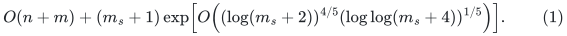

The constants are independent of the input. The graph may be disconnected, nonbipartite, of odd order, or without a perfect matching. With the exact preprocessing kernel of Section 3.1, <code class="math">m_s</code> in the second term can instead be replaced by an actual edge count <code class="math">m_H\leq\min\{m_s,O(\nu(G)^2)\}</code>. The input scan is performed once.

The central contributions are as follows.

1. **Actual integral carriers.** We maintain every integral ledger as an acyclic transportation carrier, retaining zero-valued carrier edges. A batch touching <code class="math">q</code> incidences needs only <code class="math">O(q)</code> forest pivots. At a settled bottom ledger, the carrier induces selected trees of bin weight less than <code class="math">2L</code>, together with implicit forward and inverse row assignments.
2. **Local deterministic exposure and arbitrary optimum gaps.** Output-sensitive tight-set discovery and a local forest exchange supply the structural actions. A comparison matching with <code class="math">K_{\mathrm g}</code> additional edges supplies the augmenting prefixes needed by the phase proof. This gives an exact gap driver on every general graph.
3. **Exact projection and direct numerical parameters.** A conserved rational flow with total integral-bound violation below one can be rounded to exact feasibility. True-flow and optimistic-cut recovery give the complete residual peel. Binary ledger periods and independently chosen numerical accuracy give total client work <code class="math">S E^4\mathrm{poly}(\log S)</code>.
4. **Sequential routing and normalized ambient sparsification.** We give explicit finite local procedures, a virtual hierarchy with one physical root map, and a scatter–meet–reverse query induction. The static provider has structural quality <code class="math">\log\Gamma=O((p+r)\log U)</code>, while its larger construction factor remains local work.
5. **A complete quantitative composition.** We retain selected-edge recourse, late initial update credit, occurrence pools, finite arithmetic, and the full recursive quality product. Their simultaneous balance gives (1).

The theorem uses the named source results in Section 2.2. Theorem 11.6
supplies the required cycle-search interface by composing the local
construction proofs; Section 12 then balances their actual costs. No single
source paper is asserted to prove the improved bound. The
[checkpoint source map](sources.md#checkpoint-provenance) records the
construction chain already present in the revised 24 October checkpoint.
The absence of an end-to-end fast implementation is a code-coverage limit,
not an additional mathematical hypothesis. Output verification establishes
optimality of an accepted matching; the construction proofs establish the
faster time bound.

### 1.1 Unconditional executable companion

The [standard-library reference solver](reference/README.md) implements
the normalization, connected-component decomposition and exact edge kernel
of Section 3.1. The earlier checkpoint's
[outside-endpoint compression](reference/cover-compression-proof.md) preserves
every matchable subset of the computed cover and leaves at most
<code class="math">3\nu(G_i)</code> vertices for the final exact matching search.
Both the crossing compression and a final bipartite solve use
Hopcroft–Karp; other final solves use classical Edmonds blossom.
For nonempty normalized input components <code class="math">G_i</code>, its time is

<!-- math-display: 6c0fddf87e29fb75109bfdec
O\!\left(n+m\log(m+2)+\sum_i\nu(G_i)^{p_i}\right),
\qquad p_i\in\{5/2,3\}.
-->

The exponent is `5/2` if the first retained edge kernel is bipartite and
`3` otherwise. The [complete bipartite proof](reference/bipartite-proof.md)
derives the matching-number phase bound and linear certificate extraction;
all originally bipartite input components satisfy its condition.

It returns the original selected edge IDs and uses <code class="math">O(n+m)</code> records,
with actual label bytes and comparison costs charged separately. Its
optional certificate mode has the same bound. Certificate extraction still
runs on the original edge kernel; with <code class="math">k_i</code> vertices and <code class="math">h_i</code>
edges there, it costs <code class="math">O(k_i+h_i)</code> in the bipartite case and
<code class="math">O(h_i+k_i(\nu(G_i)+1))</code> otherwise, within the respective
solve bounds. No matching-number estimate is supplied as input.
A [separate verifier](reference/verify_certificate.py) checks exact kernel
preservation and a Tutte–Berge upper bound using graph scans and comparison
sorting, without calling a matching algorithm. The reference documentation
proves that acceptance certifies maximum cardinality. Its
[self-contained extraction proof](reference/certificate-proof.md) derives a
tight general odd-component barrier from one exhausted alternating forest;
the bipartite proof obtains the same certificate equality from a minimum
vertex cover. This implementation uses classical matching searches;
it does not execute Theorem 11.6's cycle-search hierarchy.
The additional polynomial matching work is used only in this executable companion,
and is not charged to or assumed by the faster composition theorem.

## 2. Model, notation, and inherited primitives

### 2.1 Computational and identity conventions

We use a word RAM with word size sufficient for an input vertex or edge identifier. Input vertex names are integers in <code class="math">[n]</code>. Counting/radix sorting of endpoint pairs and compaction therefore take <code class="math">O(n+m)</code> time. All larger integers and rational arithmetic are charged by their actual word operations. A word never stores an uncharged arbitrarily long integer.

All logarithms are base two unless an entropy or exponential potential explicitly uses natural logarithms. The notation <code class="math">\mathrm{poly}(U)</code> always has a fixed absolute degree. Constants in <code class="math">O(\cdot)</code> are uniform in every growing parameter introduced below.

A *lifetime identifier* names one birth-to-retirement instance of a vertex, edge, or exposed occurrence. Reusing an address creates a new lifetime. Parallel edges have distinct identifiers. An *immediate* graph is the graph in which a path is currently defined; two distinct immediate vertices remain distinct even if they later project to the same physical vertex.

For a walk <code class="math">P</code>, its raw length counts every traversal. For an ambient path table <code class="math">\Pi</code>, <code class="math">L(\Pi)</code> is maximum path length and <code class="math">C(\Pi)</code> is maximum vertex-occurrence congestion, including endpoints. A fixed factor may count a shared endpoint twice. Empty paths retain endpoint annotations.

We separate the following parameters throughout.

| Symbol | Meaning |
|---|---|
| <code class="math">S=2^s</code> | Master size for the subcubic matching problem |
| <code class="math">U=2s</code> | Master logarithmic size for numerical instances of size at most <code class="math">S^2</code> |
| <code class="math">h=\lceil\log(U+4)\rceil</code> | Logarithmic auxiliary factor |
| <code class="math">K_{\mathrm g}</code> | Target matching improvement in a phase |
| <code class="math">L</code> | Integral allocation per row |
| <code class="math">p,r</code> | Routing and degree-band decomposition parameters |
| <code class="math">K_{\mathrm r}</code> | Number of touched-set repair layers |
| <code class="math">k=2^x</code> | Recursive size-reduction factor |
| <code class="math">\Gamma,F</code> | Static structural quality and construction-work factors |
| <code class="math">P_{\mathrm d}</code> | Parent ledger debt in a local projection |
| <code class="math">P_{\mathrm b}</code> | Encoded child-record and recurrence factor |
| <code class="math">E,D,q</code> | Backend cap, rounded numerical cap, and numerical accuracy |

### 2.2 External inputs

We use the following named source results at their indicated interfaces.
The bibliography gives primary source locations. These are ordinary
mathematical dependencies; the parameterized composition and the additional
algorithmic interfaces are proved below and in the linked companion proofs.

| Input | Interface used |
|---|---|
| **[OAI], Sections 3–5** | Deterministic row/bin state identities, logarithmic descriptors, bounded objective and positivity service, and the local exchange-network exploration/lock invariants. Sections 4–8 below specify our representation, gap, numerical parameters, and exact recovery. |
| **[AHLT]** | Deterministic worst-case dynamic forests with link, cut, expose, path extrema, lazy path addition, and rooted ancestor queries; internal degree reduction is permitted. |
| **[CHHIP], Lemma 3.5** | Directed one-edge-out discovery in work proportional to a supplied exploration budget, with the stated bounded-volume output or absence conclusion. |
| **[KMPG], [CKL], and [AN]** | Deterministic center/stable-forest and original-edge weighted tree geometry, including pointwise fixed stretch labels and monotone forest cuts. Section 11.5 states the finite-bit interface used in our composition. |
| **[CGLNPS], [CS21]** | Deterministic balanced-cut and expander-pruning primitives. Section 10 composes them into the degree-band interface, with each call in its actual-size parameter range. |
| **[CS], [CHS], and [KMPS]** | Combinatorial hierarchy, shuffler, and distance-to-cycle geometry at the local interfaces described in Sections 9 and 11. Our sequential work, query, normalization, and raw-lift specifications are separate. |
| **[Gabow]** | A deterministic augmenting-path search from an arbitrary matching, including an exhausted-search outcome, in near-linear work. |

The matching-state localization input has a particularly useful precise form. A projection from an integral parent of floor <code class="math">c+1</code> and debt <code class="math">P_{\mathrm d}</code> to floor <code class="math">c</code> uses a frozen parent. Its threshold networks expose <code class="math">O(P_{\mathrm d}+1)</code> records, keep permanent sink locks, have total source deficit at most <code class="math">P_{\mathrm d}</code>, and admit the true/optimistic-region recovery in Section 8. We inherit this locality and its bounded objective/lock accounting from the source framework; an exact flow existence argument alone is not its locality proof.

The theorem relies on these source results in their stated scope. Its
routing, normalization, lifetime and parameter claims are supplied by the
local constructions, rather than attributed to a source result with a
different interface or parameter range.

## 3. Exact input reductions

### 3.1 Cleanup and an optional quadratic edge kernel

Remove loops, keep one original identifier per unordered nonloop pair, and remove isolated vertices. The empty case returns immediately. Let the remaining simple graph have <code class="math">v_0\leq2m_s</code> vertices.

For the optional kernel, take a greedy maximal matching <code class="math">M_0</code>, set <code class="math">C=V(M_0)</code>, <code class="math">c=&#124;C&#124;</code>, and <code class="math">I=V(G)\setminus C</code>. Maximality makes <code class="math">I</code> independent. Keep every <code class="math">C</code>-<code class="math">C</code> edge and, for each <code class="math">u\in C</code>, exactly <code class="math">\min\{c,&#124;N(u)\cap I&#124;\}</code> distinct neighbors in <code class="math">I</code>, using original edge order. Call the retained graph <code class="math">H</code>, after removing its isolated vertices. This construction and Lemma 3.1 are independent of the numerical backend.

**Lemma 3.1.** The kernel is constructed in linear time and satisfies

<!-- math-display: 8f781f2b56a2c9b665bf750a
\nu(H)=\nu(G),\qquad
 m_H\leq\min\left\{m_s,\binom c2+c^2\right\},\qquad
 c\leq2\nu(G).
 \tag{2}
-->
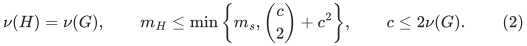

**Proof.** The endpoints of a maximal matching form a vertex cover, so every matching has at most <code class="math">c</code> edges. If a maximum matching uses an omitted edge <code class="math">uv</code>, with <code class="math">u\in C</code> and <code class="math">v\in I</code>, then <code class="math">u</code> has <code class="math">c</code> retained neighbors in <code class="math">I</code>. Remove <code class="math">uv</code> temporarily. At most <code class="math">c-1</code> vertices of <code class="math">I</code> are now matched, so one of those retained neighbors is free. Match <code class="math">u</code> to that neighbor. Each replacement decreases the number of omitted edges and preserves cardinality. Hence some maximum matching lies in <code class="math">H</code>. The reverse inequality follows from <code class="math">H\subseteq G</code>. Finally <code class="math">c=2&#124;M_0&#124;\leq2\nu(G)</code>. The edge and work bounds follow directly from the construction. ∎

The cutoff <code class="math">c</code> is sharp for arbitrary local neighbor choices. For even <code class="math">c\geq2</code>, take the complete bipartite graph on <code class="math">C</code> and an independent set <code class="math">I</code>, both of size <code class="math">c</code>, and add a perfect matching inside <code class="math">C</code>. The added matching may be the initial maximal matching. If every cover vertex keeps the same <code class="math">c-1</code> vertices of <code class="math">I</code>, then the retained graph has only <code class="math">2c-1</code> nonisolated vertices and matching number <code class="math">c-1</code>, whereas the original matching number is <code class="math">c</code>.

**Corollary 3.1a (componentwise refinement).** Let <code class="math">G_1,\ldots,G_a</code> be the nonempty connected components of the cleaned graph, and let <code class="math">m_i</code> and <code class="math">\nu_i</code> be their edge counts and matching numbers. In one <code class="math">O(n+m)</code> scan, construct the kernels separately, with retained sizes

<!-- math-display: ad0a5dc30399fd01705c24bb
h_i\leq\min\left\{m_i,\binom{c_i}{2}+c_i^2\right\}
       =O(\min\{m_i,\nu_i^2\}).
-->
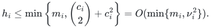

Applying Theorem 1.1 to each retained component gives the refined time

<!-- math-display: c11b4819087eae338a95a968
O(n+m)+\sum_{i=1}^{a}(h_i+1)
 \exp\!\left[O\!\left(
   (\log(h_i+2))^{4/5}(\log\log(h_i+4))^{1/5}
 \right)\right].
-->
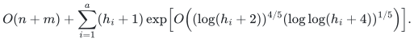

**Proof.** Connected components and all greedy matchings are computed in total linear work. Apply Lemma 3.1 in each component and invoke the same uniform program on each retained graph. Maximum matching is additive over connected components; the union of the decoded outputs is therefore maximum. Every nonempty component has at least one retained edge, so component overhead and final output are included. Constants are shared by all calls. ∎

All subsequent workers and verifiers use the same cleaned graph or the same kernel. Original identifiers remain passive labels until the winner is translated once.

### 3.2 An exact subcubic reduction with a decoder for every matching

For the graph to be solved, write <code class="math">e</code> and <code class="math">v</code> for its edge and nonisolated vertex counts. Replace a degree-<code class="math">d_u</code> vertex <code class="math">u</code> by a path with <code class="math">2d_u-1</code> vertices. Its odd positions are incidence ports. Each original edge joins its designated two ports. Let <code class="math">J</code> be the resulting subcubic graph and put

<!-- math-display: c5fa7462e95b864791034b6c
A=\sum_u(d_u-1)=2e-v,\qquad N=4e-v.
 \tag{3}
-->
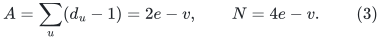

**Lemma 3.2.** We have <code class="math">\nu(J)=A+\nu(G)</code>. Any matching <code class="math">Q</code> of <code class="math">J</code> can be decoded in linear time to a matching of <code class="math">G</code> of cardinality at least <code class="math">&#124;Q&#124;-A</code>.

**Proof.** An original matching lifts by leaving its occupied port available and matching the even path segments on either side. An unmatched gadget leaves its first port free. Each gadget contributes <code class="math">d_u-1</code> internal edges, proving one inequality.

For the converse, let <code class="math">F</code> be the set of external gadget edges of <code class="math">Q</code>, viewed on original vertices, and let <code class="math">t_u=\deg_F(u)</code>. If <code class="math">t_u=0</code>, the gadget contributes at most <code class="math">d_u-1</code> internal edges. If <code class="math">t_u\geq1</code>, deleting its occupied odd ports leaves path segments with total matching capacity <code class="math">d_u-t_u</code>. Consequently

<!-- math-display: 637f1a9af7213b23487b15b0
|Q|\leq |F|+\sum_u(d_u-\max\{1,t_u\})
       =A+|V(F)|-|F|.
 \tag{4}
-->
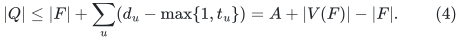

Here <code class="math">V(F)</code> excludes isolated vertices. Each nonempty tree component of <code class="math">F</code> contributes one to <code class="math">&#124;V(F)&#124;-&#124;F&#124;</code>; each other component contributes at most zero. One edge from each tree component forms an original matching, with cardinality at least <code class="math">&#124;Q&#124;-A</code>. Component traversal gives the decoder. Apply it to a maximum <code class="math">Q</code> and combine the two inequalities. ∎

Choose <code class="math">S=2^s</code> with <code class="math">N\leq S&lt;2N</code>, using direct handling of bounded cases. A lifted greedy matching initializes the phase driver. Its remaining optimum gap is at most <code class="math">\lfloor v/2\rfloor-&#124;M_0&#124;</code>, by (3).

## 4. The represented matching and minimal tight contractions

### 4.1 Bins, rows, and ledgers

A *bin* <code class="math">d</code> is an odd factor-critical physical block of size <code class="math">2w_d-1</code>, where <code class="math">w_d\geq1</code>. A *row* is a physical singleton outside the bins, with at most three physical incidences to bins. Let <code class="math">\mathcal A</code> be the rows and <code class="math">\mathcal D</code> the bins. An injection <code class="math">\mu:\mathcal A\to\mathcal D</code> assigns each row along one real incidence. The remaining vertices are explicitly matched pairs or unmatched blockers.

Each assigned bin exposes the endpoint of its assigned incidence, matches that row, and matches its other vertices internally. A free bin exposes one unmatched vertex. Thus the represented matching has cardinality

<!-- math-display: 7bb9d6321c591d083ee02104
|Q|=\sum_{d\in\mathcal D}(w_d-1)+|\mathcal A|
                      +\tfrac12|V_{\mathrm{paired}}|.
 \tag{5}
-->
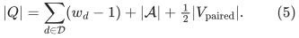

Every valid injection represents a matching of this same size.

For bins <code class="math">X</code>, define

<!-- math-display: 4a345dadd789377866cb971b
\mathcal A(X)=\{a:N(a)\subseteq X\},\qquad
 \eta(X)=|X|-|\mathcal A(X)|.
 \tag{6}
-->
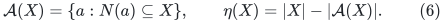

A ledger of floor <code class="math">c</code> has nonnegative incidence allocations <code class="math">x</code>, residuals <code class="math">y_d=L-\sum_a x_{ad}</code>, and nonnegative debts <code class="math">p_d</code>, with

<!-- math-display: 0449b8d83fb624920f3b982c
\sum_d x_{ad}=L,\qquad y_d+p_d\geq c w_d.
 \tag{7}
-->
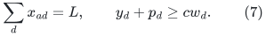

Integral levels have integer values. At a settled bottom level, <code class="math">c=1</code> and <code class="math">p=0</code>. Hence, for every nonempty <code class="math">X</code>,

<!-- math-display: 3edb9d1a0e891291665fdcf1
L\eta(X)\geq y(X)\geq w(X)>0.
 \tag{8}
-->
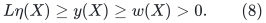

In particular, <code class="math">\eta(X)\geq1</code>; if <code class="math">X</code> is *tight*, meaning <code class="math">\eta(X)=1</code>, then <code class="math">w(X)\leq L</code>. A single bin also has weight at most <code class="math">L</code>.

The positive top coordinates are <code class="math">x^0</code> and <code class="math">\sigma_d=y_d^0+p_d^0-Cw_d</code>. Their logarithmic objective is the sum of their logarithms. Integral carrier normalization below leaves top coordinates unchanged.

### 4.2 Constructive contraction

**Lemma 4.1.** Let a physical edge join distinct bins <code class="math">i,j</code>. If <code class="math">X</code> is an inclusion-minimal tight set containing <code class="math">i,j</code>, then the union of its bins and its captive rows <code class="math">\mathcal A(X)</code> is factor-critical, has weight <code class="math">w(X)</code>, and preserves the represented matching cardinality when contracted.

**Proof.** There are <code class="math">&#124;X&#124;-1</code> captive rows, so the physical block has size <code class="math">2w(X)-1</code>. For any nonempty captive row set <code class="math">R</code>, strict surplus applied to <code class="math">N(R)</code> gives <code class="math">&#124;N(R)&#124;\geq &#124;R&#124;+1</code>. Removing any one child bin therefore preserves Hall's condition. This gives a captive-row injection avoiding whichever child contains a prescribed exposed physical vertex. Expose the requested vertex there; in every other child expose its assigned row contact.

To expose a captive row <code class="math">a</code>, remove it and reserve <code class="math">i,j</code> for the joining edge. If the other captive rows could not be injected into <code class="math">X\setminus\{i,j\}</code>, some row set <code class="math">R\subseteq\mathcal A(X)\setminus\{a\}</code> would satisfy <code class="math">&#124;N(R)\setminus\{i,j\}&#124;&lt;&#124;R&#124;</code>. Strict surplus forces <code class="math">i,j\in N(R)</code> and <code class="math">&#124;N(R)&#124;=&#124;R&#124;+1</code>, with exactly those <code class="math">R</code> captive. This is a proper tight subset of <code class="math">X</code> containing <code class="math">i,j</code>, contrary to minimality. Match the reserved contacts across the joining edge, match the remaining rows into their children, and leave only <code class="math">a</code> exposed.

The old injection uses <code class="math">&#124;X&#124;-1</code> bins for captive rows, so at most one exterior row is assigned into <code class="math">X</code>. Preserve that incidence as the exterior assignment of the new bin, if present. Equation (5) is unchanged. ∎

Each contraction stores one immutable record: child-bin records, captive row incidences, the joining edge, and the creation-time captive assignment. To materialize a prescribed exposure, repair that stored assignment by at most one bipartite augmentation for a child exposure, or at most two for a swallowed-row exposure. Each row has at most three incidences. The record tree has total arity linear in physical volume, so dissolution costs that volume times a logarithmic indexing factor. Later global assignment choices do not modify these creation-time records.

## 5. Persistent carriers for the actual integral ledgers

### 5.1 Sparse-batch normalization

A carrier is a forest in the bipartite row/bin incidence graph. It contains every positive allocation; its other edges may have allocation zero. Every off-carrier incidence has allocation zero. We store the actual integral ledger in this form.

**Lemma 5.1 (carrier normalization).** A legal old-to-final batch on <code class="math">q</code> incidences, including incidence births, deaths, or endpoint changes, can be applied and normalized with <code class="math">O(q)</code> signed path operations, cuts, and links. The resulting ledger has the batch's row and column margins and nonnegative integral values.

**Proof.** Read required old values from the designated version and coalesce repeated final writes. Apply the whole batch before pivoting. Cut dead or retargeted carrier edges, update surviving edge values, and keep the <code class="math">O(q)</code> positive off-carrier values in a pending dictionary.

Process one pending incidence <code class="math">e=(a,d)</code>. If its endpoints are disconnected, link it. Otherwise traverse the unique carrier path from row <code class="math">a</code> to bin <code class="math">d</code>, with every incidence permanently oriented row-to-bin. Let <code class="math">\theta</code> be the minimum value of a path edge agreeing with the traversal. This class is nonempty. Add <code class="math">\theta</code> to <code class="math">e</code>; subtract it from agreeing path edges and add it to disagreeing ones. This is a transportation circulation, preserving all margins. Cut one agreeing minimizer, now zero, and link <code class="math">e</code>. Retain every other zero edge. A zero minimum is permitted.

Each pending incidence uses at most one pivot. An earlier pivot touches only carrier edges and its own pending edge, so it cannot change an unprocessed pending value. Nonnegativity, integrality, and acyclicity follow at each step. ∎

An edge can become zero without an explicit notification. It remains represented until a charged topology operation removes it. The ledger fields <code class="math">y,p,w</code> are unchanged by every pivot, so (7) and (8) are preserved exactly.

### 5.2 Balanced selected trees and canonical point assignments

Root each carrier component at its minimum-identifier bin. Every row has at least two positive incidences: one positive incidence would equal <code class="math">L</code>, exceeding its bin capacity <code class="math">L-w_d&lt;L</code>. Its carrier degree is therefore two or three. Keep both incidences of a degree-two row; for a degree-three row keep its two child incidences. Suppress rows to obtain a selected forest with one row-labelled edge per row.

**Lemma 5.2.** Each selected component <code class="math">T</code> has <code class="math">w(T)&lt;2L</code>. Its physical volume, including internal rows, is less than <code class="math">4L</code>.

**Proof.** A selected component with bin set <code class="math">D_T</code> has <code class="math">&#124;D_T&#124;-1</code> internal rows. At most one of those rows—the top degree-three row, if present—sends allocation outside the component. Its export <code class="math">o</code> is less than <code class="math">L</code>, since at least one retained child incidence is positive. Let <code class="math">i\geq0</code> be incoming allocation from external rows. Then

<!-- math-display: c76570cc62e91c27bf17d940
\mathrm{load}(D_T)=L(|D_T|-1)-o+i
                         \leq L|D_T|-w(D_T).
-->
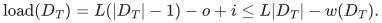

Thus <code class="math">w(D_T)\leq L+o-i&lt;2L</code>. The physical volume is <code class="math">2w(D_T)-1</code>. ∎

Assign a degree-two carrier row to its child bin and a degree-three row to its child with smaller incidence identifier. Each bin has only one carrier parent row, so the assignment is injective. To invert at a bin, inspect its parent row and that row's chosen child. These queries use a constant number of rooted forest operations and at most three incidences. This is an implicit representation of the complete current injection.

### 5.3 Persistence and transaction order

Use the worst-case dynamic-tree implementation of [AHLT]. Path clusters store two orientation classes, two minima, and two lazy tags; reversing a path swaps the classes. Internal degree-reduction connectors have zero incidence count and participate in neither allocation extrema nor additions.

Simulate its memory by a persistent balanced dictionary from addresses to words. Every write path-copies the dictionary, and a version is one dictionary root. The extra logarithmic factor preserves polylogarithmic worst-case operations. Frozen read queries may execute in temporary persistent branches and discard them afterward. All addresses and word operations are charged.

Version the full at-most-three incidence list of every row, including zero off-carrier choices, its physical contacts, and lifetime endpoints. Also version any adjacency dictionary read by a historical query. This makes an old version a complete incidence state.

A structural transaction uses the following order.

1. Freeze the pre-event bottom assignment version and create a sparse forward/inverse overlay for the event.
2. Save captive assignments before a contraction. Use the same version plus overlay for all assigned-row deletions.
3. Freeze each projection parent throughout threshold tests, locks, capacity reads, and final recovery.
4. Apply the full child allocation batch and all deleted-row load releases before normalizing that child. Apply preserving deletions separately to coarser ledgers.
5. Publish the new bottom canonical injection after the whole transaction settles.

Unchanged physical matching edges remain implicit through factor-critical records. Materialize only erased physical volume and phase-boundary output. Equation (5) justifies replacing one settled valid injection by another.

## 6. Deterministic local structural actions

### 6.1 Output-sensitive minimal tight-set discovery

For queried bins <code class="math">i,j</code>, construct an implicit directed split graph. Each bin has <code class="math">d_{\rm in}\to d_{\rm out}</code>. Add doubled arcs from a query source to <code class="math">i_{\rm in},j_{\rm in}</code>; from an occupied <code class="math">d_{\rm out}</code> to every neighbor input of its assigned row; and from a free <code class="math">d_{\rm out}</code> to a sink. Outgoing degree is constant. Generate it by inverse assignment queries and the assigned row's three incidences.

For a tight set <code class="math">X</code> containing <code class="math">i,j</code>, exactly <code class="math">&#124;X&#124;-1</code> bins are occupied by captive rows. Include all inputs of <code class="math">X</code>, the query source, and outputs of those occupied bins. There is exactly one outgoing split edge and <code class="math">O(&#124;X&#124;+1)</code> induced arcs.

Apply [CHHIP] with doubling budgets up to a constant multiple of <code class="math">L</code>. A lazily generated doubled chain beyond the sink, longer than twice the largest returned-volume budget, excludes sink-containing outputs. A returned set is first restricted to vertices reachable from the query source in its original induced digraph. No doubled arc can cross its one-edge boundary, so the input bins form a tight witness containing <code class="math">i,j</code>.

Refine this witness using only its captive rows: one unit augmentation in its split network, followed by residual reachability, returns the smallest source-side minimum cut. Tight sets containing the pair are closed under intersection, because <code class="math">\eta</code> is submodular and strict surplus holds on their nonempty intersection. Thus this is the globally inclusion-minimal tight witness. Doubling makes the total work <code class="math">O((&#124;X&#124;+1)\mathrm{polylog}S)</code> on a tight answer and <code class="math">O(L\mathrm{polylog}S)</code> on a certified freeable pair.

### 6.2 Joint exposure inside two small selected trees

If a certified freeable pair lies in different selected trees, enumerate those trees and root them at the pair. Otherwise enumerate its common selected tree <code class="math">T</code>, whose physical volume is <code class="math">O(L)</code>. A tight set containing both queried bins is contained in <code class="math">T</code>: its <code class="math">&#124;X&#124;-1</code> captive selected edges already connect its bins.

Prune row edges in parallel rounds whenever the row has a third neighbor outside its current component. Record the round and one exterior witness. Queue processing and scans of the smaller pieces give <code class="math">O(&#124;T&#124;\mathrm{polylog}S)</code> work. The final components are maximal tight blocks: within a terminal component every selected row is captive, and a first pruned internal edge prevents any tight set from crossing its split.

Add an artificial infinite-level edge <code class="math">ij</code>, delete a minimum finite-level row edge on its cycle, and regard that row as a hole. Replace the hole's original edge by the pair consisting of an original endpoint and its recorded exterior witness. If this closes a cycle, delete a minimum-level edge on it and continue. The hole level strictly decreases. Indeed, at threshold <code class="math">\ell</code>, every current edge of level at least <code class="math">\ell</code> lies within an original level-<code class="math">\ell</code> component, while the hole's witness lies outside that component. Any connecting path therefore contains a lower-level edge. The final operation links to one second original tree; deleting the artificial edge separates <code class="math">i,j</code>.

All nonterminal exchanges remain in <code class="math">T</code>. The second tree is enumerated only at the final link. There are at most <code class="math">O(L)</code> finite levels and total touched physical volume <code class="math">O(L)</code>. Orient the two resulting trees to free the pair and record the explicit assignment overlay. This overlay is consumed immediately by the gain. The next settled ledger supplies its own balanced carrier forest.

Consequently, over contractions <code class="math">X_1,\ldots,X_b</code> and <code class="math">g</code> gains, local pair work is

<!-- math-display: 496158d1f0d97b8de44680e5
O\!\left(\left[\sum_{a=1}^{b}(|X_a|-1)+Lg\right]
                     \mathrm{polylog}S\right).
 \tag{9}
-->
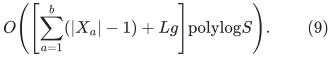

## 7. An exact optimum-gap phase and binary ledger accounting

### 7.1 Phase specification

Start a phase with represented matching size <code class="math">q_0</code>, target <code class="math">K_{\mathrm g}\geq1</code>, and

<!-- math-display: 55cba0ac78222572cc820cf7
C=s+1,\qquad
 L=\left\lceil\frac{10000CN}{K_{\mathrm g}}\right\rceil,\qquad
 g_*=\max\left\{1,\left\lfloor\frac{K_{\mathrm g}}{100C}\right\rfloor\right\}.
 \tag{10}
-->
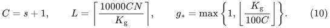

If <code class="math">K_{\mathrm g}&gt;\lfloor N/2\rfloor-q_0</code>, return LOW immediately with its cardinality justification. Otherwise initialize unmatched vertices as singleton bins, matched pairs as the paired remainder, and no rows or blockers. Initial debts vanish. Use levels <code class="math">j=0,\ldots,s</code> with floors <code class="math">c_j=C-j</code>; the bottom floor is one.

At a settled state, perform the first applicable action.

1. **Bin contact.** For an edge between two bins, contract the minimal tight witness if one exists. Otherwise free the pair, expose the joining contacts, match across the edge, and return the two bins to the paired remainder. This increases matching cardinality by one.
2. **Expansion.** At a bin with a paired-remainder contact and cached top slack at least <code class="math">4C</code>, make that contact vertex a row and its mate a singleton bin. Assign the row to the new bin.
3. **Pricing.** Request a priced circulation step in the top logarithmic coordinates. Apply a returned step exactly and settle notifications. A valid LOW ends the phase.

The <code class="math">g_*</code>-th gain ends the phase immediately. Other structural actions are followed by the reset transaction below. A checked prerequisite or work-cap violation suspends its worker and is a distinct outcome from LOW.

### 7.2 Ledger algebra and erased-volume charges

A tight contraction replaces <code class="math">X</code> by a bin of weight <code class="math">w(X)</code>, residual <code class="math">y(X)</code>, and debt <code class="math">p(X)</code>. Indeed, deleting its <code class="math">&#124;X&#124;-1</code> captive rows removes <code class="math">L(&#124;X&#124;-1)</code> load, making the new residual <code class="math">L&#124;X&#124;-\mathrm{load}(X)=y(X)</code>. All floor inequalities add.

An integral expansion puts <code class="math">L</code> on the new assigned incidence and debt <code class="math">c_j</code> on the child bin. At the top, put <code class="math">C+1</code> on the trigger-parent incidence and <code class="math">L-C-1</code> on the child incidence, with the source positivity service on any remaining coordinates. Eligibility gives enough actual parent slack; the new child slack is one. The guarded positivity service adds total debt less than <code class="math">S^{-800}</code> during a phase.

To erase bins <code class="math">R</code>, remove every row assigned into <code class="math">R</code>, under the frozen event injection. Redirect each surviving row's allocation from <code class="math">R</code> to its assigned exterior bin and add the same amount of debt there. If <code class="math">f</code> bins of <code class="math">R</code> are free, then <code class="math">&#124;R&#124;-f</code> rows are removed. Let <code class="math">I</code> be their old exterior allocation and <code class="math">O</code> the redirected allocation. We have

<!-- math-display: 5e4dd1fb7f8fac9c421e770e
y(R)=Lf+I-O,\qquad
 I\leq L(\eta(R)-f).
-->
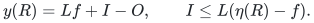

Subtracting deleted debt and using (7) gives

<!-- math-display: 0fd0bcb25863cc9879c658d9
\Delta p_{\rm total}=O-p(R)\leq L\eta(R)-c_jw(R).
 \tag{11}
-->
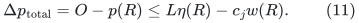

For a gain, its two erased bins are free, so the debt increase is at most <code class="math">2L</code>. A failed projection to floor <code class="math">c</code> supplies the complete residual peel <code class="math">R</code> with <code class="math">L\eta(R)&lt;cw(R)</code>, as proved in Section 8. In every preserved coarser ledger, <code class="math">c_j\geq c+1</code>; (11) therefore decreases debt by at least <code class="math">w(R)</code>. The peel creates

<!-- math-display: 756e12320baca1992e6ce86f
f\leq\eta(R)<\frac{Cw(R)}{L}
 \tag{12}
-->
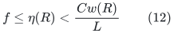

new blockers.

Before the terminal gain, the top debt pays all peeled weight. Hence

<!-- math-display: 24140cd5c67988686b560af7
\sum_{\rm peels}w(R)\leq2L(g_*-1)+S^{-800},
 \qquad
 \#\mathrm{blockers}\leq2C(g_*-1).
 \tag{13}
-->
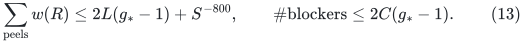

The latter follows from the strict inequality (12), integrality, and <code class="math">CS^{-800}/L&lt;1</code>. A peel materializes at most <code class="math">2w(R)</code> physical vertices; a gain erases bins of total weight at most <code class="math">2L</code>. Also <code class="math">Lg_*\leq10001CN</code>. Counting initial vertices, returned volume, expansions, and contraction arities gives <code class="math">O(CN)</code> structural volume. Retaining a largest child at each contraction moves a physical vertex only <code class="math">O(\log S)</code> times per stay in the bin system. Its original degree is at most three. All physical incidence work and all carrier updates over the <code class="math">s</code> levels consequently cost <code class="math">S\mathrm{poly}(s)</code>, apart from numerical projection work.

### 7.3 A comparison matching prevents a false LOW

**Lemma 7.1.** If <code class="math">\nu(J)\geq q_0+K_{\mathrm g}</code>, the phase cannot return a valid LOW before its <code class="math">g_*</code>-th gain.

**Proof.** After <code class="math">i&lt;g_*</code> gains, compare the current represented matching with one of size at least <code class="math">q_0+K_{\mathrm g}</code>. Their symmetric difference contains at least <code class="math">K_{\mathrm g}-i</code> vertex-disjoint augmenting paths. Discard those meeting blockers. By (13), at least

<!-- math-display: 49f76f82798e08ab9ec480c3
K_{\mathrm g}-i-2C(g_*-1)\geq K_{\mathrm g}/2
 \tag{14}
-->
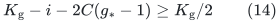

remain.

At a settled state without a bin/bin edge, orient each remaining path from an unmatched endpoint. It starts at a free bin's exposed base. On entering a row, its next matching edge is that row's assigned incidence, entering the next bin at its unique exposed base. That bin's crossing matching edge has already been used, so a simple alternating path must leave by a nonmatching edge. Before reaching the paired remainder, every bin entry is therefore through its base.

Such a prefix cannot end in an assigned bin or enter another free bin through an assigned row. It must reach a bin with a paired-remainder contact. Distinct physical paths have disjoint bin bases and rows. Reassign each prefix row to its preceding bin. The resulting conceptual injection frees <code class="math">r_0\geq K_{\mathrm g}/2</code> distinct contact bins.

Scale the conceptual injection by <code class="math">L</code>. Its top column capacities are <code class="math">L+p_d^0-Cw_d</code>, nonnegative by top feasibility. Clip overloaded columns; at most <code class="math">CN</code> mass is removed. The existing feasible top allocation ensures completion under those capacities. Source-to-sink residual augmentations never decrease column sink flow, so initially empty contact columns receive at most the removed <code class="math">CN</code> mass. The alternative top slack on the contact set <code class="math">Z</code> therefore satisfies

<!-- math-display: 4570f1aff95a8d15d66d0dce
\sigma'(Z)\geq Lr_0-2CN.
 \tag{15}
-->
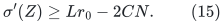

This completion is an existence argument. No flow solve is executed to obtain the comparison direction.

If no expansion is eligible, the source cache guarantees <code class="math">\sigma_d\leq5C</code> on <code class="math">Z</code>. Allocation arcs and slack arcs both enter bins, so alternative minus current coordinates is a circulation. Every negative logarithmic derivative contribution has magnitude at most one, since the alternative coordinate is nonnegative. There are at most <code class="math">4N</code> such contributions. The positive contribution is at least

<!-- math-display: 0fc89ef1514d635bbf9eab94
\frac{Lr_0-2CN}{5C}-N>12N.
 \tag{16}
-->
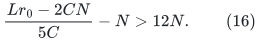

Its signed derivative exceeds one half of the sum of absolute individual logarithmic derivatives. The priced-step interface of Section 8.2 excludes LOW in this case. Bounded objective range and positive progress per accepted step also preclude endless pricing. ∎

Thus a LOW after <code class="math">i</code> gains means precisely <code class="math">\nu(J)&lt;q_0+K_{\mathrm g}</code>, while the current matching has size <code class="math">q_0+i</code>.

### 7.4 Binary resets and additive projection volume

Give level <code class="math">j</code> period <code class="math">b_j=2^{s-j}</code>. Expansions and contractions add one tick; repaired gains add <code class="math">L</code>; peels add none. On a positive tick increase, reset the smallest <code class="math">j\geq1</code> whose period quotient changes. A reset at level one uses all-expanded exact exchange recovery. At <code class="math">j&gt;1</code>, project from the just-current normalized parent, freeze it for the complete call, and share the settled child's persistent roots with deeper fresh levels.

Total ticks are <code class="math">\tau=O(sS)</code>. If <code class="math">j&gt;1</code> is selected, no <code class="math">b_{j-1}</code> boundary was crossed. Since expansions add at most <code class="math">C</code> debt per tick and gains at most twice their tick increase, the parent's debt obeys

<!-- math-display: dee84d878e8cf1d6ea10de4a
P_{\mathrm d}\leq(C+2)b_{j-1}.
 \tag{17}
-->
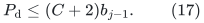

This applies to large tick jumps as well: crossing a coarser boundary would select that coarser reset. There are at most <code class="math">\tau/b_j</code> selections of level <code class="math">j</code>, and <code class="math">b_{j-1}=2b_j</code>. Consequently

<!-- math-display: dc1fbe277a3564b4eaa55ae2
\sum_{\text{higher resets}}(P_{\mathrm d}+2)
 \leq\sum_{j=2}^{s}\frac{\tau}{b_j}
                         ((C+2)b_{j-1}+2)
 =O(s^3S).
 \tag{18}
-->
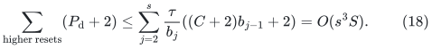

There are <code class="math">O(s)</code> level-one resets. Applying a structural batch to <code class="math">s</code> ledgers is an additive factor; the numerical accuracy is chosen independently below.

### 7.5 The optimum-gap driver

Maintain an integer <code class="math">B\geq\nu(J)-&#124;Q&#124;</code>. While <code class="math">B&gt;0</code>, set <code class="math">K_{\mathrm g}=\lceil B/2\rceil</code> and run a phase.

~~~text
SUCCESS with g gains:       B <- B - g
LOW after i gains:          B <- K_g - 1 - i
SUSPENDED:                  suspend this worker
~~~

Both numerical updates preserve the bound, by Lemma 7.1 and integrality. For <code class="math">B</code> above a fixed multiple of <code class="math">C</code>, success reduces it by an <code class="math">\Omega(1/C)</code> fraction, while LOW approximately halves it. Below that threshold, each success gains at least one. There are <code class="math">O(C(1+\log N))=O(s^2)</code> phases. At <code class="math">B=0</code>, materialize the maximum gadget matching and use Lemma 3.2.

## 8. From raw circulations to exact projection

### 8.1 The raw numerical interface

For an oriented graph with positive integral lengths <code class="math">\ell</code> and integral gradient <code class="math">\gamma</code>, put

<!-- math-display: 1ccfa9e8c19383e98dfcc157
\rho^*=\sup_{\substack{Bc=0\\c\ne0}}
           \frac{|\gamma^{\mathsf T}c|}{\sum_e\ell_e|c_e|}.
 \tag{19}
-->
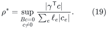

Here <code class="math">B</code> is the incidence matrix; take <code class="math">\rho^*=0</code> when there is no nonzero circulation. A backend answer consists of unit signed real-edge pieces and signed paths in exposed occurrence forests. Their total projects to a circulation <code class="math">c</code>. A certificate <code class="math">V</code> dominates the sum of lengths of **all mapped traversals before cancellation**, and the useful answer guarantee is

<!-- math-display: 2c38189940759e4c12e8da1a
\frac{|\gamma^{\mathsf T}c|}{V}\geq\frac{\rho^*}{E}.
 \tag{20}
-->
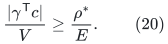

Zero-score cases may return a certified zero alternative. A complete cap <code class="math">E</code> also bounds initialization per actual record, amortized edits and queries, exposed logs, occurrence multiplicity, and answer pieces. The interface includes disconnected graphs, genuine loops, native identities, stable path images, dormant occurrences, and complete retirement transfers. Numerical instances have actual nominal size at most <code class="math">S^2</code>, <code class="math">O(s)</code>-bit root prices, and a fixed polynomial master history. Theorem 11.6 constructs this interface and supplies the bounds used by Theorem 1.1.

### 8.2 A direct master-scale priced client

Set

<!-- math-display: 487a81053292c35577053c18
D=\mathrm{pow2ceil}(\max\{16,4E\}),\qquad
 q=\frac1{16D},\qquad
 \delta=S^{-1000},\quad \varepsilon=S^{-3000},
 \quad H_{\rm price}=S^{100}.
 \tag{21}
-->
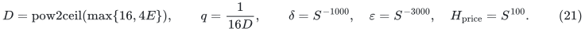

The logarithmic client has coordinate gradient <code class="math">g</code> and absolute derivative weight <code class="math">\lambda</code>, counting individual logarithms before signed cancellation. At anchors use integer prices <code class="math">\ell_e=\lceil H_{\rm price}\lambda_e\rceil</code> and <code class="math">\gamma_e=\mathrm{round}(H_{\rm price}g_e)</code>. Source argument and magnitude bounds give <code class="math">\ell_e\geq S^{80}</code> and prices below <code class="math">S^{1200}</code>. Degree-three private port paths add at most <code class="math">2M\sum_e&#124;d_e&#124;</code> length to a logical circulation, with <code class="math">M\leq S^2</code>. Thus any logical direction

<!-- math-display: 2e3c7e8b67cdaa680618aa28
g^{\mathsf T}d>\tfrac12\sum_e\lambda_e|d_e|
 \tag{22}
-->
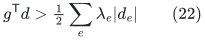

has integer-priced lifted ratio greater than <code class="math">1/4</code>. With (20), <code class="math">E\leq D/4</code>, and <code class="math">1/(4D)&gt;2q</code>, it passes the acceptance test <code class="math">&#124;\gamma^{\mathsf T}c&#124;\geq2qV</code>. This proves the no-LOW implication used above.

Choose one common dyadic step coefficient <code class="math">\mu</code> satisfying

<!-- math-display: 7b85ffd0b2865a29039af633
\frac q{400}\leq\frac{\mu V}{H_{\rm price}}\leq\frac q{200}.
 \tag{23}
-->
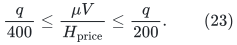

The raw traversal bound controls every partial application of the path list, so positivity is preserved throughout. Coordinate drift thresholds are dyadic values in

<!-- math-display: dd6ea5d264388875145ad3c5
\frac{qH_{\rm price}}{800D\ell_e}
 \leq\theta_e\leq
 \frac{qH_{\rm price}}{400D\ell_e}.
 \tag{24}
-->
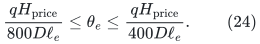

The source descriptor/Taylor argument now gives exact <code class="math">\varepsilon</code>-grid circulation steps, total relative absolute motion at most <code class="math">q/100</code>, objective increase <code class="math">\Omega(q^2)</code>, and settled register error at most <code class="math">q/100</code>. A report consumes at least <code class="math">q/(800D)</code> raw priced motion, while one step creates at most <code class="math">q/200</code>; genuine reports therefore number <code class="math">O(D)</code> per step. Common-grid compatibility and these conclusions require the checked inequalities <code class="math">q\geq S^{-1}</code> and <code class="math">D\leq S^2</code>, which hold eventually for the subpolynomial cap obtained below.

Let <code class="math">J_{\rm step}</code> count accepted steps and <code class="math">Q_{\rm own}</code> requests from the owning client, including LOW and unsuccessful requests. Internal refreshes are counted separately. Complete initialization, point access, copy sweeps, and refresh work are bounded by

<!-- math-display: 8fbc544dd36070956765e435
T_{\rm priced}
 \leq O(MD+Q_{\rm own}D+D^2J_{\rm step})
                                      \mathrm{poly}(s).
 \tag{25}
-->
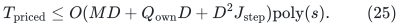

All exposed copies, including dormant ones, remain on signed and absolute-motion lists. Retirement transfers both counters before metadata expires. Obtaining and consuming or discarding a query answer is one transaction; representation-triggered refreshes are queued until afterward. Mutable numerical trees have one amortized history. The persistent integral carrier is a separate worst-case structure.

### 8.3 Exact rounding below one unit of violation

**Lemma 8.1 (conserved near-feasible rounding).** Let <code class="math">f</code> satisfy integral vertex demands exactly in an oriented multigraph with integral lower and upper bounds <code class="math">l\leq u</code>. If

<!-- math-display: 02b7779da1cd629a1df3c713
\mathrm{viol}(f)=
 \sum_e((l_e-f_e)_++(f_e-u_e)_+)<1,
 \tag{26}
-->
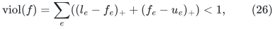

then a deterministic algorithm finds an integral feasible vector with the same demands in <code class="math">O(m\log(m+2))</code> scalar/dynamic-tree operations, plus <code class="math">O(n+m)</code> input/demand bookkeeping if isolated vertices are supplied. A dyadic <code class="math">b</code>-bit input uses <code class="math">O(b+\log(m+2))</code>-bit arithmetic.

**Proof.** Restrict coordinate <code class="math">e</code> to <code class="math">[\lfloor f_e\rfloor,\lceil f_e\rceil]</code>. On this box the original violation equals <code class="math">a^{\mathsf T}x+\kappa</code>, with integral constant <code class="math">\kappa</code> and <code class="math">a_e\in\{-1,0,1\}</code>, according as the original coordinate violates its lower bound, violates its upper bound, or is feasible. The total violation assumption places a violating coordinate less than one unit outside its bound, so these affine formulas hold throughout the box.

Freeze integral coordinates. Maintain a forest of nonintegral edges. Each off-forest edge closes a fundamental circulation; choose its sign with nonpositive <code class="math">a</code>-cost and push maximally inside the rounding box. At least one edge becomes integral. Mask and enumerate all simultaneous zero residual minimizers on the exposed path before cutting them, then freeze and remove them. If the processed edge remains nonintegral, link it. A self-loop is a one-edge cycle.

Each edge is processed, linked, and removed at most once. The remaining fractional support is a forest. A nonempty fractional forest would have a leaf whose divergence is nonintegral after all other incident coordinates have become integral, contradicting the integral demand. Hence the final vector is integral. Its violation is a nonnegative integer no larger than the original value below one, so it is zero. Pushes are differences of dyadic coordinates and integer endpoints; no new denominator is introduced. ∎

### 8.4 Exact exchange and its residual peel

For an integral ledger and target floor <code class="math">c</code>, put

<!-- math-display: 8e4d4aaff3b60ba2840148d9
b_d=(cw_d-y_d)_+,\qquad
 u_d=(y_d-cw_d)_+,\qquad \beta=\sum_db_d.
-->
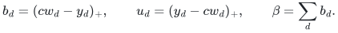

The exchange network has arcs <code class="math">s\to d</code> of capacity <code class="math">b_d</code>, <code class="math">d\to t</code> of capacity <code class="math">u_d</code>, and, for each incidence <code class="math">e=(a,d)</code>, separate arcs <code class="math">d\to a</code> of capacity <code class="math">x_e</code> and <code class="math">a\to d</code> of capacity <code class="math">L+1</code>. An integral maximum flow <code class="math">F</code> gives

<!-- math-display: bc77f6bca08ba4a0d0d4ba1a
x'_e=x_e-F_{d,a}(e)+F_{a,d}(e),\qquad
 y'_d=y_d+F_{s,d}-F_{d,t}.
 \tag{27}
-->
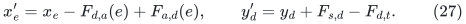

Row conservation preserves sum <code class="math">L</code>, and a row-to-bin arc cannot saturate its capacity <code class="math">L+1</code>. If the value is <code class="math">\beta</code>, all deficits are filled.

Otherwise let <code class="math">R</code> be all residual-reachable bins from <code class="math">s</code>. The combined residual capacity from bin <code class="math">d</code> to row <code class="math">a</code> is exactly <code class="math">x'_e</code>. A reachable row reaches all its neighboring bins. Therefore precisely the captive rows supply allocation to <code class="math">R</code>, and

<!-- math-display: b81bec0967dbd8fe73b244b7
y'(R)=L\eta(R)<cw(R).
 \tag{28}
-->
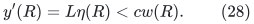

Outside <code class="math">R</code>, deficits are filled. Restrict the new allocation after deleting <code class="math">R</code> and its assigned rows; a surviving row has no positive allocation into <code class="math">R</code>. This is the exact zero-debt child needed by Section 7. When the frozen parent satisfies floor <code class="math">c+1</code>, <code class="math">\beta\leq P_{\mathrm d}</code>. Its captive rows also give <code class="math">y_{\rm parent}(R)\leq L\eta(R)</code>, so
<code class="math">(c+1)w(R)\leq y_{\rm parent}(R)+p(R)\leq L\eta(R)+P_{\mathrm d}&lt;cw(R)+P_{\mathrm d}</code>.
Thus <code class="math">w(R)&lt;P_{\mathrm d}</code>.

### 8.5 Recovering the exact local maximum without another feasibility solver

The inherited localized threshold engine uses fewer than <code class="math">1000(P_{\mathrm d}+1)</code> ordinary arcs. Multiply capacities by 16, let the return arc <code class="math">t\to s</code> have value <code class="math">z</code>, and test threshold <code class="math">b</code> with <code class="math">T=16b</code> and return weight <code class="math">W=20000(P_{\mathrm d}+1)</code>. The objective is

<!-- math-display: 32ca76f04dfd5675674c864b
\Phi=\sum_{\text{ordinary }e}
  [\log(F_e-l_e+\zeta_e^-)+\log(U_e+\zeta_e^+-F_e)]
                  -W\log(T-z).
 \tag{29}
-->
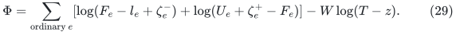

The iterate is exactly conserved. Its ordinary unpadded violation is at most <code class="math">\alpha&lt;S^{-800}&lt;1/100</code>. Positive locks occur only on sink arcs. An unexpanded boundary's flow stays below <code class="math">10u_d</code>, while its true scaled sink capacity is <code class="math">16u_d</code>. Success means <code class="math">z\geq16b-1/4</code>; LOW has the strong-direction exclusion (22).

On success, discard locks, divide by 16, install true ordinary capacities, and give the return arc bounds <code class="math">[b,\beta]</code>. Total violation is at most <code class="math">1/64+\alpha/8&lt;1</code>. Lemma 8.1 returns a true integral flow of value exactly <code class="math">b</code>, because its return rounding interval has upper endpoint <code class="math">b</code>.

For the final LOW test immediately above the optimum, write <code class="math">b=v+1</code>, where the unlocked optimistic maximum is <code class="math">v</code>. Locked bounds are feasible by Lemma 8.1. A feasible locked flow can reach the unlocked maximum without decreasing sink-arc flows: simple source-to-sink residual augmentations never use an arc leaving the sink. This proves existence of a lock-respecting comparator of value <code class="math">16v</code>.

Put <code class="math">d=16v-z</code>. If <code class="math">d\geq8</code>, its return derivative is <code class="math">Wd/(16+d)\geq W/3</code>, while total negative ordinary contributions are below <code class="math">2000(P_{\mathrm d}+1)</code>. Their signed-to-absolute ratio exceeds one half, contradicting LOW. Thus <code class="math">z&gt;16v-8</code>. Removing locks and dividing by 16 gives violation below <code class="math">1/2+\alpha/8&lt;1</code> with return lower bound <code class="math">v</code>. Rounding returns an optimistic maximum flow of value <code class="math">v</code>, and residual reachability returns its minimum cut.

Run <code class="math">O(s)</code> threshold tests to obtain the proposed optimum <code class="math">v</code>; retain or rerun success at <code class="math">v</code> and LOW at <code class="math">v+1</code>, with the natural one-sided cases at <code class="math">0,\beta</code>. Check conservation, bounds, integrality, flow value, and cut capacity. An optimistic boundary cannot lie on the source side of this cut, since its sink capacity is <code class="math">\beta+1&gt;v</code>. Hence all outgoing full-network arcs of that cut are represented, and it is also a full cut of capacity <code class="math">v</code>.

For the complete residual peel, unite the success and failure regions by original arc identifier, install true capacities, and extend the true success flow by zero. Equality of its value and the full cut capacity prevents any full residual arc from leaving that cut. Forward residual arcs inside it are present in the failure region; positive-flow reverse arcs are present in the success region. Reachability in the union is therefore exactly full residual reachability. All residual searches omit the numerical return arc.

This recovers (27) and the entire peel with <code class="math">O(P_{\mathrm d}+1)</code> records. All-expanded recovery uses the same argument with its actual graph volume in place of <code class="math">P_{\mathrm d}+1</code>.

### 8.6 Complete matching-client cost

Each local threshold has objective range, including insertion and lock losses, <code class="math">O((P_{\mathrm d}+1)s)</code>. Progress <code class="math">\Omega(q^2)</code> gives

<!-- math-display: e3ccf087a48413db70bb0a62
J_{\rm step}=(P_{\mathrm d}+1)D^2\mathrm{poly}(s),
 \qquad
 Q_{\rm own}=(P_{\mathrm d}+1)D^3\mathrm{poly}(s).
-->
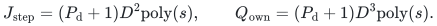

Its nominal lifetime is at most <code class="math">8192(P_{\mathrm d}+1)</code>, with power-of-two rounding <code class="math">M=\mathrm{pow2ceil}(16(R+2))</code>. Equation (25), all <code class="math">O(s)</code> tests, rounding, and final recovery consequently cost

<!-- math-display: b18d6691f9b5081f30db79ce
T_{\rm projection}\leq
       (P_{\mathrm d}+1)D^4\mathrm{poly}(s).
 \tag{30}
-->
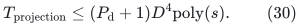

The top client uses <code class="math">R_{\rm top}=S(s+1)^{10}</code> and costs <code class="math">SD^4\mathrm{poly}(s)</code>. By (17), local lifetimes are <code class="math">O(sS)</code>; both top and local nominal sizes are below <code class="math">S^2</code> eventually. Root prices and logical capacity bounds are fixed before choosing <code class="math">D,q</code>; repricing reuses endpoint slots.

Sum (30) using (18), add <code class="math">O(s)</code> all-expanded resets and structural work, and then include <code class="math">O(s^2)</code> phases. Since <code class="math">D=O(E)</code>, the complete matching-side reduction is

<!-- math-display: b6cec42905288680f4259c87
T_{\rm match}\leq S E^4\mathrm{poly}(s).
 \tag{31}
-->
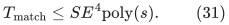

Loose polynomial action, lifetime, and iteration guards are declared first. On their prefixes, tiny pad changes have total size below <code class="math">S^{-800}</code>; the sharper objective and locality counts then imply eventual nonfailure when <code class="math">E=S^{o(1)}</code>. This order establishes precision premises before using the final fast-time bound.

## 9. Sequential expander routing with explicit paths

The routing construction is useful because its output quality depends linearly on a depth parameter in the logarithmic exponent, whereas expensive local construction remains a separate cost.

**Proposition 9.1 (routing assembly).** On a connected loopless <code class="math">m'</code>-edge multigraph of conductance at least <code class="math">\phi&gt;0</code>, and with master logarithmic inventory bound <code class="math">U</code>, the hierarchy and local constructions specified below give preprocessing work

<!-- math-display: 3c1b8f2a0222f42affb9aa8d
m'\exp O(U/p+ph+\log\phi^{-1})\mathrm{poly}(U).
 \tag{32}
-->
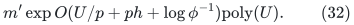

A query with at most <code class="math">D_{\rm tok}\deg(v)</code> starts and destinations at every vertex returns explicit simple paths with length at most <code class="math">Q</code>, edge-occurrence congestion at most <code class="math">D_{\rm tok}Q</code>, and work at most <code class="math">m'D_{\rm tok}Q\mathrm{poly}(U)</code>, where

<!-- math-display: 228a15b74ef61216c2f6e9b8
Q=\exp O(ph+\log\phi^{-1}).
 \tag{33}
-->
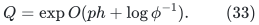

The polynomial degrees and constants are independent of <code class="math">p</code>. The geometric hierarchy uses the module interfaces from [CS, CHS] and the implementation requirements of Section 11.6. The following subsections specify these interfaces and prove the sequential replacement and cost bounds used in the composition.

### 9.1 Incidence ports and actual-size recursion

Give each incidence a port. A vertex of degree <code class="math">d</code> receives a cube fiber with the next power of two above <code class="math">d</code> ports, and each genuine edge joins its designated ports. The elementary cube inequality

<!-- math-display: 95e1b1d044d1bd85c3a6e444
|\partial X|\geq\min\{|X|,|V(Q_a)\setminus X|\}
 \tag{34}
-->
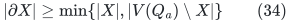

follows by induction on cube dimension, splitting the cut between the two smaller cubes and their joining matching. The port graph has at most <code class="math">4m'</code> vertices, <code class="math">O(m'\log(m'+2))</code> edges, and degree <code class="math">O(\log(m'+2))</code>.

For a port cut, let <code class="math">z</code> be the number of minority ports over fibers. Internal cube boundaries contribute at least <code class="math">z</code>; comparison with the majority-side original vertex cut contributes at least <code class="math">c\phi\min\{&#124;X&#124;,&#124;\overline X&#124;\}-O(z)</code> external crossings for a fixed <code class="math">c&gt;0</code>. Thus port-graph conductance is at least <code class="math">\phi/O(\log(m'+2))</code>. This loss is a fixed polynomial in <code class="math">U</code>. Distribute starts and destinations cyclically among genuine incidence ports; each port receives at most <code class="math">D_{\rm tok}</code> of either.

For the actual port graph order <code class="math">n'</code>, put <code class="math">v=\lceil\log(n'+2)\rceil</code> and

<!-- math-display: b33d2f01a7bb4c43ec23213f
b_{\rm route}=2^{\max\{5,\lceil v/p\rceil\}},\qquad
 \lambda_{\rm cap}=C_\lambda(v+1)^2.
 \tag{35}
-->
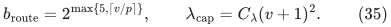

Stop hierarchy recursion when an actual node has at most <code class="math">C_{\rm leaf}b_{\rm route}^5\lambda_{\rm cap}^2</code> vertices, with fixed sufficiently large constants. This is a leaf test, not an allocated padded graph. The depth is <code class="math">O(p)</code>. A genuine internal partition has <code class="math">2b_{\rm route}/3\leq t_{\rm part}\leq b_{\rm route}</code>, parts of size <code class="math">\Theta(&#124;X&#124;/b_{\rm route})</code>, and <code class="math">n'_X=6&#124;X&#124;/b_{\rm route}</code>. In particular <code class="math">t_{\rm part}\geq16</code>. Its parts satisfy

<!-- math-display: afea5a684ed5ffa873c5cea6
\min_i|Y_i|\geq8\lambda t_{\rm part}^2,\qquad
 n'_X\geq\lambda t_{\rm part}^2,\qquad
 t_{\rm part}\leq b_{\rm route},\quad \lambda\leq\lambda_{\rm cap}.
 \tag{36}
-->
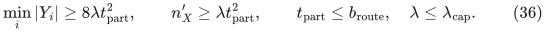

These are the integer guards used in the query proof.

### 9.2 Short paths, actual cuts, and success coverage

The local matching primitive maintains a breadth-first-search tree truncated at depth <code class="math">d+2</code>, with a supersource and supersink. Extract a shortest path of length at most <code class="math">d</code>, delete all its physical vertices, and continue. Distances only increase; each arc is scanned <code class="math">O(d+2)</code> times. This gives an exact maximal packing of short vertex-disjoint paths in <code class="math">O((n+m)(d+2))</code> work. Processing at most <code class="math">b_{\rm route}</code> colors sequentially costs an additional construction factor <code class="math">b_{\rm route}</code>, while the union remains vertex-disjoint in one round.

For <code class="math">d=O(\Delta\psi^{-1}\log(n+2))</code>, either enough short paths are found, or distance balls give an actual sparse cut. A ball has some radius with relative growth <code class="math">O(\log n/d)</code>, since the product of growth ratios is at most <code class="math">n</code>. Temporarily isolated path vertices have total boundary at most <code class="math">\Delta</code> times their count; the small-packing inequality pays that restoration boundary. Every reported cut is therefore a cut of its declared full host.

Repeated matching rounds use the full unchanged host, update only matched terminal lists, and start with an empty exclusion set. In outer round <code class="math">j</code>, use cutoff <code class="math">\psi/(16j^2)</code>. The convergent boundary budget controls the union of failure cuts. Exact single-color covering either saturates every remaining source or returns an actual cut containing every uncovered source. All leftover terminals are thereby represented.

A weak cut-or-expander call on a current <code class="math">N</code>-vertex host returns either a cut of size between <code class="math">\beta N</code> and <code class="math">N/2</code>, or a virtual expander on at least <code class="math">(1-\beta)N</code> vertices, where <code class="math">\beta=1/1000</code>. Spectral leaves remove small cuts only until the removed union first reaches <code class="math">\beta N</code>. If they instead certify expansion, the retained graph has the same <code class="math">(1-\beta)</code> coverage. An exact rational Laplacian PSD test and a weighted-median sweep implement this leaf/coarse-cut decision in fixed polynomial local work.

The strong wrapper removes disjoint weak cuts until their union first reaches <code class="math">N_0/4</code>, or retains the single final weak success. At a cut exit the removed union is below <code class="math">5N_0/8</code>; complementation loses less than <code class="math">5/3</code> in sparsity. At a success exit, coverage exceeds

<!-- math-display: 2357291bdecb7aeb1371ffa8
(1-\beta)\frac{3N_0}{4}>\frac{2N_0}{3}.
 \tag{37}
-->
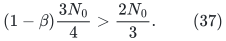

There are <code class="math">O(1/\beta)</code> weak calls. In a promised expander root, every actual-host cutoff is strictly below true sparsity. A first removed cut is impossible. Covering therefore covers the entire root; a first coarse removal is likewise impossible because its block boundary is exactly the corresponding original-host cut. Root coverage is exact.

### 9.3 Half-matching entropy progress

**Lemma 9.2.** Let an abstract <code class="math">N</code>-vertex graph be the multigraph union of previous matchings. Suppose a continuing cut has <code class="math">N/4\leq &#124;S&#124;=a\leq N/2</code> and boundary at most <code class="math">a/8</code>. Adding a matching from <code class="math">S</code> to its complement of size at least <code class="math">a/2</code>, with lazy averaging on matched pairs, increases total transition entropy by at least <code class="math">5N/1024</code>.

**Proof.** Write <code class="math">p(j,k)</code> for the previous doubly stochastic transition matrix. Unit mass initially on <code class="math">S</code> sends at most one half-unit across each previous crossing matching occurrence. Thus cross-cut mass in either direction is at most <code class="math">a/16</code>.

Let <code class="math">S_*</code> be the new matching's source endpoints. The total mass <code class="math">p(j,k)</code> for <code class="math">j\in S,k\in S_*</code> is at least <code class="math">a/2-a/16=7a/16</code>. Call a matched triple good if <code class="math">p(j,k)\geq2p(j,\ell(k))</code>. Bad triples have total source-side mass at most twice the cross-cut mass, namely <code class="math">a/8</code>. Good mass is therefore at least <code class="math">5a/16\geq5N/64</code>.

For entropy density <code class="math">H(z)=z\ln(1/z)</code>, averaging <code class="math">u,w</code> with <code class="math">w\leq u/2</code> gains at least <code class="math">u/16</code>. Divide by <code class="math">u</code> and differentiate the resulting one-variable function; its minimum on <code class="math">w/u\in[0,1/2]</code> is <code class="math">\frac12\ln(32/27)&gt;1/16</code>. Every other pair has nonnegative gain by concavity. Multiply by the good-mass bound. ∎

Entropy lies in <code class="math">[0,N\ln N]</code>, so <code class="math">512\lceil\log(N+2)\rceil</code> continuing rounds are more than sufficient. Every repeated matching occurrence remains a distinct multigraph edge.

### 9.4 Virtual hierarchy and polynomial local construction

Each successful node exports an explicit graph on exactly its terminal set <code class="math">X</code>, partitioned as

<!-- math-display: 169398c4abe473f8a3699375
X=\dot\bigcup_{i=1}^{t_{\rm part}}Y_i,\qquad
 Y_i=X_i\dot\cup B_i,
 \tag{38}
-->
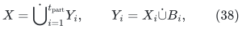

where an injective covering matching maps <code class="math">B_i</code> into the good child <code class="math">X_i</code>. Child graphs and covering edges are inserted literally in the parent virtual graph. In particular, each good child graph is induced in the virtual root. A path interior is stored in the embedding and does not enlarge its terminal set.

The retained hierarchy has one physical map <code class="math">f_0:H_{\rm root}\to G^\diamond</code>. Its length and congestion are <code class="math">\phi^{-O(1)}v^{O(p)}</code>. Nonroot construction hosts are unions of <code class="math">O(v)</code> matchings, with degree <code class="math">O(v)</code>; a success object ends its game. Their expansion losses are polynomial in <code class="math">v</code> per depth. Thus only the original root pays the original inverse conductance. Within one depth, good-node edge inventories are disjoint. Build shufflers and leaf circuits only after retaining the final hierarchy, union their primitive paths in the virtual root, and apply <code class="math">f_0</code> once. The complete primitive family has

<!-- math-display: 20fd54d46394f97dbe416a8f
A_{\rm fam}=\phi^{-O(1)}v^{O(p)}
 \tag{39}
-->
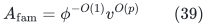

as a common path-length and aggregate congestion bound.

Here are finite algorithms for the remaining local computations.

**Energy cut player.** For rational centered row vectors <code class="math">v_i=R_i-\overline R</code>, let <code class="math">\Phi=\sum_i\&#124;v_i\&#124;^2</code> and <code class="math">a_0=\lceil\log_4(8t_{\rm part}^3)\rceil</code>. Choose signs <code class="math">z\in\{-1,1\}^{t_{\rm part}}</code> by conditional expectations of

<!-- math-display: 2387023ace311638281ef8ae
\Psi(z)=\sum_i\langle v_i,z\rangle^2
 -t_{\rm part}\Phi\sum_{i<j:v_i\ne v_j}
 \left(\frac{\langle v_i-v_j,z\rangle^2}
 {8a_0\|v_i-v_j\|^2}\right)^{a_0}.
 \tag{40}
-->
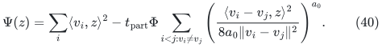

The even-moment inequality
<code class="math">\mathbb E\langle d,z\rangle^{2a_0}\leq(2a_0)^{a_0}\&#124;d\&#124;^{2a_0}</code>
gives <code class="math">\mathbb E\Psi\geq7\Phi/8</code>. A maximizing conditional choice gives projected energy at least <code class="math">7\Phi/8</code>, while every projected pair distance squared is at most <code class="math">8a_0</code> times its true distance squared. Sort the projections, take the heavier of the top and bottom eighth-tails relative to the median, and pair it with the opposite half. The sets <code class="math">T,T'</code> satisfy, for every map <code class="math">\sigma:T\to T'</code>,

<!-- math-display: bee119207224f56091412f27
\sum_{i\in T}\|R_i-R_{\sigma(i)}\|^2\geq\frac{\Phi}{512a_0}.
 \tag{41}
-->
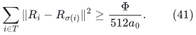

Saturating the physical source clusters gives a fractional matching matrix with source row mass at least <code class="math">1/18</code>. Its lazy symmetric update decreases <code class="math">\Phi</code> by at least <code class="math">\Phi/(18432a_0)</code>. Hence <code class="math">\lambda=O(\log(t_{\rm part}+2)\log(n'+2))</code> rounds give a stochastic product within <code class="math">1/(100t_{\rm part})</code> of uniform in every entry.

Conditional even moments are computed by the recurrence

<!-- math-display: a08c3bfabdeb17585dd5b7c8
M'_j=\sum_{\substack{0\leq z\leq j\\z\ {\rm even}}}
                       \binom jz d^z M_{j-z}.
 \tag{42}
-->
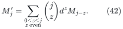

They need a fixed polynomial number of operations on polynomial-bit rationals. The larger temporary integers are charged to construction.

**Leaf circuits.** On an actual leaf of order <code class="math">a</code>, maximum degree <code class="math">\Delta</code>, and edge expansion <code class="math">\psi</code>, use a symmetric lazy walk assigning probability <code class="math">1/(2D_0)</code> to each oriented edge, with <code class="math">D_0</code> a power of two above <code class="math">\Delta</code>. In
<code class="math">T=O(\Delta^2\psi^{-2}\log(a+2))</code> steps its transition entries are at least <code class="math">1/(2a)</code>. Route each bounded-load demand through a uniform intermediate vertex by two conditioned walks. Each half has density at most two relative to the ordinary walk. Expected total traversal load of an edge is <code class="math">O(T/D_0)</code>.

Derandomize the potential <code class="math">\sum_e(1+1/(2T))^{N_e}</code> by fixing intermediates and successive oriented edges. Its exact conditional moments are matrix powers in which that edge's transitions are multiplied by <code class="math">1+1/(2T)</code>. This gives explicit paths of length at most <code class="math">2T</code> and congestion <code class="math">O(T\log(a+\Delta+2))</code>, with fixed polynomial bit work. Precompute these paths for the <code class="math">O(\log^2 a)</code> cross-block layers of a bitonic network. For load <code class="math">L_{\rm tok}</code>, round block length to a power of two. Comparator distances below a block stay local; cross-block patterns are independent of that length. A query uses <code class="math">O(aL_{\rm tok})</code> actual slots and charges their arithmetic and trajectory records.

Finally, hierarchy construction satisfies an actual-size recurrence

<!-- math-display: f2c3ab88cd032b8df085fec2
T(N,j)\leq v^{c_1}\sum_iT(N_i,j-1)
       +N b_{\rm route}^{c_2}v^{c_3}
                      \mathrm{poly}(\psi_{\rm cut}^{-1}),
 \quad \sum_iN_i\leq c_4N,
 \tag{43}
-->
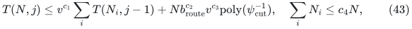

with absolute constants. Local polynomial-<code class="math">b_{\rm route}</code> work is additive. Only polynomial-<code class="math">v</code> attempt factors multiply over <code class="math">O(p)</code> levels. Original inverse expansion occurs at the first host; nonroot thresholds are fixed constants on bounded-degree matching hosts. Together with the leaf and shuffler computations, this yields (32). This is a sequential-work argument including temporary bit operations and explicit lists.

### 9.5 Scatter, meet, reverse, and exact destinations

The query induction uses the retained hierarchy, its shuffler matrices, (36), and (39). To route inside a part <code class="math">Y_i</code>, fold <code class="math">B_i</code> into <code class="math">X_i</code> along its injective covering matching, invoke the smaller child router, and unfold the destination. Every folding fiber has size at most two.

For color <code class="math">\ell</code>, let <code class="math">N_{i\ell}</code> be its token count in part <code class="math">i</code>. At shuffler step <code class="math">a</code>, with <code class="math">p_{ij}^a</code> actual matching portals between parts, send exactly

<!-- math-display: 43f2a5f96513449fb3d8c12d
\left\lfloor\frac{p_{ij}^a N_{i\ell}}{2n'_X}\right\rfloor
 \tag{44}
-->
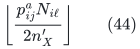

tokens from <code class="math">i</code> to <code class="math">j</code>. Cyclically assign them to genuine portals and use part routers to reach those portals. Per-color accumulated rounding error is at most <code class="math">\lambda t_{\rm part}</code>. After the shuffler, color mass in each part is between
<code class="math">.99N_\ell/t_{\rm part}-\lambda t_{\rm part}</code> and
<code class="math">1.01N_\ell/t_{\rm part}+\lambda t_{\rm part}</code>.
The total quota at one portal is <code class="math">O(L_{\rm tok})</code>, and vertex endpoint load during scattering is <code class="math">O(L_{\rm tok}(\lambda+1))</code>.

Color each real token by its destination part. Separately scatter <code class="math">2L_{\rm tok}</code> dummy tokens from every vertex, colored by their origin part. In every current part and color, dummies outnumber reals, since

<!-- math-display: 378c1fa373fe6123853f04a1
.97L_{\rm tok}|Y_j|/t_{\rm part}
                       -2\lambda t_{\rm part}>0
 \tag{45}
-->

by (36). Match real tokens injectively to dummies of the same current part and color. Route reals to those dummy locations, then reverse the recorded dummy traces. They reach their correct parts with load at most <code class="math">2L_{\rm tok}</code>. One final part-router call reaches the exact destinations.

All recursion goes to strictly smaller children. If <code class="math">\mathcal V_j</code> sums vertex-count times supplied load over depth-<code class="math">j</code> invocations, then

<!-- math-display: 6a867082921bcf43b7a826fa
\mathcal V_0=n'L_{\rm tok},\qquad
 \mathcal V_{j+1}\leq c(\lambda+1)^2\mathcal V_j.
 \tag{46}
-->

The same factor counts uses of each stored primitive and repeated trace consumption. Hence dilation is at most <code class="math">A_{\rm fam}(c(\lambda+1))^{d+1}</code>, congestion at most <code class="math">L_{\rm tok}A_{\rm fam}(c(\lambda+1)^2)^{d+1}</code>, and work at most <code class="math">n'L_{\rm tok}</code> times this non-load factor and logarithmic bookkeeping. Here <code class="math">d=O(p)</code>. For quota enumeration, store portal groups in decreasing <code class="math">p_{ij}^a</code>; every positive quota consumes a token, plus one stopping test per nonempty part/color. Work per step is <code class="math">O((M_{\rm tok}+t_{\rm part}^2)\mathrm{polylog}(n'L_{\rm tok}+2))</code>, paid by (36).

Project cube-port moves to the original host, retaining genuine edge identifiers, then erase closed subwalks using immediate host lifetime IDs. Length and all loads decrease. Equations (39) and (46) give (33) and the full query-volume bound in Proposition 9.1.

## 10. A normalized static sparsifier

**Proposition 10.1 (static provider).** Let a loopless demand multigraph <code class="math">J_0</code> have native edge identifiers, maximum degree <code class="math">\Delta_0</code>, and endpoint-preserving ambient walks <code class="math">\Pi(e)</code> of maximum length <code class="math">L_0\geq1</code> and vertex-occurrence congestion <code class="math">C_0</code>. For <code class="math">1\leq p,r\leq U</code> with <code class="math">(p+r)h\leq U</code>, the construction below returns a normalized table <code class="math">\Pi'</code>, a selected subgraph <code class="math">\widetilde J_0\subseteq J_0</code>, and routes <code class="math">R:J_0\to\widetilde J_0</code>, with

<!-- math-display: a7720363e821e046bbe15d4b
\begin{aligned}
 |E(\widetilde J_0)|&\leq |V(J_0)|\Gamma\mathrm{poly}(U),\\
 L(R)&\leq\Gamma,\qquad L(\Pi'\circ R)\leq\Gamma L_0,\\
 C(\Pi'\circ R)&\leq\Gamma(C_0+\Delta_0),
\end{aligned}
 \tag{47}
-->

where

<!-- math-display: 80eae4a81ff9800391fd1c07
\log\Gamma=O((p+r)h),\qquad
 \log F=O(U/p+U/r+r^2h+(p+r)h).
 \tag{48}
-->

Full work, plus actual vertex bookkeeping, is

<!-- math-display: 51f9577993ad4ca9971763ed
|E(J_0)|F^{O(1)}\Gamma^{O(1)}(L_0+1)\mathrm{poly}(U).
 \tag{49}
-->

The statement is relative to Proposition 9.1 and the inherited degree-band primitive. Its proof follows.

### 10.1 Degree bands and explicit weighted witnesses

First loop-erase every individual ambient image, using immediate ambient lifetime identifiers. This gives simple <code class="math">\Pi'(e)</code>, with length at most <code class="math">L_0</code> and congestion at most <code class="math">C_0</code>.

The degree-band primitive, with parameter <code class="math">r</code>, partitions demand edges into a residual graph with at most <code class="math">&#124;V(J_0)&#124;</code> edges and band graphs <code class="math">J_i</code>. Their nontrivial components have conductance at least <code class="math">\phi=\exp(-O(rh))</code>, minimum degree at least <code class="math">\rho_i=\phi2^i</code>, and <code class="math">\phi\leq\rho_i\leq\Delta_0</code>. Its work is <code class="math">m_0\exp O(U/r+r^2h+rh)\mathrm{poly}(U)</code>, with <code class="math">m_0=&#124;E(J_0)&#124;</code>.

For clarity, this is a reconstructed reduction from the external cut/pruning primitives. Start at <code class="math">\ell=\max\{0,\lceil\log(2m_0/n_0)\rceil\}</code>, where <code class="math">n_0</code> counts nonisolated vertices, with invariant <code class="math">&#124;E(G_i)&#124;\leq2^in_0</code>. Decompose <code class="math">G_i</code> with a fixed crossing-edge fraction; within each component prune vertices below <code class="math">\phi2^i</code>, using a sufficiently small fixed rescaling of the common <code class="math">\phi</code>. The pruning volume bound and component discard budget leave at most <code class="math">2^{i-1}n_0</code> edges for the next stage. Retained components have the stated minimum degree and conductance. Summing <code class="math">\sum_{i\leq\ell}2^in_0=O(m_0)</code> pays actual scanning work. There are <code class="math">O(U)</code> bands, and each retained band has at most <code class="math">2^in_0</code> edges. Calls on smaller graphs clip <code class="math">r</code> to the source's legal range; this improves expansion and stays within the master work envelope.

For each component, give vertex <code class="math">v</code> weight <code class="math">w_v=\deg_{J_i}(v)/\rho_i</code>. These weights are at least one and balanced: no one exceeds the sum of all others. Round <code class="math">\lceil w_v\rceil</code> to group sizes between that value and twice it, summing to the next power of two and keeping every group at most half the total. This is possible by a linear capacity-filling scan. Contract those groups in a cube and discard within-group cube edges. By (34), the resulting loopless multigraph <code class="math">W_i</code>, whose edges have common weight <code class="math">\rho_i</code>, satisfies

<!-- math-display: 7465c8fb32c1f43f2d8b3491
\deg_{J_i}(v)\leq\rho_i\deg_{W_i}(v)
                 \leq O(U)\deg_{J_i}(v),
 \qquad \Phi(W_i)\geq1/O(U).
 \tag{50}
-->

The degree-band inventory bounds, with the explicit cube factor, give

<!-- math-display: 0897e7b9fe283d97aba16bc4
\begin{aligned}
 \sum_i|E(W_i)|&\leq O(|V(J_0)|\phi^{-1}U^2),\\
 \sum_i|E(W_i)|&\leq O(m_0\phi^{-1}U),\\
 \sum_i\rho_i|E(W_i)|&\leq O(m_0U).
\end{aligned}
 \tag{51}
-->

Every host and witness is generated at its actual inventory.

### 10.2 Both routing directions pay full query volume

Route <code class="math">\lceil\rho_i\rceil</code> unit-token copies of every witness edge through <code class="math">J_i</code>. Equation (50) gives endpoint load <code class="math">O(U/\phi)</code> relative to host degree. Aggregate full query volume is <code class="math">O(m_0U/\phi)</code>.

In reverse, route one token per <code class="math">J_i</code> edge through <code class="math">W_i</code>, with degree-relative load <code class="math">D_i=\max\{1,\lceil\rho_i\rceil\}</code>. By (51),

<!-- math-display: 4f9bdb229d404c3a4e90f78e
\sum_i|E(W_i)|D_i
 \leq\sum_i(\rho_i+1)|E(W_i)|
 =O(m_0U/\phi).
 \tag{52}
-->

Preprocess each actual <code class="math">J_i</code> and <code class="math">W_i</code> component once. Only query work multiplies load. Proposition 9.1 gives common simple-path quality <code class="math">Q=\exp O((p+r)h)</code> and the work factor in (48). Loop-erasing these token paths in their immediate hosts is separate from normalizing <code class="math">\Pi</code>.

### 10.3 Sparse deterministic weighted path selection

**Lemma 10.2.** Suppose group <code class="math">g</code> has <code class="math">q_g\geq1</code> explicit options with nonnegative integer resource multiplicities <code class="math">a_{gjx}</code>. The explicit-list size <code class="math">S_{\rm list}</code> counts all option headers and every unit resource occurrence; aggregated multiplicities retain that occurrence budget. Put

<!-- math-display: fa44eba4652cb3935835692a
\mu_x=\sum_g\sum_{j=1}^{q_g}a_{gjx},\qquad
 B_0=\max_{g,j,x}q_g a_{gjx}.
-->

One can choose <code class="math">j(g)</code> deterministically so that

<!-- math-display: aa594307aa8436feb996a3a1
\sum_g q_g a_{g,j(g),x}
 \leq4\mu_x+4B_0\ln(2|X|+2)
 \tag{53}
-->

for every used resource, in explicit-list size times a polylogarithmic arithmetic factor. The same bound holds with any weights <code class="math">0&lt;w_g\leq q_g</code> in place of <code class="math">q_g</code>.

**Proof.** If <code class="math">B_0=0</code>, choose arbitrarily. Otherwise, for unprocessed groups define

<!-- math-display: 86258c06adb09c71a8faee91
E_{gx}=\frac1{q_g}\sum_j e^{q_ga_{gjx}/B_0},\qquad
 W_x=e^{(b_x-2\mu_x)/B_0}\prod_{\rm unprocessed\ g}E_{gx}.
-->

All individual exponents lie in <code class="math">[0,1]</code>. From <code class="math">e^u\leq1+(e-1)u</code>, initially <code class="math">W_x\leq1</code>. Averaging over an option leaves the total potential unchanged. To choose a minimizing option sparsely, omit its common term and minimize only

<!-- math-display: 06b9da78ba5bddb9cc8bfb5f
\sum_{x:a_{gjx}>0}\frac{W_x}{E_{gx}}
                                  (e^{q_ga_{gjx}/B_0}-1).
 \tag{54}
-->

All summands are nonnegative. Update only resources appearing in the group. Thus every resource occurrence is processed a logarithmic number of times. Exact expectations keep total potential at most <code class="math">&#124;X&#124;</code>, giving the stronger bound <code class="math">2\mu_x+B_0\ln&#124;X&#124;</code>.

For a finite implementation, evaluate positive exponential series and positive sums with a fixed multiple of <code class="math">\log(S_{\rm list}+2)</code> mantissa bits and explicit binary exponents. All exponents in the elementary factors lie in <code class="math">[0,1]</code>; binary exponents of the accumulated weights need <code class="math">O(\log(S_{\rm list}+2))</code> bits. Choose elementary relative error <code class="math">(S_{\rm list}+2)^{-c}</code> for a sufficiently large fixed <code class="math">c</code>. Approximate minimum scores increase the true potential by at most <code class="math">1+O(1/(S_{\rm list}+1))</code> per group. Their total increase is bounded by a constant, absorbed in (53). Computing <code class="math">e^u-1</code> by its positive series avoids subtractive cancellation. ∎

Apply this lemma to the forward candidate paths of each witness edge with <code class="math">q_g=\lceil\rho_i\rceil</code> and weight <code class="math">\rho_i</code>. After composition with <code class="math">\Pi'</code>, total candidate resource mass is <code class="math">O(UQC_0/\phi)</code>. One candidate uses at most <code class="math">Q</code> host edges, each with a simple ambient image, so its multiplicity at any ambient vertex is <code class="math">O(Q+1)</code>, independent of <code class="math">L_0</code>. Thus

<!-- math-display: de77c6ce44f79a6e7f18ca67
B_0\leq O((\Delta_0+1)(Q+1)).
-->

Weighted ambient congestion of the chosen witness paths is at most

<!-- math-display: de75b7017c131569b4fb6bec
Q\phi^{-O(1)}\mathrm{poly}(U)(C_0+\Delta_0).
 \tag{55}
-->

Only used ambient resources enter the logarithm; their logarithmic inventory is <code class="math">O(U)</code>.

### 10.4 Selected input support and composition

Retain all native <code class="math">J_0</code>-edge identifiers used by the selected witness paths, together with residual edges. By (51), their number is at most <code class="math">&#124;V(J_0)&#124;Q\phi^{-O(1)}\mathrm{poly}(U)</code>.

Each reverse route uses a witness edge with congestion at most <code class="math">D_iQ</code>, or relative to weight <code class="math">\rho_i</code>, at most <code class="math">2Q/\phi</code>. Substitute the chosen forward path for every witness occurrence. This multiplies (55) by at most <code class="math">2Q/\phi</code>; final host length is at most <code class="math">Q^2</code>. These fixed powers give (47)–(48). Scanning all composed occurrence lists costs the factor <code class="math">L_0+1</code> in (49). Thus ambient input length affects construction work while the congestion bound remains additive in <code class="math">C_0+\Delta_0</code>.

### 10.5 Exact correction circulations after normalization

Let <code class="math">R(e)</code> be the current selected-support route for edge <code class="math">e</code>, with the same immediate endpoints and raw weighted length at most <code class="math">\delta_{\rm str}\ell_e</code>. The selected edge keeps its own native length and gradient. Define its correction <code class="math">d_e=e-R(e)</code>. For every circulation <code class="math">c</code>,

<!-- math-display: 6605f10a6d4fc6d41d6c05da
c=\sum_e c_e(e-R(e))+R(c).
 \tag{56}
-->

Every term is a circulation in its appropriate graph. The sum of their raw denominator charges is at most

<!-- math-display: 0cf953b0921c0d4631b072f4
(1+2\delta_{\rm str})\sum_e\ell_e|c_e|.
 \tag{57}
-->

Linearity of the numerator and weighted averaging therefore give a correction or a selected-graph circulation with at least the comparator's ratio divided by <code class="math">1+2\delta_{\rm str}</code>. This is an existence/comparison statement; the algorithm maintains the corresponding alternatives.

Replacing a route <code class="math">R_0(e)</code> by <code class="math">R_1(e)</code> changes the correction by the exact circulation <code class="math">R_0(e)-R_1(e)</code>. Normalization's entire gradient discrepancy is retained in the new <code class="math">e-R_1(e)</code>. A selected projected edge contributes its central original identifier to support, even if geometric loop erasure removes that occurrence from its image. Distinct aliases remain distinct until their explicitly typed projection. These conventions preserve (56) and the raw lift.

## 11. Dynamic repair, degree reset, and the complete raw backend

This section constructs the dynamic cycle-search hierarchy and records its
chronological work, literal path lengths and finite arithmetic. Sections
11.1–11.5 give the main invariants and recurrences. Theorem 11.6 identifies
the complete companion constructions that instantiate each required
interface and proves that their composition has those bounds.

### 11.1 Actual-size stable cores

Every nonbase parent has maximum degree three. A fresh period begins with its actual nonisolated graph of resident size <code class="math">m'</code>, and lasts <code class="math">O(m'/k)</code> parent edits. Within the period, newly isolated slots are retained and counted. A later period starts from the maintained nonisolated list, without rescanning unrelated private isolates.

The deterministic center interface uses <code class="math">O((n'/k)\log^2(n'+2))</code> large-component centers, strict balls of size at most <code class="math">k</code>, and inverse clusters of size at most <code class="math">2k</code>, with <code class="math">O(n'k\mathrm{polylog}(n'+2))</code> work. It follows by greedy hitting sets of nearest-vertex lists, then repeatedly hitting prefixes in the remaining oversized inverse clusters; at least half of the oversized vertices settle each round. Small connected components receive a common local center.

Stable forests have components of <code class="math">O(k)</code> physical vertices. Endpoint promotions and monotone cuts preserve the initial future-path inventory, apart from separately recorded new generating middle edges. Weighted future-path halving gives a polynomial-<code class="math">U</code> family of forests. We use <code class="math">A=\mathrm{poly}(U)</code> to cover their count, buckets, cut logs, and indexing factors. Then:

- native core degree is at most <code class="math">Ak</code>;
- initially relevant nonloop roots number at most <code class="math">Am'/k</code>;
- a parent edit or requested feedback cut creates at most <code class="math">A</code> native core edits;
- a native split partitions existing input incidences, preserving their edge lifetime IDs.

Whole small-component trees remain in parent storage and physical pool counts. Only selected nonloop endpoints are published recursively. A registered loop demand keeps its current endpoint annotations and an empty route. If a native split makes it nonloop, both endpoints are touched; this does not create a fresh batch of input lifetimes.

### 11.2 Touched-set repair and selected-edge feedback

Choose

<!-- math-display: 8a911998fd88cf806315668b
\rho=2^{\lceil8U/K_{\mathrm r}\rceil},\qquad
 N_{\rm sched}=\rho^{K_{\mathrm r}}.
 \tag{58}
-->

The latter is a counter, not an allocated universe. Initialize a sparse static base using Proposition 10.1. True new edge lifetimes enter the base by identity routes. Repair layers start empty, with periods <code class="math">\rho^{K_{\mathrm r}-j}</code>; a native deletion or split increments the clock. At a period boundary, rebuild the least eligible layer and clear higher layers.

The touched-set schedule follows the local template of [CKLMPG, Section 7.2]; the static base, normalized paths, degree feedback, and chronological credit accounting here specify its present use.

The route-validity induction follows first-touched vertices: a demand had a valid lower route at its last relevant rebuild or its birth. Prefixes before their first touched vertices survive. The repair sparsifies the projected middle demand between those vertices. A selected projected edge inserts only its central native edge into support; its prefix and suffix already lie in retained lower layers.

For a layer of period <code class="math">a</code>, a rebuild after <code class="math">t</code> native events has at most <code class="math">O(\min\{t,\rho a\})</code> touched vertices. Thus all its selected membership births through that prefix number at most <code class="math">A\Gamma\rho t</code>. Summing the at most <code class="math">U+1</code> layers and absorbing that factor into <code class="math">A</code> gives

<!-- math-display: 8db2b12e2fadf3c1c191ee39
I_{\rm repair}(t)\leq \alpha t,\qquad
 \alpha=A\Gamma\rho.
 \tag{59}
-->

The only initial selected credit is <code class="math">I_0\leq A\Gamma m'/k</code>.

For degree feedback, partition a selected star only when its degree exceeds <code class="math">6z</code>, with <code class="math">z=\lceil64A\alpha\rceil</code>. The elementary tree partition [KMPG, Theorem 3.8] cuts its physical preimage into pieces of selected degree at most <code class="math">3z</code>, all but one with at least <code class="math">z</code> incidences. Use the potential

<!-- math-display: 0a54b04fb672e92a40dbf9cc
\Phi_{\rm deg}=\sum_v(\deg_{\rm selected}(v)-z)_+.
-->

One selected insertion raises it by at most two; deletions and splits do not raise it. A partition into <code class="math">a\geq3</code> pieces decreases it by at least <code class="math">z(a-1)/2</code>. Let <code class="math">f</code> count requested feedback cuts and <code class="math">q_{\rm par}</code> parent edits. Since

<!-- math-display: 07b747abed22a4157bbad4ea
t\leq A(q_{\rm par}+f),\qquad
 I\leq I_0+Aq_{\rm par}+A\alpha(q_{\rm par}+f),
-->

the inequality <code class="math">zf/2\leq2I</code> absorbs the feedback term and gives, on every finite cascade prefix,

<!-- math-display: 0c7b581b7fa75716af0c8dee
f=O(I_0/z+q_{\rm par}),\qquad
 I=O(I_0+A\alpha q_{\rm par}).
 \tag{60}
-->

These prefix bounds prove cascade termination. Deduplicate central identifiers across owners before computing degrees or passing weights to the physical tree partition.

Publish a child transcript only after feedback settles. Continuously surviving selected edges are compared by their old and final endpoints. A transient unpublished birth followed by death emits no child edge. The resulting selected-degree and fully encoded edit factor <code class="math">R_{\rm sel}</code> has

<!-- math-display: e3551dc438a611aa68203242
\log R_{\rm sel}=O(U/K_{\mathrm r}+\log\Gamma+\log U),
 \tag{61}
-->

with initial size and chronological child transcript at most
<code class="math">O(m'R_{\rm sel}/k+R_{\rm sel}q_{\rm par})</code>.
The additive initial term is one credit for the period, and may be spent later.

At each repair, preliminary projected degree and ambient congestion are <code class="math">O(C_j+\Delta_{\rm native})</code>, where <code class="math">\Delta_{\rm native}=k\mathrm{poly}(U)</code>. This uses actual normalized route owners and their first-touched endpoints. Proposition 10.1 gives

<!-- math-display: b2f3acc5f40d7a09c0eadab4
L_{j+1}\leq c\Gamma L_j,\qquad
 C_{j+1}\leq c\Gamma(C_j+k\mathrm{poly}(U)).
 \tag{62}
-->

Therefore <code class="math">L_{K_{\mathrm r}}\leq\Gamma^{O(K_{\mathrm r})}</code> and
<code class="math">C_{K_{\mathrm r}}\leq k\mathrm{poly}(U)\Gamma^{O(K_{\mathrm r})}</code>.
Full route lists, reverse occurrence indices, moved incidences, native endpoint changes, and correction-score updates are local work bounded by

<!-- math-display: c54205a8467fe6c30de0a178
W=k^{O(1)}\rho^{O(1)}F^{O(1)}
                       \Gamma^{O(K_{\mathrm r})}\mathrm{poly}(U).
 \tag{63}
-->

Only genuine selected-edge provenance and label changes propagate as recursive input edits. Updating a correction route changes its correction record under (56); it does not replace the selected edge's native gradient.

### 11.3 Fixed degree-three fibers and exact cycle comparison

After identifying equal physical roots with their correct frozen gauges, let the settled selected graph have maximum degree at most <code class="math">C_{\rm port}</code>, a fixed dyadic envelope for <code class="math">R_{\rm sel}</code>. Give each actual selected-vertex lifetime a fixed full binary tree with <code class="math">C_{\rm port}</code> leaves. Assign its current incidences to distinct leaves. Put a real child edge between the assigned leaves for every selected edge. Let

<!-- math-display: 9decdb5e91e1ca03aa7893ae
H_{\rm port}=
 2^{\lceil\log(4(\log C_{\rm port}+1))\rceil}.
 \tag{64}
-->

Scale real lengths and gradients together by <code class="math">H_{\rm port}</code>; give fiber connectors length one and gradient zero. The child has degree at most three. Reuse the same fiber across temporary selected-degree zero states, and recycle an incidence leaf only after complete retirement of its old lifetime. A deleted parent lifetime leaves a counted inactive fiber until the enclosing period is discarded.

A simple selected-graph cycle uses at most <code class="math">2\log C_{\rm port}</code> connector traversals per real edge. Since real lengths are at least one, its child lift has length at most twice the scaled original length and exactly the scaled gradient. Thus cycle quality loses at most two. Conversely, contracting fibers takes every child circulation to a selected-graph circulation. A fiber-only circulation is zero because a fiber is a tree.

If a child answer has numerator <code class="math">N_{\rm ch}</code> and raw certificate <code class="math">V_{\rm ch}</code>, its parent image has

<!-- math-display: b9d527bccc66c6dd01c2048a
N_{\rm par}=N_{\rm ch}/H_{\rm port},\qquad
 L_{\rm raw,par}\leq V_{\rm ch}/H_{\rm port}.
 \tag{65}
-->

Path coefficients stay unit signed integers. The selected edge's gradient is the exact gradient of its two forest legs and central parent edge. Frozen potential corrections telescope on complete circulations. They are not recomputed merely because a stable forest splits. Immediate-null links have their own typed provenance; an edge that becomes null only after a later projection remains a real edge in its immediate graph.

### 11.4 Flat occurrence pools and chronological recurrences

For each parent root <code class="math">v</code>, let <code class="math">T_v</code> be the direct sum of its stable forest trees, identifying only their roots. If the child has <code class="math">G_{\rm ch}</code> occurrences per child vertex, reserve <code class="math">O(C_{\rm port}(G_{\rm ch}+1))</code> copies <code class="math">T_{v,a}</code>, with common copy indices across roots. Assign each child occurrence over a port of <code class="math">v</code> a distinct index.

A real child forest edge is lifted by one connecting central parent edge between its two assigned pool copies, at the appropriate forest positions. A connector or immediate-null child edge becomes a typed null root-to-root connection. Contracting every assigned pool tree recovers the child forest, proving that the lift is a forest. Unassigned copies are separate counted trees.

Child occurrence births claim existing pool slots; child forest-edge changes alter one connecting record. They do not copy the whole <code class="math">O(k)</code>-vertex parent tree. Parent stable-forest cuts have a different charge: apply their cut logs to current descendant copies, at the counted occurrence factor. Dormant copies remain counted, and retiring copies transfer both signed increments and absolute motion before any old image expires. Pool doubling is based on observed counts; all replacement and retirement work is charged.

Enlarge <code class="math">R_{\rm sel}</code> by fixed polynomial encoding and fiber factors to <code class="math">P_{\mathrm b}</code>, so

<!-- math-display: 5d61086a7cfa2a5dbedb2519
\log P_{\mathrm b}
 =O(U/K_{\mathrm r}+(p+r)h+h).
 \tag{66}
-->

For <code class="math">d</code> remaining recursive levels, let <code class="math">G_d</code> bound occurrences and answer pieces, <code class="math">J_d</code> be initial work allowance per actual record, and <code class="math">T_d</code> amortized update work. A safe recurrence is

<!-- math-display: 37f002bf86e2a4bc307bd08c
\begin{aligned}
 G_d&\leq P_{\mathrm b}(G_{d-1}+1),\\
 J_d&\leq W+P_{\mathrm b}(G_{d-1}+1)
        +(P_{\mathrm b}/k)(J_{d-1}+T_{d-1}),\\
 T_d&\leq O(kW+kP_{\mathrm b}(G_{d-1}+1))
                 +O(P_{\mathrm b})(J_{d-1}+T_{d-1}).
\end{aligned}
 \tag{67}
-->

The <code class="math">T_{d-1}</code> term in the initialization allowance pays child updates caused by late spending of initial credit. Setting <code class="math">\mathcal H_d=J_d+T_d/k</code> closes the recurrence:

<!-- math-display: 2302ac219f23fd9586a6a55e
\mathcal H_d\leq
 O(W+P_{\mathrm b}(G_{d-1}+1))+O(P_{\mathrm b})\mathcal H_{d-1}.
 \tag{68}
-->

All work and occurrence factors are consequently bounded by
<code class="math">k^{O(1)}W(cP_{\mathrm b})^{O(d)}</code>.
Small actual instances use an explicit polynomial-time minimum-ratio cycle base solver with charged multiword arithmetic. The polynomial-<code class="math">k</code> base factor occurs once in this envelope.

The local distance comparison and (56) give one-level inverse quality <code class="math">\Gamma^{O(K_{\mathrm r})}</code>, up to fixed polynomial factors in <code class="math">U</code>. Across <code class="math">d</code> levels, complete raw inverse quality is therefore bounded by

<!-- math-display: fe86273bf4e6ac0dca0da620
k^{O(1)}\exp O(dK_{\mathrm r}\log\Gamma+d\log U).
 \tag{69}
-->

Local same-tree cycles and correction circulations are extracted with their actual expansion work paid in <code class="math">W</code>. The raw certificate must dominate their literal traversals. Equation (69) includes every recursive level.

### 11.5 Finite-bit forests without recursive precision growth

The finite-bit tree interface required here is the following: on a connected <code class="math">n'</code>-vertex, <code class="math">m'</code>-edge graph with original edge lengths in <code class="math">[1,2^b)</code>, return an original-edge spanning tree <code class="math">T</code> with

<!-- math-display: 0cabacbdb870530f5b44fb96
\sum_{e=uv}\frac{d_T(u,v)}{\ell_e}\leq
       m'\mathrm{poly}(b+\log(n'+m'+4))
 \tag{70}
-->

in <code class="math">(n'+m')\mathrm{poly}(b+\log(n'+m'+4))</code> bit work. The
[finite-bit petal-tree adapter](../../manuscripts/graph-backends/an-weighted-finite-bit-adapter.md),
Sections 1–7, proves this realization using the weighted petal geometry of
[AN]. It uses exact weighted portals on a common dyadic grid, one static
directed metric during each petal, exact midpoint tests, and separate
working and inherited target paths. It omits short-edge contractions and
pays polynomial overhead in the aspect-bit bound. Temporary portal
coordinates are removed before exporting the original-edge tree. The
[stable-forest integration proof](../../manuscripts/graph-backends/polynomial-bit-stretch-stable-forest-integration.md),
Sections 2–7, supplies the weighted calls and the acyclic bit bound below.

For weighted forest calls, use occurrence counts <code class="math">N_e</code> and integer importance <code class="math">w_e=N_e\ell_e</code>. If a component has <code class="math">a</code> edges and total <code class="math">W_0&gt;0</code>, smooth by <code class="math">v_e=aw_e+W_0</code> and use replica counts <code class="math">\lceil av_e/\sum_fv_f\rceil</code>, totaling at most <code class="math">2a</code>. If <code class="math">W_0=0</code>, use uniform positive weights. Reciprocal ordering uses the dyadic proxy <code class="math">2^{-\lceil\log\ell_e\rceil}</code>. All these operations use integer arithmetic or one common power-of-two grid.

Crucially, one exported fixed stretch label has the exact realization

<!-- math-display: f1323b69528c932cde46c50c
\ell_e\widetilde{\mathrm{str}}(e)
       =2\sum_{j=0}^{O(\log^2(n'+2))}(\ell_e+P_j(e)),
 \tag{71}
-->

where each <code class="math">P_j(e)</code> is one simple original-tree path or two root legs. If <code class="math">L_{\max}</code> bounds parent lengths over the instance lifetime, the label is at most
<code class="math">O((n'+1)\log^2(n'+2)L_{\max})</code>.
Its magnitude does not depend on the average stretch in (70), or on how many weighted forest calls are made.

Frozen corrected gradients likewise have magnitude at most <code class="math">(2n'+1)G_{\max}</code>, using lifetime rather than current magnitude bounds. With actual-record guard <code class="math">n'+m'\leq2^{c_{\rm size}U}</code>, each distance level therefore adds only <code class="math">O(U)</code> bits, plus the port scaling. Declare

<!-- math-display: 358c820e7f2e2544a9222366
b_*=c_b U(d_*+1),
 \tag{72}
-->

with fixed <code class="math">c_b</code> large enough for the root-price and size constants. This label bound is proved before substituting the polynomial-bit tree cost. Consequently the input precision in (70) is <code class="math">\mathrm{poly}(U)</code>, and its cost contributes fixed polynomial factors only.

The complete initial future-path occurrence inventory has size and total edge count <code class="math">m'k^{O(1)}\mathrm{poly}(U)</code>, and maximum path length at most <code class="math">k^{O(1)}\mathrm{poly}(U)2^{b_*}</code>. Weighted path halving thus uses
<code class="math">O(\log(m'+2)+\log(k+2)+b_*+\log(U+2))=\mathrm{poly}(U)</code>
forests. This count includes the length aspect. Temporary spectral, moment, or portal arithmetic is charged locally and is not exported as a stored numerical label.

### 11.6 Deterministic cycle-search realization

The next theorem instantiates the interfaces used above. In particular,
the raw-length comparison, occurrence maintenance and finite-bit tree
construction are supplied by the linked proofs. They are not additional
unproved primitives.

**Theorem 11.6 (realization and dependency closure).** Use the deterministic
source results in Section 2.2, the actual-size conventions of Section 11.1,
and the parameter family (73). For every sufficiently large master size,
fixed sufficiently large cap constants give a finite deterministic dynamic
algorithm realizing Section 8.1 on its announced polynomial master
history. This includes disconnected graphs, native parallel records,
genuine positive-length loops, and representation changes chosen from the
settled past. It returns signed physical-edge and forest-path pieces whose
gradient is exact and whose length certificate dominates every physical
traversal before cancellation.

Before balancing the parameters, its occurrence, initialization and update
bounds are (67)–(68), and its inverse raw quality is (69). Thus the work
and record bounds are
<code class="math">k^{O(1)}W(cP_{\mathrm b})^{O(d_*)}</code>;
the separate quality bound includes
<code class="math">\exp O(d_*K_{\mathrm r}\log\Gamma+d_*\log U)</code>.
The same work envelope pays queries, their exposed logs and explicit
answer pieces. Stored lengths and gradients satisfy (71)–(72). All
polynomial degrees and implicit constants are fixed independently of the
growing parameters.

The intermediate constructions allow integer
<code class="math">1\leq p,r,K_{\mathrm r}\leq U</code> with
<code class="math">(p+r)h\leq U</code>. Each local call uses its actual
resident graph, the local source range or the stated direct base case,
and the bit guard of Section 11.5. Section 12 checks the shrinkage, depth,
aspect and numerical-client inequalities for (73); no inadmissible
parameter substitution into a complete published hierarchy is used.

| Required interface | Construction that supplies it | Bound and application scope |
|---|---|---|
| Literal raw-cycle quality and exact gradients | [Raw lift](../../manuscripts/graph-backends/distance-oracle-raw-lift.md), Sections 2–7; [normalized cycle comparison](../../manuscripts/graph-backends/normalized-route-cycle-comparison.md), Sections 1–6; [degree reset](../../manuscripts/graph-backends/distance-degree-reset-candidate.md), Sections 2–5 | Nonloop root legs, same-root fundamental cycles, retained-edge gauge correction and the circulation identity give (56), (65) and the full product (69). The final local extraction loss is paid once. |
| Chronological initialization, repair and selected-edge recourse | [Static-base repair](../../manuscripts/graph-backends/amortized-static-base-distance-sparsifier.md), Sections 3–7; [projected route composition](../../manuscripts/graph-backends/normalized-projected-route-composition.md), Sections 1–5; [route notifications](../../manuscripts/graph-backends/demand-route-notifications-and-local-work.md), Sections 2–6 and 8 | Every prefix, including an attempted cascade, satisfies (59)–(63). Initial credit may be spent later and is paid by the child update term in (67). Full route and inverse-list maintenance enters <code class="math">W</code>; only selected native-edge changes enter <code class="math">P_{\mathrm b}</code>. |
| Genuine occurrence forests, dormant records and retirement | [Degree reset and flat pools](../../manuscripts/graph-backends/distance-degree-reset-candidate.md), Sections 2–7; [lifetime and loop construction](../../manuscripts/graph-backends/numerical-backend-lifetime-and-loops.md), Sections 1–5; [disconnected-component wrapper](../../manuscripts/graph-backends/disconnected-component-backend-wrapper.md), Sections 2, 5–8 | Stable fibers belong to actual lifetimes; dormant and isolated copies count in (67). Old maps remain valid until signed increments and absolute motion are transferred. Query and consumption form one atomic transaction. Positive-length loops have their separate exact-ratio service. |
| Finite-bit original-edge trees and additive label growth | [Finite-bit petal-tree adapter](../../manuscripts/graph-backends/an-weighted-finite-bit-adapter.md), Sections 1–7; [stable-forest integration](../../manuscripts/graph-backends/polynomial-bit-stretch-stable-forest-integration.md), Sections 2–7; [deterministic path ties](../../manuscripts/graph-backends/deterministic-symbolic-shortest-path-ties.md), Sections 1–6 | Equation (70) holds in polynomial aspect-bit work. Integer smoothing and a common dyadic reciprocal grid avoid unrelated denominators. The exact label formula (71) gives only <code class="math">O(U)</code> added bits per level, before the tree's cost is substituted. |
| A uniform finite router, static provider and common caps | [Sequential router](../../manuscripts/graph-backends/sequential-expander-routing-tradeoff.md), Sections 2–8; [linear-parameter static provider](../../manuscripts/graph-backends/linear-parameter-static-sparsifier.md), Sections 2–7; [uniform source interfaces](../../manuscripts/graph-backends/uniform-source-interfaces-for-4-5.md), Sections 1–8; [quantitative composition](../../manuscripts/graph-backends/quantitative-matching-4-5-composition.md), Sections 3–7 | The explicit providers give <code class="math">\log\Gamma=O((p+r)h)</code> and <code class="math">\log F=O(U/p+U/r+r^2h+(p+r)h)</code>. Actual-size base cases, temporary bit work, both witness-query volumes and all recursive quality factors are charged. Fixed enumerable constants suffice. |

**Proof.** First construct the static provider rather than assuming its
output type. The
[virtual hierarchy](../../manuscripts/graph-backends/virtual-expander-hierarchy-reconstruction.md),
Sections 3–5.1, supplies literal child inclusions, the corrected coverage
guarantee, and the complete family of paths flattened through one root
embedding. Exact short-path matching, the fresh-cut adapter, the
threshold-at-most-one-eighth entropy proof, the energy cut player and the
leaf circuits supply its local procedures. The
[full-router induction](../../manuscripts/graph-backends/conditional-full-router-from-shufflers.md),
Sections 3–8, then routes the real and dummy tokens with exact destinations.
Its generic input hypotheses are all supplied by that hierarchy and its
leaf circuits; the sequential router's Section 6 performs this
instantiation explicitly. Thus a filename containing “conditional” does
not leave the present router as an assumption.

The static provider uses this router in both weighted-witness directions
and pays full host size times load in both calls. Deterministic weighted
path selection and immediate-graph loop erasure supply the selected
support and normalized paths. This proves Proposition 10.1 with its
separate structural factor <code class="math">\Gamma</code> and construction
factor <code class="math">F</code>. Small balanced-cut calls clip
<code class="math">r</code> to their actual legal range. The old complete
dynamic-spanner theorem is never invoked at
<code class="math">K_{\mathrm r}=t^2</code>.

Next apply the static-base schedule to each actual stable core. The
prefix potential proof bounds all feedback cuts before settlement;
deduplicated selected-edge IDs determine degree and child publication.
The route-owner recurrence gives (62), including endpoints of formerly
empty routes. Explicit forward and inverse lists enumerate every changed
correction route; the selected edge keeps its own central provenance.
Consequently this local work is charged by (63), without turning each
correction change into a recursive input edit. The late initial credit
is a genuine chronological charge, so (67) retains both
<code class="math">J_{d-1}</code> and <code class="math">T_{d-1}</code>.

Insert the stable degree-three fibers and flat root pools. Contracting
the assigned pool trees recovers the child forest, which proves that the
expanded object is a forest. A child forest change alters a connecting
record or claims a counted pool slot; parent cuts are separately applied
to all descendant copies. Pool growth uses observed-count doubling, whose
replacement and retirement work is charged geometrically. The lifetime
construction transfers both signed flow and absolute motion while the
old maps are valid, retains dormant copies, and queues refreshes until a
returned answer is consumed or discarded. These rules preserve the
numerical identities on every completed transaction and under adaptive
histories of settled operations.

For quality, the raw-lift proof bounds each literal lifted traversal.
A same-root edge uses its simple fundamental cycle; a nonloop uses its
two root legs. Retained edges receive the frozen-potential correction
before zero-link contraction. Hence gradients telescope on complete
circulations and raw length is bounded in the required direction.
The normalized-route identity preserves its correction alternative, and
degree reset preserves the numerator with (65)'s length domination.
Multiplying all level losses gives (69); the terminal extraction loss is
not repeated at every level.

For arithmetic, the petal adapter proves the weighted original-edge
tree interface with polynomial cost in
<code class="math">b+\log(n'+m'+4)</code>. Its portals lie on one dyadic grid
and its temporary coordinates do not become numerical labels. The fixed
label expression (71) depends on simple original-tree paths, so its
magnitude is bounded independently of the average stretch or number of
weighted calls. This establishes (72) before charging the polynomial
tree work. Weighted future-path halving includes the aspect term and all
initial singleton edges. Deterministic symbolic ties, integer replicas
and exact conditional expectations introduce no random seed or
uncharged real operation.

All remaining loops are finite scans, dictionary operations, explicit
path operations or named deterministic source calls within their stated
ranges. The recurrences therefore have fixed uniform constants.
Equations (67)–(69) and the acyclic bit induction give the asserted work,
record and quality bounds. Their simultaneous substitution in Section 12
provides a favorable fixed cap tuple; that section handles all finite
exceptional sizes by the independently checked classical worker. ∎

**Published boundary and implementation coverage.** Kyng, Meierhans,
Probst Gutenberg and Sulser's
[*A Simpler and Faster Min-Cost Flow Solver via Min-Ratio Cycles from
Distance Oracles*, arXiv:2609.23852v1](https://arxiv.org/html/2609.23852v1),
Theorems 4.4–4.5, gives its own deterministic
<code class="math">\exp(O(\log^{20/21}m\log\log m))</code> hierarchy.
That parameter choice is not the proof of this theorem. Its zero-flow
insertion operation is supplemented here by the proved lifetime transfer,
and the raw-lift proof supplies the physical-length upper bound required
in place of the printed direction in its Lemma 5.4. The new routing,
repair and finite-bit constructions supply the improved parameters.
These are mathematical algorithms and proofs already present in the
24 October construction chain. End-to-end fast code remains future
implementation work; the available reference solver has its own
polynomial bound. The [source map](sources.md) identifies every imported
paper and the [verification note](verify/README.md) records the narrower
executable evidence.

## 12. Parameter balance and one finite program

### 12.1 Rounded parameters and all charged terms

For sufficiently large <code class="math">U</code>, compute

<!-- math-display: 70cb91dea460f92a1d82b046
\begin{gathered}
 h=\lceil\log(U+4)\rceil,\qquad
 t=\left\lfloor(U/h)^{1/5}\right\rfloor,\qquad
 p=r=t,\\
 K_{\mathrm r}=t^2,\qquad x=\lceil U/t\rceil,\qquad
 k=2^x,\qquad d_*=\lceil8U/x\rceil+10.
\end{gathered}
 \tag{73}
-->

Integer-root comparisons suffice. Check <code class="math">t\geq2</code>, <code class="math">(p+r)h\leq U</code>, and <code class="math">K_{\mathrm r}\leq U</code>. Finitely many exceptional sizes are handled by the classical worker below. We have

<!-- math-display: a676bc3f1ba1f45f42153a68
t^5h\leq U,\qquad
 x=\Theta(U^{4/5}h^{1/5}),\qquad d_*=O(t).
 \tag{74}
-->

Choose dyadic cap constants before the run. One convenient acyclic family, indexed by an integer <code class="math">c_C</code>, has
<code class="math">c_\phi=\max\{1,\lfloor c_C^{1/4}\rfloor\}</code>,
<code class="math">c_\Lambda=\max\{1,\lfloor c_C^{1/2}\rfloor\}</code>, and
<code class="math">c_\Gamma=\max\{1,\lfloor c_C^{3/4}\rfloor\}</code>.
Use expansion cap <code class="math">2^{-c_\phi rh}</code>, routing cap <code class="math">2^{c_\Lambda(p+r)h}</code>, static cap <code class="math">2^{c_\Gamma(p+r)h}</code>, and port/record caps with logarithm
<code class="math">O(c_C(\lceil U/K_{\mathrm r}\rceil+(p+r)h+h))</code>.
Their constants dominate one another in the displayed order. After fixing a sufficiently large <code class="math">c_C</code>, a separate fixed <code class="math">c_E</code> bounds all work and inverse quality.

By (48),

<!-- math-display: 87c5366164568d8ace169da9
\log\Gamma=O(th),\qquad
 \log F=O(U/t+t^2h+th).
 \tag{75}
-->

The complete work/quality envelope is bounded by a constant multiple of

<!-- math-display: 80fe99d45a1f4c4ff77284b9
x+\log F+K_{\mathrm r}\log\Gamma+
       \frac Ux\left(\frac{U}{K_{\mathrm r}}
                  +\log\Gamma+K_{\mathrm r}\log\Gamma+h\right).
 \tag{76}
-->

The following table pays each term separately.

| Charge | Bound under (73) |
|---|---|
| Recursive reduction and direct base | <code class="math">x=O(U/t)</code> |
| Static construction | <code class="math">\log F=O(U/t+t^2h)</code> |
| Local repair work | <code class="math">K_{\mathrm r}\log\Gamma=O(t^3h)</code> |
| Propagated records, work, and initial credit | <code class="math">d_*\log P_{\mathrm b}=O(U/t+t^2h+th)</code> |
| Full recursive inverse quality | <code class="math">d_*K_{\mathrm r}\log\Gamma=O(t^4h)</code> |
| Stored-label arithmetic | <code class="math">b_*=O(Ut)</code>, charged polynomially |

Since <code class="math">t^5h\leq U</code>, all logarithmic overhead charges are <code class="math">O(U/t)</code>. Moreover
<code class="math">\log P_{\mathrm b}/x=O(1/t+t^2h/U)=o(1)</code>, so the child size factor <code class="math">P_{\mathrm b}/k\leq k^{-1/2}</code> eventually; <code class="math">d_*</code> has fixed slack. On a nonbase graph <code class="math">\log m'\geq x-O(1)</code>, and
<code class="math">b_*/x^2=O(t^3/U)=o(1)</code>, satisfying the stored-label aspect guard. Smaller instances use their direct charged base solver.

By Theorem 11.6, a fixed sufficiently large pair
<code class="math">(c_C,c_E)</code> therefore gives the computable complete cap

<!-- math-display: b1bbf358860e881023720016
E_*=2^{c_E x},\qquad
 \log E_*=O(U^{4/5}(\log(U+4))^{1/5}).
 \tag{77}
-->

This covers initialization per actual record, amortized updates, queries, complete logs, occurrences, answer pieces, and inverse raw quality. A root answer with at most <code class="math">E_*</code> pieces in forests of at most <code class="math">ME_*</code> records has raw numerator and denominator bounded in magnitude by <code class="math">ME_*^2</code> times the corresponding root label bound. Their bit sizes are <code class="math">O(U)</code> for a favorable fixed tuple. Maintained path aggregates supply each returned forest path's length and signed gradient sum without expanding it to compute the certificate. Computing the actual raw denominator can only improve its ratio relative to the inherited upper certificate.

### 12.2 Uniform constants and independent acceptance

To obtain one program without numerical advice about sufficiently large constants, enumerate positive integer pairs <code class="math">(c_C,c_E)</code> in a fixed computable order. A scheduler reserves a fixed positive instruction share for a classical deterministic exact worker and assigns each fixed tuple a positive constant share, for example by a binary ruler schedule. Tuple generation and instruction simulation are charged. No worker preallocates its master bound.

Each worker checks degree, size, history, prefix-recourse, depth, label, and work caps before using a result. A cap violation suspends the worker, and an overlong path is never truncated. Before any candidate is accepted, validate its edge list and run one independent deterministic augmenting-path search [Gabow] on the shared compact graph. No augmenting path certifies maximum cardinality. Verification and candidate materialization are charged inside that worker's instruction share.

This arrangement always terminates and returns a correct answer: the
classical worker receives positive share and supplies one, while no accepted
candidate fails the augmenting-path criterion. Theorem 11.6 and the
inequalities in Section 12.1 prove that some fixed tuple is favorable for
every sufficiently large input. To see that the guards do not add a new
hypothesis, consider its first purported failure. All prior transactions
satisfy the invariants; the chronological prefix bounds also cover the
attempted batch. The work, size, label and depth bounds consequently fit
that tuple's caps, contradicting first failure. Its scheduling penalty is
constant, its finite-word simulation overhead is polynomial in
<code class="math">s</code>, and its verified completion is bounded by (31).
Any finite collection of exceptional input sizes is absorbed into a
uniform constant. The output verifier alone would not establish this
favorable-tuple or running-time argument.

The classical worker also bounds total pretermination instructions and allocated records by a fixed polynomial in the compact instance size, up to scheduler overhead. Addresses and live scheduling indices therefore need only <code class="math">O(s)</code> bits. This justifies the charged word simulation used by the persistent memory and the portfolio.

### 12.3 Completion of Theorem 1.1

Substitute <code class="math">U=2s</code> and (77) into (31). Since <code class="math">S=\Theta(e+1)</code> for the cleaned subcubic construction, all fixed polynomial factors in <code class="math">s</code> fit the exponential in (1). Cleanup and optional kernel construction cost <code class="math">O(n+m)</code>; candidate checks use only that shared compact exact-preserving graph. Translate only the accepted matching's edge identifiers once. Lemmas 3.1 and 3.2 give exactness on the original input and the kernelized form of the second term. This proves Theorem 1.1, using the instantiated construction of Theorem 11.6 and the named source results in Section 2.2. ∎

## References

**[OAI]** OpenAI. *Almost-Linear-Time Maximum-Cardinality Matching in General Graphs*. Manuscript dated 24 September 2026, Sections 3–5. [Official manuscript directory](https://github.com/openai/math/tree/main/preprints/Almost-Linear-Time-Maximum-Cardinality-Matching-in-Sparse-General-Graphs-September-24-2026).

**[AHLT]** Stephen Alstrup, Jacob Holm, Kristian de Lichtenberg, and Mikkel Thorup. *Maintaining Information in Fully-Dynamic Trees with Top Trees*. Version 2, 2003; ACM Transactions on Algorithms, 2005. [arXiv:cs/0310065v2](https://arxiv.org/abs/cs/0310065v2).

**[CHHIP]** Shiri Chechik, Thomas Dueholm Hansen, Giuseppe F. Italiano, Veronika Loitzenbauer, and Nikos Parotsidis. *Faster Algorithms for Computing Maximal 2-Connected Subgraphs in Sparse Directed Graphs*. 2017, Section 3.1, Lemma 3.5. [arXiv:1705.10709v1](https://arxiv.org/abs/1705.10709v1).

**[KMPG]** Rasmus Kyng, Simon Meierhans, and Maximilian Probst Gutenberg. *A Dynamic Shortest Paths Toolbox: Low-Congestion Vertex Sparsifiers and their Applications*. 2023, Theorems 3.2 and 3.8, Lemma 3.5, and Appendix A.1. [arXiv:2311.06402v1](https://arxiv.org/abs/2311.06402v1).

**[CKL]** Li Chen, Rasmus Kyng, Yang P. Liu, Richard Peng, Maximilian Probst Gutenberg, and Sushant Sachdeva. *Maximum Flow and Minimum-Cost Flow in Almost-Linear Time*. 2022, deterministic single-forest construction and fixed labels in Lemmas 6.5–6.6 and Appendix B.3. [arXiv:2203.00671v1](https://arxiv.org/abs/2203.00671v1).

**[AN]** Ittai Abraham and Ofer Neiman. *Using Petal-Decompositions to Build a Low Stretch Spanning Tree*. SIAM Journal on Computing 48(2), 2019. [DOI:10.1137/17M1115575](https://doi.org/10.1137/17M1115575).

**[CGLNPS]** Julia Chuzhoy, Yu Gao, Jason Li, Danupon Nanongkai, Richard Peng, and Thatchaphol Saranurak. *A Deterministic Algorithm for Balanced Cut with Applications to Dynamic Connectivity, Flows, and Beyond*. Version 2, 2020, Theorems 2.6 and 5.1. [arXiv:1910.08025v2](https://arxiv.org/abs/1910.08025v2).

**[CS21]** Julia Chuzhoy and Thatchaphol Saranurak. *Deterministic Algorithms for Decremental Shortest Paths via Layered Core Decomposition*. 2020 preprint, deterministic expander-pruning interface, Theorem 3.7. [arXiv:2009.08479v1](https://arxiv.org/abs/2009.08479v1).

**[CS]** Yi-Jun Chang and Thatchaphol Saranurak. *Deterministic Distributed Expander Decomposition and Routing with Applications in Distributed Derandomization*. 2020, Sections 4.1–4.3 and hierarchy geometry. [arXiv:2007.14898v1](https://arxiv.org/abs/2007.14898v1).

**[CHS]** Yi-Jun Chang, Shang-En Huang, and Hsin-Hao Su. *Deterministic Expander Routing: Faster and More Versatile*. 2024, hierarchy and shuffler architecture. [arXiv:2405.03908v1](https://arxiv.org/abs/2405.03908v1).

**[CKLMPG]** Li Chen, Rasmus Kyng, Yang P. Liu, Simon Meierhans, and Maximilian Probst Gutenberg. *Almost-Linear Time Algorithms for Incremental Graphs: Cycle Detection, SCCs, <code class="math">s</code>-<code class="math">t</code> Shortest Path, and Minimum-Cost Flow*. 2023, Section 7.2, touched-set scheduling template. [arXiv:2311.18295v1](https://arxiv.org/abs/2311.18295v1).

**[KMPS]** Rasmus Kyng, Simon Meierhans, Maximilian Probst Gutenberg, and Aurelio Sulser. *A Simpler and Faster Min-Cost Flow Solver via Min-Ratio Cycles from Distance Oracles*. 2026, local distance-to-cycle comparison. [arXiv:2609.23852v1](https://arxiv.org/abs/2609.23852v1).

**[Gabow]** Harold N. Gabow. *The Weighted Matching Approach to Maximum Cardinality Matching*. 2017, first-search correctness and implementation, Sections 3 and 5. [arXiv:1703.03998v1](https://arxiv.org/abs/1703.03998v1).

---

**Attribution:** icekylinx and GPT-6 Astra Pro.

The proofs use their named external interfaces. Finite checks are separate from proof-assistant verification.
