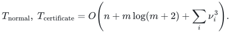

# Executable exact maximum matching

[matching.py](matching.py) is a deterministic maximum-cardinality matching
solver for arbitrary undirected graphs. It requires Python 3.10 or later and
only the standard library. It returns original edge identifiers, handles
loops, parallel input records and isolated vertices, and optionally supplies
an optimality certificate checked by a [separate verifier](verify_certificate.py).

This implementation uses the classical Edmonds blossom algorithm with two
proved componentwise reductions: an edge kernel and a smaller set of outside
vertices. Its ordinary polynomial running time
is stated below. The faster conditional [research theorem](../proof.md)
requires additional deterministic cycle-search machinery and is a separate
result; that machinery is not part of this executable.

## Run the example

From the repository root:

```bash
python3 -B problems/general-matching/reference/matching.py \
  problems/general-matching/reference/example.json --certificate \
  > /tmp/matching-result.json

python3 -B problems/general-matching/reference/verify_certificate.py \
  problems/general-matching/reference/example.json /tmp/matching-result.json
```

The example has a star, an odd cycle, parallel records, loops and an isolated
vertex. Its optimum has two edges. The verifier returns
`"optimality_verified": true` after checking the actual input, matching and
certificate. It does not import or call the blossom solver.

Both normal mode and `--certificate` have the same cubic time bound.
Use `--no-kernel` to solve
the full normalized components. Input `-`, or no filename, reads JSON from
standard input. A result without a certificate can be checked with
`--feasibility-only`; that check establishes edge validity and disjoint
endpoints, and does not establish maximum cardinality.

## Input and output

The input is a JSON object with `n`, `edges`, and optional `edge_ids`:

```json
{"n": 4, "edges": [[1, 0], [0, 1], [1, 2], [2, 3]],
 "edge_ids": ["first", "parallel", "middle", "last"]}
```

Vertices are the integers from zero through `n-1`. Every edge is a pair of
vertices. Edge IDs are distinct integers or strings; integers and strings
are different types, so `1` and `"1"` are different IDs. Booleans are not
accepted as vertices or IDs. If IDs are omitted, zero-based input record
indices are used. All arithmetic governing matching and certification is
integral and exact.

Each returned matching entry contains `input_index`, `id`, `u`, and `v`.
The endpoints preserve the orientation of that original input record, even
though the graph is undirected. For a parallel pair the earliest input
record is retained. A loop is never selected. Output is ordered by input
record index. Empty graphs return an empty matching.

The callable interface is
`maximum_matching(n, edges, edge_ids=None, *, use_kernel=True, certificate=False)`.
The separate `verify_result` function raises `ValueError` on a rejected
certificate and returns the verified scope on acceptance. Its
`require_certificate=False` option only checks feasibility. Informational
statistics supplied by the solver never serve as certificate evidence.

## Running time and storage

Let <code class="math">n</code> be the number of named vertices and <code class="math">m</code> the number of input edge
records. For each nonempty connected component <code class="math">G_i</code> of the normalized
simple graph, let <code class="math">\nu_i=\nu(G_i)</code> be its maximum matching size. The
implemented default bounds are

<!-- math-display: 881d8fd3ae4ba28e3c163328
T_{\mathrm{normal}},\ T_{\mathrm{certificate}}
 = O\!\left(n+m\log(m+2)+\sum_i \nu_i^3\right).
-->


The matching sizes are not input parameters. The
[complete compression proof](cover-compression-proof.md) derives the bound
and keeps certificate generation within it. With `--no-kernel`, both
reductions are disabled and the solve term is instead
<code class="math">\sum_i n_i^3</code>, where <code class="math">n_i=&#124;V(G_i)&#124;</code>.

Working storage is <code class="math">O(n+m)</code>. The output certificate also has
<code class="math">O(n+m)</code> records. These are word-operation bounds with vertex indices and
record indices occupying <code class="math">O(\log(n+m+2))</code> bits. Arbitrarily long ID strings
or integers incur their actual comparison, storage and JSON input/output
costs. The solver uses comparison sorting for deterministic normalization
and ID uniqueness checks; it does not assume worst-case constant-time
hashing or claim the manuscript's linear radix-sort preprocessing bound.

The independent certificate verifier uses comparison sorting and graph
scans in <code class="math">O(n+m\log(m+2))</code> word operations and <code class="math">O(n+m)</code> storage, plus
the actual label and certificate encoding costs. It performs no matching
search. On invalid input, processing is also charged to the supplied
certificate's size.

The first reduction keeps all edges inside a vertex cover <code class="math">C_i</code> formed
by a greedy maximal matching, and at most <code class="math">c_i=&#124;C_i&#124;</code> distinct outside
neighbors per cover vertex. Its edge kernel <code class="math">H_i</code> has

<!-- math-display: c66d6f22513a70f1d9b6f176
|E(H_i)|\leq
\min\!\left\{m_i,\binom{c_i}{2}+c_i^2\right\},
\qquad
|V(H_i)|\leq c_i+c_i^2,
\qquad
c_i\leq 2\nu_i.
-->


The second reduction computes a maximum bipartite matching between
<code class="math">C_i</code> and the remaining vertices of <code class="math">H_i</code>. Keep only its matched
outside endpoints <code class="math">T_i</code>, together with the entire cover. The induced
graph <code class="math">J_i=H_i[C_i\cup T_i]</code> has at most <code class="math">2c_i\leq4\nu_i</code>
vertices and preserves the general matching optimum. Both this crossing
matching and the subsequent blossom solve cost <code class="math">O(c_i^3)</code>.

The certificate is still constructed and verified on <code class="math">H_i</code>. If it has
<code class="math">k_i</code> vertices and <code class="math">h_i</code> edges, extraction costs
<code class="math">O(h_i+k_i(\nu_i+1))</code>. It uses one simultaneous failed alternating
forest per kernel requiring a nonempty barrier, with at most <code class="math">\nu_i</code>
contractions and no vertex-deletion matching calls. Since
<code class="math">h_i,k_i=O(c_i^2)</code>, this is also <code class="math">O(c_i^3)</code>. The
[complete extraction proof](certificate-proof.md) is self-contained.

The informational statistics distinguish the two stages:
`kernel_vertices` and `kernel_edges` describe <code class="math">H_i</code> in total;
`blossom_vertices` counts the vertices actually given to blossom search;
`cover_vertices` counts the computed covers. None is trusted by the verifier.
A path on 20 cover vertices, each with 20 private leaves, has 420 vertices
and 419 edges. With the specified greedy order, its first kernel retains
all 420 vertices, while the second stage needs only 40 blossom vertices.
It returns and independently certifies a matching of size 20. A large star
has a four-vertex first kernel and a three-vertex blossom graph. Processing
many separate components does not allocate a full <code class="math">n</code>-vertex array for
each one.

## Why the returned matching is maximum

**Normalization and the kernel.** Removing loops preserves matching
cardinality. Selecting one original record for each unordered nonloop pair
preserves every possible matched pair. Components can be solved separately.
The endpoints of a greedy maximal matching form a vertex cover <code class="math">C</code>.
If a maximum matching uses an omitted edge <code class="math">uv</code>, where <code class="math">u\in C</code> and
<code class="math">v\notin C</code>, remove that edge temporarily. The remaining matching has at
most <code class="math">c-1</code> matched vertices outside the cover. Of the <code class="math">c</code> neighbors
retained at <code class="math">u</code>, one is therefore free. Substituting this retained edge
preserves cardinality and decreases the number of omitted matching edges.
Repeated substitution puts a maximum matching inside the kernel. This is
the [main proof's Lemma 3.1](../proof.md#31-cleanup-and-an-optional-quadratic-edge-kernel).

**Outside-vertex compression.** For any crossing matching <code class="math">P</code> between
the cover and its outside vertices, compare <code class="math">P</code> with a maximum crossing
matching <code class="math">Q</code>. If <code class="math">P</code> uses a right endpoint outside those matched by
<code class="math">Q</code>, their symmetric difference gives an alternating path to a right
endpoint matched by <code class="math">Q</code> and free in <code class="math">P</code>. The other possible ending
would augment <code class="math">Q</code>, contradicting its maximal cardinality. Flipping
<code class="math">P</code> along this even path preserves exactly its matched cover vertices
and moves one outside endpoint into the retained set. Repeat until all
are retained. Thus every matchable cover subset is preserved, so any
general matching can keep its cover-cover edges and replace the crossing
edges without changing its size. The
[full exchange proof](cover-compression-proof.md#1-a-small-set-of-outside-endpoints-preserves-all-cover-subsets)
also proves the deterministic crossing-matching algorithm and its cost.

**Blossom search.** The code initializes a greedy matching and searches
from each still-free vertex. An alternating tree labels unmatched and
matched steps. An edge joining two outer vertices contracts the odd cycle
through their least common tree ancestor. The `base` array represents the
contraction; rewritten `parent` links retain the alternating route needed
when an augmenting path is found. This is the classical blossom
contraction/expansion search of
[Edmonds, *Paths, Trees, and Flowers* (1965), Section 4](https://doi.org/10.4153/CJM-1965-045-4).
It applies to nonbipartite and disconnected graphs, without a perfect
matching promise.

The augmenting-path criterion follows by taking the symmetric difference
with any larger matching: one component would be an augmenting path.
Each successful search increases the cardinality by one and leaves all
previously matched vertices matched. A failed free root needs no later
restart. If a later augmentation from that root were possible, comparing
the resulting matching with the matching at the failed search would yield
an augmenting path from that root already then. Exhausting the searches
therefore leaves a maximum matching.

Write <code class="math">j_i=&#124;V(J_i)&#124;</code> for the graph supplied to blossom. Within one
search, every vertex becomes outer at most once and its
adjacency is scanned once. Each nontrivial contraction merges current
bases, so there are at most <code class="math">j_i</code> contractions. Ancestor/branch walks
and a contraction scan each cost <code class="math">O(j_i)</code>. A search costs
<code class="math">O(j_i^2)</code>, and at most <code class="math">j_i</code> root searches give the stated cubic
bound. The implementation is iterative; it does not require a recursion
depth proportional to the graph size.

## A certificate whose verification needs no blossom algorithm

For each original nonempty component the certificate lists its cover,
retained native input indices, and a set <code class="math">A\subseteq V(H)</code>. The verifier
reconstructs the normalized input independently. It checks that the cover
meets every edge, every cover-cover edge is retained, and each cover vertex
keeps at least <code class="math">\min\{c,&#124;N(u)\setminus C&#124;\}</code> distinct outside neighbors.
These conditions certify exact preservation by the preceding exchange
proof. The verifier also checks every selected native ID and endpoint.

Let <code class="math">o(H-A)</code> count the odd connected components after removing <code class="math">A</code>,
including isolated retained vertices. The final acceptance test is

<!-- math-display: f076fc50a27eedd87ba5ebd6
2|M|=|V(H)|-o(H-A)+|A|.
-->


**Self-contained upper-bound proof.** An odd component of <code class="math">H-A</code> that
has no matching edge to <code class="math">A</code> contains an unmatched vertex. At most
<code class="math">&#124;A&#124;</code> such components can use matching edges to <code class="math">A</code>, because those
edges have distinct endpoints in <code class="math">A</code>. Thus every matching leaves at
least <code class="math">o(H-A)-&#124;A&#124;</code> vertices unmatched and has size at most the displayed
right-hand side divided by two. A feasible matching attaining that upper
bound is maximum. No claim about the search's internal state is used.

**How a certificate is found.** First try <code class="math">A=\varnothing</code>; this already
works whenever each retained component has a perfect or nearly perfect
matching. Otherwise run one complete alternating forest from all exposed
vertices, with the maximum matching fixed. Every original member of a
contracted outer blossom is included in the outer set <code class="math">O</code>. Let <code class="math">I</code>
be the remaining inner vertices and return <code class="math">A=I</code>.

At exhaustion there are <code class="math">&#124;I&#124;+f</code> odd outer blocks, where <code class="math">f</code> is the
number of exposed roots. There are no edges between different outer
blocks or from the outer set to unreached vertices. The unreached part
has a perfect matching. Hence <code class="math">o(H-I)=&#124;I&#124;+f</code>, proving the required
equality directly. The [full proof](certificate-proof.md) establishes the
contraction, lifting and counting invariants, the
<code class="math">O(h+k(\nu+1))</code> extraction bound, and the identification
<code class="math">O=\{v:\nu(H-v)=\nu(H)\}</code>. This is
the classical Gallai–Edmonds exposable set, with the required facts proved
locally. The code checks the equality before returning its certificate.

The certificate itself is sufficient even if its producer is untrusted:
its verifier uses only the elementary kernel exchange and odd-component
upper bound, and never assumes that the producer correctly identified
the exposable set or correctly contracted a blossom.

## Executable evidence and scope

```bash
python3 -B problems/general-matching/verify/check_reference.py
python3 -B problems/general-matching/verify/check_certificate_search.py
python3 -B problems/general-matching/verify/check_cover_compression.py
```

The first check compares all 33,868 simple graphs through six vertices
with an independent subset dynamic program in both kernel and full-graph
modes: 67,736 certified solves. It also checks 152 native-record instances,
260 seeded or explicit larger instances, 29 invalid-input/certificate
cases, and four scale/CLI cases. Every oracle comparison includes
independent certificate verification. The larger cases include odd cycles,
touching blossoms, the Petersen graph, dense graphs, stars and paths.

The second check tests the actual certificate search on all 33,868 simple
graphs through six vertices and 500 seeded graphs on seven through thirteen
vertices. Independent subset dynamic programming identifies the exact
exposable set; explicit even alternating paths and terminal block
invariants are checked separately. The checker also rejects two valid but
nonmaximum input matchings through explicit production exceptions.

The third check calls the actual compression implementation on 68,236
covers: every simple graph through six vertices in both fixed edge orders,
plus 500 seeded larger graphs. Independent subset dynamic programming
checks 70,578 maximum-crossing right endpoint sets and 2,882,175 ranks of
cover subsets. It also checks general matching preservation, the
<code class="math">2c</code> vertex bound and the certificate search's matched-edge contraction
bound. These counts describe the default command.

The seed selects test graphs only; the solver has no randomized step.
The mathematical checkers explicitly refuse optimized Python execution
that disables assertions. The production solver and verifier acceptance
logic use explicit conditions rather than assertions. Finite evidence
supports code review and does not constitute a proof-assistant
formalization or verification of the separate fast research construction.
