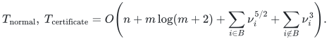
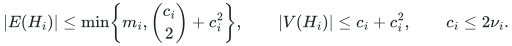
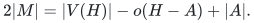

# Executable exact maximum matching

[matching.py](matching.py) is a deterministic maximum-cardinality matching
solver for arbitrary undirected graphs. It requires Python 3.10 or later and
only the standard library. It returns original edge identifiers, handles
loops, parallel input records and isolated vertices, and optionally supplies
an optimality certificate checked by a [separate verifier](verify_certificate.py).

This implementation uses Hopcroft–Karp on bipartite retained graphs and
Edmonds blossom otherwise, with two proved componentwise reductions: an
edge kernel and a smaller set of outside vertices. Its ordinary polynomial running time
is stated below. The faster [research theorem](../proof.md) has its own
proved cycle-search construction, assembled in
[Theorem 11.6](../proof.md#116-deterministic-cycle-search-realization).
That hierarchy is not part of this executable; the distinction concerns
code coverage, not an unresolved mathematical premise.

The outside-endpoint exchange lemma and its at-most-<code class="math">4\nu</code>
vertex bound already appear in the direct checkpoint of 24 October 2026.
This package adds executable compression, native-ID handling, independent
checks and certificates, and the current bipartite phase refinement. See
the [source history](../sources.md#checkpoint-provenance).

## Run the example

From the repository root:

```bash
python3 -B problems/general-matching/reference/matching.py \
  problems/general-matching/reference/example.json --certificate \
  > /tmp/matching-result.json

python3 -B problems/general-matching/reference/verify_certificate.py \
  problems/general-matching/reference/example.json /tmp/matching-result.json
```

The example has a star, an odd cycle, parallel records, loops and an isolated
vertex. Its optimum has two edges. The verifier returns
`"optimality_verified": true` after checking the actual input, matching and
certificate. It does not import or call the blossom solver.

Both normal mode and `--certificate` have the same componentwise time bound.
Use `--no-kernel` to solve
the full normalized components. Input `-`, or no filename, reads JSON from
standard input. A result without a certificate can be checked with
`--feasibility-only`; that check establishes edge validity and disjoint
endpoints, and does not establish maximum cardinality.

## Input and output

The input is a JSON object with `n`, `edges`, and optional `edge_ids`:

```json
{"n": 4, "edges": [[1, 0], [0, 1], [1, 2], [2, 3]],
 "edge_ids": ["first", "parallel", "middle", "last"]}
```

Vertices are the integers from zero through `n-1`. Every edge is a pair of
vertices. Edge IDs are distinct integers or strings; integers and strings
are different types, so `1` and `"1"` are different IDs. Booleans are not
accepted as vertices or IDs. If IDs are omitted, zero-based input record
indices are used. All arithmetic governing matching and certification is
integral and exact.

Each returned matching entry contains `input_index`, `id`, `u`, and `v`.
The endpoints preserve the orientation of that original input record, even
though the graph is undirected. For a parallel pair the earliest input
record is retained. A loop is never selected. Output is ordered by input
record index. Empty graphs return an empty matching.

The callable interface is
`maximum_matching(n, edges, edge_ids=None, *, use_kernel=True, certificate=False)`.
The separate `verify_result` function raises `ValueError` on a rejected
certificate and returns the verified scope on acceptance. Its
`require_certificate=False` option only checks feasibility. Informational
statistics supplied by the solver never serve as certificate evidence.

## A fixed kernel for future native failures

[failure_kernel.py](failure_kernel.py) constructs one subgraph preserving
every matching optimum after any mixture of at most `f` native vertex or
edge deletions.  It retains at most <code class="math">(f+3)\nu(G)</code> vertices and
<code class="math">O(\nu(G)^2+\nu(G)f)</code> edges with its default greedy cover.  A supplied
cover of size `c` gives the exact bound <code class="math">(f+2)c</code> instead.  Its
[complete proof](fault-tolerant-cover-compression.md) establishes the
stronger preservation of every matchable subset of the cover, including
arbitrary cover deletions and graphs attached through that cover.

The input must be simple and loopless; this constructor rejects parallel
records instead of dropping native failure identities.  Run the separate
simple example and universal certificate verifier:

```bash
python3 -B problems/general-matching/reference/failure_kernel.py \
  problems/general-matching/reference/failure-example.json --failures 2 \
  > /tmp/matching-failure-kernel.json

python3 -B problems/general-matching/reference/verify_failure_kernel.py \
  problems/general-matching/reference/failure-example.json \
  /tmp/matching-failure-kernel.json
```

The callable constructor is
`build_failure_kernel(n, edges, failure_budget, edge_ids=None, *, cover=None)`.
Its certificate contains a sparse neighbor kernel and consecutive maximum
crossing matchings, each paired with a vertex cover of the same size.
The verifier checks those local witnesses and the final induced subgraph;
it performs no matching search and enumerates no failure queries.
An accepted result establishes all permitted queries simultaneously.
The output gives original vertex numbers and native edge IDs.  A particular
query is answered by deleting its failed objects and solving the retained
graph; preprocessing alone does not return all future matchings.

[failure_query.py](failure_query.py) supplies that query adapter through
`solve_failure_query(graph, kernel, *, failed_vertices=(), failed_edge_ids=())`.
It first checks the supplied universal certificate, deletes the requested
native objects, solves the compact retained residual graph, and lifts the
matching to original vertex numbers, input indices, endpoint orientations
and typed edge IDs. For example, after constructing `kernel` from `graph`:

```python
from failure_query import solve_failure_query
from verify_failure_query import verify_failure_query

answer = solve_failure_query(graph, kernel, failed_vertices=[0])
print(answer["matching"])
report = verify_failure_query(graph, kernel, answer, failed_vertices=[0])
assert report["optimality_verified"]
```

Failures refer to original vertices and edge IDs, including objects omitted
from the kernel. Integer `1` and string `"1"` remain distinct IDs. Duplicate
or unknown failures and booleans are rejected. Every listed outside vertex
and crossing edge costs one unit, even when a failed edge touches a failed
vertex; cover vertices and cover-internal edges are uncharged. Queries
exceeding the certified budget are rejected. Thus the stronger theorem's
scope, including arbitrarily many cover deletions, is available directly.

The result's `subproblem` and `subproblem_result` describe the compact
retained residual graph and its ordinary matching optimality certificate.
They can be passed to `verify_result`; their vertex numbers and input
indices are local. `subproblem_vertices` maps local vertices back to the
original graph. The top-level `matching` alone uses original input indices
and endpoints. The universal certificate and the residual certificate
establish optimality together, after checking the specified deletions and
the coordinate lift. The independent
[composite verifier](verify_failure_query.py) performs these checks through
`verify_failure_query(graph, kernel, answer, *, failed_vertices=(), failed_edge_ids=())`.
The caller supplies the query separately: it must not be taken from an
untrusted answer. No matching solver or kernel producer is imported.

**Acceptance argument.** The universal verifier establishes preservation
for every permitted query. The composite verifier independently validates
and charges all requested original objects, reconstructs the surviving
retained graph and its compact vertex map, and requires the disclosed graph
to agree exactly, including types of IDs and integers. The ordinary verifier
then proves the optimum of that reconstructed graph. Finally, the native
answer is checked for original-record feasibility, exclusion of failed
objects and equality to the certified optimum. Universal preservation gives
the same optimum on the full residual input, so acceptance proves the native
answer is maximum there. A different optimal native matching is allowed;
it need not coincide with the producer's particular compact matching.

Besides the two existing certificate verifiers, this composition uses
comparison sorting and scans of original and retained records. It allocates
linear original-universe arrays; encoded label and certificate lengths are
charged as well. It makes no matching search. Both query interfaces are
callable Python functions, with no additional CLI.

Each query rechecks the full supplied kernel certificate, scans the original
graph and retained records, sorts native IDs, and runs the ordinary solver
on the compact residual graph. It allocates original-universe vertex and
edge arrays for validation and mapping. It claims no sublinear, dynamic,
or fast-hierarchy query bound. The dedicated
[query checker](../verify/check_failure_query.py) compares full residual
optima with an independent subset dynamic program and checks the residual
certificates and native-coordinate lifts.

The order <code class="math">O(\nu f)</code> in vertices for positive budgets was already proved
by [Banerjee, Gupta, Raman and Saurabh (2022)](https://doi.org/10.1007/978-3-031-09574-0_8).
The new package supplies the local layered proof, exact counts, stronger
interface guarantee and complete universal-certificate implementation.

## Running time and storage

Let <code class="math">n</code> be the number of named vertices and <code class="math">m</code> the number of input edge
records. For each nonempty connected component <code class="math">G_i</code> of the normalized
simple graph, let <code class="math">\nu_i=\nu(G_i)</code> be its maximum matching size.
Let `B` contain the components whose first retained edge kernel is bipartite.
The implemented default bounds are

<!-- math-display: 90ca746e3eb379a953073ce1
T_{\mathrm{normal}},\ T_{\mathrm{certificate}}
 = O\!\left(n+m\log(m+2)
   +\sum_{i\in B}\nu_i^{5/2}+\sum_{i\notin B}\nu_i^3\right).
-->


The matching sizes are not input parameters. The
[compression proof](cover-compression-proof.md) and
[bipartite phase/certificate proof](bipartite-proof.md) derive the bound.
Every originally bipartite component belongs to `B`; surplus-edge deletion
can sometimes make the retained graph bipartite as well. With `--no-kernel`,
both reductions are disabled: a bipartite full component costs
`O((n_i+m_i) sqrt(nu_i+1))`, and a nonbipartite full component costs `O(n_i^3)`.
The normalization term remains unchanged.

Working storage is <code class="math">O(n+m)</code>. The output certificate also has
<code class="math">O(n+m)</code> records. These are word-operation bounds with vertex indices and
record indices occupying <code class="math">O(\log(n+m+2))</code> bits. Arbitrarily long ID strings
or integers incur their actual comparison, storage and JSON input/output
costs. The solver uses comparison sorting for deterministic normalization
and ID uniqueness checks; it does not assume worst-case constant-time
hashing or claim the manuscript's linear radix-sort preprocessing bound.

The independent certificate verifier uses comparison sorting and graph
scans in <code class="math">O(n+m\log(m+2))</code> word operations and <code class="math">O(n+m)</code> storage, plus
the actual label and certificate encoding costs. It performs no matching
search. On invalid input, processing is also charged to the supplied
certificate's size.

The first reduction keeps all edges inside a vertex cover <code class="math">C_i</code> formed
by a greedy maximal matching, and at most <code class="math">c_i=&#124;C_i&#124;</code> distinct outside
neighbors per cover vertex. Its edge kernel <code class="math">H_i</code> has

<!-- math-display: c66d6f22513a70f1d9b6f176
|E(H_i)|\leq
\min\!\left\{m_i,\binom{c_i}{2}+c_i^2\right\},
\qquad
|V(H_i)|\leq c_i+c_i^2,
\qquad
c_i\leq 2\nu_i.
-->


The second reduction computes a maximum bipartite matching between
<code class="math">C_i</code> and the remaining vertices of <code class="math">H_i</code>. Keep only its matched
outside endpoints <code class="math">T_i</code>, together with the entire cover. The induced
graph <code class="math">J_i=H_i[C_i\cup T_i]</code> has at most <code class="math">\min\{2c_i,3\nu_i\}</code>
vertices and preserves the general matching optimum. Hopcroft–Karp computes
this crossing matching in `O(c_i^(5/2))`: its number of matched edges is at
most `c_i`, even though its vertex count may be quadratic. If `H_i` is
bipartite, the solve on `J_i` has the same bound. Otherwise blossom search
costs `O(c_i^3)`. Both the compression and final bipartite solve are
accelerated; the first stage does not leave a hidden cubic cost.

The certificate is still constructed and verified on <code class="math">H_i</code>;
write `k_i=|V(H_i)|` and `h_i=|E(H_i)|`.
For a bipartite kernel, one alternating reachability search produces a
minimum vertex cover in <code class="math">O(k_i+h_i)</code>, which supplies the existing tight
odd-component certificate. For a nonbipartite kernel, extraction costs
<code class="math">O(h_i+k_i(\nu_i+1))</code>. It uses one simultaneous failed alternating
forest when an empty barrier is insufficient, with at most <code class="math">\nu_i</code>
contractions and no vertex-deletion matching calls. Since
<code class="math">h_i,k_i=O(c_i^2)</code>, this is <code class="math">O(c_i^3)</code> in the general
case and `O(c_i^2)` in the bipartite case. Both extraction proofs are
self-contained: [general forests](certificate-proof.md) and
[bipartite covers](bipartite-proof.md#5-a-linear-certificate-on-the-first-kernel).

The informational statistics distinguish the two stages:
`kernel_vertices` and `kernel_edges` describe <code class="math">H_i</code> in total;
`solver_vertices` counts all final solve vertices, split between
`blossom_vertices` and `bipartite_vertices`; `cover_vertices` counts the
computed covers. `hopcroft_karp_calls`, `hopcroft_karp_phases`, and
`hopcroft_karp_bfs` include both crossing compression and final bipartite
solves. Each call has exactly one more BFS than successful phases.
None of these counters is trusted by the verifier.
The sharper <code class="math">3\nu_i</code> vertex accounting follows because the number of retained
outside endpoints equals a crossing matching's size, hence is at most <code class="math">\nu_i</code>.
The old <code class="math">4\nu_i</code> estimate used only the weaker bound <code class="math">&#124;T_i&#124;\leq c_i</code>.
A path on 20 cover vertices, each with 20 private leaves, has 420 vertices
and 419 edges. With the specified greedy order, its first kernel retains
all 420 vertices, while the second stage needs only 40 bipartite solve vertices.
It returns and independently certifies a matching of size 20. A large star
has a four-vertex first kernel and a three-vertex bipartite solve graph. Processing
many separate components does not allocate a full <code class="math">n</code>-vertex array for
each one.

## Why the returned matching is maximum

**Normalization and the kernel.** Removing loops preserves matching
cardinality. Selecting one original record for each unordered nonloop pair
preserves every possible matched pair. Components can be solved separately.
The endpoints of a greedy maximal matching form a vertex cover <code class="math">C</code>.
If a maximum matching uses an omitted edge <code class="math">uv</code>, where <code class="math">u\in C</code> and
<code class="math">v\notin C</code>, remove that edge temporarily. The remaining matching has at
most <code class="math">c-1</code> matched vertices outside the cover. Of the <code class="math">c</code> neighbors
retained at <code class="math">u</code>, one is therefore free. Substituting this retained edge
preserves cardinality and decreases the number of omitted matching edges.
Repeated substitution puts a maximum matching inside the kernel. This is
the [main proof's Lemma 3.1](../proof.md#31-cleanup-and-an-optional-quadratic-edge-kernel).

**Outside-vertex compression.** For any crossing matching <code class="math">P</code> between
the cover and its outside vertices, compare <code class="math">P</code> with a maximum crossing
matching <code class="math">Q</code>. If <code class="math">P</code> uses a right endpoint outside those matched by
<code class="math">Q</code>, their symmetric difference gives an alternating path to a right
endpoint matched by <code class="math">Q</code> and free in <code class="math">P</code>. The other possible ending
would augment <code class="math">Q</code>, contradicting its maximal cardinality. Flipping
<code class="math">P</code> along this even path preserves exactly its matched cover vertices
and moves one outside endpoint into the retained set. Repeat until all
are retained. Thus every matchable cover subset is preserved, so any
general matching can keep its cover-cover edges and replace the crossing
edges without changing its size. The
[full exchange proof](cover-compression-proof.md#1-a-small-set-of-outside-endpoints-preserves-all-cover-subsets)
also proves the deterministic crossing-matching algorithm and its cost.

**Bipartite search.** A BFS finds the minimum number of matching edges on
an augmenting path. Each phase freezes the starting matching and uses
explicit DFS stacks to find a maximal family of vertex-disjoint shortest
augmenting paths. Flipping those paths strictly increases the next shortest
augmenting length. The symmetric difference with an optimum then bounds
the number of phases by `O(sqrt(nu+1))`, including a final failed BFS.
The [complete local proof](bipartite-proof.md) establishes the fixed-matching
search invariants, this matching-number bound, and the cost of both uses
of the algorithm. Its classical source is John E. Hopcroft and Richard M.
Karp, [*An n^(5/2) Algorithm for Maximum Matchings in Bipartite Graphs*
(1973)](https://doi.org/10.1137/0202019).

**Blossom search.** The code initializes a greedy matching and searches
from each still-free vertex. An alternating tree labels unmatched and
matched steps. An edge joining two outer vertices contracts the odd cycle
through their least common tree ancestor. The `base` array represents the
contraction; rewritten `parent` links retain the alternating route needed
when an augmenting path is found. This is the classical blossom
contraction/expansion search of
[Edmonds, *Paths, Trees, and Flowers* (1965), Section 4](https://doi.org/10.4153/CJM-1965-045-4).
It applies to nonbipartite and disconnected graphs, without a perfect
matching promise.

The augmenting-path criterion follows by taking the symmetric difference
with any larger matching: one component would be an augmenting path.
Each successful search increases the cardinality by one and leaves all
previously matched vertices matched. A failed free root needs no later
restart. If a later augmentation from that root were possible, comparing
the resulting matching with the matching at the failed search would yield
an augmenting path from that root already then. Exhausting the searches
therefore leaves a maximum matching.

Write <code class="math">j_i=&#124;V(J_i)&#124;</code> for the graph supplied to blossom. Within one
search, every vertex becomes outer at most once and its
adjacency is scanned once. Each nontrivial contraction merges current
bases, so there are at most <code class="math">j_i</code> contractions. Ancestor/branch walks
and a contraction scan each cost <code class="math">O(j_i)</code>. A search costs
<code class="math">O(j_i^2)</code>, and at most <code class="math">j_i</code> root searches give the stated cubic
bound. The implementation is iterative; it does not require a recursion
depth proportional to the graph size.

## A certificate whose verification needs no blossom algorithm

For each original nonempty component the certificate lists its cover,
retained native input indices, and a set <code class="math">A\subseteq V(H)</code>. The verifier
reconstructs the normalized input independently. It checks that the cover
meets every edge, every cover-cover edge is retained, and each cover vertex
keeps at least <code class="math">\min\{c,&#124;N(u)\setminus C&#124;\}</code> distinct outside neighbors.
These conditions certify exact preservation by the preceding exchange
proof. The verifier also checks every selected native ID and endpoint.

Let <code class="math">o(H-A)</code> count the odd connected components after removing <code class="math">A</code>,
including isolated retained vertices. The final acceptance test is

<!-- math-display: f076fc50a27eedd87ba5ebd6
2|M|=|V(H)|-o(H-A)+|A|.
-->


**Self-contained upper-bound proof.** An odd component of <code class="math">H-A</code> that
has no matching edge to <code class="math">A</code> contains an unmatched vertex. At most
<code class="math">&#124;A&#124;</code> such components can use matching edges to <code class="math">A</code>, because those
edges have distinct endpoints in <code class="math">A</code>. Thus every matching leaves at
least <code class="math">o(H-A)-&#124;A&#124;</code> vertices unmatched and has size at most the displayed
right-hand side divided by two. A feasible matching attaining that upper
bound is maximum. No claim about the search's internal state is used.

**Bipartite certificates.** Let `Z` be the vertices reached by alternating
search from all unmatched left vertices in `H`. Then
`A = (L - Z) union (R intersect Z)` covers every edge and contains exactly
one endpoint of every matching edge. Thus `|A|=|M|`, and `H-A` consists
of singleton odd components. This gives the same displayed equality in
linear time. The [full proof](bipartite-proof.md#5-a-linear-certificate-on-the-first-kernel)
also establishes the production rejection conditions.

**General certificates.** For a nonbipartite kernel, first try <code class="math">A=\varnothing</code>; this already
works whenever each retained component has a perfect or nearly perfect
matching. Otherwise run one complete alternating forest from all exposed
vertices, with the maximum matching fixed. Every original member of a
contracted outer blossom is included in the outer set <code class="math">O</code>. Let <code class="math">I</code>
be the remaining inner vertices and return <code class="math">A=I</code>.

At exhaustion there are <code class="math">&#124;I&#124;+f</code> odd outer blocks, where <code class="math">f</code> is the
number of exposed roots. There are no edges between different outer
blocks or from the outer set to unreached vertices. The unreached part
has a perfect matching. Hence <code class="math">o(H-I)=&#124;I&#124;+f</code>, proving the required
equality directly. The [full proof](certificate-proof.md) establishes the
contraction, lifting and counting invariants, the
<code class="math">O(h+k(\nu+1))</code> extraction bound, and the identification
<code class="math">O=\{v:\nu(H-v)=\nu(H)\}</code>. This is
the classical Gallai–Edmonds exposable set, with the required facts proved
locally. The code checks the equality before returning its certificate.

The certificate itself is sufficient even if its producer is untrusted:
its verifier uses only the elementary kernel exchange and odd-component
upper bound, and never assumes that the producer correctly identified
the exposable set or correctly contracted a blossom.

## Executable evidence and scope

```bash
python3 -B problems/general-matching/verify/check_reference.py
python3 -B problems/general-matching/verify/check_certificate_search.py
python3 -B problems/general-matching/verify/check_cover_compression.py
python3 -B problems/general-matching/verify/check_bipartite.py
```

The first check compares all 33,868 simple graphs through six vertices
with an independent subset dynamic program in both kernel and full-graph
modes: 67,736 certified solves. It also checks 152 native-record instances,
260 seeded or explicit larger instances, 29 invalid-input/certificate
cases, and four scale/CLI cases. Every oracle comparison includes
independent certificate verification. The larger cases include odd cycles,
touching blossoms, the Petersen graph, dense graphs, stars and paths.

The second check tests the actual certificate search on all 33,868 simple
graphs through six vertices and 500 seeded graphs on seven through thirteen
vertices. Independent subset dynamic programming identifies the exact
exposable set; explicit even alternating paths and terminal block
invariants are checked separately. The checker also rejects two valid but
nonmaximum input matchings through explicit production exceptions.

The third check calls the actual compression implementation on 68,236
covers: every simple graph through six vertices in both fixed edge orders,
plus 500 seeded larger graphs. Independent subset dynamic programming
checks 70,578 maximum-crossing right endpoint sets and 2,882,175 ranks of
cover subsets. It also checks general matching preservation, the
<code class="math">2c</code> vertex bound and the certificate search's matched-edge contraction
bound. These counts describe the default command.

The fourth check compares 74,963 bipartite graphs with at most four vertices
per side to an independent matching oracle. It adds 300 seeded cases in
two side/adjacency orders, eight rejection checks and six long-path,
native-record and branch-selection cases. A constructed second-phase
augmenting path contains 2,400 matching edges, exercising the nonrecursive
search beyond Python's usual recursion limit. Public results are checked
by the unchanged independent certificate verifier, in both kernel modes.
It also verifies the phase-count bound and the final failed BFS accounting.

The seed selects test graphs only; the solver has no randomized step.
The mathematical checkers explicitly refuse optimized Python execution
that disables assertions. The production solver and verifier acceptance
logic use explicit conditions rather than assertions. Finite evidence
supports code review and does not constitute a proof-assistant
formalization or verification of the separate fast research construction.
