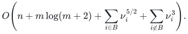
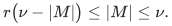
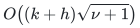
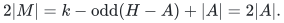

# Matching-number time bound for the implemented bipartite branch

This proves the bipartite branch of the ordinary, unconditional
[matching reference implementation](matching.py). It does not implement the manuscript's faster
deterministic cycle-search construction. The existing edge-kernel and
right-endpoint compression proofs continue to supply their stated matching
preservation properties.

## 1. Graphs and the exact bound

Let `n` count the named vertices and `m` the native input edge records.
Normalize the graph by removing loops and retaining the earliest input
record of every unordered pair, while preserving its original ID for output.
Let the nonempty connected components of this graph be `G_i`, and write
`nu_i` for their maximum matching sizes. In each component, the endpoints of
a greedy maximal matching form a cover `C_i` of size `c_i <= 2 nu_i`.

The first compression retains all cover--cover edges and the first `c_i`
distinct outside neighbors of each cover vertex. Its graph `H_i` has
`O(c_i^2)` vertices and edges, no more edges than the original component,
and the same maximum matching size. The second compression takes a maximum
matching `Q_i` in the bipartite crossing graph `C_i` versus `V(H_i) - C_i`.
If `T_i` comprises its matched right endpoints, the induced graph
`J_i = H_i[C_i union T_i]` has at most `2 c_i <= 4 nu_i` vertices and preserves
every cover subset that could be matched to the outside. Hence it preserves
the general matching number as well.

The implementation uses the bipartite phase algorithm of John E. Hopcroft and
Richard M. Karp, [*An n^(5/2) Algorithm for Maximum Matchings in Bipartite
Graphs*, SIAM Journal on Computing 2(4), 225--231 (1973)](https://doi.org/10.1137/0202019).
The published paper gives the classical `O((V+E) sqrt(V))` bound. Sections
2--4 below give the specific implementation invariants and the
matching-number refinement needed here; the refinement is not obtained by
substituting `nu` for the vertex count without proof.

Hopcroft--Karp computes `Q_i`, and a breadth-first two-color test
on `H_i` decides the final branch. If `H_i` is bipartite, its coloring restricts
to `J_i`, which is solved by Hopcroft--Karp. Otherwise the existing Edmonds
blossom implementation solves `J_i`. Both return the original input IDs after
lifting through the unchanged index maps. Testing `H_i` rather than only
`J_i` also permits the linear certificate algorithm in Section 5.

Let `B` be the set of components whose retained `H_i` is bipartite. The total
operation count, with or without optional optimality certificates, is

<!-- math-display: 29172e3065b0989979a0a9d9
O\!\left(n+m\log(m+2)
  +\sum_{i\in B}\nu_i^{5/2}
  +\sum_{i\notin B}\nu_i^3\right).
-->

Every originally bipartite component belongs to `B`; occasionally deletion
of surplus edges makes `H_i` bipartite even when `G_i` was not. This broader
classification is safe because both kernel preservation and certification
refer to `H_i`. The bound is a componentwise operation bound on the stated
integer-index model; long ID comparisons and input/output representation
bytes retain the charges in the reference README.

## 2. The phase implementation

Consider a bipartite graph with fixed left and right sides, `k` vertices,
`h` edges, and a current matching `M`. Only left adjacency lists are needed.
An augmenting path begins at an unmatched left vertex, ends at an unmatched
right vertex, and alternates between unused and matching edges. If it has
`d` matching edges, it has `2d+1` graph edges. This `d`, not the total path
length, is the unit used in the implementation.

The BFS initializes every free left vertex at level zero. From a left vertex
`u` at level `d`, an edge outside `M` either reaches a free right endpoint,
producing a candidate terminal level `d`, or reaches a matched right vertex
whose partner is put at level `d+1`. The first terminal level is the minimum
number of matching edges on any augmenting path. Vertices at greater levels
need not be scanned. If there is no terminal, the algorithm returns `M`.

Otherwise, `phase_mate` freezes the matching for the entire phase. An
explicit-stack DFS follows only this fixed layered graph: a matched right
vertex advances to its partner at the next left level; a free right vertex
is accepted only at the minimum terminal level. Each left adjacency list has
a cursor advanced whenever an edge is examined. A left vertex exhausted
without a terminal is permanently marked unavailable for this phase. Every
vertex on a successful path is also marked unavailable.

Exhausted vertices may safely remain unavailable: subsequent successful
paths only delete vertices from this fixed directed acyclic layered graph.
They never introduce a new path from a previously exhausted vertex. The
strictly increasing left levels also prohibit a repeated vertex within one
DFS path. Successful paths are therefore vertex-disjoint. The implementation
may flip them immediately because every subsequent search reads
`phase_mate`, and the unavailable marks prevent intersecting a flipped path.

Each originally free left root is searched unless already used. If, at the
end, a shortest augmenting path disjoint from all selected paths remained,
its free root would have been exhausted even though it had a route to a
terminal in the remaining graph. This contradicts the DFS rule. The selected
paths are consequently a maximal vertex-disjoint family of shortest
augmenting paths. A reachable phase must have at least one such path; the
production code raises an explicit error if this invariant fails.

The BFS, initialization, matching snapshot, cursors, unavailable marks, and
path flips cost `O(k+h)` per phase. A successful path's vertices are visited
only once during its flip; a failed left vertex never reenters a later DFS.
Every left adjacency cursor advances at most its degree. The implementation
uses no recursion, so the bound does not require a bounded augmenting-path
depth.

## 3. Why the next shortest path is longer

For completeness, use the standard unit-capacity matching network: arcs
`s -> L`, `L -> R` for graph edges, and `R -> t`, each with capacity one.
The integral unit flow of `M` has an `s`--`t` residual path exactly when the
graph has an augmenting path. Such a graph path with `d` matching edges
becomes a residual path of `2d+3` arcs. Simplicity removes any irrelevant
return to `s` or visit to `t` before the final endpoint.

Before one phase, let `ell(x)` be residual distance from `s`. Every residual
arc from a reachable vertex satisfies `ell(v) <= ell(u)+1`. A shortest
`s`--`t` path increases this distance by exactly one at each step. Augmenting
the chosen disjoint shortest paths introduces only reversals of such arcs;
every newly introduced arc goes backward by one old level. Every unchanged
arc still advances by at most one. No newly reachable vertex can have had
infinite old distance: unchanged arcs out of the old reachable set could
already be followed, and new arcs have endpoints on the chosen paths.

It follows that a new augmenting residual path is at least as long as the
old shortest one. If its length were equal, every arc would advance by one
old level. It could not use any reversed path arc. Moreover it could not
pass through a vertex of a chosen path using only unchanged forward arcs:
each left vertex on that path had exactly one incoming residual arc (its old
matching edge, or its source arc when free), and that arc was used and
reversed; equivalently, each right vertex had exactly one outgoing residual
arc (its old matching edge, or its sink arc when free), also used and
reversed. Thus an equally short new path would be an old shortest path
vertex-disjoint from the entire chosen family. Section 2's maximality rules
this out.

The minimum `d` therefore strictly increases after every successful phase
that leaves another augmenting path. Its integer value increases by at least
one. This is the progress fact used by the phase count, not an assumption
that any single arbitrary augmentation increases the shortest path length.

## 4. Matching number controls the phase count

An empty graph is handled in constant time. For a nonempty vertex array,
let `nu` be the unknown optimum matching size. For `nu=0`, the initial BFS
already fails and costs `O(k+h)`. Suppose `nu>=1`, and set
`r = ceil(sqrt(nu))`. After `r` successful phases, if the algorithm has not
terminated, every augmenting path contains at least `r` matching edges by
Section 3 and the initial lower bound zero.

Compare the current `M` with any optimum `M*`. Their symmetric difference is
a vertex-disjoint union of alternating paths and cycles. No component can
have one more `M` edge than `M*` edges: flipping that component would increase
the maximum matching `M*`. Components with one more `M*` edge are augmenting
paths for `M`, and there are exactly `nu - |M|` of them. Every such path uses
at least `r` distinct edges of `M`; the paths are edge-disjoint. Consequently

<!-- math-display: ca42ebf29f8f7cde1869e8e4
r\bigl(\nu-|M|\bigr)\le |M|\le\nu.
-->

At most `floor(nu/r)` further successful phases are possible, since each
increases matching size by at least one. There are at most
`r + floor(nu/r) <= 2 ceil(sqrt(nu))` successful phases in total. **One final
failed BFS is also charged**, including the case where the last successful
phase produces a maximum matching. This gives

<!-- math-display: e971095073dbb3d481139260
O\bigl((k+h)\sqrt{\nu+1}\bigr)
-->

operations and `O(k+h)` storage. This also proves optimality: on termination
there is no augmenting path, whereas the symmetric-difference argument
would supply one if a larger matching existed.

For the crossing graph used by compression, `nu_cross <= c`, even though
its number of vertices may be `Theta(c^2)`. Thus the crossing computation
costs `O(c^(5/2))`, rather than the `O(c^3)` cost of sequentially augmenting
once for every cover vertex. The induced `J` has `O(c)` vertices and
`O(c^2)` edges, and its matching number is `nu <= c`, so its bipartite solve
also costs `O(c^(5/2))`. Accelerating only the second solve would not suffice:
the old compression step would otherwise keep the total cost cubic.

For `--no-kernel`, a bipartite full component is solved in
`O((n_i+m_i) sqrt(nu_i+1))`; nonbipartite full components retain their ordinary
`O(n_i^3)` blossom bound. Normalization and explicit vertex/output scans
remain charged separately.

## 5. A linear certificate on the first kernel

Lift the resulting maximum matching from `J` to the retained graph `H`.
Its matching number is unchanged by compression. Suppose the two-color test
gave sides `L,R` for `H`. Start an alternating reachability search at every
unmatched left vertex. Follow nonmatching edges from left to right, and the
unique matching edge from a reached matched right vertex back to the left.
Let `Z` be the reached vertex set. Reaching an unmatched right vertex would
exhibit an augmenting path and is an explicit production error.

Set `A = (L - Z) union (R intersect Z)`. This is a vertex cover. For an edge
`lr`, if `l` is not reached then `l` is in `A`. If `l` is reached and `lr`
is not a matching edge, the search reaches `r`, so `r` is in `A`. If it is
a matching edge, the matched left vertex `l` could only have been reached
through its partner `r`, giving the same conclusion; a root is unmatched.

For each matching edge, its endpoints are either both reached or both
unreached. Hence exactly one endpoint belongs to `A`. Every unmatched left
vertex is reached and is not in `A`; every reached right vertex is matched,
so there is no unmatched right vertex in `A`. Therefore `|A| = |M| = nu`.
This proves minimum cardinality directly, because any vertex cover must
meet all `nu` disjoint matching edges.

The existing certificate format records a vertex set whose odd-component
bound is tight. A vertex cover `A` is exactly such a set: `H-A` is
independent, so all `k-|A|` remaining vertices are singleton odd components.
Consequently

<!-- math-display: 3a2f0b237b9dbf51201b6621
2|M|=k-\mathrm{odd}(H-A)+|A|=2|A|.
-->

The separate verifier already checks the matching, kernel preservation,
and this odd-component equality. It needs no new field, no bipartite
algorithm, and no change of certificate format. The producer additionally
checks the lifted matching's validity, the edge-cover condition, and
`|A|=|M|` by explicit rejection conditions; none depends on `assert`.
Coloring, alternating reachability, these checks, and output all cost
`O(k+h)=O(c^2)`.

Nonbipartite `H` continues to use the previously proved general forest
barrier extraction in `O(h+k(nu+1))`, which is `O(c^3)` on the first kernel.
The general case's bound is unchanged. The bipartite branch needs neither
that cubic certificate computation nor an external decomposition theorem.

## 6. Finite evidence and scope

The [bipartite checker](../verify/check_bipartite.py) compares the actual phase solver with an independent
subset-enumeration matching oracle on every bipartite graph with at most
four vertices per side. It checks matching validity, the phase-count bound,
the final failed BFS count, and the produced minimum cover. Seeded cases
reverse the side names and adjacency order and exercise both public kernel
modes with the unchanged independent optimality verifier.

A separate construction forces a second-phase augmenting path containing
2,400 matching edges, beyond Python's usual recursion limit. Native cases
include ignored loops, parallel and reversed records, isolated vertices,
and distinct integer versus string IDs. Another fixture has a nonbipartite
original component but bipartite retained `H`, checking the branch's exact
scope. Invalid side masks, invalid matchings, and a valid nonmaximum matching
are rejected explicitly. The existing exhaustive general-graph, compression,
certificate-forest, and CLI suites continue to exercise the blossom fallback.

These are finite implementation checks supporting review of the local
proofs. They do not certify all executions or establish the manuscript's
complete faster cycle-search construction or its asymptotic work bound.
