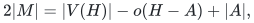
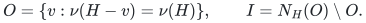
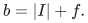
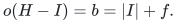

# A quadratic extraction of a matching optimality certificate

This note proves the certificate extraction implemented by
`_failed_search_forest` and `_barrier` in [matching.py](matching.py).
Given a maximum matching of size <code class="math">\nu</code> on a simple graph with <code class="math">k</code>
vertices and <code class="math">h</code> edges, extraction takes <code class="math">O(h+k(\nu+1))</code> additional
work, at most <code class="math">O(k^2)</code>. Consequently the reference solver's normal and
certificate modes share the same cubic bound. The certificate is checked
by the [independent verifier](verify_certificate.py), which performs no
blossom search.

The construction is a classical alternating-forest method. The resulting
sets give the Gallai–Edmonds decomposition, whose historical source is
[Gallai (1964), Theorem (E.1)](https://real.mtak.hu/189486/1/cut_MATKUTINT_1964_3_pp401_-_413.pdf).
The proof below establishes the required extraction and upper-bound
equality directly; it does not assume that decomposition theorem.

## 1. Statement and algorithm

Fix a maximum matching <code class="math">M</code> of the simple graph <code class="math">H</code>. Let <code class="math">f</code> be
the number of vertices exposed by <code class="math">M</code>, meaning unmatched by it. Start
one Edmonds alternating forest with all exposed vertices as roots. Keep
<code class="math">M</code> fixed throughout the search.

Every root is initially **outer**. An edge from an outer vertex to an
unreached matched vertex grows the forest by that **inner** vertex and its
matched outer child. An edge between different outer blocks in the same
tree contracts the usual odd blossom. Every original vertex in the new
block becomes outer; newly outer vertices enter the scan queue. An edge
between outer vertices in different trees would give an augmenting path,
so the implementation rejects that state as inconsistent with a maximum
input matching.

After exhausting the queue, let <code class="math">O</code> be the set of all original outer
vertices and <code class="math">I</code> the remaining inner vertices. Return <code class="math">A=I</code>.

**Theorem 1.** The algorithm leaves <code class="math">M</code> unchanged and returns a set
<code class="math">A</code> satisfying

<!-- math-display: 607827c2333df510cb72ce3d
2|M|=|V(H)|-o(H-A)+|A|,
-->

where <code class="math">o(H-A)</code> is the number of odd connected components after deleting
<code class="math">A</code>. It uses <code class="math">O(h+k(\nu+1))=O(k^2)</code> time and
<code class="math">O(k+&#124;E(H)&#124;)</code> storage. Moreover,

<!-- math-display: 5c1700071c3b2cf0b465198d
O=\{v:\nu(H-v)=\nu(H)\},
\qquad I=N_H(O)\setminus O.
-->

The implementation first tests <code class="math">A=\varnothing</code> and skips the forest
search when that set already gives the displayed equality. This shortcut
returns a valid barrier, although it need not be the particular set
<code class="math">N_H(O)\setminus O</code>. The theorem describes the forest search when it
is used; the independent verifier accepts either tight barrier.

## 2. Invariants of the contracted forest

A **block** is either a singleton or the set of original vertices inside
a current contracted blossom. The quotient graph has one vertex per
block. At every stage the search maintains these invariants:

1. Each outer block is connected, has odd order, and is factor-critical:
   deleting any prescribed vertex leaves a perfect matching inside that
   block. Its current <code class="math">M</code>-edges form a near-perfect internal matching
   whose only internally exposed vertex is the block's base.
2. **Only the base can have a matched edge leaving an outer block.** A
   nonroot outer block's base is matched to its inner parent. A root block
   has no external matched edge and contains exactly one original exposed
   vertex of <code class="math">M</code>.
3. Every inner vertex is a singleton and has exactly one matched outer
   child. Thus every nonroot outer block has one inner parent, and every
   inner vertex has one such child. There is one more outer block than
   inner vertices in each quotient tree.
4. The original members of different blocks are disjoint. Every original
   member of an outer block is marked outer and has its adjacency scanned
   once after receiving that mark.

These statements initially hold for the singleton roots. Growing a tree
adds one inner singleton and its matched outer child, preserving the
matching structure and the difference between the two node counts.

For a contraction, take an edge between outer blocks in the same tree.
The least common tree ancestor of its endpoints is outer: an inner
vertex has only one child and cannot be the branching ancestor. The
two paths to this ancestor, together with the new edge, form an odd
cycle in the quotient, with one more outer block than inner singleton.
If the cycle contains <code class="math">a</code> outer blocks, it contains <code class="math">a-1</code> inner
vertices. Replacing them by one outer block removes <code class="math">a-1</code> of each
type, preserving the count exactly.

The new block is factor-critical. More generally, consider an odd cycle
of disjoint odd factor-critical blocks joined by selected connecting
edges. After deleting a vertex in one block, match that punctured block
internally. Pair the remaining even number of blocks around the cycle.
For each pair use its connecting edge, and match both blocks internally
after deleting the connecting endpoints. This is a perfect matching of
the union minus the prescribed vertex. The argument applies recursively
to nested blossoms and uses only actual graph edges.

The fixed matching also has the required base property after contraction.
Each inner vertex on the alternating cycle is matched to its outer child
on that cycle. Each constituent outer block is internally matched except
at its base. Consequently all bases on the cycle are matched internally
to the new block except the ancestor block's base. That base retains its
previous external matched edge, if any. No second external matched edge
appears.

For the array implementation, `base[v]` identifies the current quotient
block. To climb from an outer block to its outer grandparent, first use
the matched edge at its base and then the `parent` edge of that inner
vertex. These are exactly the two steps used in `common_base`.
`mark_branch` rewrites the alternating routes along the two cycle
branches; the later scan identifies all their blocks with the ancestor
base. The ancestor's external matched edge is unchanged. Tree branches
attached to the contracted cycle remain attached to its new block.
The root label `owner` remains unchanged within that tree. This maintains
the quotient forest and the unique external matched-edge invariant
through every parent rewrite.

## 3. Lifting paths through the blocks

Every vertex of an outer block can be exposed by a matching of the same
cardinality as <code class="math">M</code>, preserving the other roots. To see this, follow the
quotient tree path from its root block to the target block. Remove the
matched edge from each inner vertex to the next block base, and add the
preceding unmatched tree edge into that inner vertex.

In each nonfinal block on this path, the new crossing edge uses one known
attachment vertex <code class="math">x</code>. Replace the internal matching by a perfect
matching of that block minus <code class="math">x</code>, using factor-criticality. In the
final block leave the prescribed target vertex exposed. Other blocks and
off-path matching edges stay as they were. Exactly one original root
has been matched and the target has been exposed; cardinality is unchanged.

The symmetric difference with <code class="math">M</code> contains a simple even alternating
path from that root to the target. Its first edge is unmatched by <code class="math">M</code>
and its last edge is matched by <code class="math">M</code>; a zero-length path is allowed.
This is the required lifting argument. It does not assume that an
arbitrary projected walk through nested blossoms is already simple.

If an edge joined outer vertices in different trees, the two lifted
paths would be vertex-disjoint because their trees have disjoint blocks.
Joining them by that edge gives an augmenting path between two exposed
roots. Such a path would increase <code class="math">&#124;M&#124;</code>, contradicting maximal
cardinality. This proves that the explicit cross-tree rejection cannot
occur for a correct maximum matching.

## 4. Exhaustion gives a tight odd-component bound

Let <code class="math">b</code> be the number of final outer blocks. Summing the quotient-tree
count over all <code class="math">f</code> roots gives

<!-- math-display: 85666abab7b0daa0d7dc603a
b=|I|+f.
-->

There is no edge between distinct final outer blocks. Such an edge would
have been scanned when its later-labelled endpoint became outer. It
would contract blocks within a tree or give an augmenting path between
trees. Later contractions only merge blocks.

Also <code class="math">N_H(O)\setminus O=I</code>. An unreached neighbor would grow a tree,
while every inner vertex has an outer parent. Let
<code class="math">U=V(H)\setminus(O\cup I)</code>. Every vertex in <code class="math">U</code> is matched by
<code class="math">M</code> to another vertex of <code class="math">U</code>: all exposed vertices were roots, and
every reached matched pair lies inside an outer block or is an
inner/outer parent-child pair. Hence <code class="math">M</code> restricted to <code class="math">U</code> is
a perfect matching.

After deleting <code class="math">I</code>, the components are the <code class="math">b</code> connected odd outer
blocks and the components of <code class="math">H[U]</code>. Each latter component has a
perfect matching and therefore even order. It follows that

<!-- math-display: f392f4ac70455342dbdbd78d
o(H-I)=b=|I|+f.
-->

Since <code class="math">2&#124;M&#124;=k-f</code>, this proves the equality in Theorem 1.

For completeness, the equality is a self-contained optimality certificate.
For any proposed set <code class="math">A</code>, each odd component of <code class="math">H-A</code> needs either
an unmatched vertex or a matching edge to <code class="math">A</code>. At most <code class="math">&#124;A&#124;</code>
components can use such matching edges. Therefore every matching has size
at most <code class="math">(k-o(H-A)+&#124;A&#124;)/2</code>. A feasible matching attaining that bound
is maximum. The independent verifier uses only this argument and the
separately proved exact kernel conditions.

## 5. Why the outer set is exactly the exposable set

Section 3 shows that every vertex of <code class="math">O</code> can be exposed by a maximum
matching. Conversely, any matching leaves at least <code class="math">b-&#124;I&#124;=f</code>
vertices of <code class="math">O</code> unmatched: each odd outer block needs an unmatched
vertex or a distinct matching endpoint in <code class="math">I</code>. A maximum matching
has exactly <code class="math">f</code> exposed vertices in the whole graph, so it cannot
expose a vertex outside <code class="math">O</code>. Thus <code class="math">O</code> is exactly the set of
vertices exposable by a maximum matching.

A vertex is exposable by a maximum matching precisely when
<code class="math">\nu(H-v)=\nu(H)</code>. Equivalently it is the endpoint of a simple even
<code class="math">M</code>-alternating path from an exposed root. One implication follows by
flipping that path; the other follows by taking the symmetric difference
of <code class="math">M</code> with a maximum matching that exposes the vertex. Both matchings
are maximum, so their path components cannot augment either matching.
This proves the remaining claims of Theorem 1 without invoking an
external decomposition theorem.

## 6. Cost and executable evidence

Every vertex becomes outer at most once and has its adjacency scanned
once. A matched edge can create at most one inner singleton during the
whole search. When its first endpoint becomes inner, the other endpoint
becomes outer, and outer status is permanent. If that inner endpoint is
later absorbed by a blossom, both endpoints remain outer; the edge cannot
create a second inner vertex. Thus there are at most <code class="math">\nu=&#124;M&#124;</code>
inner-vertex births.

Every nontrivial contraction has at least one inner singleton on its odd
quotient cycle. All such vertices become outer permanently. Charge each
contraction to one of these absorbed inner vertices. No vertex can be
charged again, so there are at most <code class="math">\nu</code> contractions. Ancestor
walks, branch rewrites and the full-array contraction scan each cost
<code class="math">O(k)</code>. Initialization and ordinary adjacency scans cost <code class="math">O(k+h)</code>.
The total is <code class="math">O(h+k(\nu+1))</code>, with linear additional storage.
Constructing <code class="math">I</code> and checking its odd-component count also takes
<code class="math">O(k+h)</code> work.

For the [two-stage reference solver](cover-compression-proof.md), the
first edge kernel has <code class="math">h,k=O(c^2)</code> and <code class="math">\nu\leq c</code>. Extraction
on that original kernel therefore costs <code class="math">O(c^3)</code>, even when the
blossom solve took place on its smaller <code class="math">2c</code>-vertex induced graph.

The [dedicated search checker](../verify/check_certificate_search.py)
compares the actual production function against the deletion-defined
exposable set using independent subset dynamic programming. It checks
all simple graphs through six vertices and 500 seeded graphs on seven
through thirteen vertices. It also verifies the terminal count, the
factor-criticality of each outer block, its unique external matched
edge, the perfect matching on <code class="math">U</code>, and the exact odd-component count.
For graphs through nine vertices it independently enumerates simple
even alternating paths. Rejection of a nonmaximum input matching uses
explicit production exceptions and remains active under optimized Python.
The [compression checker](../verify/check_cover_compression.py) additionally
checks the <code class="math">\nu</code> contraction bound on the production search after lifting
the smaller-graph matching back to the original kernel.

The [full reference test suite](../verify/check_reference.py) additionally
checks every public solver result with the independent certificate
verifier, including native loops, parallel records, isolated vertices,
invalid certificates and CLI execution. These are finite implementation
checks supporting the proof and review; they are not proof-assistant
formalization.
