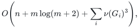
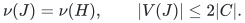
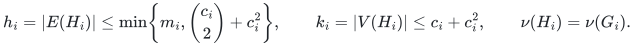
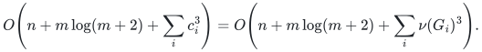

# Cubic reference matching in the component matching numbers

The [reference solver](matching.py) first builds the proved
<code class="math">c</code>-neighbor edge kernel, then reduces the number of vertices further
using a maximum matching in its bipartite crossing graph. The resulting
default time bound, including an optional optimality certificate, is

<!-- math-display: 805d3cd8d967a32a1c02dc4e
O\!\left(n+m\log(m+2)+\sum_i \nu(G_i)^3\right),
-->

where <code class="math">G_i</code> ranges over nonempty normalized input components. No
matching-number estimate is supplied as input. This is an ordinary
polynomial implementation improvement, derived from classical alternating
exchange; no new almost-linear algorithm or publication-priority claim is
made. The separate faster research composition does not use this cubic
preprocessing step.

## 1. A small set of outside endpoints preserves all cover subsets

**Lemma 1.** Let <code class="math">C</code> be any vertex cover of a simple graph <code class="math">H</code>,
put <code class="math">I=V(H)\setminus C</code>, and let <code class="math">Q</code> be a maximum matching in
the bipartite graph containing the <code class="math">C</code>–<code class="math">I</code> edges of <code class="math">H</code>.
Let <code class="math">T\subseteq I</code> be the right endpoints matched by <code class="math">Q</code>.
Every subset of <code class="math">C</code> matchable into <code class="math">I</code> is matchable into <code class="math">T</code>.
Consequently the induced graph <code class="math">J=H[C\cup T]</code> satisfies

<!-- math-display: 3023ed8f1559f9308a26aaed
\nu(J)=\nu(H),\qquad |V(J)|\leq 2|C|.
-->

**Proof.** Fix a crossing matching <code class="math">P</code> whose matched left set is a
prescribed <code class="math">S\subseteq C</code>. If <code class="math">P</code> uses a right vertex
<code class="math">x\notin T</code>, then <code class="math">x</code> is unmatched by <code class="math">Q</code>. The component
of <code class="math">P\mathbin{\triangle}Q</code> starting at <code class="math">x</code> is an alternating
path beginning with a <code class="math">P</code>-edge.

This path cannot end at a left vertex unmatched by <code class="math">Q</code>: its first
and last edges would both belong to <code class="math">P</code>, giving an augmenting path
for the maximum matching <code class="math">Q</code>. It therefore ends at a right vertex
<code class="math">y\in T</code> unmatched by <code class="math">P</code>, with a final <code class="math">Q</code>-edge. Flip
<code class="math">P</code> along the path. The matched left set remains exactly <code class="math">S</code>;
<code class="math">x</code> becomes unmatched and <code class="math">y</code> becomes matched. Every internal
right vertex is incident to a <code class="math">Q</code>-edge and already lies in <code class="math">T</code>.
Thus the number of <code class="math">P</code>-used vertices outside <code class="math">T</code> decreases by
one. Repetition gives a matching of exactly <code class="math">S</code> into <code class="math">T</code>.

Now take any matching in the general graph <code class="math">H</code>. Keep its <code class="math">C</code>–<code class="math">C</code>
edges. Its crossing edges match a subset <code class="math">S</code> of the remaining cover
vertices; replace them using the preceding argument, preserving <code class="math">S</code>.
The union is a matching of the same cardinality in <code class="math">J</code>. The reverse
inequality follows from <code class="math">J\subseteq H</code>. Finally <code class="math">&#124;T&#124;=&#124;Q&#124;\leq&#124;C&#124;</code>.
∎

The lemma holds for **any maximum** crossing matching. It preserves every
matchable left subset simultaneously, including subsets chosen after
<code class="math">T</code> is fixed. A merely maximal crossing matching is insufficient.

## 2. Apply the edge kernel before computing the crossing matching

For a normalized component <code class="math">G_i</code>, let <code class="math">C_i</code> be the endpoints of
a greedy maximal matching and put <code class="math">c_i=&#124;C_i&#124;</code>. Then
<code class="math">\nu(G_i)\leq c_i\leq2\nu(G_i)</code>. The first-stage
[<code class="math">c_i</code>-neighbor kernel](../proof.md#31-cleanup-and-an-optional-quadratic-edge-kernel)
<code class="math">H_i</code> has

<!-- math-display: caa52414a3f7e0bb81709373
h_i=|E(H_i)|\leq\min\!\left\{m_i,\binom{c_i}{2}+c_i^2\right\},
\qquad
k_i=|V(H_i)|\leq c_i+c_i^2,
\qquad \nu(H_i)=\nu(G_i).
-->

Compute a maximum crossing matching in <code class="math">H_i[C_i,V(H_i)\setminus C_i]</code>
and apply Lemma 1. The graph <code class="math">J_i</code> given to blossom search has at most
<code class="math">2c_i\leq4\nu(G_i)</code> vertices. All its edges retain original native
input indices and identifiers.

The crossing matching uses ordinary bipartite augmenting paths, processing
the cover vertices one at a time. Inductively, the current matching is
maximum for the processed left prefix. Adding one left vertex can increase
the optimum by at most one. Any new augmenting path must start at that
new vertex: an augmenting path with other endpoints could not contain the
new unmatched left vertex internally and would already exist in the old
prefix. An exhaustive alternating search therefore either increases the
optimum by one or certifies that it is unchanged. This proves the
correctness of `_compress_cover`'s crossing matching.

There are at most <code class="math">c_i</code> searches. Each scans
<code class="math">O(h_i+k_i)=O(c_i^2)</code> records, including its working arrays. Thus the
crossing matching costs <code class="math">O(c_i^3)</code> time and <code class="math">O(c_i^2)</code> space.
The subsequent blossom computation on <code class="math">J_i</code> also costs
<code class="math">O(c_i^3)</code>. Computing the crossing matching only **after** the edge
kernel avoids an extra <code class="math">c_i m_i</code> input-processing term.

## 3. Certify on the original edge kernel

The public certificate format is unchanged. It lists the first-stage
kernel <code class="math">H_i</code>, its cover, the original chosen edge records, and an
odd-component barrier in <code class="math">H_i</code>. It does not ask the verifier to trust
or execute the additional compression.

Lift the maximum matching of <code class="math">J_i</code> back to <code class="math">H_i</code>, marking discarded
outside vertices unmatched. Lemma 1 proves that this is maximum in
<code class="math">H_i</code>. Run the [simultaneous failed-forest extraction](certificate-proof.md)
there. Its sharper accounting is useful here.

**Lemma 2.** Given a maximum matching of size <code class="math">\nu</code> in a graph with
<code class="math">k</code> vertices and <code class="math">h</code> edges, that extraction takes
<code class="math">O(h+k(\nu+1))</code> time and linear storage.

**Proof.** Each matched edge can create at most one inner singleton.
When an endpoint first becomes inner, its mate becomes outer. Outer
status is permanent. If the inner endpoint is later absorbed by a
blossom, both endpoints remain outer; the same matched edge cannot
create another inner vertex. There are therefore at most <code class="math">\nu</code>
inner-vertex births.

Every nontrivial odd-cycle contraction absorbs at least one current
inner singleton, permanently making it outer. Hence there are at most
<code class="math">\nu</code> contractions. Each contraction's ancestor walks, temporary
arrays and full-array scan cost <code class="math">O(k)</code>. Ordinary adjacency scans
cost <code class="math">O(h)</code> in total, and initial arrays cost <code class="math">O(k)</code>. This gives
the claimed bound. ∎

Here <code class="math">k_i=O(c_i^2)</code>, <code class="math">h_i=O(c_i^2)</code>, and
<code class="math">\nu(H_i)\leq c_i</code>, so certificate extraction also costs
<code class="math">O(c_i^3)</code>. Its independently checked equality proves optimality on
<code class="math">H_i</code> and, by the verified edge-kernel conditions, on the original
input. A faulty compression cannot make the unchanged verifier accept
a suboptimal matching.

## 4. Complete time, storage and scope

Comparison-sort normalization costs <code class="math">O(n+m\log(m+2))</code>. Constructing
all first-stage kernels and handling components costs <code class="math">O(n+m)</code>
after normalization. Both normal and certificate modes therefore take

<!-- math-display: 1ccadc76e61a3c0d5a1cf782
O\!\left(n+m\log(m+2)+\sum_i c_i^3\right)
=O\!\left(n+m\log(m+2)+\sum_i\nu(G_i)^3\right).
-->

Working storage and certificate storage remain <code class="math">O(n+m)</code> records.
Long edge-ID labels incur their actual comparison and encoding costs.
The verifier still takes <code class="math">O(n+m\log(m+2))</code> word operations, with
no matching search. Empty inputs and isolated vertices retain their
previous handling.

The `--no-kernel` option disables both stages and runs blossom search
on the full normalized components. Its bound is
<code class="math">O(n+m\log(m+2)+\sum_i n_i^3)</code>, where <code class="math">n_i</code> counts vertices of
nonempty normalized component <code class="math">i</code>.

This compression is for the current static graph. It is not a replacement
for the separately proved simultaneous mixed-failure kernel. A right
endpoint set chosen before failures need not preserve later answers:
with a one-vertex cover of a star, deleting the one retained crossing
edge destroys its matching while another original leaf remains usable.
The fault summary must remain intact until a particular failure instance
has been fixed.

## 5. Evidence and a concrete size reduction

The [production-helper checker](../verify/check_cover_compression.py)
tests all 33,868 simple graphs through six vertices in both fixed edge
orders, followed by 500 seeded graphs on seven through thirteen vertices.
It checks 68,236 covers, 70,578 possible maximum-matching right endpoint
sets, and 2,882,175 left-subset ranks using independent subset dynamic
programming. It invokes the actual compression code and verifies the
matched-edge bound on contractions in the actual certificate search.

For a visible larger example, take a path on 20 cover vertices, list its
10 disjoint pair edges first, and attach 20 private leaves to each cover
vertex. The first kernel has all 420 vertices and 419 edges. The new
stage reduces the blossom solve to 40 vertices, returns 20 original
edges, and certifies the answer on the original 420-vertex kernel. This
case is included in the [full solver checker](../verify/check_reference.py).

The finite checks support implementation review and the displayed local
proofs. They do not certify the separate fast research hierarchy.
