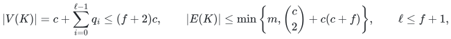
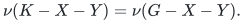
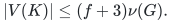
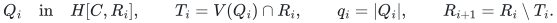
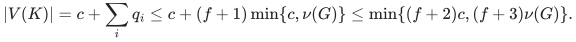
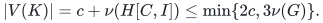
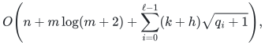
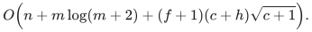

# Certified matching compression for mixed failures and arbitrary cover contexts

## 1. Statement, model, and relationship to earlier work

Let <code class="math">G=(V,E)</code> be a fixed simple loopless graph, let <code class="math">C</code> be a supplied
vertex cover, put <code class="math">I=V\setminus C</code>, and write <code class="math">c=&#124;C&#124;</code>.  A native failure
deletes one vertex or one edge, identified in the original input.  Fix an
integer <code class="math">f\geq0</code> before preprocessing.  All algorithms below are
deterministic; all retained vertices and edges are original objects.

The earlier [static compression](cover-compression-proof.md) keeps the
right endpoints of one maximum crossing matching.  Repeating that
construction on disjoint right grounds gives the following universal
extension.

**Theorem 1 (layered cover compression).** There is an explicit subgraph
<code class="math">K\subseteq G</code> with

<!-- math-display: d80784e7b1bf43c3db284316
|V(K)|=c+\sum_{i=0}^{\ell-1}q_i\leq(f+2)c,
\qquad
|E(K)|\leq\min\left\{m,\binom c2+c(c+f)\right\},
\qquad \ell\leq f+1,
-->

where <code class="math">q_i</code> is the cardinality of the maximum crossing matching in layer
<code class="math">i</code>.  Simultaneously for every <code class="math">D\subseteq I</code> and
<code class="math">F\subseteq E(C,I)</code> satisfying <code class="math">&#124;D&#124;+&#124;F&#124;\leq f</code>, and every <code class="math">S\subseteq C</code>,
the set <code class="math">S</code> is matchable into <code class="math">I\setminus D</code> in <code class="math">G-F</code> if and only if it is
matchable into <code class="math">(V(K)\cap I)\setminus D</code> in <code class="math">K-F</code>.

Consequently arbitrary additional deletions of cover vertices and
cover-internal edges do not consume the budget.  In particular, for all
<code class="math">X\subseteq V</code>, <code class="math">Y\subseteq E</code> with <code class="math">&#124;X&#124;+&#124;Y&#124;\leq f</code>,

<!-- math-display: a818a3fb88e45e5bb1b5b501
\nu(K-X-Y)=\nu(G-X-Y).
-->

When <code class="math">C</code> is the endpoint set of any maximal matching, the same construction
also satisfies

<!-- math-display: 2257840aa62be5970258d60e
|V(K)|\leq (f+3)\nu(G).
-->

No estimate of <code class="math">\nu(G)</code> is supplied.  An output certificate, checked without
any matching search, establishes the simultaneous guarantee.

**Literature and scope.** Banerjee, Gupta, Raman, and Saurabh,
[*Output Sensitive Fault Tolerant Maximum Matching*, CSR 2022,
pp. 115–132](https://doi.org/10.1007/978-3-031-09574-0_8), already give
the general-graph orders <code class="math">O(\nu^2+\nu f)</code> edges and <code class="math">O(\nu f)</code> vertices
for positive failure budgets.  Those asymptotic orders are not a new
claim here.  The present note gives a self-contained consecutive-matching
proof, its precise counts, a stronger all-cover-subset statement, explicit
context composition, and a native-ID implementation with an independent
universal certificate.  It also sharpens the repository's existing
static <code class="math">4\nu</code> accounting to <code class="math">3\nu</code> without changing that solver.

## 2. A sparse crossing graph preserving every cover subset

Form <code class="math">H\subseteq G</code> by retaining every edge inside <code class="math">C</code> and, at each
<code class="math">u\in C</code>, any <code class="math">\min\{c+f,&#124;N_G(u)\cap I&#124;\}</code> distinct outside neighbors.
Use the fixed input order for a deterministic choice.  This is the existing
[mixed-failure edge reduction](../../../manuscripts/graph-backends/matching-size-kernel-corollary.md#4-one-kernel-for-mixed-vertex-and-edge-failures).
Its proof strengthens directly to all subsets of the cover.

**Lemma 2.** For all <code class="math">D,F,S</code> in Theorem 1, <code class="math">S</code> is matchable into
<code class="math">I\setminus D</code> in <code class="math">G-F</code> if and only if it is so matchable in <code class="math">H-F</code>.

**Proof.** Take a surviving matching <code class="math">P</code> of exactly <code class="math">S</code>.  If its edge
<code class="math">uv</code> was omitted, then <code class="math">u\in S\subseteq C</code> originally retained <code class="math">c+f</code>
distinct outside neighbors.  The failures destroy at most <code class="math">f</code> of these
choices.  After removing <code class="math">uv</code> from <code class="math">P</code>, at most <code class="math">&#124;S&#124;-1\leq c-1</code> outside
vertices are occupied.  At least one of the surviving retained neighbors
is free.  Replace <code class="math">uv</code> by its edge to that neighbor.  The matched left
set stays exactly <code class="math">S</code>, and the number of omitted edges decreases.
Repeat to obtain a matching entirely in <code class="math">H-F</code>.  The reverse direction
uses <code class="math">H\subseteq G</code>.  No deleted cover vertex occurs in <code class="math">S</code>; no
cover-internal edge is used by this argument. ∎

Write <code class="math">h=&#124;E(H)&#124;</code>.  Keep all <code class="math">c</code> cover vertices, including any supplied
isolates, and discard isolated vertices outside the cover.  This gives
at most <code class="math">c+h</code> vertices and the edge bound in Theorem 1.

## 3. Consecutive right endpoint layers

Set <code class="math">R_0=I\cap V(H)</code>.  For <code class="math">i=0,1,\ldots,f</code>, while a crossing edge
remains, compute any maximum matching

<!-- math-display: 84325daf24b0ced423e3e215
Q_i\quad\hbox{in}\quad H[C,R_i],\qquad
T_i=V(Q_i)\cap R_i,\qquad q_i=|Q_i|,
\qquad R_{i+1}=R_i\setminus T_i.
-->

The notation <code class="math">H[C,R_i]</code> means only the crossing edges; it omits edges
inside <code class="math">C</code>.  Keep <code class="math">T=\bigcup_iT_i</code> and define <code class="math">K=H[C\cup T]</code>.
The sets <code class="math">T_i</code> are pairwise disjoint, and <code class="math">q_i\leq c</code>.
If fewer than <code class="math">f+1</code> nonempty layers were made, no crossing edge remains
outside <code class="math">T</code>, so the conclusion is immediate.  Otherwise there are
exactly <code class="math">f+1</code> layers.

**Lemma 3 (one untouched layer suffices).** Fix <code class="math">D,F</code> with
<code class="math">&#124;D&#124;+&#124;F&#124;\leq f</code>.  Every matching of a specified left set <code class="math">S</code> in
<code class="math">H[C,I]-D-F</code> can be replaced by a matching of exactly <code class="math">S</code> into <code class="math">T-D</code>,
using only surviving edges.

**Proof.** A deleted outside vertex belongs to at most one <code class="math">T_i</code>.
A failed edge belongs to at most one <code class="math">Q_i</code>, because those matchings have
disjoint right endpoint sets.  Mark a layer if <code class="math">D</code> meets its <code class="math">T_i</code> or
if <code class="math">F</code> meets its <code class="math">Q_i</code>.  At most <code class="math">f</code> layers are marked.  Select an
unmarked layer <code class="math">i</code>.

Start with a surviving matching <code class="math">P</code> of exactly <code class="math">S</code>.  Freeze every edge
of <code class="math">P</code> whose right endpoint lies in <code class="math">T_0\cup\cdots\cup T_{i-1}</code>.
Remove those frozen edges temporarily, and denote the remaining matching
by <code class="math">P'</code>.  Its right endpoints all lie in <code class="math">R_i</code>; its left endpoints form
a subset <code class="math">S'\subseteq S</code>.  Keep <code class="math">Q_i</code> on its full original left ground
<code class="math">C</code> when using its maximum-cardinality property.

If <code class="math">P'</code> uses <code class="math">x\in R_i\setminus T_i</code>, then <code class="math">x</code> is unmatched by <code class="math">Q_i</code>.
The component of <code class="math">P'\mathbin{\triangle}Q_i</code> starting at <code class="math">x</code> is an
alternating path beginning with a <code class="math">P'</code> edge.  It cannot end at a left
vertex unmatched by <code class="math">Q_i</code>: that would augment <code class="math">Q_i</code>.  It therefore
ends at a right vertex of <code class="math">T_i</code> unmatched by <code class="math">P'</code>, with a final
<code class="math">Q_i</code> edge.  Every left vertex of this path is incident to a <code class="math">P'</code> edge,
so it belongs to <code class="math">S'</code>.  Every internal right vertex is incident to a
<code class="math">Q_i</code> edge, so it belongs to <code class="math">T_i</code>.

All edges of <code class="math">P'</code> survive.  Every <code class="math">Q_i</code> edge and every right vertex of
<code class="math">T_i</code> survives because layer <code class="math">i</code> is unmarked.  The path thus avoids all
failures, as well as the frozen left vertices.  Flip <code class="math">P'</code> along it.
The left set remains exactly <code class="math">S'</code> and one fewer right endpoint lies
outside <code class="math">T_i</code>.  Repetition gives a matching of <code class="math">S'</code> into <code class="math">T_i</code>.
Reinserting the frozen edges yields the required matching of <code class="math">S</code> into
<code class="math">T-D</code>.  This also explains why deleting cover vertices does not mark
every layer: the replacement paths visit only surviving left vertices
already used by <code class="math">P'</code>. ∎

Apply Lemma 2 and then Lemma 3.  They prove Theorem 1's all-subset
statement.  For a matching in a general graph after failures, freeze
its cover-internal edges.  Its crossing edges match a subset of the
remaining cover; replace that subset using the two lemmas.  This keeps
the cardinality and avoids the frozen endpoints.  The opposite
inequality follows from <code class="math">K\subseteq G</code>.

## 4. Exact vertex counts, context composition, and sharpness

The construction keeps exactly <code class="math">c+\sum_iq_i</code> vertices, with
<code class="math">q_i\leq\min\{c,\nu(G)\}</code>.  If <code class="math">C</code> is the endpoint set of a maximal
matching <code class="math">M_0</code>, then <code class="math">c=2&#124;M_0&#124;\leq2\nu(G)</code>, giving

<!-- math-display: e64be1c22e496f4302ab6678
|V(K)|=c+\sum_iq_i
\leq c+(f+1)\min\{c,\nu(G)\}
\leq\min\{(f+2)c,(f+3)\nu(G)\}.
-->

At <code class="math">f=0</code> this is the repository's original outside-endpoint reduction.
Its sharper bound is

<!-- math-display: a258a7c94eede828432c6ece
|V(K)|=c+\nu(H[C,I])\leq\min\{2c,3\nu(G)\}.
-->

The earlier <code class="math">4\nu</code> bound followed by separately replacing <code class="math">c</code> by
<code class="math">2\nu</code> in both copies of <code class="math">2c</code>.  Counting the actual crossing matching
gives the stronger bound for the unchanged implementation.

**Corollary 4 (arbitrary interface context).** Let <code class="math">A</code> be any graph on
<code class="math">C\cup W</code>, where <code class="math">W\cap I=\varnothing</code>.  It may be chosen after <code class="math">K</code>
is built and may replace the entire graph inside <code class="math">C</code>.  Under any
permitted outside-vertex/crossing-edge failures in the original module,
replace <code class="math">H[C,I]</code> by <code class="math">K[C,T]</code> while keeping <code class="math">A</code> unchanged.  The maximum
matching cardinality of the union stays the same.  This remains true
after arbitrary deletions within the context.

**Proof.** Freeze the edges of a matching that lie in <code class="math">A</code>.  Its remaining
edges match a subset of the still-free cover vertices into <code class="math">I</code>.
Theorem 1 replaces exactly that subset.  The reverse direction follows
from inclusion. ∎

**Sharpness for an arbitrary specified cover.** Take <code class="math">c</code> disjoint stars,
each having <code class="math">f+1</code> leaves, and let <code class="math">C</code> be their centers.  Every subgraph
preserving all queries must retain every leaf: if a star omits a leaf,
delete all its retained leaf edges, using at most <code class="math">f</code> failures.  That
star has no surviving retained edge while the original still has the
omitted edge.  No other star can compensate for the missing unit.
Thus <code class="math">(f+2)c</code> vertices can be necessary, even for matching cardinality
alone.  At <code class="math">f=0</code> the example consists of disjoint single edges.

**Sharpness of the stated greedy construction.** Take <code class="math">\nu</code> disjoint
stars with <code class="math">f+2</code> leaves each.  A greedy initial matching contributes
the center and one leaf of every star to <code class="math">C</code>.  Every subsequent
crossing layer takes one remaining leaf per star.  The construction
retains exactly <code class="math">(f+3)\nu</code> vertices.  This is a limitation of this
specific construction, not an unrestricted lower bound of that value.

## 5. Deterministic implementation and universal certificates

The [constructor](failure_kernel.py) accepts the same vertex and edge-ID
encoding as the ordinary matching solver, but rejects loops and parallel
records.  An ordinary normalization that drops duplicate records is not
valid before a native edge-failure query.  A supplied cover is optional;
otherwise fixed-order greedy matching constructs it.

The initial neighbor reduction scans the input.  Each crossing layer
uses the [nonrecursive bipartite phase solver](bipartite-proof.md),
and an alternating-reachability pass returns an equally large vertex
cover of that residual crossing graph.  The output includes the initial
edge-kernel indices, each layer's matching indices and vertex cover,
and the final induced subgraph with native IDs.

**Certificate proposition.** The separate
[verifier](verify_failure_kernel.py) checks the original cover, exact
<code class="math">c+f</code> neighbor counts, every layer's residual matching and same-size
vertex cover, disjoint right grounds, sufficient layer count or edge
exhaustion, and the final induced subgraph.  Acceptance proves Theorem 1
for every permitted failure query at once.

**Proof.** Neighbor counts certify Lemma 2.  In any graph, a matching
uses at most one vertex of a vertex cover per edge, hence its size is
at most that cover's cardinality.  An equally large matching and cover
therefore certify maximum cardinality without a search.  All accepted
layers satisfy exactly the hypotheses of Lemma 3.  The remaining checks
certify the subgraph to which that lemma applies.  Statistics are not
trusted. ∎

Let <code class="math">k\leq c+h</code> be the first kernel's vertex count and let <code class="math">\ell</code> be
the number of nonempty layers.  The implemented word-operation cost is

<!-- math-display: 5ef8650f8e0a9b3bb72c9633
O\!\left(n+m\log(m+2)+
       \sum_{i=0}^{\ell-1}(k+h)\sqrt{q_i+1}\right),
-->

with at most one additional linear failed scan, if needed.  In particular
it is bounded by

<!-- math-display: 450d894555d1a2dab6b089ea
O\!\left(n+m\log(m+2)+(f+1)(c+h)\sqrt{c+1}\right).
-->

The verifier takes <code class="math">O(n+m\log(m+2)+(\ell+1)(c+h))</code> word operations
and performs zero matching searches.  The input, working storage, and
certificate use <code class="math">O(n+m)</code> records.  In particular,
<code class="math">\sum_iq_i=&#124;T&#124;\leq k</code>; recording every layer matching and its
same-size cover does not multiply storage by <code class="math">f</code>.
Arbitrarily long IDs and the binary budget incur their actual input,
comparison, and output costs.  The loop count is clipped to the number
of available outside vertices, and it stops when no crossing edge
remains; no array of length equal to an enormous encoded <code class="math">f</code> is allocated.

## 6. Verification scope

The [independent finite checker](../verify/check_failure_kernel.py)
compares original and retained graphs with subset dynamic programming,
including all left-subset ranks after mixed failures on its exhaustive
domain.  It checks arbitrary cover choices, uncharged cover deletions,
both sharp star families, native IDs, large budgets, and rejected
input/certificate mutations.  These finite checks support the algorithm
and verifier; Lemmas 2–3 establish the all-size universal statement.

This kernel supplies a retained graph and a universally checkable
preservation certificate.  Answering a particular query still requires
solving the surviving retained graph; no constant-time query bound is
claimed.  Arbitrarily correlated edge labels are outside the native
failure model.
