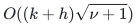
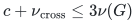

# Sources and proof dependencies

## Canonical manuscripts

- [Deterministic Exact General Matching through Persistent Integral Carriers and Normalized Routing](proof.md)

## Dependency status

**Deterministic research theorem.**
[Theorem 1.1](proof.md#1-result-contributions-and-proof-scope) gives the
four-fifths bound using the named source results below. Its
[realization theorem](proof.md#116-deterministic-cycle-search-realization)
supplies all five additional algorithmic interfaces: literal raw-cycle
quality, chronological repair, complete occurrence retirement, finite-bit
weighted trees, and parameter-uniform construction. The theorem links each
interface to its constructive proof and pays its work before balancing the
parameters. There is no additional unresolved cycle-search premise.
End-to-end implementation of that fast hierarchy remains separate work.

**Unconditional executable solver.** The
[reference implementation](reference/README.md) uses only Python's standard
library. Its general blossom search implements the classical method
of [Edmonds, *Paths, Trees, and Flowers* (1965), Section 4](https://doi.org/10.4153/CJM-1965-045-4).
Its crossing compression and final bipartite solve implement John E.
Hopcroft and Richard M. Karp's [*An `n^(5/2)` Algorithm for Maximum Matchings
in Bipartite Graphs* (1973)](https://doi.org/10.1137/0202019). The
[local bipartite proof](reference/bipartite-proof.md) establishes the exact
phase invariants, the

<!-- math-display: 8106455c3e5652644520b9d8
O((k+h)\sqrt{\nu+1})
-->

 matching-number refinement, and
the linear vertex-cover certificate; those facts are proved here rather
than assumed from a changed parameter in the original vertex-count bound.
The earlier checkpoint's
[outside-endpoint compression proof](reference/cover-compression-proof.md)
preserves every matchable cover subset and gives a cubic solve term in
each component's matching number; the bipartite refinement improves that
term to exponent `5/2`, including certificates. It derives the needed
exchange argument locally. The exchange argument and
<!-- math-display: 78fa8ed98cba2c8c1465ddca
4\nu
-->

 vertex bound already appear in
<em>A linear-vertex refinement of the matching-size kernel</em>, Sections
1–3, in the direct checkpoint of 24 October; the source history below
distinguishes that proof from the current implementation.
The actual retained count is

<!-- math-display: 9995d9eeb1f88293f7ed4275
c+\nu_{\mathrm{cross}}\leq3\nu(G)
-->

;
this later refinement strengthens the original

<!-- math-display: 78fa8ed98cba2c8c1465ddca
4\nu
-->

 accounting.
The [layered failure extension](reference/fault-tolerant-cover-compression.md)
repeats maximum crossing matchings on disjoint right grounds, proves
universal cover-subset and context preservation, and supplies an independent
matching/cover certificate for every layer.  Its positive-budget asymptotic
size is already present in Banerjee, Gupta, Raman and Saurabh,
[*Output Sensitive Fault Tolerant Maximum Matching*, CSR 2022](https://doi.org/10.1007/978-3-031-09574-0_8);
the local proof does not assume an unspecified expansion routine from that
paper, and makes no new priority claim for those asymptotic orders.
A nonbipartite kernel's optional certificate
uses one failed alternating forest when the empty barrier is insufficient.
The
[complete extraction proof](reference/certificate-proof.md)
establishes its tight odd-component bound and exposable set locally;
[Gallai (1964), Theorem (E.1)](https://real.mtak.hu/189486/1/cut_MATKUTINT_1964_3_pp401_-_413.pdf)
is historical provenance, not an assumed extraction theorem. The certificate's
sufficiency also has an elementary proof, and its verifier imports no
matching implementation. There is no external runtime package or
unimplemented cycle-search dependency in this reference solver.

**Unconditional local reductions.** Lemmas 3.1–3.2 prove the exact
matching-size kernel, its componentwise form and the subcubic gadget.
The companion's [mixed-failure theorem](../../manuscripts/graph-backends/matching-size-kernel-corollary.md#4-one-kernel-for-mixed-vertex-and-edge-failures)
extends exact preservation to every mixture of at most <code class="math">f</code> native
vertex/edge failures in a fixed simple graph. These reductions need no
external matching algorithm, random sampling or raw-cycle interface.
The [finite reduction checker](verify/check_reductions.py)
tests their small instances independently of the proposed backend.

**Local constructions beyond the published cycle hierarchy.** The
[raw-lift proof](../../manuscripts/graph-backends/distance-oracle-raw-lift.md)
establishes the physical traversal-length upper bound and exact frozen
gradient correction. The
[lifetime construction](../../manuscripts/graph-backends/numerical-backend-lifetime-and-loops.md)
specifies signed and absolute retirement, dormant copies and atomic query
consumption. The static-base, degree-reset and finite-bit proofs supply
the other interfaces in Theorem 11.6. These results are needed in addition
to the published distance-oracle theorem; they are present as local
construction proofs, rather than left as unspecified implementations.

**Imported matching framework.** Section 2.2 imports the OpenAI
matching-state identities, bounded objectives and localized exchange/lock
interfaces. The current proof changes the integral carrier, optimum-gap
driver, numerical parameters and recovery. It does not re-prove every
inherited state invariant.

**Imported data structures and geometry.** The named source map below
identifies each dynamic-tree, local-discovery, forest, decomposition and
routing operation. The papers retain their original hypotheses and
parameter ranges. The
[petal-tree adapter](../../manuscripts/graph-backends/an-weighted-finite-bit-adapter.md)
and [stable-forest integration](../../manuscripts/graph-backends/polynomial-bit-stretch-stable-forest-integration.md)
provide the finite-bit realization; the
[sequential router](../../manuscripts/graph-backends/sequential-expander-routing-tradeoff.md)
provides sequential work and exact path construction. Thus neither
finite arithmetic nor sequential work is inferred from a source theorem
that states only real-arithmetic geometry or distributed rounds.

**Acceptance inside the faster theoretical composition.** The single augmenting-path search in
[the verifier interface](../../manuscripts/graph-backends/deterministic-maximum-matching-verifier.md)
is based on Kurt Mehlhorn and Romina Nobahari,
[*Gabow's `O(sqrt(n)m)` Maximum Cardinality Matching Algorithm,
Revisited*](https://arxiv.org/html/2603.22909v2), Sections 2.3 and 4.
It certifies the optimality of an accepted output. Theorem 11.6 and the
parameter calculation separately prove the backend and its time bound.
The classical fallback gives
termination independently of the favorable fast branch. This theoretical
near-linear acceptance interface is distinct from the executable reference
solver and its separately constructed certificate; the reference's cubic
computation is not silently charged as near-linear work.

## Linked mathematical dependencies

These manuscripts contain the interfaces, constructive proofs and source
comparisons referenced by this result. Theorem 11.6 explicitly supplies
the inputs of each generic composition lemma.

- [A classical independent optimality verifier for general matching](../../manuscripts/graph-backends/classical-matching-optimality-verifier.md)
- [A deterministic near-linear final maximum-matching verifier](../../manuscripts/graph-backends/deterministic-maximum-matching-verifier.md)
- [An exact matching-size kernel and the current time corollary](../../manuscripts/graph-backends/matching-size-kernel-corollary.md)
- [Executable exact matching and its independent certificate](reference/README.md)
- [Outside-endpoint compression and the matching-size cubic bound](reference/cover-compression-proof.md)
- [Bipartite matching in the matching number, with linear certificates](reference/bipartite-proof.md)
- [A `4/5` research composition from sequential expander routing](../../manuscripts/graph-backends/quantitative-matching-4-5-composition.md)
- [Cycle-search realization and dependency closure](proof.md#116-deterministic-cycle-search-realization)
- [Uniform source interfaces and their actual parameter ranges](../../manuscripts/graph-backends/uniform-source-interfaces-for-4-5.md)
- [Exact general-graph matching](README.md)

## Named source map for the fast theorem

These are mathematical imports of the research composition. None is a
runtime package required by the executable reference solver.

| Primary paper and pinned location | Operation used | Boundary retained here |
|---|---|---|
| OpenAI, [*Almost-Linear-Time Maximum-Cardinality Matching in General Graphs*](https://github.com/openai/math/tree/main/preprints/Almost-Linear-Time-Maximum-Cardinality-Matching-in-Sparse-General-Graphs-September-24-2026), manuscript dated 24 September 2026, Sections 3–5 | Matching-state identities, objectives, exchange networks and lock/locality invariants | The source's randomized theorem is not a deterministic fast solver. [The import audit](../../manuscripts/graph-backends/oai-baseline-and-imports.md) separates inherited lemmas from locally reconstructed ones. |
| Stephen Alstrup, Jacob Holm, Kristian de Lichtenberg and Mikkel Thorup, [*Maintaining Information in Fully-Dynamic Trees with Top Trees*](https://arxiv.org/html/cs/0310065v2), Theorem 1, Section 2.5, Theorem 15 and Section 6 | Link, cut, expose, path aggregates/additions and rooted ancestor queries | Use the deterministic worst-case implementation when that guarantee is claimed; the paper also discusses an amortized implementation. |
| Shiri Chechik, Thomas Dueholm Hansen, Giuseppe F. Italiano, Veronika Loitzenbauer and Nikos Parotsidis, [*Faster Algorithms for Computing Maximal 2-Connected Subgraphs in Sparse Directed Graphs*](https://arxiv.org/abs/1705.10709v1), Section 3.1, Lemma 3.5 | Directed one-edge-out discovery within a supplied exploration budget | Keep the bounded-volume output or absence conclusion; it is not an unrestricted reachability oracle. |
| Rasmus Kyng, Simon Meierhans and Maximilian Probst Gutenberg, [*A Dynamic Shortest Paths Toolbox: Low-Congestion Vertex Sparsifiers and their Applications*](https://arxiv.org/abs/2311.06402v1), Theorems 3.2/3.8, Lemma 3.5 and Appendix A.1 | Deterministic centers, stable forests and elementary tree partitioning | Theorem 11.6 supplies the improved local repair, raw lifting and lifetimes. The complete Theorem 3.1 is not evaluated at the new growing repair depth. |
| Li Chen and coauthors, [*Maximum Flow and Minimum-Cost Flow in Almost-Linear Time*](https://arxiv.org/abs/2203.00671v1), Lemmas 6.5–6.6 and Appendix B.3 | The deterministic single-forest construction and fixed pointwise stretch labels | Only these deterministic components are imported; the paper's randomized global theorem does not provide the required deterministic cycle engine. |
| Ittai Abraham and Ofer Neiman, [*Using Petal-Decompositions to Build a Low Stretch Spanning Tree*](https://doi.org/10.1137/17M1115575), weighted petal construction, Sections 6–7 | Original-edge weighted-tree geometry | The local petal adapter proves a finite-bit realization with polynomial aspect-bit overhead. The stable-forest integration bounds exported labels before using that work bound. |
| Julia Chuzhoy, Yu Gao, Jason Li, Danupon Nanongkai, Richard Peng and Thatchaphol Saranurak, [*A Deterministic Algorithm for Balanced Cut with Applications to Dynamic Connectivity, Flows, and Beyond*](https://arxiv.org/abs/1910.08025v2), Theorems 2.6 and 5.1 | Deterministic balanced-cut and decomposition primitives | Each actual recursive graph must lie in the theorem's parameter range; the local degree-band composition is additional. |
| Julia Chuzhoy and Thatchaphol Saranurak, [*Deterministic Algorithms for Decremental Shortest Paths via Layered Core Decomposition*](https://arxiv.org/abs/2009.08479v1), Theorem 3.7 | Deterministic expander pruning | Keep its deletion budget, conductance and work guarantees when invoking the local wrapper. |
| Yi-Jun Chang and Thatchaphol Saranurak, [*Deterministic Distributed Expander Decomposition and Routing with Applications in Distributed Derandomization*](https://arxiv.org/abs/2007.14898v1), Sections 4.1–4.3 | Combinatorial hierarchy and routing geometry | Sequential work, finite guards and source coverage are established separately in Section 9; they are not inferred from a distributed round bound. |
| Yi-Jun Chang, Shang-En Huang and Hsin-Hao Su, [*Deterministic Expander Routing: Faster and More Versatile*](https://arxiv.org/abs/2405.03908v1), Definition 3.7, Definitions 4.2–4.3 and Appendix A | Hierarchy and shuffler architecture | [The hierarchy/load audit](../../manuscripts/graph-backends/chs-hierarchy-and-load-boundaries.md) identifies why the headline theorem alone is insufficient. The virtual hierarchy and direct full-router induction supply the stronger coverage and full-load query interfaces used here. |
| Li Chen, Rasmus Kyng, Yang P. Liu, Simon Meierhans and Maximilian Probst Gutenberg, [*Almost-Linear Time Algorithms for Incremental Graphs: Cycle Detection, SCCs, `s–t` Shortest Path, and Minimum-Cost Flow*](https://arxiv.org/abs/2311.18295v1), Section 7.2 | Touched-set scheduling template | The static-base proof supplies chronological credit and selected recourse; the lifetime proof supplies positive frozen-flow transfer and complete signed/absolute retirement. |
| Rasmus Kyng, Simon Meierhans, Maximilian Probst Gutenberg and Aurelio Sulser, [*A Simpler and Faster Min-Cost Flow Solver via Min-Ratio Cycles from Distance Oracles*](https://arxiv.org/html/2609.23852v1), Theorems 4.4–4.5, Definition 5.1 and Lemma 5.4 | Published deterministic distance-to-cycle geometry | Its printed `20/21` scale is not substituted for the present `4/5` proof. The raw-lift argument establishes the needed physical-length upper bound, and Theorem 11.6 supplies the new parameters and lifetime operations. |
| Harold N. Gabow, [*The Weighted Matching Approach to Maximum Cardinality Matching*](https://arxiv.org/abs/1703.03998v1), Sections 3 and 5; Mehlhorn–Nobahari's account above | An augmenting-path search from a supplied matching, including exhausted search | This supports theoretical acceptance of a candidate. The executable solver uses its own ordinary polynomial blossom algorithm and explicit certificate. |

## Checkpoint provenance

The mathematical constructions predate the current executable reference
package. The [matching provenance](../../provenance/matching.md) and
[source manifests](../../provenance/README.md) preserve their import
history. Original filenames below identify checkpoint sources; current
proof links give their maintained mathematical content.

| Earlier checkpoint | Original proof and contribution | Maintained location |
|---|---|---|
| Direct checkpoint, 24 October 2026; identical in fixed-`epsilon` and uniform checkpoints | <code>linear_vertex_kernel_refinement.md</code>, Sections 1–3: a maximum crossing matching's right endpoints preserve every matchable cover subset; at most twice the cover size and at most four times the matching number in vertices | [Compression proof](reference/cover-compression-proof.md), Sections 1–2 |
| Constructive checkpoint, 24 October 2026 | <code>distance_oracle_raw_lift.md</code> and <code>numerical_backend_lifetime_and_loops.md</code>: raw traversal domination, frozen gauges, dormant records and signed/absolute retirement | [Raw lift](../../manuscripts/graph-backends/distance-oracle-raw-lift.md); [lifetime construction](../../manuscripts/graph-backends/numerical-backend-lifetime-and-loops.md) |
| Six-sevenths and five-sixths checkpoints, 24 October 2026 | Static-base prefix accounting, local route notifications, normalized projected routes and exact cycle corrections | [Static-base repair](../../manuscripts/graph-backends/amortized-static-base-distance-sparsifier.md); [normalized routes](../../manuscripts/graph-backends/normalized-projected-route-composition.md); [cycle comparison](../../manuscripts/graph-backends/normalized-route-cycle-comparison.md) |
| Four-fifths and revised four-fifths checkpoints, 24 October 2026 | Sequential hierarchy/router/static provider; revised coverage, actual-size and finite-bit interfaces; complete recursive quality and parameter calculation | [Sequential router](../../manuscripts/graph-backends/sequential-expander-routing-tradeoff.md); [uniform interfaces](../../manuscripts/graph-backends/uniform-source-interfaces-for-4-5.md); [composition](../../manuscripts/graph-backends/quantitative-matching-4-5-composition.md) |
| Current repository implementation pass | Standard-library solver, native-ID decoding, independent certificate verification, simultaneous certificate extraction, compression implementation and checks, nonrecursive Hopcroft–Karp branch and its matching-number bound | [Executable package](reference/README.md); [bipartite proof](reference/bipartite-proof.md); [verification scope](verify/README.md) |

The single-file editorial manuscript of 25 October compressed the cycle
construction into a realization hypothesis. The detailed 24 October
checkpoint proofs supply those interfaces. The current Theorem 11.6 makes
that dependency closure explicit; it does not attribute a newly discovered
four-fifths algorithm or the earlier

<!-- math-display: 78fa8ed98cba2c8c1465ddca
4\nu
-->

 structural
lemma to the implementation pass.

## Evidence and provenance

The [verification note](verify/README.md) states the scope of executable
evidence and the remaining mathematical dependencies. The
[import record](../../provenance/README.md) preserves source revisions,
canonical paths, attribution and applicable licenses.

**Attribution:** Yilin Liu · GPT-6 Astra Pro.
