# Exact graph certificates under color failures

One fixed edge set preserves every surviving ordered prefix and its canonical minimum spanning forest.

[Proof](proof.md) · [Sources](sources.md) · [Reference implementation](reference/README.md)

**Guarantee**

For vertex colors, retain at most

<!-- math-display: d4147752f7020b5bc0e31bf6
\sum_C\left[n_Ck_C-\binom{k_C+1}{2}\right]
-->
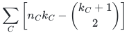
 edges, where <code class="math">k_C=\min\{h+1,q_C\}</code>, and preserve exact connectivity and canonical MSF after every allowed color failure.

**Objective and output**

An original-edge certificate for the fixed signed weight/ID order. Mixed colors and overlapping lists use the separate formulas below.

**Randomness**

Deterministic preprocessing and exact queries. The near-linear single-color construction uses a deterministic dynamic-MSF backend with exchange reporting.

**Time**

Uniform deterministic polynomial preprocessing. After sorting, the direct activation matrix uses the following number of field operations:

<!-- math-display: 8621c1d65519d977c3e4cd4f
O(mR^2)
-->
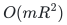

Here <code class="math">R=\sum_Cn_Ck_C</code>. For <code class="math">h=1</code>, a separate dynamic-MSF construction has the near-linear work bound below and requires exchange reporting.

**Space**

Displayed bounds count retained original edges. Direct elimination uses

<!-- math-display: c94f6827f2afa806b704f95a
O(R^2)
-->
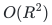
 field elements of workspace. Query output includes scanning the surviving certificate and Kruskal work.

**Parameters**

<code class="math">n_C,q_C</code> count original component vertices/colors; <code class="math">h</code> is failed-color budget; <code class="math">d_v,d_e</code> bound vertex/extra-edge list lengths; <code class="math">t</code> is actual vertex-feature rank when computed.

**Model and representation**

Undirected graphs with optional parallel edges, signed rational weights, and permanent edge IDs. Failures delete full color classes. The weight order stays fixed.

**Lower-bound scope**

The vertex-only envelope is sharp via the classical individual-vertex example. List and mixed models have matching leading coefficients in the stated simple-graph or multigraph regimes.

**Review status**

**Ready for review.** Complete canonical graph family: sharp componentwise singleton vertex-color activation theorem; overlapping vertex lists with actual symmetric-matrix rank saving; mixed vertex/extra-edge lists and singleton mixed symmetric-cubic dependencies; all surviving fixed-order prefix connectivity partitions and exact canonical minimum spanning forests with signed rational weights/permanent IDs; ordinary sharp and all stated leading-order simple/multigraph lower examples; completed-batch one-failure replacement lists, exact indexed values, and the published dynamic-MSF composition. Native references compute actual evaluation spans without formal monomial enumeration and exercise genuine original-ID exchange reporting with separately charged exact reference updates.

**Dependencies and scope.** One original undirected multigraph, one shared color-failure palette, overlapping vertex/edge lists, signed rational edge weights and one fixed permanent-ID tie-broken order are retained. Prefix and canonical-forest guarantees hold after all allowed failures; arbitrary recosting, metric distances or a second unrelated order are not included. The mixed/list backend computes polynomial-size actual evaluation-module rowspaces on component vertices or endpoint/edge positions. Both-direction row maps preserve the full formal activation-matrix dependencies. Vertex-mode ranks are componentwise actual vertex-feature ranks; mixed feature-rank metadata is not the vertex Vandermonde rank used by the separate cubic formula. No uncomputed global actual rank is asserted. Native arithmetic is rational or over a caller-supplied sufficiently large prime field. Primality validation and field-extension software are not supplied. The rational construction alone realizes deterministic polynomial preprocessing; all coordinate, elimination, sorting and original rational-bit costs are charged. Retained-edge support is distinct from arithmetic workspace and full forest-report cost. HDT JACM2001 Theorem 8 and Section5.1, together with its original page724 problem definition, realize the exchange-reporting dynamic-MSF interface. The global forest changes name their entering/leaving original edges; parallel-pair priority queues use constant-many simple-graph updates. The shipped ReferenceMSF instead scans original records and recomputes exact Kruskal per update, with its own polynomial scan/hash/set ledger. No polylogarithmic dynamic implementation is claimed. The one-failure wrapper collects only completed deletion batches, sorts replacement lists and the retained union, and charges those sorts. Compact indexed difference/value lookup is separate from raw original-color binary search and materializing a full forest. Replacement support is bounded by destroyed baseline incidence, with no intermediate-forest accumulation. Support lower bounds concern original retained subgraphs in their stated simple-graph or multigraph asymptotic regimes; they do not lower-bound arbitrary encodings or prove optimality of all mixed instances. The color-list model is publicly credited. Quantitative comparisons to uninspected journal refinements, exhaustive historical priority, external peer review and proof-assistant verification are outside this readiness scope.

The [verification note](verify/README.md) identifies executable coverage. This status does not claim external peer review or proof-assistant verification.

**Source**

[Complete proof](proof.md) and [canonical manuscript map](sources.md).

## Results

**One color per vertex**

<!-- math-display: d4147752f7020b5bc0e31bf6
\sum_C\left[n_Ck_C-\binom{k_C+1}{2}\right]
-->

Here <code class="math">k_C=\min\{h+1,q_C\}</code>.

**Vertex lists of size <code class="math">d_v</code>, computed feature rank <code class="math">t</code>**

<!-- math-display: a522ff5528b0a0b9a2fd5dd6
nt-\binom{t+1}{2}
-->
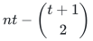

The computed rank satisfies

<!-- math-display: 5a11217d7e8bb7c53df4f827
t\le\min\left\{n,\binom{h+d_v}{d_v}\right\}
-->
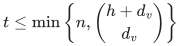
.

**Vertex and extra-edge lists, degrees <code class="math">d_v,d_e</code>**

<!-- math-display: 9427102b495e5d8ba5b0b578
\min\left\{m,n\binom{h+d_v+d_e}{d_v+d_e}\right\}
-->
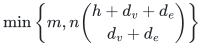

**One color per vertex and per edge; at least <code class="math">h+1</code> vertex colors in a component**

Componentwise:

<!-- math-display: b0b23d704f0ea883103beec0
n\binom{h+2}{2}-\binom{h+3}{3}
-->
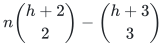

**General mixed-color rank refinement**

<!-- math-display: 29681171be94d6428a1df96f
n\binom{h+2}{2}-\binom{h+3}{3}+\binom{h-t+3}{3}
-->
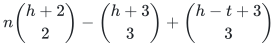

**One failed color, near-linear construction**

<!-- math-display: 844b7664ee4f2ab142eb93ef
O\!\left((m+A)[\log^4(n+2)+\log(m+2)]+ar\right)
-->
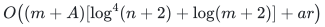

Input organization is additional. Here <code class="math">a=2d_v+d_e</code>, <code class="math">A\le am</code>, and <code class="math">r</code> is the MSF size.

**One failed color, total difference lists**

<!-- math-display: a6393cceb749af0256fda39e
\sum_c\lvert R_c\rvert\le ar
-->
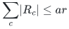

Indexed cost lookup takes

<!-- math-display: 4a137b861e8d266f3c1bfeb6
O(1)
-->
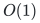
 time.

The direct monomial-construction gate claims only its stated parameter
envelope. The [native evaluation-span construction](reference/README.md)
computes componentwise actual vertex-feature ranks without enumerating that
formal monomial universe, so its vertex-list bounds use the computed ranks. Both retained
support bounds remain separate from arithmetic workspace.

**Attribution:** icekylinx and GPT-6 Astra Pro.
