# Exact minimum-spanning-forest certificates under correlated color failures

**Abstract.** We give a deterministic polynomial-time construction of exact minimum-spanning-forest certificates for correlated vertex and edge failures. The certificate preserves every prefix of one fixed weight order. Vertex colors admit the sharp componentwise bound below; mixed colors and overlapping lists admit incidence-sensitive extensions.

The main theorem gives a deterministic polynomial-time construction of an exact weighted certificate for arbitrary vertex color classes, with the sharp bound

<!-- math-display: bf16bedeaea57bdbff35c8f6
|E(H)|\le \sum_{C}\left(n_C k_C-\binom{k_C+1}{2}\right),
  \qquad k_C=\min\{h+1,q_C\}.
\tag{G1}
-->
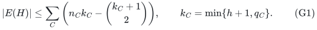

Here a query deletes at most <code class="math">h</code> colors, a color can occur on arbitrarily many vertices, and <code class="math">C</code> ranges over the original connected components, with <code class="math">n_C</code> vertices and <code class="math">q_C</code> colors. The certificate contains the canonical minimum spanning forest after **every** allowed query. All edge weights may be signed, and ties are resolved by fixed original edge IDs.

The ordinary individual-vertex-failure specialization, including its sharp constant and extremal example, is already due to Sorkin--Steger--Zenklusen. The extension here treats the extension to arbitrary correlated color classes with a polynomial construction. The algebraic matrix is a specialization of Kalai's hyperconnectivity matrix; we claim no invention of that matrix. Sections 6--8 give mixed-color and overlapping-list extensions.

## 1. Model and precise output

The input is an undirected graph, optionally with parallel edges. Each vertex has one color. Each original edge has a fixed signed rational weight and a distinct permanent ID. The graph need not be connected. Loops may be deleted because they never belong to a forest.

A failure set <code class="math">F</code> removes every vertex whose color belongs to <code class="math">F</code>, together with all incident edges. We require <code class="math">&#124;F&#124;\le h</code>. All retained edges keep their original endpoints, weights, and IDs.

The returned subgraph <code class="math">H</code> has the following stronger property: for every failure set and every prefix of the total edge order `(weight, ID)`, the surviving prefix of <code class="math">H</code> has the same connected-component partition as the surviving prefix of the original graph. Consequently the canonical Kruskal forest is literally the same on both graphs.

This is an exact forest and connectivity guarantee. It is not a metric-spanner stretch guarantee, and the retained-edge bound is not an auxiliary-workspace bound.

## 2. A general linear-activation lemma

Let every vertex <code class="math">v</code> have a vector <code class="math">z_v\in\mathbb F^t</code>, with the vectors spanning <code class="math">\mathbb F^t</code>. Suppose every allowed query <code class="math">Q</code> has a common linear functional <code class="math">\ell_Q</code> such that

<!-- math-display: d7f41701e56e4f412a13c213
a_v(Q):=\ell_Q(z_v)\ne0
  \quad\Longleftrightarrow\quad
  v\text{ survives }Q.
\tag{G2}
-->
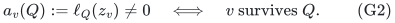

Orient each edge arbitrarily. Define its lifted column by

<!-- math-display: f264d5fd58a66c2b4d5afd4d
b_{uv}[u]=z_v,\qquad b_{uv}[v]=-z_u,
 \qquad b_{uv}[w]=0\ (w\notin\{u,v\}).
\tag{G3}
-->
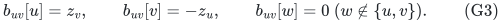

Take the greedy column basis of this matrix in the fixed edge order. Let <code class="math">H</code> be its original edge set.

For a fixed query, define a linear row map blockwise by

<!-- math-display: 391834d77f5aff5b11499cfb
x\text{ in block }u\ \longmapsto\
        a_u(Q)\ell_Q(x)e_u.
\tag{G4}
-->
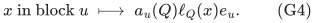

It sends <code class="math">b_{uv}</code> to

<!-- math-display: b7bb2e8e30a24a67b77aaeec
a_u(Q)a_v(Q)(e_u-e_v).
\tag{G5}
-->
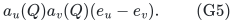

For a failed edge endpoint this is zero; otherwise it is a nonzero scalar multiple of the ordinary incidence column. Since a greedy basis spans every ordered prefix of its full input matrix, applying (G4) shows that the two surviving incidence-prefix spaces agree. Graphic rank and connectivity therefore agree at every ordered prefix. In particular every edge accepted by canonical Kruskal occurs in <code class="math">H</code>, proving the claimed exact forest guarantee.

There is also a rank saving. For every symmetric <code class="math">t\times t</code> matrix <code class="math">S</code>, the block row vector <code class="math">(Sz_v)_v</code> annihilates (G3), because

<!-- math-display: 024e6df508ce93104dee4d56
z_u^TSz_v-z_v^TSz_u=0.
\tag{G6}
-->
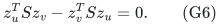

The map from <code class="math">S</code> to this row vector is injective: the <code class="math">z_v</code>'s span the whole space. Thus there are <code class="math">\binom{t+1}{2}</code> independent row dependencies, and

<!-- math-display: 6eecc8357bc1d0bea543c666
|E(H)|\le nt-\binom{t+1}{2}.
\tag{G7}
-->
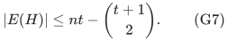

The same proof works componentwise and with any exact finite field, including characteristic two. This explicit specialized matrix need not represent the generic hyperconnectivity matroid. No generic-matroid independence algorithm or polynomial-identity-testing assertion is used.

## 3. Arbitrary vertex color classes

Assign distinct field elements <code class="math">a_c</code> to the colors. In a component with <code class="math">q</code> colors, use

<!-- math-display: 5ce74c01669985e2e6d7d80d
k=\min(h+1,q),\qquad
   z_c=(1,a_c,a_c^2,\ldots,a_c^{k-1}).
\tag{G8}
-->
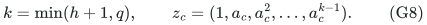

At least <code class="math">k</code> distinct color vectors occur and span the whole space by the Vandermonde determinant. A query that removes all component colors leaves an empty graph and is automatic. Otherwise, let <code class="math">F_C</code> be the failed colors occurring in the component and put

<!-- math-display: 32d11c12442d419b721d43ca
p_{F_C}(T)=\prod_{c\in F_C}(T-a_c).
\tag{G9}
-->
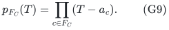

Its degree is at most <code class="math">\min(h,q-1)\le k-1</code>. Its coefficient vector defines a linear functional on (G8), nonzero exactly at the surviving colors. Apply Section 2. This proves (G1) and the ordered-prefix guarantee.

A useful special case has <code class="math">q\ll h</code>: the bound depends on <code class="math">q</code>, not the larger failure allowance. A one-color connected component needs only its ordinary minimum spanning tree.

## 4. Polynomial construction, query work, and representation

For a static component choose any prime exceeding its number of colors, assign distinct residues, form the explicit columns, and run exact finite-field elimination in edge order. A prime of polynomial magnitude can be found by a deterministic polynomial procedure; rational Vandermonde arithmetic is an alternative. The cost sorting uses the original rational weights and IDs, independently of the finite field.

With <code class="math">R=\sum_C n_Ck_C</code>, elementary incremental elimination takes <code class="math">O(mR^2)</code> field operations after sorting, with <code class="math">O(R^2)</code> field elements of workspace. This deliberately conservative bound is sufficient for deterministic uniform polynomial preprocessing. Sparse or faster linear algebra can improve it but is not part of this manuscript's guarantee.

For a query, delete the failed-color vertices from the retained ordered edge list and run Kruskal. The query processes only the certificate and the failure description. The original graph's canonical forest is returned exactly, including the same original edge IDs. Every ordered threshold connectivity relation, and hence every pair's bottleneck-path value, is preserved as well.

The statement is about the number of retained original edges. It does not claim linear preprocessing time or <code class="math">O(nh)</code> total arithmetic workspace. Arbitrary later changes to the edge cost order are outside the theorem.

## 5. Sharpness inherited from ordinary vertex failures

Let <code class="math">k=\min(h+1,n)</code>, give all vertices distinct colors, make a clique on <code class="math">k</code> core vertices with weight 1, and join each other vertex to every core vertex with weight 2. The graph has

<!-- math-display: 8777f840fabffbca55b7ea09
k(n-k)+\binom{k}{2}
        = nk-\binom{k+1}{2}
\tag{G10}
-->
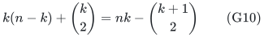

edges. Every outer-to-core edge is compulsory after the other <code class="math">k-1</code> core vertices fail. Every core edge is compulsory in a minimum forest after the other <code class="math">k-2</code> core vertices fail: omitting the weight-1 core edge requires an additional weight-2 edge or loses connectivity. The cases <code class="math">k=1</code> and <code class="math">k=n</code> obey the same formula with empty edge classes interpreted naturally.

This is the standard extremal construction already given after Theorem 1 in Sorkin--Steger--Zenklusen. It certifies that (G1)'s worst-case coefficient cannot improve even in the ordinary-vertex special case. It is not a new lower-bound construction, nor a lower bound for arbitrary compressed encodings.

## 6. Mixed vertex and edge colors

Now both vertices and edges have one color from the same palette. A failed color removes its vertices and all edges carrying that color. The total number of failed colors is at most <code class="math">h</code>.

The lifted block below depends on the edge as well as on the endpoint, so it
uses the following direct extension of Section 2. For an oriented edge <code class="math">uv</code>,
let its block at <code class="math">u</code> be <code class="math">x_{u,e}</code>, its block at <code class="math">v</code> be
<code class="math">-x_{v,e}</code>, and suppose a query functional <code class="math">L_F</code> evaluates these blocks
to the survival factors of the opposite endpoint and of the edge. Multiplying
the <code class="math">u</code>-block by the survival factor of <code class="math">u</code>, and the <code class="math">v</code>-block by that
of <code class="math">v</code>, sends the lifted column to a nonzero scalar times the ordinary
incidence column exactly when the edge survives, and to zero otherwise. The
same prefix-span argument as in Section 2 applies to the greedy basis of this
edge-dependent matrix. Its row count is <code class="math">n</code> times the block dimension; no
vertex-only vector <code class="math">z_v</code> is assumed in this variant.

For each endpoint/edge pair define the monic quadratic

<!-- math-display: 81c57b781a868d005e0526e0
g_{v,e}(T)=(T-a_{c(v)})(T-a_{c(e)}).
\tag{G11}
-->
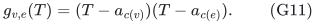

Let <code class="math">\phi(v,e)</code> list every monomial of total degree at most <code class="math">h</code> in its two nonleading coefficients. Its dimension is

<!-- math-display: 5af6b5301520805f3c4b11a5
D=\binom{h+2}{2}.
\tag{G12}
-->
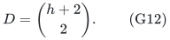

Lift <code class="math">e=uv</code> to block <code class="math">\phi(v,e)</code> at <code class="math">u</code> and block <code class="math">-\phi(u,e)</code> at <code class="math">v</code>. For a failure set <code class="math">F</code>, the expression

<!-- math-display: 0019b38c7a8fd7307ef834bf
\prod_{c\in F}g_{v,e}(a_c)
\tag{G13}
-->
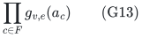

is a linear functional <code class="math">L_F</code> of the feature vector, because it is a polynomial of degree at most <code class="math">&#124;F&#124;\le h</code> in the two coefficients. With <code class="math">p_F(T)=\prod_{c\in F}(T-a_c)</code>, its value is <code class="math">p_F(a_{c(v)})p_F(a_{c(e)})</code>. Apply <code class="math">p_F(a_{c(u)})L_F</code> at the block of vertex <code class="math">u</code>. Each edge column maps to

<!-- math-display: 29ecb13bb3b0202110d3c565
p_F(a_{c(u)})p_F(a_{c(v)})p_F(a_{c(e)})(e_u-e_v).
\tag{G14}
-->
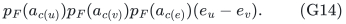

This is nonzero precisely for a surviving edge. The edge-dependent activation
argument above therefore gives an exact weighted certificate with at most

<!-- math-display: 003e61063397295ac79cafae
n\binom{h+2}{2}
\tag{G15}
-->
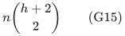

edges, in deterministic polynomial time. Repeated colors at the two endpoints or on the edge cause repeated factors but no problem. In a static instance one can cap <code class="math">h</code> at the number of occurring colors minus one, since removing every occurring color leaves no vertices.

### A symmetric-cubic rank refinement

Put <code class="math">k=h+1</code>. The feature functions in (G11)--(G12) span exactly the symmetric bivariate polynomials whose degree in each variable is at most <code class="math">h</code>. Indeed, the elementary-symmetric basis <code class="math">(x+y)^a(xy)^b</code>, <code class="math">a+b\le h</code>, and the symmetric-monomial basis <code class="math">x^iy^i</code>, <code class="math">x^iy^j+x^jy^i</code>, <code class="math">0\le i&lt;j\le h</code>, span the same <code class="math">D</code>-dimensional space. The recurrence for <code class="math">x^m+y^m</code> proves this without division.

Write <code class="math">z_x=(1,x,\ldots,x^h)</code>. Every symmetric trilinear form <code class="math">S</code> gives a row dependency by putting the coefficients of <code class="math">S(z_{c(u)},\cdot,\cdot)</code> in the block of <code class="math">u</code>. On edge <code class="math">uv</code>, the two contributions are <code class="math">S(z_u,z_v,z_e)</code> and <code class="math">-S(z_v,z_u,z_e)</code>, so they cancel.

If the occurring vertex vectors span <code class="math">t</code> dimensions, this supplies

<!-- math-display: e1a64d7bf89747b24355f686
\binom{k+2}{3}-\binom{k-t+2}{3}
\tag{G16}
-->
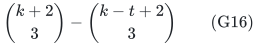

independent row dependencies. The map from symmetric trilinear forms to these
row dependencies has kernel consisting of forms on the quotient by the
vertex-vector span; an arbitrary sparse input graph may have additional row
dependencies. Thus (G15) can be reduced by (G16), componentwise. In
particular, with at least <code class="math">h+1</code> distinct vertex colors the bound is

<!-- math-display: 24f0032bfde1d007b2d20dfe
n\binom{h+2}{2}-\binom{h+3}{3}.
\tag{G17}
-->
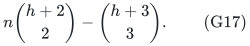

No exact optimum for all mixed instances is asserted.

### Leading-order mixed lower bound for multigraphs

Let <code class="math">q=h+2</code> core vertices have colors <code class="math">1,\ldots,q</code>, and let all other vertices have color 0. For every outer vertex and pair <code class="math">a&lt;b</code> in <code class="math">[q]</code>, put an edge to core <code class="math">a</code> with edge color <code class="math">b</code>. Add the core clique, with edge color 0. Give all edges unit weight.

For a fixed pair <code class="math">a&lt;b</code>, fail every color of <code class="math">[q]\setminus\{a,b\}</code>. Each
outer vertex now has exactly its edge indexed by <code class="math">\{a,b\}</code>, attached to
core <code class="math">a</code>; the surviving core clique may still contain cycles, but every
outer vertex has degree one. Hence that surviving outer edge is compulsory
for connectivity. Every original edge is compulsory under one of these
queries.

Therefore these multigraphs need

<!-- math-display: 61146bb56da82ae58b42f0f3
\binom{h+2}{2}(n-h-1)
\tag{G18}
-->
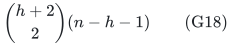

retained edges, even for unweighted connectivity. This matches the leading term in (G15) when <code class="math">n/h</code> tends to infinity. Parallel edges are used; this is not a simple-graph lower bound as written.

## 7. Overlapping lists of vertex colors

Let vertex <code class="math">v</code> carry an arbitrary set <code class="math">\sigma(v)</code> of at most <code class="math">d</code> colors, and fail whenever <code class="math">\sigma(v)\cap F\ne\varnothing</code>. Color classes can overlap arbitrarily. Reduce an oversized encoded <code class="math">d</code> to the largest list actually supplied; cap <code class="math">h</code> at the number of occurring colors. For <code class="math">h=0</code>, the ordinary minimum spanning forest already suffices. Choose an extra code <code class="math">a_0</code> never queried and set

<!-- math-display: 33c459ad79a5e5be0f956007
g_v(T)=(T-a_0)^{d-|\sigma(v)|}
                \prod_{c\in\sigma(v)}(T-a_c).
\tag{G19}
-->
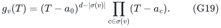

Let <code class="math">z_v</code> consist of all monomials of degree at most <code class="math">h</code> in the <code class="math">d</code> nonleading coefficients of <code class="math">g_v</code>. Its length is

<!-- math-display: 313696fab2f41f9e3f6ae9b8
D_v=\binom{h+d}{d}.
\tag{G20}
-->
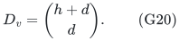

For every query, <code class="math">\prod_{c\in F}g_v(a_c)</code> is a linear functional of <code class="math">z_v</code> and is nonzero exactly when <code class="math">v</code> survives. Apply the general linear-activation lemma. If the vertex feature vectors have rank <code class="math">t</code>, the retained size is

<!-- math-display: d91874c18282fa26d3fb5e91
nt-\binom{t+1}{2},
          \qquad t\le\min(n,D_v).
\tag{G21}
-->
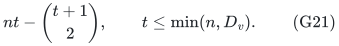

In particular the simple bound is <code class="math">n\binom{h+d}{d}</code>, rather than using the union of both endpoint lists and paying <code class="math">n\binom{h+2d}{2d}</code> in a direct per-edge feature lift. That comparison is to the direct lifting construction, not a claim that the latter is the best published list-model algorithm.

For uniform polynomial construction when <code class="math">h,d</code> are binary parameters, first test whether <code class="math">D_v\ge n</code>. In that case keep only the cheapest ordered edge of each parallel class and return that simple graph. It has at most <code class="math">\binom n2</code> edges, within (G21)'s upper envelope at <code class="math">t=n</code>, and preserves every query because parallel edges have identical endpoint failure conditions. When <code class="math">D_v&lt;n</code>, the explicit feature matrix is polynomial in the input, including all coefficient calculations. The actual-rank refinement (G21) is claimed when the features are computed; the identity branch only claims the displayed parameter upper envelope with <code class="math">t=\min(n,D_v)</code>.

### Leading-order list lower bound on simple graphs

Let <code class="math">D_v=\binom{h+d}{d}</code>, <code class="math">n\ge D_v</code>, and make one core vertex for each <code class="math">d</code>-subset <code class="math">S</code> of <code class="math">[h+d]</code>. Give that vertex exactly the labels <code class="math">S</code>. The other <code class="math">n-D_v</code> vertices have no labels. Take the complete bipartite graph between these two groups, with unit weights.

Fail <code class="math">[h+d]\setminus S</code>, a set of <code class="math">h</code> labels. The sole surviving core vertex is the one indexed by <code class="math">S</code>, so its entire star is compulsory. Varying <code class="math">S</code> shows that every one of the

<!-- math-display: 9c5434e47d7e74335ec9bb19
D_v(n-D_v)
\tag{G22}
-->
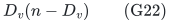

edges must be retained. Thus the leading <code class="math">nD_v</code> dependence is unavoidable on simple graphs when <code class="math">n/D_v</code> tends to infinity. This is a retained-subgraph lower bound.

The color-lists model itself is already present in the January 2026 journal version of *Color Fault-Tolerant Spanners*, as explicitly confirmed by its authors' institutional abstract. No numerical parameter comparison with an uninspected journal theorem is asserted; this manuscript does not claim to introduce overlapping-color failures.

## 8. Vertex lists together with edge lists

Suppose vertex lists have size at most <code class="math">d_v</code>, edge lists at most <code class="math">d_e</code>, and a single failure set of at most <code class="math">h</code> colors removes an object when any of its listed colors fails. Use separately padded monic polynomials <code class="math">g_v</code> and <code class="math">g_e</code>. For edge <code class="math">uv</code>, put the coefficient-monomial features of <code class="math">g_vg_e</code> at block <code class="math">u</code>, and the negative features of <code class="math">g_ug_e</code> at block <code class="math">v</code>.

The degree of either product is <code class="math">d_v+d_e</code>, so the block dimension is

<!-- math-display: 0321f79c57621ecb8b8cad76
D_{v,e}=\binom{h+d_v+d_e}{d_v+d_e}.
\tag{G23}
-->
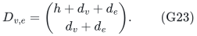

The failure-evaluation functional, multiplied at <code class="math">u</code> by <code class="math">\prod_{c\in F}g_u(a_c)</code>, maps an edge column to the nonzero surviving scalar

<!-- math-display: e8d75b3296025f2ed2022274
\prod_{c\in F}g_u(a_c)g_v(a_c)g_e(a_c)\,(e_u-e_v).
\tag{G24}
-->
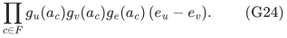

Hence a cost-ordered basis retains at most <code class="math">nD_{v,e}</code> edges and gives the same exact weighted-prefix guarantee. The apparent duplication of a shared color only raises its factor's multiplicity; zeros still encode the union of all three failure lists.

For a uniform polynomial static construction, if <code class="math">nD_{v,e}\ge m</code>, simply retain the input. Otherwise <code class="math">D_{v,e}&lt;m</code>, and, for <code class="math">h\ge1</code>, <code class="math">d_v+d_e&lt;D_{v,e}</code>; explicit polynomial construction and feature enumeration are polynomial in the input. When <code class="math">h=0</code>, retain the ordinary minimum spanning forest. When <code class="math">d_v+d_e=0</code>, there are no relevant failures and the same branch applies. An oversized encoded list bound can first be reduced to the maximum list length actually present.

### Matching leading coefficient already on simple graphs

The apex construction in the accompanying boundary-lift manuscript also gives a simple-graph lower bound for (G23). Put <code class="math">q=\binom{h+d_v+d_e}{d_v+d_e}</code>, take a palette of <code class="math">h+d_v+d_e</code> colors, and create one apex <code class="math">x_S</code> for each <code class="math">(d_v+d_e)</code>-subset <code class="math">S</code> of the palette. Split <code class="math">S=A_S\mathbin{\dot\cup}B_S</code>, with <code class="math">&#124;A_S&#124;=d_v</code>, <code class="math">&#124;B_S&#124;=d_e</code>. Give <code class="math">x_S</code> vertex list <code class="math">A_S</code>. Add <code class="math">t</code> base vertices with empty lists, join every apex to every base vertex, and give all edges incident to <code class="math">x_S</code> edge list <code class="math">B_S</code>. All weights are one.

For the query <code class="math">F=\text{palette}\setminus S</code>, an apex-to-base edge at <code class="math">x_{S'}</code> survives exactly when <code class="math">S'\cap F=\varnothing</code>, hence exactly when <code class="math">S'=S</code>. Some other apex vertices may themselves survive, but they are isolated. The unique nontrivial surviving component is therefore the star centered at <code class="math">x_S</code>, and every one of its <code class="math">t</code> edges is compulsory even for connectivity. Varying <code class="math">S</code> forces all <code class="math">qt=q(n-q)</code> original edges into any certificate. Thus the leading coefficient <code class="math">D_{v,e}</code> in (G23) is sharp on simple graphs as <code class="math">n/D_{v,e}</code> tends to infinity. Taking <code class="math">d_v=d_e=1</code> also supplies a simple-graph leading-order lower bound for Section 6; its finite additive term differs from the multigraph example there.

## 9. Near-linear construction and a difference oracle for one failed color

This is a separate low-time corollary for <code class="math">h=1</code>. It applies to the overlapping vertex/edge lists of Section 8, and avoids the large matrix elimination. Let

<!-- math-display: cb7d71f615ba3c3c0d6a9050
a=2d_v+d_e,
       \qquad r=|T_0|\le n-1,
\tag{G25}
-->
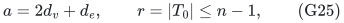

where <code class="math">T_0</code> is the canonical original minimum spanning forest. Interpret the list union on an edge as the colors whose individual failure destroys that edge. Count each edge/color incidence once; the total number <code class="math">A</code> of these incidences satisfies <code class="math">A\le am</code>.

For every occurring color <code class="math">c</code>, let <code class="math">D_c</code> be its destroyed edges, let <code class="math">T_c</code> be the canonical forest of <code class="math">G-D_c</code>, and define <code class="math">R_c=T_c\setminus T_0</code>. Then

<!-- math-display: c7700fa7075074b2fd32884d
T_c=(T_0\setminus D_c)\mathbin{\dot\cup}R_c,
       \qquad |R_c|\le |T_0\cap D_c|.
\tag{G26}
-->
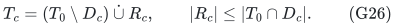

To see the containment, a surviving edge of <code class="math">T_0</code> increased the rank of its original ordered prefix. Deleting other edges cannot connect its endpoints in that prefix, so it is still accepted by Kruskal. The size bound follows because deleting edges cannot increase graphic rank. Summing (G26),

<!-- math-display: bf8a8190130a6615a17209a5
\sum_c |R_c|\le ar.
\tag{G27}
-->
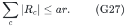

Use the deterministic fully dynamic MSF structure of Holm--de Lichtenberg--
Thorup, with <code class="math">O(\log^4 n)</code> amortized update time and an implementation
interface that reports the forest exchanges. Initialize the full graph. For
each color, delete the edges of <code class="math">D_c</code>, record the current forest edges
outside <code class="math">T_0</code>, and restore the same edges. Track the current non-<code class="math">T_0</code>
forest in a dictionary using the reported forest insertions and deletions.
Only the dictionary at a completed color-deletion batch is enumerated.
Intermediate forests are not added to the output. If a chosen dynamic MSF
implementation exposes only the maintained forest and not exchange events,
the same corollary requires an explicit augmentation to report those events.

There are <code class="math">m+2A</code> original edge updates including initialization, and the total enumeration work is <code class="math">O(ar)</code> by (G27), rather than one full forest per color. Parallel edges can be handled with a priority queue for each endpoint pair: a change of its cheapest surviving edge induces at most a constant number of simple-graph MSF updates and <code class="math">O(\log(m+2))</code> additional work. IDs break all weight ties permanently.

Thus, after forming the color-incidence lists, the update and forest-recording work is

<!-- math-display: 0a1ceb60b402c543209c1fed
O\!\left((m+A)\left[\log^4(n+2)+\log(m+2)\right]+ar\right).
\tag{G28}
-->
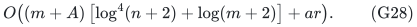

Input reading and dictionary construction are additional near-linear work in the encoded vertex and edge label incidences. This is deterministic near-linear preprocessing when the maximum list sizes are fixed; arithmetic and comparisons on the given rational costs must be charged in the chosen bit model.

The output <code class="math">T_0\cup\bigcup_cR_c</code> is the exact union of the canonical forests for no failure and one failed color. It is a subgraph of every certificate that contains all these canonical forests. Therefore it inherits the sharper bounds proved above: at most <code class="math">2n-3</code> edges in a connected single-vertex-color instance with at least two colors; at most <code class="math">3n</code> in the mixed single-color instance, or the applicable rank-refined bound. The direct general-list bound <code class="math">(a+1)r</code> also follows from (G27).

Store the baseline cost <code class="math">w(T_0)</code>, each <code class="math">R_c</code>, and

<!-- math-display: f6c048f9530ff54a39512e54
V_c=w(T_0)-w(T_0\cap D_c)+w(R_c).
\tag{G29}
-->
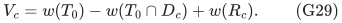

An indexed single-color query returns its exact MSF value in <code class="math">O(1)</code> lookup time, or its forest as the baseline-minus-destroyed-edges representation together with <code class="math">R_c</code>. Writing the entire forest costs its output size plus the baseline scan. All replacement lists together contain at most <code class="math">ar</code> edge IDs. Colors destroying no baseline-forest edge have <code class="math">R_c=\varnothing</code> and the unchanged value, so they need no nondefault difference record.

This corollary uses standard dynamic MSF machinery and does not claim priority for single-failure sensitivity oracles. It does not replace the all-<code class="math">h</code> construction: running these batches for all <code class="math">h</code>-color subsets would reintroduce color-universe enumeration.

## 10. Related work and comparison

The comparison currently supported by the inspected primary sources is:

| Model | Inspected baseline | This manuscript |
|---|---|---|
| Ordinary individual vertex failures | Sorkin--Steger--Zenklusen: sharp <code class="math">nk-\binom{k+1}{2}</code> union bound and polynomial construction | Recovered as a specialization; not a new claim |
| Arbitrary single vertex colors | Petruschka--Sapir--Tzalik: <code class="math">O(hn)</code> existence; April 2026 Theorem 4.2 supplies an <code class="math">O(hn\log n)</code> polynomially computable connectivity certificate | Deterministic polynomial construction, sharp (G1), and exact fixed-order weighted MSF preservation |
| Mixed single vertex/edge colors | ITCS 2024 gives <code class="math">O(h^2n)</code> existence and, via its efficient spanner result at logarithmic stretch parameter, a polynomial <code class="math">O(h^2n\log^2 n)</code> connectivity certificate | Deterministic polynomial construction with (G15), optionally (G17); exact weighted MSF preservation |
| Overlapping color lists | Explicitly treated in the 2026 TALG journal version | Explicit (G20)--(G24), with a simple-graph leading-order lower (G22); no claim that the model is new |

PST's weighted construction processes edges in increasing order and discards an edge only after certifying an earlier-edge surviving path for every allowed failure set (ITCS 2024, Section 5, "Handling Weights"). That observation already implies ordered-prefix connectivity and canonical-MSF preservation, although their theorem is phrased as a spanner result. The proposed improvement over that construction is the removal of the logarithmic size losses, together with the explicit sharp vertex-color bound; weighted-MSF preservation by itself is not claimed as a first result.

The algorithm does not require finding a minimum color cut. It computes a basis of an explicitly instantiated matrix. The reachability/forest claims follow from a query-dependent linear image, which is enough even if the lift retains edges that no optimal queried forest actually uses.

The comparisons above distinguish existence from polynomial construction. They do not establish priority against every later journal refinement, a new exponent for ordinary individual failures, or a new metric-spanner bound.

## References

1. Gregory B. Sorkin, Angelika Steger, Rico Zenklusen. *A tight bound on the collection of edges in MSTs of induced subgraphs*. Theorem 1, the following sharpness example, and the polynomial construction following Theorem 5. https://arxiv.org/pdf/0705.2439
2. Asaf Petruschka, Shay Sapir, Elad Tzalik. *Color Fault-Tolerant Spanners*. ITCS 2024, Theorem 3 and the efficient constructions of Section 5. https://drops.dagstuhl.de/storage/00lipics/lipics-vol287-itcs2024/LIPIcs.ITCS.2024.88/LIPIcs.ITCS.2024.88.pdf
3. Asaf Petruschka, Shay Sapir, Elad Tzalik. *Connectivity Labeling in Faulty Colored Graphs*. Distributed Computing 39, Article 14, published 7 April 2026, Theorem 4.2. https://link.springer.com/article/10.1007/s00446-026-00506-1
4. Asaf Petruschka, Shay Sapir, Elad Tzalik. *Color Fault-Tolerant Spanners*. ACM Transactions on Algorithms 22(1), Article 6, January 2026, DOI 10.1145/3750728. Institutional abstract explicitly records the color-lists extension: https://weizmann.elsevierpure.com/en/publications/color-fault-tolerant-spanners-2/
5. Dániel Garamvölgyi, Bill Jackson, Tibor Jordán, Soma Villányi. *Sufficient conditions for bipartite rigidity, symmetric completability and hyperconnectivity of graphs*, arXiv:2511.00298, Section 1 and Lemma 1.1. This source credits Kalai's 1985 matrices and records the hyperconnectivity matrix and generic maximum rank. https://arxiv.org/html/2511.00298v1
6. Jacob Holm, Kristian de Lichtenberg, Mikkel Thorup. *Poly-logarithmic deterministic fully-dynamic algorithms for connectivity, minimum spanning tree, 2-edge, and biconnectivity*. Journal of the ACM 48(4), 2001, Theorem 8 and Section 5.1. The deterministic fully dynamic MSF bound is <code class="math">O(\log^4 n)</code> amortized per edge update, and the original page-724 problem definition responds with maintained forest updates. Primary full text: https://u.cs.biu.ac.il/~liamr/p723-holm.pdf

The [native mixed/list realization](reference-mixed-list-realization.md)
computes actual feature spans without formal monomial enumeration and
supplies the completed-batch exchange wrapper. Its exact reference-update
and sorting costs are separate from the identified published dynamic bound.

The manuscript gives proofs of its algebraic specializations and does not require treating the generic hyperconnectivity matroid as efficiently recognizable.
