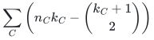
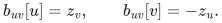
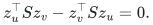
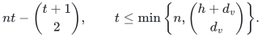
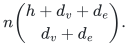
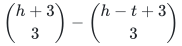
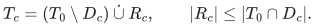
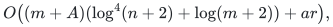

# Exact colored-graph certificates

## 1. Sharp vertex-color theorem

Fix an undirected graph with signed rational weights and permanent edge-ID tie breaking. Every vertex has one color. For each original component <code class="math">C</code>, let <code class="math">n_C,q_C</code> count its vertices and colors, and put <code class="math">k_C=\min\{h+1,q_C\}</code>. Deterministic polynomial preprocessing retains at most
<!-- math-display: 87f255f938e89330ecdc27e5
\sum_C\left(n_Ck_C-\binom{k_C+1}{2}\right)
-->

original edges, preserving the connectivity partition of every surviving ordered prefix after any at most <code class="math">h</code> color failures. It therefore contains the exact canonical minimum spanning forest. The bound is worst-case sharp.

## 2. Activation lemma

Suppose vertex vectors <code class="math">z_v\in\mathbb F^t</code> span the space, and each query has a linear functional <code class="math">\ell_F</code> with <code class="math">a_v=\ell_F(z_v)\ne0</code> exactly at surviving vertices. Orient an edge <code class="math">uv</code> and give it block column
<!-- math-display: 0103100aed55a92e0fd68a00
b_{uv}[u]=z_v,\qquad b_{uv}[v]=-z_u.
-->

Retain the fixed-order greedy basis.

**Proof of prefix preservation.** Map block <code class="math">x</code> at vertex <code class="math">u</code> to <code class="math">a_u\ell_F(x)e_u</code>. The edge maps to <code class="math">a_ua_v(e_u-e_v)</code>, zero on failures and a nonzero multiple of its incidence column otherwise. Applying this map to every prefix-span relation proves equality of surviving incidence-prefix spaces. Canonical Kruskal thus accepts the same original edges. <code class="math">\square</code>

**Proof of the size bound.** Every symmetric <code class="math">t</code>-by-<code class="math">t</code> matrix <code class="math">S</code> gives a row dependency <code class="math">(Sz_v)_v</code>, because
<!-- math-display: bc099d23ad5517ce87c872d1
z_u^\top Sz_v-z_v^\top Sz_u=0.
-->

The map from <code class="math">S</code> is injective since the <code class="math">z_v</code>'s span. These dependencies have dimension <code class="math">\binom{t+1}{2}</code>, so the lift has rank at most <code class="math">nt-\binom{t+1}{2}</code>. This also works in characteristic two. <code class="math">\square</code>

In a component use <code class="math">z_c=(1,a_c,\ldots,a_c^{k_C-1})</code> at distinct color points. Vandermonde independence gives full span. Unless every color fails, <code class="math">\prod_{c\in F\cap C}(T-a_c)</code> has degree at most <code class="math">k_C-1</code> and supplies the functional. If all fail, the component is empty. Apply the lemma componentwise.

For sharpness, take a clique on <code class="math">k</code> distinctly colored core vertices with weight one and join every outer vertex to each core vertex with weight two. Deleting all other cores forces each outer edge; retaining only a pair of cores forces its clique edge in the minimum forest. The number forced is <code class="math">nk-\binom{k+1}{2}</code>, the classical Sorkin–Steger–Zenklusen example.

## 3. List and mixed extensions

For vertex lists of degree <code class="math">d_v</code>, use coefficient monomials of the padded label-root polynomials through total degree <code class="math">h</code>. If their actual rank is <code class="math">t</code>, the same lemma gives
<!-- math-display: b523309836dabb09abc28296
nt-\binom{t+1}{2},\qquad
t\le\min\left\{n,\binom{h+d_v}{d_v}\right\}.
-->

When that feature dimension is gated out, retain the cheapest edge of every parallel class and claim the parameter envelope at <code class="math">t=n</code>; the actual-rank refinement requires computing the features.

With extra edge lists of degree <code class="math">d_e</code>, put the feature of <code class="math">g_vg_e</code> at endpoint <code class="math">u</code>, and its opposite-endpoint analogue at <code class="math">v</code>. Multiplying each block evaluation by its own vertex factor yields the same scalar on the incidence column, nonzero exactly for surviving edges. The bound is
<!-- math-display: a741f9439797ad84a75e0fb1
n\binom{h+d_v+d_e}{d_v+d_e}.
-->

For one color per vertex and edge, symmetric trilinear forms subtract
<!-- math-display: abd85ea0525c08ee322ed4e6
\binom{h+3}{3}-\binom{h-t+3}{3}
-->

from <code class="math">n\binom{h+2}{2}</code>, where <code class="math">t</code> is the vertex-color-vector rank in dimension <code class="math">h+1</code>. With full rank this gives <code class="math">n\binom{h+2}{2}-\binom{h+3}{3}</code>. The complete proof gives the dependency injection and lower examples.

## 4. One failed color in near-linear preprocessing time

Let <code class="math">T_0</code> be the canonical original forest, <code class="math">D_c</code> the edges destroyed by color <code class="math">c</code>, and <code class="math">T_c</code> the forest after its failure. Every surviving baseline edge remains accepted by Kruskal, since deletion cannot connect its endpoints earlier. Thus
<!-- math-display: 7026c5f395cca6617ae81bdf
T_c=(T_0\setminus D_c)\mathbin{\dot\cup}R_c,\qquad
|R_c|\le|T_0\cap D_c|.
-->

With <code class="math">a=2d_v+d_e</code> and <code class="math">r=&#124;T_0&#124;</code>, summing gives <code class="math">\sum_c&#124;R_c&#124;\le ar</code>. A deterministic dynamic MSF structure with exchange reporting can delete and restore each color batch while maintaining the nonbaseline forest in a dictionary. Enumerate it only at completed batches.

If <code class="math">A\le am</code> is the edge/color incidence count, this costs
<!-- math-display: 83ab9a01fa84ff1c12b4805b
O\bigl((m+A)(\log^4(n+2)+\log(m+2))+ar\bigr),
-->

plus input organization. The output is the exact union of canonical forests and inherits the algebraic support bounds. Indexed cost lookup is <code class="math">O(1)</code>; full output additionally scans the baseline and writes the result. Exchange reporting is an explicit backend requirement.

## Executable realization

The [rational vertex-color backend](reference/README.md) implements the sharp componentwise activation construction for correlated single-color vertex classes. Its [realization proof](manuscripts/reference-vertex-color-realization.md) establishes fixed-order prefix preservation, exact canonical forest queries and bit accounting. The [independent checker](verify/check_vertex_colors.py) uses graph reachability to compare all allowed small failures and prefixes.

The [mixed/list reference](reference/list_colors.py) and its
[realization proof](manuscripts/reference-mixed-list-realization.md) compute
actual coefficient-evaluation feature spans without formal monomial
enumeration, preserving full activation rank and the cubic saving. They
also supply the completed-batch one-failure exchange wrapper. Its default
exact reference backend scans original records per update, separately from
the published fast dynamic-MSF bound. HDT's original problem definition,
Theorem 8 and Section 5.1 identify the required exchange-reporting interface.

## Complete proof

[Activation, mixed/list bounds, sharpness, and MSF implementation](manuscripts/colored-graph-and-vertex-failure-certificates.md).

**Attribution:** Yilin Liu and GPT-6 Astra Pro.
