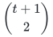
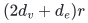

# Verification and scope

[Main proof](../proof.md) · [Source dependencies](../sources.md)

## Evidence status

The family is supported by the activation identities, rank bounds and prefix-span arguments in the proof and companion. The [rational vertex-color backend](../reference/README.md) now realizes the sharp componentwise theorem, with an explicit [implementation proof](../manuscripts/reference-vertex-color-realization.md).

```sh
python3 problems/graph-color-failure-certificates/verify/check_vertex_colors.py
```

The independent checker passes 371 graph/color/budget instances, 2,099 failure queries and 24,388 ordered-prefix connectivity comparisons. Thirty-five classical sharpness examples meet the bound exactly; seven malformed-input or over-budget cases are rejected. It uses independent reachability flood fills and a partition-based canonical forest scan, with exhaustive small simple graphs, seeded multigraphs, parallel records, loops, isolates and signed rational ties.

The original executable covers one color per vertex. The separate
[mixed/list backend](../reference/list_colors.py) and
[realization proof](../manuscripts/reference-mixed-list-realization.md)
now cover overlapping lists, edge colors, computed feature ranks, the
cubic saving and completed-batch one-failure differences. Its default
dynamic update is an exact scan-based reference, separate from HDT's
published polylogarithmic implementation. Runtime and support claims
are mathematical bounds, not empirical measurements. Quantitative
comparisons to unseen journal theorems and historical priority remain
outside the review.

```sh
python3 -B problems/graph-color-failure-certificates/verify/check_list_colors.py
```

This independent checker covers 1,664 original graphs and 12,641 exact
failure/prefix comparisons, using graph flood fills and an original
partition-based Kruskal comparator. It checks 186 exchange wrappers
performing 2,776 actual updates; 30 independently expanded feature matrices
also reproduce the canonical full activation-matrix greedy IDs. Seven
compulsory-edge examples cover vertex lists, mixed lists and the mixed
multigraph core. Other fixtures include overlapping and repeated-between-
objects labels, loops, parallel edges, signed rational ties, empty lists,
disconnected graphs, absent colors, rational and prime-field arithmetic
including characteristic two, a huge binary failure allowance and enormous
unmaterialized formal feature dimension. Preprocessing-disabled queries
still return exact results; 12 malformed inputs/queries are rejected.

The exact field API assumes a sufficiently large caller-supplied prime;
it does not validate primality or construct extensions. All arithmetic,
sorts, reference-update scans, hash/set work, compact-index lookup,
raw-label search and output are explicitly charged. These finite checks
support the original-input implementation and do not prove the general
rank/approximation statements or implement the fast dynamic structure.

## Activation and rank

The query map sends every lifted edge <code class="math">uv</code> to a scalar multiple of its ordinary incidence column. That scalar is nonzero exactly when both endpoints survive. Symmetric matrix row dependencies have dimension

<!-- math-display: 9cae79263ac8b219dbe824a4
\binom{t+1}{2}
-->

 when the vertex feature vectors span dimension <code class="math">t</code>. The cancellation argument remains valid in characteristic two.

Mixed edge/vertex labels use an edge-dependent block feature and a separate symmetric-trilinear refinement. The native module computes actual evaluation spans without constructing the formal monomial matrix. Both-direction rowspace maps preserve full activation rank, so its actual-rank and cubic bounds are justified. The direct full-input gate retains its separate parameter-envelope interpretation.

## Fixed-order prefixes and MSFs

Equality of every surviving ordered incidence-prefix span means that canonical Kruskal accepts exactly the same original edges. This covers signed weights with fixed edge-ID tie breaking. It does not assert preservation under arbitrary later recosting or preservation of shortest-path distances.

For one failed color, every surviving baseline MSF edge remains accepted. Across all color queries, the replacement lists have total size at most

<!-- math-display: 08fd74b9b38e01cc5a51262c
(2d_v+d_e)r
-->

. The near-linear construction requires a dynamic MSF interface that reports exchanged forest edges and enumerates the nonbaseline forest only after each color-deletion batch is complete. This amortized output accounting is a separate construction from the general all-<code class="math">h</code> matrix lift.

The new realization identifies that exchange interface in HDT's original
page-724 problem definition, Theorem 8 and Section 5.1. Native difference
collection uses actual events and completed batches; its default reference
updates have their own full-scan cost. Extra-list and retained-union sorting
are charged, and indexed value lookup is distinguished from raw original
color lookup and materializing a whole forest.

**Attribution:** Yilin Liu and GPT-6 Astra Pro.
