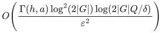
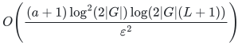

# Finite-group, affine, and metric sparsification

One nonnegative coefficient per original generator, constraint, metric, or block preserves the entire stated query family. Support counts and construction costs are recorded separately.

## Results

For every result, the support may be capped by the original item count <code class="math">m</code>.

**Arbitrarily weighted Cayley spectral sparsification on any finite group <code class="math">G</code>**

**Support or guarantee.** <code class="math">O\!\left(\frac{\log^3(2\lvert G\rvert)}{\varepsilon^2}\right)</code> generators

**Construction and scope.** Deterministic polynomial time in the explicit permutation-matrix input; no weight-ratio dependence. An optional group-operations bundle sampler is Monte Carlo with failure at most <code class="math">\delta</code>, with its confidence-dependent support in [Section 5.1](manuscripts/arbitrary-group-cayley-sparsification.md)

**Proof.** [Theorem 1](manuscripts/arbitrary-group-cayley-sparsification.md)

**A supplied <code class="math">d</code>-dimensional unitary action of <code class="math">G</code>**

**Support or guarantee.** <code class="math">O\!\left(\frac{\log^2(2\lvert G\rvert)\log(2d)}{\varepsilon^2}\right)</code> generator items

**Construction and scope.** Deterministic in the supplied explicit action arithmetic model; the regular-action bound also works simultaneously in every later representation. Rational polynomial-bit construction is specified for explicit permutation matrices; arbitrary implicit unitary actions have no such bit-model claim

**Proof.** [Representation corollary](manuscripts/arbitrary-group-cayley-sparsification.md)

**Cayley generators after all <code class="math">h</code> correlated label deletions, at most <code class="math">a</code> labels per item**

**Support or guarantee.**

<!-- math-display: 976ebcd8c2b00aad5aa06c45
O\!\left(\frac{\Gamma(h,a)\log^2(2\lvert G\rvert)\log(2\lvert G\rvert Q/\delta)}{\varepsilon^2}\right)
-->

**Construction and scope.** Monte Carlo polynomial time in explicit group/input size, failure at most <code class="math">\delta</code> on one common all-failure event with fixed weights; for <code class="math">h=1</code>, deterministic support

<!-- math-display: ac2b105ae25a653a870b791e
O\!\left(\frac{(a+1)\log^2(2\lvert G\rvert)\log(2\lvert G\rvert(L+1))}{\varepsilon^2}\right)
-->

**Proof.** [Theorem 4](manuscripts/arbitrary-group-cayley-sparsification.md)

**Whole subgroup-complement constraints**

**Support or guarantee.** <code class="math">O\!\left(\frac{\log\!\left(2[G:\bigcap_e H_e]\right)}{\varepsilon^2}\right)</code>

**Construction and scope.** Support existence, with Monte Carlo partial-coloring construction polynomial in an explicit predicate table and success at least <code class="math">2/3</code> under the backend contract in [the proof](proof.md#randomness-and-confidence). Arbitrary subgroups, including nonnormal ones

**Proof.** [Theorem 1](manuscripts/optimal-whole-subgroup-constraints.md)

**Arbitrary affine coset-complement constraints**

**Support or guarantee.** <code class="math">O\!\left(\frac{\log(2\lvert G\rvert)}{\varepsilon^2}\right)</code>

**Construction and scope.** Monte Carlo explicit-table partial coloring, success at least <code class="math">2/3</code> under the backend contract; no common satisfying assignment required; optional exact total input weight

**Proof.** [Theorem 1](manuscripts/affine-constraints-over-arbitrary-finite-groups.md)

**Arbitrary-arity group-derived Mal'tsev constraint violations over <code class="math">A^n</code>**

**Support or guarantee.** <code class="math">O\!\left(\frac{1+n\log\lvert A\rvert}{\varepsilon^2}\right)</code> whole constraints

**Construction and scope.** Monte Carlo through the explicit-table coset construction; each accepting relation is a subgroup coset and the alphabet group may be nonabelian

**Proof.** [Corollary 2](manuscripts/affine-constraints-over-arbitrary-finite-groups.md)

**Distances to an arbitrary received word in a subgroup code <code class="math">C</code>**

**Support or guarantee.** <code class="math">O\!\left(\frac{\log(2\lvert C\rvert)}{\varepsilon^2}\right)</code> original coordinates

**Construction and scope.** Monte Carlo through the explicit-table coset construction; preserves every codeword's weighted distance and does not perform decoding

**Proof.** [Group-code corollary](manuscripts/affine-constraints-over-arbitrary-finite-groups.md)

**Sums of itemwise invariant Hilbert distances on a transitive <code class="math">N</code>-point space**

**Support or guarantee.** <code class="math">O\!\left(\frac{\log(2N)}{\varepsilon^2}\right)</code> whole metrics

**Construction and scope.** Monte Carlo explicit-table partial coloring, success at least <code class="math">2/3</code> under the stated certified separation/precision contract; optional exact total weight

**Proof.** [Theorem 1](manuscripts/transitive-metrics-and-group-alignment.md)

**The same metric problem with orbit sizes <code class="math">N_1,\ldots,N_k</code>**

**Support or guarantee.** <code class="math">O\!\left(\frac{\min\{N,\log(2k!\prod_{j=1}^k N_j)\}}{\varepsilon^2}\right)</code>

**Construction and scope.** Symmetry branch: Monte Carlo using the original distance table and its numerical-access contract. Unrestricted <code class="math">N</code> branch: existence only from the ordinary seminorm theorem

**Proof.** [Theorem 1](manuscripts/hilbert-metric-sums-with-few-orbits.md)

**Two-anchor Euclidean alignment over a finite group <code class="math">G</code>, including itemwise Bernstein transforms**

**Support or guarantee.** <code class="math">O\!\left(\frac{\log(2\lvert G\rvert)}{\varepsilon^2}\right)</code> whole observations

**Construction and scope.** Monte Carlo through the explicit-table metric construction; preserves every group alignment and the norm losses are unsquared

**Proof.** [Corollary 2 and Section 4.1](manuscripts/transitive-metrics-and-group-alignment.md)

**Coordinate-permutation alignment of vector or matrix pairs in dimension <code class="math">d</code>**

**Support or guarantee.** <code class="math">O\!\left(\frac{d\log(d+1)}{\varepsilon^2}\right)</code> whole pairs

**Construction and scope.** Monte Carlo through the explicit-table metric construction; specializes to <code class="math">S_d</code> and signed permutations; no optimizer is asserted

**Proof.** [Sections 5.2–5.3](manuscripts/transitive-metrics-and-group-alignment.md)

**Affine modular blocks over arbitrary binary-encoded <code class="math">\mathbb Z_q</code>**

**Support or guarantee.** Existence <code class="math">O(r/\varepsilon^2)</code>; compact randomized construction <code class="math">O\!\left(\frac{r\log(2r/\varepsilon)}{\varepsilon^2}\right)</code>

**Construction and scope.** Compact Monte Carlo, success at least <code class="math">2/3</code>; <code class="math">r=\log_2\lvert H\rvert</code> for the subgroup generated by augmented rows. Polynomial bit time without factoring; whole blocks remain atomic; the sharper support bound is existence only in this compact model

**Proof.** [Theorem MB](manuscripts/affine-modular-blocks-and-sharp-modulus-dependence.md)

**Closure-preserving rationalization of a unit-gap submodular rank**

**Support or guarantee.** Exact rational rank at most <code class="math">4R</code>, denominator <code class="math">O(R)</code>, and identical zero marginals

**Construction and scope.** Deterministic, given the stated deterministic weak value oracle; <code class="math">O(m)</code> constant-precision weak evaluations plus one evaluation at precision <code class="math">1/\mathrm{poly}(R)</code> per value query

**Proof.** [Theorem 1](manuscripts/rational-quotient-ranks-from-weak-oracles.md)

Here <code class="math">Q=\sum_{j=0}^h\binom{L}{j}</code> and <code class="math">\Gamma(h,a)=\frac{(h+a)^{h+a}}{h^h a^a}</code>, with value one if either parameter is zero. The failure budget is clipped to the number of occurring labels <code class="math">L</code>. <code class="math">R</code> is a supplied integer upper bound on the original submodular rank.

## Contract

**Objective and output**

Preserve each specified nonnegative objective within <code class="math">1\pm\varepsilon</code> using a subset of its original items with one nonnegative coefficient each.

**Randomness**

Mixed. Cayley matrix construction and rational-rank conversion are deterministic; the optional group-operations Cayley variant is Monte Carlo with failure at most <code class="math">\delta</code>. Subgroup, coset and metric table constructions are Monte Carlo partial coloring with success at least <code class="math">2/3</code>, using bounded fresh trials and certified table/separation checks under the stated precision contract. Compact modular blocks are Monte Carlo with success at least <code class="math">2/3</code>. Optimal compact-input support and the unrestricted few-orbit seminorm branch are existence statements where no such construction is supplied.

**Time**

Cayley construction is polynomial in explicit group/action size. Gaussian subgroup and metric constructions are polynomial in an explicit query table under their separation/precision contract. Modular and rational-rank constructions are polynomial in compact binary input and <code class="math">\varepsilon^{-1}</code> with their stated oracle access.

**Space**

Support bounds count retained items. Input tables, output coefficient lengths, and algorithm workspace are separate; no independent workspace exponent is claimed.

**Parameters**

<code class="math">m</code> is the item count; group order, action dimension, orbit sizes, subgroup rank, label count, failure budget, modulus encoding, and accuracy are distinguished in the table.

**Model and representation**

Nonabelian groups and nonnormal subgroups are allowed. Every metric item must be invariant under the common action. Modular ranks use generated subgroups, not a presumed basis over a composite ring.

**Lower-bound scope**

Graph-cut instances force the joint <code class="math">\log N/\varepsilon^2</code> order in the stated large-<code class="math">N</code> regime. Powers-of-two moduli force <code class="math">n\log q/\varepsilon^2</code> for <code class="math">\varepsilon\le1/4</code> and <code class="math">n\ge2\left\lceil(2\varepsilon)^{-2}\right\rceil</code>. Few-orbit lower bounds have their own orbit-size regime.

**Review status**

The [verification note](verify/README.md) records the proof scope, executable evidence and remaining conditions. No proof-assistant verification or external peer review is claimed.

**Source**

[Proofs](proof.md), [manuscript and reference map](sources.md), [analytic review](verify/README.md), and [exact checks](verify/README.md).

The [exact-separation and conditional-sign results](../obstruction-boundaries/) state the implementation and proof-model boundaries relevant to this family.

**Attribution:** Yilin Liu and GPT-6 Astra Pro.
