# Optimal-support sparsification of affine constraints over arbitrary finite groups

**Abstract.** We prove that weighted complements of arbitrary subgroup cosets in a finite group <code class="math">G</code> have relative-error sparsifiers on <code class="math">O(\log(2&#124;G&#124;)/\epsilon^2)</code> original constraints. The cosets may be inconsistent and their subgroups need not be normal. A common wreath-product embedding turns every accepting coset into a subgroup and every original query into one fixed group element, allowing the whole-subgroup theorem to apply. Consequences include arbitrary-arity group-derived Mal'tsev constraints and coordinate coresets for group codes with arbitrary received words.

## 1. Main theorem

Let <code class="math">G</code> be a finite group, <code class="math">N=&#124;G&#124;</code>. For each original item <code class="math">e\in[m]</code>, choose a subgroup <code class="math">H_e\le G</code>, an element <code class="math">a_e\in G</code>, and a weight <code class="math">w_e&gt;0</code>. Put
<!-- math-display: b975343b4fade4907cf2270a
C_e=a_eH_e,\qquad
 b_e(g)=\mathbf1[g\notin C_e],\qquad
 W(g)=\sum_e w_e b_e(g).
 \tag{A1}
-->
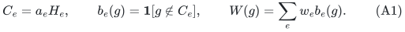
There is no assumption that the subgroups are normal, that the cosets intersect, or that any assignment has zero cost.

**Theorem 1.** For every <code class="math">0&lt;\epsilon&lt;1</code>, there are coefficients <code class="math">\omega_e\ge0</code>, supported on
<!-- math-display: cfdf583d89e16e1779ebbfea
O\!\left(\min\left\{m,\frac{\log(2N)}{\epsilon^2}\right\}\right)
 \tag{A2}
-->
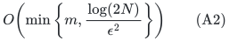
original indices, such that
<!-- math-display: f0193e09c44afb44cba3054e
(1-\epsilon)W(g)
 \le \sum_e\omega_e w_e b_e(g)
 \le (1+\epsilon)W(g)
 \qquad\text{for every }g\in G.
 \tag{A3}
-->
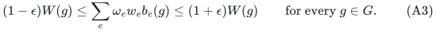
All items retain their original predicates. In particular, a coset is not replaced by separately weighted character tests, generators, or coordinates.

Identically zero items can be discarded. An empty accepting set gives a constant-one item; any collection of such items can be represented exactly by one of those original indices with their total weight. This adds at most one item and preserves (A2). Right cosets are included because <code class="math">Ha=a(a^{-1}Ha)</code>.

**Optional exact total weight.** One can additionally require
<code class="math">\sum_e\omega_ew_e=\sum_e w_e</code>, with the same support order and relative error. For this version the total includes identically zero original items; those items are kept available to the construction instead of being discarded in advance. The short augmentation proof is given at the end of Section 3.

With the <code class="math">N\times m</code> predicate table explicitly supplied and rational input weights, the separation-based partial-coloring implementation is randomized polynomial in the table and encoding sizes, under the usual accuracy contract of the backend. The table can be exponentially larger than a compact presentation of <code class="math">G</code> and its cosets. The theorem does not turn a difficult compact separation problem into a polynomial-time algorithm.

## 2. One common wreath product turns every coset into a subgroup

Write
<!-- math-display: 28e9167cc5e020f0fcd345a5
\widetilde G=(G\times G)\rtimes C_2,\qquad
 \tau(x,y)\tau=(y,x).
 \tag{A4}
-->
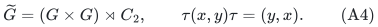
Thus <code class="math">&#124;\widetilde G&#124;=2N^2</code>. For a particular coset <code class="math">C=aH</code>, set
<!-- math-display: 17dae927a26f553bfffca5ab
B_C=(aHa^{-1})\times H,\qquad
 t_C=(a,a^{-1})\tau.
 \tag{A5}
-->
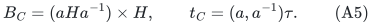
The same ambient group <code class="math">\widetilde G</code> is used for every original item.

First, <code class="math">t_C^2=1</code>. Moreover
<!-- math-display: a6402c5fa5b5cacd5eabbe5c
t_C(x,y)t_C^{-1}
   =(aya^{-1},a^{-1}xa),
 \tag{A6}
-->
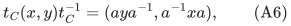
so <code class="math">t_C</code> normalizes <code class="math">B_C</code>. Therefore
<!-- math-display: cd68ae545c5c76a74776a7cd
K_C=B_C\rtimes\langle t_C\rangle
 \tag{A7}
-->
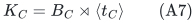
is a subgroup of <code class="math">\widetilde G</code>. Its odd part is exactly
<!-- math-display: 1aaab087c967880a8353a2e1
B_Ct_C
   =\{(ah_1,h_2a^{-1})\tau:h_1,h_2\in H\}.
 \tag{A8}
-->
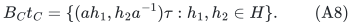

Use the query embedding
<!-- math-display: 3b54b4e3f64519d3b4f8826c
q(g)=(g,g^{-1})\tau.
 \tag{A9}
-->
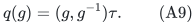
Equations (A8)--(A9) give the exact membership identity
<!-- math-display: 3aecccad077fef80335857b6
q(g)\in K_C\quad\Longleftrightarrow\quad g\in aH.
 \tag{A10}
-->
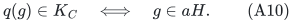
Indeed, if <code class="math">g=ah</code>, the second coordinate is <code class="math">h^{-1}a^{-1}</code>, so take <code class="math">h_1=h</code> and <code class="math">h_2=h^{-1}</code>. Conversely, the first coordinate in (A8) already forces <code class="math">g\in aH</code>.

The map <code class="math">q</code> is not claimed to be a homomorphism. That is unnecessary: the homogeneous sparsifier is valid on every element of <code class="math">\widetilde G</code>, and hence also on this fixed embedded query set.

The wreath subgroup in (A7) is established algebra. For example, Proposition 3 of Dinh--Moore--Russell's 2011 hidden-shift reduction writes the subgroup
<!-- math-display: 848c58cf5b12c3f7b5020d84
(H_0\times s^{-1}H_0s)
 \ \cup\
 (H_0s\times s^{-1}H_0)\tau.
-->
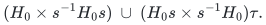
Taking <code class="math">H_0=aHa^{-1}</code> and <code class="math">s=a</code> gives (A7)--(A8). The contribution here is its application to simultaneous sparsification with one retained coefficient per original coset, together with the Gaussian support theorem; the wreath construction itself is not claimed as new.

## 3. Gaussian consequence and support proof

We state the needed result from the companion manuscript
[optimal-whole-subgroup-constraints.md](optimal-whole-subgroup-constraints.md).

**Homogeneous subgroup theorem.** If <code class="math">L_e</code> are subgroups of a finite group <code class="math">A</code>, then, for every positive weighting and every restricted item subfamily,
<!-- math-display: c272475fccac8c04eeb7067a
\Pr_{\xi}\!\left[
   \sum_e w_e\xi_e\mathbf1[x\notin L_e]\le0
   \text{ for all }x\in A
 \right]\ge |A|^{-1},
 \tag{A11}
-->
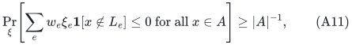
where the <code class="math">\xi_e</code> are independent standard Gaussians. The associated hereditary Gaussian-section argument and dilated partial-coloring theorem yield <code class="math">O(\log(2&#124;A&#124;)/\epsilon^2)</code> whole original items.

For clarity, the Gaussian part has a short direct proof. Independently sample a standard Gaussian <code class="math">T_{e,D}</code> for each left coset <code class="math">D\in A/L_e</code>, and define
<!-- math-display: 9e0a8e700e4bc7c88dc15bb4
F_x=2^{-1/2}\sum_e w_eT_{e,xL_e},
 \quad
 Y_x=F_1-F_x,
 \quad
 Z_x=\sum_e w_e\xi_e\mathbf1[x\notin L_e].
 \tag{A12}
-->
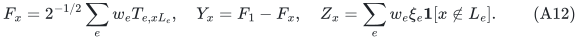
Left translation preserves the law of <code class="math">F</code>, so the identity is a global minimum with probability at least <code class="math">1/&#124;A&#124;</code>. For each coordinate, <code class="math">Y_x</code> and <code class="math">Z_x</code> have the same variance. For two coordinates outside <code class="math">L_e</code>, the contribution to <code class="math">\mathrm{Cov}(Y_x,Y_y)</code> is
<!-- math-display: fbfc5c424f77f3e52875e8cd
\frac{w_e^2}{2}\bigl(1+\mathbf1[xL_e=yL_e]\bigr)\le w_e^2,
-->
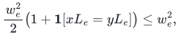
and the corresponding contribution to <code class="math">\mathrm{Cov}(Z_x,Z_y)</code> is <code class="math">w_e^2</code>. If either coordinate belongs to <code class="math">L_e</code>, both contributions vanish. Slepian comparison, after normalizing nonzero coordinates, proves (A11).

Apply (A11) to <code class="math">A=\widetilde G</code> and <code class="math">L_e=K_{C_e}</code>, and restrict its event to <code class="math">q(G)</code>. The exact identity (A10) gives
<!-- math-display: f5171088e5727c91aa02461b
\Pr_{\xi}\!\left[
   \sum_e w_e\xi_e b_e(g)\le0
   \text{ for all }g\in G
 \right]\ge\frac1{2N^2}.
 \tag{A13}
-->
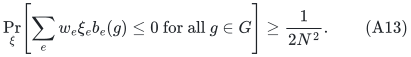
Crucially, the same lower bound holds after every positive rescaling and every restriction of the item family.

Here is the remaining support argument, with the companion Gaussian symmetrization lemma made explicit. For a current positive weighting and <code class="math">0&lt;a\le1/2</code>, let
<!-- math-display: 222ec6e0cbaef87ee70ff5fc
K_a=\left\{
 z:\sum_e w_ez_e b_e(g)\le aW(g)\quad\forall g
 \right\}.
 \tag{A14}
-->
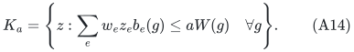
It contains <code class="math">a[-1,1]^m</code>, and every coordinate section contains the corresponding one-sided cone from (A13). The companion Gaussian symmetrization lemma says that, whenever
<!-- math-display: 04ac6f4e2e7c047a8955ae1c
m\ge C\log(2/p)/a^2,
 \qquad p=(2N^2)^{-1},
-->
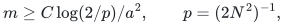
the symmetric body
<!-- math-display: 22eea4dcf3c3f6d34d2b51c7
Q_a=K_a\cap(-K_a)\cap[-1,1]^m
 \tag{A15}
-->
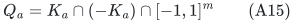
has volume at least <code class="math">c^m</code>, for an absolute <code class="math">c&gt;0</code>. This lemma uses Gaussian coordinate sections, midpoint reflection, Prékopa's theorem, and Gaussian correlation; its full proof is in the companion manuscript.

The Reis--Rothvoss large-volume partial-coloring theorem then produces
<code class="math">z\in sQ_a\cap[-1,1]^m</code>, with constant <code class="math">s</code>, having at least <code class="math">m/2</code> coordinates equal to <code class="math">1</code> or <code class="math">-1</code>. Choose its sign so that at least <code class="math">m/4</code> coordinates are <code class="math">-1</code>, and replace
<!-- math-display: a3f7c4db22086827bf23f5e2
w_e\longleftarrow w_e(1+z_e).
-->
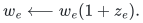
This keeps weights nonnegative, deletes at least a quarter of the items, and incurs relative error at most <code class="math">sa</code> for every query.

At support size <code class="math">m_t</code>, use
<!-- math-display: 61ede88bbf5e7008fa8285e5
a_t=\sqrt{C\log(4N^2)/m_t}.
 \tag{A16}
-->
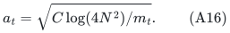
Stop at <code class="math">M=C'\log(2N)/\epsilon^2</code>. Since the support shrinks by a factor at most <code class="math">3/4</code>, the sum of the earlier <code class="math">sa_t</code> is <code class="math">O(\sqrt{\log(2N)/M})</code>. A sufficiently large <code class="math">C'</code> makes this at most <code class="math">\epsilon/4</code> and keeps every invoked <code class="math">a_t\le1/2</code>. Multiplying the one-stage inequalities yields (A3). If the initial support is already at most <code class="math">M</code>, retain it unchanged.

Only the <code class="math">N</code> original query inequalities in (A14) need to be supplied to this algorithm. The <code class="math">2N^2</code>-element wreath group proves the mass bound; it need not be materialized as the query table used by the partial-coloring procedure.

### Exact total-weight normalization

To obtain the optional variant, first work over <code class="math">G\times C_2</code> and replace each accepting coset <code class="math">C_e</code> by <code class="math">C_e\times\{0\}</code>. At a query <code class="math">(g,0)</code> its violation is the original predicate; at every query <code class="math">(g,1)</code> its violation equals one. Apply Theorem 1 with error <code class="math">\eta=\epsilon/4</code> to these augmented items. Let <code class="math">W_{\mathrm{tot}}=\sum_e w_e</code> and let <code class="math">\widehat W_{\mathrm{tot}}</code> be the total output weight. The bit-one query guarantees
<!-- math-display: b736e3de65d7a35fdd21b9db
(1-\eta)W_{\mathrm{tot}}
 \le\widehat W_{\mathrm{tot}}
 \le(1+\eta)W_{\mathrm{tot}}.
-->
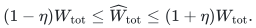
For a nonempty positive-weight input, rescale every output coefficient by
<code class="math">W_{\mathrm{tot}}/\widehat W_{\mathrm{tot}}</code>. The total is then exact, and each original query has multiplicative factors between
<code class="math">(1-\eta)/(1+\eta)</code> and <code class="math">(1+\eta)/(1-\eta)</code>, contained in <code class="math">[1-\epsilon,1+\epsilon]</code>. The extra binary factor changes <code class="math">\log(2&#124;G&#124;)</code> only by an additive constant.

This argument keeps even an original zero-loss item <code class="math">C_e=G</code> available, since its augmented predicate is nonzero on bit-one queries. Empty accepting sets, if present, can first be combined exactly into one original constant-one item while preserving their total weight. The empty input is trivial.

## 4. Arbitrary-arity group CSPs

Let <code class="math">A</code> be any finite group, and let <code class="math">x=(x_1,\ldots,x_n)\in A^n</code> be an assignment. An original constraint <code class="math">e</code> may have arbitrary arity <code class="math">r_e</code> and accept a coset
<!-- math-display: c7d2b3b122c9c51c613b35d1
R_e=a_eH_e\subseteq A^{r_e}.
 \tag{A17}
-->
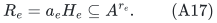
Its scope selects coordinates of <code class="math">x</code>; repeated variables are allowed. Coordinate selection is a group homomorphism
<code class="math">\pi_e:A^n\to A^{r_e}</code>.

If <code class="math">\pi_e^{-1}(R_e)</code> is nonempty, choose one <code class="math">x_e</code> in it. Then
<!-- math-display: 79b5b4bf51ca545a46e4aac2
\pi_e^{-1}(R_e)=x_e\,\pi_e^{-1}(H_e).
 \tag{A18}
-->
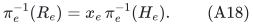
This is a coset in the common assignment group <code class="math">A^n</code>. If the preimage is empty, the violation predicate is constant one and is handled as above.

**Corollary 2.** The weighted number of violated constraints
<!-- math-display: ad08c4ed0d38da381fa8e9c2
\mathrm{Viol}(x)
 =\sum_e w_e\mathbf1[\pi_e(x)\notin a_eH_e]
-->
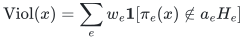
has a relative-error sparsifier retaining
<!-- math-display: 724098bdaedc1e374f9caa75
O\!\left(\min\left\{m,
 \frac{1+n\log|A|}{\epsilon^2}\right\}\right)
 \tag{A19}
-->
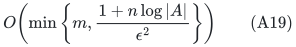
whole original constraints, simultaneously for all assignments. The bound has no arity factor. The alphabet group may be nonabelian and may be part of the input.

This includes heterogeneous relations and inconsistent constraint systems. The objective is the weight of violations of the accepting cosets, equivalently the weight satisfied by their complementary predicates. It is not a simultaneous multiplicative guarantee for both satisfaction and violation counts.

### Exact relation to group-derived Mal'tsev predicates

The relevant ternary operation on a group is
<!-- math-display: d8126b70a65d7517b14f4cb6
\mu(x,y,z)=xy^{-1}z.
 \tag{A20}
-->
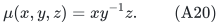
A nonempty subset <code class="math">R\subseteq A^r</code> is closed under this coordinatewise operation if and only if it is a left coset of a subgroup of <code class="math">A^r</code>.

To prove the nontrivial direction, fix <code class="math">a\in R</code> and put <code class="math">H=a^{-1}R</code>. It contains the identity. If <code class="math">h_1,h_2\in H</code>, then
<!-- math-display: b852da39c50aeb727d184a82
(ah_1)a^{-1}(ah_2)=ah_1h_2\in R,
-->
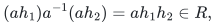
so <code class="math">h_1h_2\in H</code>. Also
<!-- math-display: 65a4df57b36b22672e60a4f2
a(ah_1)^{-1}a=ah_1^{-1}\in R,
-->
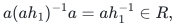
so <code class="math">h_1^{-1}\in H</code>. Thus <code class="math">H</code> is a subgroup and <code class="math">R=aH</code>. Conversely,
<!-- math-display: 5edd8618a9668dcfb0550c40
(ah_1)(ah_2)^{-1}(ah_3)=ah_1h_2^{-1}h_3
-->
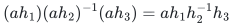
stays in <code class="math">aH</code>.

Consequently (A19) applies to the entire class of predicates preserved by the **group-derived** Mal'tsev operation (A20), for arbitrary finite groups. It does not assert an optimal bound for every algebra carrying an arbitrary Mal'tsev operation. It also does not assert that every ordered nonabelian word equation defines a subgroup coset: that requires a separate closure check.

## 5. Arbitrary-center coordinate coresets for finite group codes

Let <code class="math">\mathcal C\le A^m</code> be a subgroup code over any finite group <code class="math">A</code>. Fix an arbitrary received word <code class="math">y\in A^m</code> and positive coordinate weights <code class="math">w_e</code>. Consider
<!-- math-display: 5007c4fdfb864278581a491c
d_w(c,y)=\sum_{e=1}^m w_e\mathbf1[c_e\ne y_e],
 \qquad c\in\mathcal C.
 \tag{A21}
-->
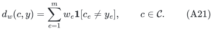
For the coordinate homomorphism <code class="math">\pi_e:\mathcal C\to A</code>, the fiber
<code class="math">\pi_e^{-1}(y_e)</code> is either empty or a coset of its kernel. Theorem 1 therefore gives
<!-- math-display: 1f243b9230a542e5c6c0f6ad
O\!\left(\min\left\{m,
 \frac{\log(2|\mathcal C|)}{\epsilon^2}\right\}\right)
 \tag{A22}
-->
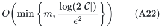
retained original coordinates preserving every distance (A21).

The center need not belong to the code, and there need not be a codeword matching every center coordinate. The same conclusion holds for a coset code after parametrizing it by its underlying subgroup. One may also replace singleton coordinate acceptance by any coset acceptance set in the alphabet, or use a projection to an entire coordinate block and keep that block as one item.

This is a coreset for the whole nearest-codeword objective, not a new decoding algorithm. If the retained objective is minimized exactly over the same code, its minimizer has original objective at most <code class="math">(1+\epsilon)/(1-\epsilon)</code> times the original optimum. Solving the retained optimization may remain hard.

## 6. Lower bound and parameter range

At constant accuracy, <code class="math">\Omega(\log N)</code> items are necessary already for <code class="math">G=\mathbb F_2^r</code>: take the <code class="math">r</code> coordinate kernels. A unit-vector query isolates each coordinate item, forcing every one to remain.

The joint <code class="math">\log N/\epsilon^2</code> dependence is also necessary in the usual nontrivial accuracy regime. Let <code class="math">K_{s,B}</code> be a complete bipartite graph, with
<!-- math-display: 2cc6114bfd8d8b0543b5880e
s=\lceil\epsilon^{-2}\rceil,\qquad
 B\ge s,\qquad 0<\epsilon\le1/2,
-->
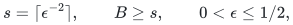
and <code class="math">n=s+B</code>. Take the assignment group
<!-- math-display: adbac7a7cf1cfd07cf76e91a
G=\mathbb F_2^n/\langle\mathbf1\rangle,
 \qquad N=2^{n-1}.
-->
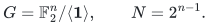
For each edge <code class="math">uv</code>, its accepting subgroup is
<code class="math">\{x:x_u=x_v\}</code>, which is well-defined on the quotient. The sum of violations is exactly the cut size.

The elementary complete-bipartite cut lower bound gives, for any nonnegative reweighting preserving all cuts, at least
<!-- math-display: 5d1fcb46ffc35169ded2447d
\frac{(1-\epsilon)^2sB}
 {(1+3\sqrt2\,\epsilon\sqrt s)^2}
 =\Omega(n/\epsilon^2)
 =\Omega(\log N/\epsilon^2)
 \tag{A23}
-->
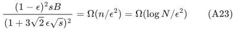
retained original edges. A derivation using degree constraints, signed cut discrepancies, Khintchine's inequality, and Jensen's inequality appears as (EC15) in the companion exact-label-cut manuscript. This is an inherited classical cut obstruction, not a claim of a new ordinary cut lower bound.

Thus (A2) has the correct worst-case order when
<code class="math">\log_2N+1\ge2\lceil\epsilon^{-2}\rceil</code>, subject to the natural cap by <code class="math">m</code>.

## 7. Related work

**Quanrud's entropy/quotient theorem gives a particularly relevant comparison.** For homogeneous subgroups <code class="math">H_e\le G</code>, let a uniformly random <code class="math">g\in G</code> induce the coset-valued variables <code class="math">gH_e</code>. Their joint entropy is
<!-- math-display: f90ab1a7474453edc8adb801
f(S)=\log_2\!\left[G:\bigcap_{e\in S}H_e\right].
-->
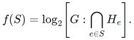
It is a normalized monotone submodular function, every positive marginal is at least one, and <code class="math">r=f([m])\le\log_2&#124;G&#124;</code>. For a fixed query <code class="math">g</code>, the zero-item set <code class="math">Z_g=\{e:g\in H_e\}</code> is closed: if adding <code class="math">H_e</code> leaves the intersection unchanged, that intersection is contained in <code class="math">H_e</code>, so a query satisfying all its members also satisfies <code class="math">e</code>.

Quanrud's public Theorem 1.1 therefore gives <code class="math">O(r\log(mr)/\epsilon^2)</code> support directly, including for nonnormal subgroups. The adaptive resparsification consequence in [../../label-block-cut/manuscripts/adaptive-quotient-resparsification.md](../../label-block-cut/manuscripts/adaptive-quotient-resparsification.md) removes the ground-set dependence and gives
<!-- math-display: 7653e1940d6da6a8ad854f35
O\!\left(\frac{r\log(2r/\epsilon)}{\epsilon^2}\right).
 \tag{A24a}
-->
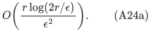
The wreath compiler applies the same comparison to arbitrary cosets with <code class="math">r=O(\log(2N))</code>. Thus (A24a) is the sharper checked comparison for this group class; the new Gaussian result removes its remaining logarithm. The cleaner resparsified formula is not attributed as a verbatim theorem of Quanrud.

The public theorem explicitly permits real-valued ranks with minimum positive marginal one; integrality is not needed for this existential/oracle comparison. Whether an implicitly represented logarithmic rank admits the required polynomial-bit optimization oracle is a separate computational question and does not invalidate the comparison. [Primary source, Theorem 1.1 and Corollary 1.7](https://kentq.s3.amazonaws.com/submodular-sparsification.pdf).

**Brakensiek--Guruswami, STOC 2025, expanded 2026 version.** Theorem 6.8 of *Redundancy Is All You Need (for CSP Sparsification)* explicitly gives weighted subgroup-code sparsifiers, including nonabelian alphabet groups, of size
<!-- math-display: 19e5a5d36207c1625be553be
O(\log|\mathcal C|\,\log^6m/\epsilon^2).
-->
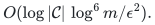
Theorems 6.11--6.12 give weighted sparsification with a polylogarithmic overhead for complements of general Mal'tsev predicates. Nonabelian group-code sparsification and Mal'tsev CSP sparsification are therefore established public models. [Primary source](https://arxiv.org/html/2411.03451v2).

**Brakensiek--Guruswami--Putterman, ICALP 2026.** Theorem 1.2 of *Multiplicative Error Set System Sparsification: A Simpler Proof via Chain Length Contraction* improves the general weighted support bound to
<!-- math-display: 0df7d8b46ada5e3b3bef759a
O\!\left(
 \frac{d\log^2(2d/\epsilon)
 [\log\log(4d/\epsilon)]^2}{\epsilon^2}
 \right),
 \tag{A24}
-->
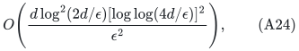
where <code class="math">d</code> is the union-closure chain length. The result is independent of the number of original items, so an older <code class="math">\log^6m</code> comparison alone would be incomplete. This is the stronger general set-system bound, while the entropy-based comparison above is sharper for the present group class. [Primary source](https://arxiv.org/html/2605.01508v1).

For the present coset predicate family, <code class="math">d=O(\log(2N))</code>. To see this on the correct side of the incidence system, let
<!-- math-display: 0b2388c8f74d3f358d7f6762
S_g=\{e:g\notin C_e\}.
-->
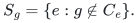
A nested chain of unions of the <code class="math">S_g</code>'s can be represented by nested accumulated query sets <code class="math">T\subseteq G</code>. The complement of such a union consists of cosets <code class="math">C_e</code> containing all of <code class="math">T</code>, equivalently containing its affine hull: for nonempty <code class="math">T</code> and <code class="math">a\in T</code>, this hull is
<!-- math-display: 37bbd074435119db393da072
\mathrm{aff}(T)
 =a\langle a^{-1}t:t\in T\rangle.
-->
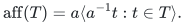
Every strict increase of a nonempty affine hull multiplies its size by at least two. The possible initial empty hull contributes one extra step. If the violated-item union increases, its affine hull must increase as well. This proves the claimed chain bound and makes (A24) an applicable broader baseline.

**Algebraic antecedent.** Dinh--Moore--Russell's *McEliece and Niederreiter Cryptosystems That Resist Quantum Fourier Sampling Attacks*, Proposition 3, supplies the standard wreath subgroup used in Section 2. The present proof is classical and uses no quantum algorithm. [Primary 2011 manuscript](https://sfi-edu.s3.amazonaws.com/sfi-edu/production/uploads/sfi-com/dev/uploads/filer/aa/25/aa2531de-e04e-4fea-8772-6f9341ddb6b7/11-06-021.pdf).

**Analytic antecedents.** Slepian's Gaussian comparison is classical. The dilated partial-coloring theorem is Reis--Rothvoss, Theorem 7 of the July 2026 version of *Linear-size <code class="math">\ell_1</code> Sparsifiers*. The new hereditary Gaussian-section bridge and the homogeneous subgroup mass theorem are proved in the companion subgroup manuscript; they are the support backend used here. [Slepian](https://doi.org/10.1002/j.1538-7305.1962.tb02419.x); [Reis--Rothvoss](https://arxiv.org/html/2606.28147v2).

The resulting increment is the removal of the remaining support logarithm for arbitrary weighted finite-group coset constraints, with arbitrary arity and no common satisfying assignment, and the arbitrary-center group-code corollary. This manuscript does not claim a compact polynomial-time optimal construction, an improvement for arbitrary Mal'tsev algebras, or a theorem for arbitrary nonabelian word equations.
