# Optimal support and compact sparsification for affine modular blocks

**Abstract.** For arbitrary binary-encoded modulus <code class="math">q</code>, weighted affine blocks of congruences admit a relative-error summary on <code class="math">O(r/\epsilon^2)</code> whole original blocks, where <code class="math">r</code> is the logarithm of the subgroup generated by all augmented rows. A factorization-free randomized compact-input algorithm retains <code class="math">O(r\log(2r/\epsilon)/\epsilon^2)</code> blocks. Exact closure-preserving rationalization supplies the required value oracle. A multilevel cut construction over powers of two establishes <code class="math">\Omega(n\log q/\epsilon^2)</code> support in the stated joint regime.

## 1. Main theorem

Let <code class="math">q\ge2</code> be an arbitrary integer. A weighted input item <code class="math">e</code> consists of
<!-- math-display: 2ac38760c47327a38da350b6
A_e\in\mathbb Z_q^{k_e\times n},\qquad
b_e\in\mathbb Z_q^{k_e},\qquad w_e\in\mathbb Q_{\ge0}.
-->
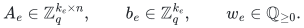
Its penalty is
<!-- math-display: c78fcee9370e8c88e9332d9c
B_e(x)=\mathbf1[A_ex\ne b_e\pmod q],
\qquad x\in\mathbb Z_q^n,
\tag{MB1}
-->
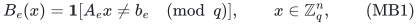
where the vector inequality means that **at least one** equation in the block fails. A block contributes its weight once, regardless of how many internal equations fail. The number of equations and the variable support of a block are unrestricted.

Write
<!-- math-display: bb8bdc69c344e6563b01e892
W(x)=\sum_{e=1}^m w_eB_e(x),
\qquad
M_e=[\,A_e\ \ -b_e\,]\in\mathbb Z_q^{k_e\times(n+1)}.
-->
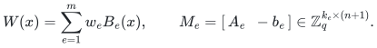
Let <code class="math">H\le\mathbb Z_q^{n+1}</code> be the additive subgroup generated by all rows of all <code class="math">M_e</code>, and put
<!-- math-display: 5271f8b9ff12742da80ec891
r=\log_2|H|,\qquad R=(n+1)\log_2q.
\tag{MB2}
-->
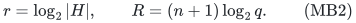
If <code class="math">H=\{0\}</code>, every penalty is zero and the empty output suffices. Otherwise <code class="math">1\le r\le R</code>.

**Theorem MB.** For <code class="math">0&lt;\epsilon&lt;1</code>, there are nonnegative coefficients <code class="math">c_e</code>, on a subset of the original block indices, satisfying
<!-- math-display: 1b1ff18001fda671b70ace34
(1-\epsilon)W(x)
\le\sum_e c_e B_e(x)
\le(1+\epsilon)W(x)
\qquad\text{for every }x\in\mathbb Z_q^n.
\tag{MB3}
-->
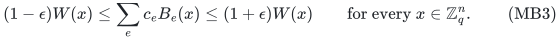
The following two bounds hold.

1. **Support existence.** One can retain
   <!-- math-display: ed3cc86ecae50c8fa19485ad
   O\!\left(\min\{m,r/\epsilon^2\}\right)
      \subseteq O\!\left(\min\{m,R/\epsilon^2\}\right)
      \tag{MB4}
   -->
   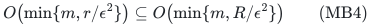
   whole original blocks. The supplied construction is polynomial in an explicitly listed finite-group query table, which can be exponential in the compact input dimension.

2. **Compact randomized construction.** In time polynomial in the binary input length and <code class="math">\epsilon^{-1}</code>, without factoring <code class="math">q</code>, one can retain
   <!-- math-display: 83d930450452496b122abb41
   O\!\left(
         \min\left\{m,\frac{r\log(2r/\epsilon)}{\epsilon^2}\right\}
      \right)
      \subseteq
      O\!\left(
         \min\left\{m,\frac{R\log(2R/\epsilon)}{\epsilon^2}\right\}
      \right)
      \tag{MB5}
   -->
   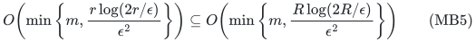
   whole original blocks, with success probability at least <code class="math">2/3</code>.

There is no factor for the number of rows in a block. The rows contribute to input-reading and normal-form computation costs. Arbitrary rational weight ratios are allowed.

For <code class="math">q=2^k</code>, the worst-case support scale in (MB4) is necessary: for <code class="math">0&lt;\epsilon\le1/4</code> and <code class="math">n\ge2\lceil(2\epsilon)^{-2}\rceil</code>, there are weighted instances requiring
<!-- math-display: ea8561c94308763bbe45cd8b
\Omega(n\log q/\epsilon^2)
\tag{MB6}
-->
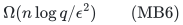
original items. These already use homogeneous scalar congruences on two variables per item. Thus the existence bound is jointly sharp in <code class="math">n,\log q,\epsilon</code> in this regime. This does not assert that the <code class="math">\log q</code> factor is necessary for prime <code class="math">q</code>.

## 2. Optimal support from whole subgroup predicates

For each block, let <code class="math">J_e\le H</code> be generated by its augmented rows. Let <code class="math">\widehat H</code> be the character group of <code class="math">H</code>; since <code class="math">H</code> is finite abelian, <code class="math">&#124;\widehat H&#124;=&#124;H&#124;</code>.

Every <code class="math">y\in\mathbb Z_q^{n+1}</code> defines a character
<!-- math-display: f458b0845831ec3cf448f1cb
\chi_y(h)=\exp(2\pi i\,h\cdot y/q).
-->
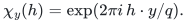
Define the annihilator subgroup
<!-- math-display: fb083be6aeda026066656daa
K_e=\{\chi\in\widehat H:\chi(h)=1\text{ for all }h\in J_e\}.
\tag{MB7}
-->
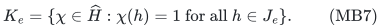
Then
<!-- math-display: d7732e82bfaafdbf24303a39
\mathbf1[M_ey\ne0\pmod q]
=\mathbf1[\chi_y\notin K_e].
\tag{MB8}
-->
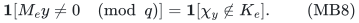

The whole-subgroup sparsification theorem in 30_optimal_whole_subgroup_constraints.md applies to arbitrary subgroups <code class="math">K_e</code> of a finite group and arbitrary nonnegative weights. It retains
<!-- math-display: 3178d58d857c582e8a383d17
O(\log(2|\widehat H|)/\epsilon^2)=O(r/\epsilon^2)
-->
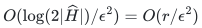
original predicates, simultaneously for all characters. Restricting to <code class="math">y=(x,1)</code> proves (MB3)--(MB4). It suffices that every required <code class="math">y</code> gives a character; no particular parametrization of all characters is needed.

Each block remains one predicate. Sparsifying its scalar equations independently would preserve a different function.

The companion proof uses a Gaussian coset comparison, hereditary-section symmetrization, and partial coloring. With a complete query table, separation scans its inequalities. No compact polynomial-time implementation of that optimal-support construction is claimed. The ambient group <code class="math">\mathbb Z_q^{n+1}</code> gives the <code class="math">R</code>-bound directly; passing to <code class="math">\widehat H</code> explains the sharper actual parameter <code class="math">r</code>.

## 3. A logarithmic-order polymatroid on the original blocks

For <code class="math">S\subseteq[m]</code>, put
<!-- math-display: 0782113ba7c44e013cb6a81d
J(S)=\sum_{e\in S}J_e,\qquad
N_S=|J(S)|,\qquad f(S)=\log_2N_S.
\tag{MB9}
-->
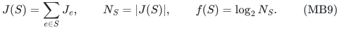
This function is normalized, monotone, and submodular. Indeed,
<!-- math-display: 5cad384eebb1cc337151c96d
J(S\cup T)=J(S)+J(T),\qquad
J(S\cap T)\subseteq J(S)\cap J(T),
-->
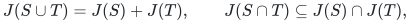
and finite subgroup orders satisfy
<!-- math-display: caed3c3f3fc3017a79af0615
|J(S)|\,|J(T)|
=|J(S)+J(T)|\,|J(S)\cap J(T)|
\ge |J(S\cup T)|\,|J(S\cap T)|.
\tag{MB10}
-->
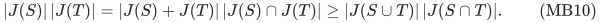
Taking logarithms gives submodularity.

For <code class="math">S\subseteq T</code>, a strict increase has
<!-- math-display: f400d49dd3297a34721cffd3
f(T)-f(S)=\log_2[J(T):J(S)]\ge1,
\tag{MB11}
-->
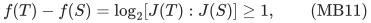
because a nontrivial finite index is an integer at least two. The total value is <code class="math">f([m])=r</code>.

For a homogeneous query <code class="math">y</code>, let
<!-- math-display: 9af086fb6ccde31e8a1dd1ba
Z_y=\{e:M_ey=0\pmod q\}.
-->
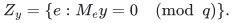
This set is closed for <code class="math">f</code>. All rows in <code class="math">J(Z_y)</code> annihilate <code class="math">y</code>. If adding <code class="math">e</code> has zero <code class="math">f</code>-marginal, the nested subgroups have the same order, so <code class="math">J_e\subseteq J(Z_y)</code>. Hence every row of <code class="math">e</code> also annihilates <code class="math">y</code>, giving <code class="math">e\in Z_y</code>. Therefore <code class="math">[m]\setminus Z_y</code> is a quotient in Quanrud's terminology.

This argument uses additive subgroups and their orders, without assuming a field rank or a free-module basis over the composite ring.

## 4. Exact order computation without factoring the modulus

Set <code class="math">d=n+1</code>. For a block subset <code class="math">S</code>, form the full-rank integer lattice
<!-- math-display: 92b206909ed1cf0e3b2b13a7
\mathcal L_S=
\mathrm{span}_{\mathbb Z}
\{\text{integer representatives of the augmented rows in }S\}
+q\mathbb Z^d
\subseteq\mathbb Z^d.
\tag{MB12}
-->
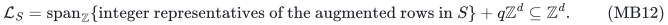
Then <code class="math">J(S)=\mathcal L_S/q\mathbb Z^d</code>. If <code class="math">D_S</code> is a square Hermite-normal-form basis of <code class="math">\mathcal L_S</code>, then
<!-- math-display: 644a8fd0d350d34bdc40d6d4
N_S=\frac{q^d}{|\det D_S|}.
\tag{MB13}
-->
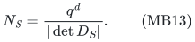
This quotient is an exact positive integer.

Standard polynomial-bit HNF algorithms compute the basis and determinant from the explicit rows and <code class="math">qI_d</code>, without prime factorization. All group orders have at most <code class="math">O(d\log q)</code> bits.

Compute <code class="math">N_{[m]}</code> the same way. If it exceeds one, use the integer bound
<!-- math-display: ffc6886cd4613f52a12980a6
\overline R=\lceil\log_2N_{[m]}\rceil,
\qquad
r\le\overline R<r+1\le2r.
\tag{MB14}
-->
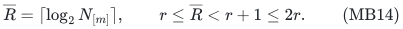
It is found from the binary length, with a power-of-two check.

The values <code class="math">\log_2N_S</code> are generally irrational. Treating them as exact real inputs to a rational submodular-minimization algorithm would leave a bit-complexity gap. The next step resolves it while preserving precisely the same closed sets.

## 5. Rationalization and the compact algorithm

The rounding theorem in 35_rational_quotient_ranks_from_weak_oracles.md gives a deterministic exact rational value oracle <code class="math">g</code> that is normalized, monotone, and submodular, has the same zero marginals as <code class="math">f</code>, has every positive marginal at least one, and satisfies
<!-- math-display: 44dfb974e78a32fdb247241a
g([m])=O(\overline R)=O(r).
-->
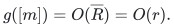
Its values have a common dyadic denominator <code class="math">O(\overline R)</code> and polynomial bit complexity.

For the present integer-order oracle, its direct specialization is
<!-- math-display: 55d526065db56cb953b2e303
\phi(t)=t-\frac{t^2}{4\overline R},
\qquad
g(S)=4\,\mathrm{Round}
\bigl(\phi(\log_2N_S)\bigr),
\tag{MB15}
-->
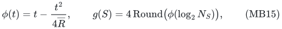
where the deterministic dyadic approximation has additive error at most <code class="math">\delta=1/(64\overline R)</code>, is identical for identical integer <code class="math">N_S</code>, and is exactly zero at <code class="math">N_S=1</code>.

The mechanism is a positive submodularity slack gap. Set <code class="math">I=S\cap T</code>, <code class="math">U=S\cup T</code>, <code class="math">x=f(I)</code>, <code class="math">a=f(S)-x</code>, and <code class="math">b=f(T)-x</code>. When <code class="math">a,b&gt;0</code>, both are at least one, and
<!-- math-display: 6ef77a9f74b8e3548f5549e2
\begin{split}
&\phi(f(S))+\phi(f(T))-\phi(f(I))-\phi(f(U))\\
&\hspace{25mm}\ge \frac{ab}{2\overline R}
\ge\frac1{2\overline R}.
\end{split}
\tag{MB16}
-->
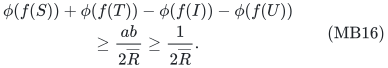
This uses submodularity of <code class="math">f</code> and monotonicity of <code class="math">\phi</code> on <code class="math">[0,2\overline R]</code>. Four rounding errors cost at most <code class="math">4\delta=1/(16\overline R)</code>. If <code class="math">a=0</code> or <code class="math">b=0</code>, monotonicity and submodularity force equality of the opposite nested pair too; the corresponding integer-order keys make their rounded values cancel exactly. A positive nested increase gives a <code class="math">\phi</code>-increase at least <code class="math">1/2</code>, so rounding and scaling by four leave its marginal greater than one.

Only <code class="math">O(\log\overline R)</code> bits of logarithmic precision are needed. The companion provides a convergent rational series and its bit analysis. Neither <code class="math">N_S</code> nor <code class="math">q</code> is factored.

Apply Quanrud's quotient-sparsification theorem to <code class="math">g</code>, followed by the adaptive resparsification lemma in 27_adaptive_quotient_resparsification.md. Quanrud assumes that nonzero marginals are at least one, and does not require integer-valued <code class="math">g</code>. The dyadic denominator in (MB15) must therefore **not** be multiplied into the rank.

The algorithm preserves every quotient of <code class="math">g</code> with support
<!-- math-display: f27e9f7cd57713263ab8c3da
O(r\log(2r/\epsilon)/\epsilon^2).
-->
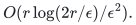
Its ground-set elements are the original blocks. Since <code class="math">g</code> and <code class="math">f</code> have the same closed sets, all active sets <code class="math">[m]\setminus Z_y</code> are preserved. Restrict to <code class="math">y=(x,1)</code>.

The resparsification companion gives the error-product and constant-confidence ledger. Its rational-weight analysis applies to the fixed-denominator oracle here: marginal numerators have polynomial bit length, and there are <code class="math">O(\log\log(2m))</code> passes. Every group-order query is an HNF computation. This proves (MB5) with compact randomized polynomial bit time and no factoring oracle.

## 6. A matching lower bound for powers of two

### 6.1 The cut-support ingredient

Let <code class="math">0&lt;\eta\le1/2</code>, <code class="math">s=\lceil\eta^{-2}\rceil</code>, and <code class="math">B\ge s</code>. Every nonnegative reweighting of original edges preserving all cuts of unweighted <code class="math">K_{s,B}</code> within <code class="math">1\pm\eta</code> uses
<!-- math-display: 1adf41af7b991b70516372b7
\Omega(B/\eta^2)
\tag{MB17}
-->
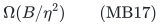
edges.

Here is a proof. Write the output as an <code class="math">s\times B</code> matrix <code class="math">W</code>, put <code class="math">E=W-\mathbf1</code>, and let <code class="math">t_j</code> be the number of nonzero entries in column <code class="math">j</code>. The total-weight cut and arbitrary sign cuts imply
<!-- math-display: c369333923399574ce390c1e
|\sigma^\top E\tau|\le3\eta sB
\quad(\sigma\in\{\pm1\}^s,\ \tau\in\{\pm1\}^B).
-->
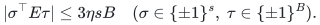
Choose the maximizing <code class="math">\tau</code> for each <code class="math">\sigma</code>, then average over independent signs <code class="math">\sigma</code>. The <code class="math">L_1</code> Khintchine inequality gives
<!-- math-display: 581c28303d804393756d0c03
\sum_j\|E_{\cdot j}\|_2\le3\sqrt2\,\eta sB.
-->
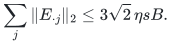
A singleton right-vertex cut gives degree at least <code class="math">(1-\eta)s</code>, hence
<!-- math-display: 50c675af68e6f32c9ae598dd
\|E_{\cdot j}\|_2
\ge\frac{(1-\eta)s}{\sqrt{t_j}}-\sqrt s.
-->
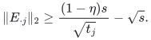
If <code class="math">t=\sum_jt_j</code>, Jensen's inequality gives
<!-- math-display: 33d943c1313e82f7820e7710
t\ge
\frac{(1-\eta)^2sB}
     {(1+3\sqrt2\,\eta\sqrt s)^2}
=\Omega(B/\eta^2).
\tag{MB18}
-->
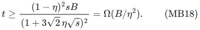
This is the inherited cut-support obstruction also recorded in 28_exact_label_cut_and_matroid_quotient_sparsification.md.

### 6.2 Independent valuation levels

Let <code class="math">q=2^k</code>, <code class="math">\eta=2\epsilon\le1/2</code>, and
<!-- math-display: b119bae3b4437ced63f1a9f0
s=\lceil(2\epsilon)^{-2}\rceil,\qquad B=n-s\ge s.
-->
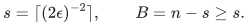
Use the vertices of <code class="math">K_{s,B}</code> as the <code class="math">n</code> modular variables. For every edge <code class="math">uv</code> and each <code class="math">j=0,\ldots,k-1</code>, introduce the scalar block
<!-- math-display: 283c3bc32bdba6cd0ec12d12
2^j(x_u-x_v)\equiv0\pmod{2^k}
-->
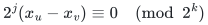
with weight <code class="math">3^j</code>.

For <code class="math">0\le\ell\le k</code>, restrict to
<!-- math-display: 7b69d06b363dcb22164ee428
x_v=2^{k-\ell}z_v\pmod{2^k},
\qquad z_v\in\{0,1\}.
\tag{MB19}
-->
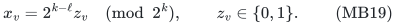
At <code class="math">\ell=0</code> this is the all-zero query. Precisely the crossing edges at levels <code class="math">j&lt;\ell</code> violate their equations. Their total weight is
<!-- math-display: e79668167aa286a974713815
W_\ell=\sum_{j<\ell}3^j=\frac{3^\ell-1}{2}
-->
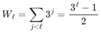
times the cut size of <code class="math">K_{s,B}</code>.

For any claimed sparsifier, let <code class="math">G'_j</code> consist of its retained original items at level <code class="math">j</code>, with their output coefficients. Equation (MB3) gives
<!-- math-display: d487137f829a51b268b68c38
\mathrm{cut}_{\sum_{j<\ell}G'_j}(z)
\in(1\pm\epsilon)W_\ell
\mathrm{cut}_{K_{s,B}}(z)
\quad\text{for every }z.
\tag{MB20}
-->
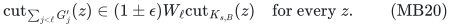
Subtract the prefix equations for <code class="math">\ell=j+1</code> and <code class="math">\ell=j</code>. The error bounds add:
<!-- math-display: bb250dfc841bbb0d95d21fda
\begin{split}
\left|
\mathrm{cut}_{G'_j}(z)
-3^j\mathrm{cut}_{K_{s,B}}(z)
\right|
&\le\epsilon(W_{j+1}+W_j)
\mathrm{cut}_{K_{s,B}}(z)\\
&\le2\epsilon\,3^j\mathrm{cut}_{K_{s,B}}(z).
\end{split}
\tag{MB21}
-->
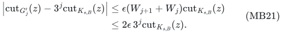
Thus <code class="math">3^{-j}G'_j</code> is a <code class="math">1\pm2\epsilon</code> cut sparsifier separately at every level. By (MB17), each level retains <code class="math">\Omega(B/\epsilon^2)</code> items. The levels have disjoint original item identities, so the total is
<!-- math-display: f9a1bd697268e2890a92a72c
\Omega(kB/\epsilon^2)=\Omega(n\log q/\epsilon^2).
-->
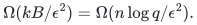

All coefficients and input weights have <code class="math">O(k)=O(\log q)</code> bits. The argument allows arbitrary nonnegative output coefficients. It already uses single-row, two-variable, homogeneous blocks.

The level-zero rows of the connected bipartite graph generate the entire sum-zero subgroup of <code class="math">\mathbb Z_q^n</code>; the homogenizing coordinate is zero. Thus this family has <code class="math">&#124;H&#124;=q^{n-1}</code> and <code class="math">r=(n-1)\log_2q</code>, so the lower bound also matches the actual-parameter order <code class="math">r/\epsilon^2</code>.

## 7. Mixed moduli

Blocks may also use a different modulus on each row. For a row
<!-- math-display: d434a153f9cf5dd6272cb2fe
a\cdot x\equiv b\pmod{q_i},
-->
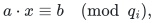
compute <code class="math">Q=\mathrm{lcm}_i q_i</code> by gcd operations and replace its augmented row by
<!-- math-display: d9f6bf1196a8f5ad2fb073ca
\frac{Q}{q_i}(a,-b)\pmod Q.
\tag{MB22}
-->
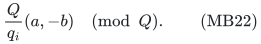
The original congruence holds exactly when this scaled row annihilates <code class="math">(x,1)</code> modulo <code class="math">Q</code>. Whole-block penalties are unchanged.

View assignments modulo <code class="math">Q</code>. Apply (MB4)--(MB5) to the subgroup generated by the scaled augmented rows; the coarse parameter is <code class="math">(n+1)\log_2Q</code>. Since <code class="math">\log Q\le\sum_i\log q_i</code>, all encodings and HNF computations remain polynomial in the original input length. No modulus is factored.

## 8. Related work

- **Khanna--Putterman--Sudan, _Efficient Algorithms and New Characterizations for CSP Sparsification_, STOC 2025.** Theorem 5.19 already gives arbitrary weighted scalar codes over <code class="math">\mathbb Z_q</code> compact randomized sparsifiers of size <code class="math">\widetilde O(n\log^2q/\epsilon^2)</code>, in time polynomial in <code class="math">mn\log q/\epsilon</code>. Section 6 treats finite abelian group codes. Modular code sparsification and affine homogenization are established models. Primary source: <https://arxiv.org/html/2404.06327v2>.

- **Quanrud, _Quotient sparsification for submodular functions_, SODA 2024.** Theorem 1.1 permits real-valued normalized monotone submodular functions with nonzero marginals at least one, and gives <code class="math">O(r\log(mr)/\epsilon^2)</code> support. The new implementation step here is the exact rational oracle preserving the closures of logarithmic subgroup order; a bare real-log oracle would not establish polynomial bit time. Primary manuscript: <https://kentq.s3.amazonaws.com/submodular-sparsification.pdf>.

- **Brakensiek--Guruswami--Putterman, _Multiplicative error set system sparsification: A simpler proof via chain length contraction_, May 2026.** Theorem 1.2 has an extra <code class="math">\log^2(d/\epsilon)(\log\log(d/\epsilon))^2</code> factor in chain length <code class="math">d</code>. Here <code class="math">d\le r</code>: intersections of closed sets remain closed, so every strict chain in the union-closure of the active sets reverses a strict chain of closed sets. Each strict inclusion between closed sets increases <code class="math">f</code> by at least one. Their Conjecture 5.1 asks for <code class="math">O(d/\epsilon^2)</code> in general. The subgroup theorem used here does not settle that conjecture for arbitrary set systems. Primary source: <https://arxiv.org/abs/2605.01508>.

- **Kannan--Bachem, _Polynomial Algorithms for Computing the Smith and Hermite Normal Forms of an Integer Matrix_, 1979.** This supplies the standard polynomial-bit HNF input: <https://doi.org/10.1137/0208040>.

The proof combines optimal-support whole subgroup sparsification, exact closure-preserving rationalization, and the valuation-level lower bound. It gives worst-case optimal <code class="math">O(n\log q/\epsilon^2)</code> support and a compact polynomial-time construction within one logarithm, uniformly for arbitrary affine modular blocks. In the scalar case, (MB5) replaces KPS's displayed quadratic <code class="math">\log q</code> dependence by linear <code class="math">\log q</code> times the explicit factor <code class="math">\log(n\log q/\epsilon)</code>. It does not claim to beat every specialized scalar or fixed-modulus algorithm in every regime.

Companions: 30_optimal_whole_subgroup_constraints.md, 35_rational_quotient_ranks_from_weak_oracles.md, 27_adaptive_quotient_resparsification.md, and 28_exact_label_cut_and_matroid_quotient_sparsification.md. None of these modular claims require quantum input or a Hilbert-space representation.
