# Sparsifying Hilbert metric sums under an action with few orbits

**Abstract.** Suppose one group action preserves every metric in a family of Hilbertian pseudometrics on <code class="math">N</code> points and has orbits of sizes <code class="math">N_1,\ldots,N_k</code>. A transitive tuple completion gives a whole-item sparsifier of size <code class="math">O(\min\{N,\log(2k!\prod_jN_j)\}/\epsilon^2)</code>. Its symmetry-based construction uses only the original distance table. An explicit family requires <code class="math">\Omega(k\log(N/k)/\epsilon^2)</code> items when the orbits are sufficiently large.

## 1. Statement

Let <code class="math">X</code> be a finite set of <code class="math">N\ge2</code> points. Each original item <code class="math">e\in[m]</code> is a Hilbertian pseudometric
<!-- math-display: 31faa2cc68cfcedf5832a59f
d_e(x,y)=\|\phi_e(x)-\phi_e(y)\|_2.
 \tag{FO1}
-->
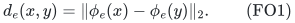
Embedding dimensions may vary. Let <code class="math">w_e&gt;0</code>, and set <code class="math">D(x,y)=\sum_e w_e d_e(x,y)</code>. Suppose a common group <code class="math">\Gamma</code> acts on <code class="math">X</code> and preserves every item individually:
<!-- math-display: d4fb8d0544b520185b91e107
d_e(gx,gy)=d_e(x,y)
 \qquad(e\in[m],\ g\in\Gamma,\ x,y\in X).
 \tag{FO2}
-->
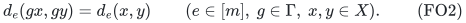
Its orbits <code class="math">X_1,\ldots,X_k</code> have sizes <code class="math">N_1,\ldots,N_k</code>. Put
<!-- math-display: d6883a3cda889b16abbf0ac1
L=\log\!\left(2\,k!\prod_{j=1}^kN_j\right).
 \tag{FO3}
-->
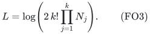
Only the permutation action matters; its image is finite even if <code class="math">\Gamma</code> was originally described as an infinite group.

**Theorem 1.** For <code class="math">0&lt;\epsilon&lt;1</code>, there are nonnegative coefficients <code class="math">\omega_e</code>, supported on
<!-- math-display: 2ca85434cc8efc500ceefb0f
O\!\left(
   \min\left\{m,\frac{\min\{N,L\}}{\epsilon^2}\right\}
 \right)
 \tag{FO4}
-->
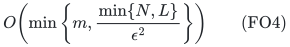
whole original metric items, such that
<!-- math-display: f53748a9fd4e52c2bf284df6
(1-\epsilon)D(x,y)
 \le\sum_e\omega_e w_e d_e(x,y)
 \le(1+\epsilon)D(x,y)
 \qquad(x,y\in X).
 \tag{FO5}
-->
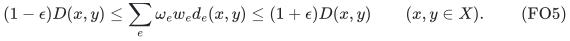
In particular, <code class="math">L\le\log2+k\log N</code>.

The <code class="math">L</code>-branch has a randomized construction polynomial in the original explicit distance-table size and encoding/accuracy parameters, under the separation/precision contract of the partial-coloring backend. The <code class="math">N</code>-branch is the published general sums-of-seminorms support theorem. No unverified construction guarantee for that separate branch is bundled into this statement.

For <code class="math">N=1</code>, all distances vanish and the empty output suffices. Zero items can otherwise be discarded. Every retained item receives one scalar coefficient; no internal embedding coordinate is separately reweighted.

## 2. A transitive completion

Let <code class="math">Y</code> be the set of ordered <code class="math">k</code>-tuples containing exactly one point from each original orbit, in arbitrary coordinate positions. Then
<!-- math-display: 9a8e46ee298e3c2202fe0510
|Y|=k!\prod_{j=1}^kN_j.
 \tag{FO6}
-->
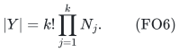
The product action <code class="math">\Gamma^k</code>, together with coordinate permutations by <code class="math">S_k</code>, acts transitively on <code class="math">Y</code>. First align the orbit labels of two tuples by a permutation, then move each coordinate within its orbit using a separate group element.

Lift each metric by its Euclidean product:
<!-- math-display: 28aa232989dfaa3fbc1fee3a
\widetilde d_e(u,v)
   =\left(\sum_{i=1}^k d_e(u_i,v_i)^2\right)^{1/2}.
 \tag{FO7}
-->
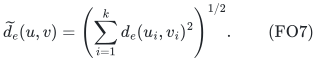
This is Hilbertian, via the direct-sum embedding
<!-- math-display: 8133f7ca0bf99a0b9f11d2dd
\widetilde\phi_e(u)
   =(\phi_e(u_1),\ldots,\phi_e(u_k)).
-->
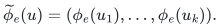
Independent group actions preserve each summand in (FO7), and coordinate permutations preserve their sum. Thus one common transitive action preserves every lifted metric individually.

Every original pair is encoded by a lifted pair with a common scalar factor:

- If <code class="math">x,y</code> belong to the same orbit, use tuples identical except that the corresponding coordinate changes from <code class="math">x</code> to <code class="math">y</code>. Then <code class="math">\widetilde d_e(u,v)=d_e(x,y)</code> for every item.
- If <code class="math">x,y</code> belong to different orbits, take a tuple containing both, and swap those two entries to obtain the second tuple. Then <code class="math">\widetilde d_e(u,v)=\sqrt2\,d_e(x,y)</code> for every item.

The factor <code class="math">\sqrt2</code> is common to every summand and cancels from a multiplicative approximation. Applying the companion transitive-metric theorem on <code class="math">Y</code> proves the <code class="math">O(L/\epsilon^2)</code> support branch.

Finally,
<!-- math-display: 97b0b1394a24c4bca8fed4a0
\prod_jN_j\le(N/k)^k,\qquad k!\le k^k,
-->
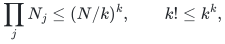
so <code class="math">&#124;Y&#124;\le N^k</code> and <code class="math">L\le\log2+k\log N</code>.

## 3. The tuple space need not be constructed

The same argument yields a hereditary Gaussian cone bound on the original pair queries. For arbitrary positive item weights, the stationary-process comparison in the companion note gives, for any anchor <code class="math">o\in Y</code>,
<!-- math-display: e1682d8395e699c5ef9eac18
\Pr_{\xi\sim N(0,I)}
 \left[
   \sum_e w_e\xi_e\widetilde d_e(o,v)\le0
   \quad\text{for every }v\in Y
 \right]\ge |Y|^{-1}.
 \tag{FO8}
-->
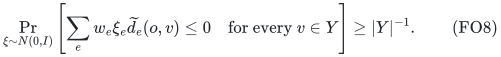
Transitivity and itemwise invariance make this anchor-pair event exactly the event that the inequalities hold for all pairs in <code class="math">Y</code>. Every original pair row is a positive scalar multiple of a lifted pair row. Consequently,
<!-- math-display: a208f0bbe31826735615e98a
\Pr_{\xi}
 \left[
   \sum_e w_e\xi_e d_e(x,y)\le0
   \quad\text{for all }x,y\in X
 \right]\ge |Y|^{-1}.
 \tag{FO9}
-->
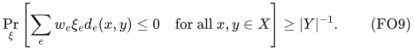
This proof remains valid after every item restriction and positive rescaling, since those operations do not change the common action.

Apply the Gaussian-section sparsification principle directly to the original table <code class="math">(d_e(x,y))_{(x,y),e}</code>. Its symmetric relative-error body is
<!-- math-display: 9fd8b55b359db1f41ae67a85
\left\{z:
 \left|\sum_e w_ez_e d_e(x,y)\right|
 \le a\sum_e w_ed_e(x,y)
 \quad\forall x,y\in X
 \right\}.
 \tag{FO10}
-->
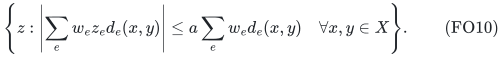
At most <code class="math">N^2</code> rows need to be checked by a separation oracle. The proof parameter is <code class="math">\log(2&#124;Y&#124;)=L</code>, but no tuple in the potentially much larger space <code class="math">Y</code> needs to be enumerated.

Thus the <code class="math">L</code>-branch inherits a randomized polynomial-time construction in the original table model. Rational distances and weights give rational linear inequalities. If distances are represented indirectly as square roots of rational quadratic expressions, an evaluation and weak-separation precision contract must be provided; a bit-complexity statement for arbitrary real input is not implicit.

The action and its orbit information are structural input or promises for the support bound. This result does not discover an unknown common isometry group.

## 4. Comparison with unrestricted metric sums

The published optimal sums-of-seminorms theorem already supplies <code class="math">O(N/\epsilon^2)</code> support without any action assumption. On the <code class="math">(N-1)</code>-dimensional zero-sum subspace of <code class="math">\mathbb R^X</code>, define
<!-- math-display: f2ed14aff56f49f8164ae9e8
f_e(z)=\left\|\sum_{x\in X}z_x\phi_e(x)\right\|_2.
 \tag{FO11}
-->
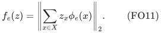
This is a seminorm, and <code class="math">f_e(\mathbf e_x-\mathbf e_y)=d_e(x,y)</code>. The existing theorem therefore proves the <code class="math">N</code>-branch in (FO4).

The increment is meaningful when <code class="math">\log(k!)+\sum_j\log N_j\ll N</code>. A bounded number of orbits gives logarithmic dependence on the number of points. For a trivial action, <code class="math">k=N</code>, the unrestricted support bound is the appropriate one. The assumption still requires preservation of each metric item: invariance of only the total sum is insufficient.

## 5. A joint lower-bound family

The dependence on the number of large orbits cannot generally be removed. Fix <code class="math">0&lt;\epsilon\le1/2</code>, let
<!-- math-display: a2b7eb36e9f1b7b2145c8f04
s=\lceil\epsilon^{-2}\rceil,\qquad B\ge s,\qquad v=s+B,
-->
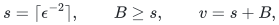
and take <code class="math">k</code> disjoint copies of
<!-- math-display: fe8c777d25a9f0acf3e8892e
X_j=\mathbb F_2^v/\langle\mathbf1\rangle,
 \qquad |X_j|=2^{v-1}.
 \tag{FO12}
-->
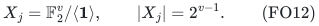
The common action is the product of the translation groups of the <code class="math">k</code> copies.

For each orbit <code class="math">j</code> and each edge <code class="math">ab</code> of <code class="math">K_{s,B}</code> on the <code class="math">v</code> Boolean coordinates, make one scalar metric item, with embedding on the entire disjoint union
<!-- math-display: 728993343ed4a9f7918a9128
\phi_{j,ab}(x)=
 \begin{cases}
 (-1)^{x_a+x_b},&x\in X_j,\\
 0,&x\notin X_j.
 \end{cases}
 \tag{FO13}
-->
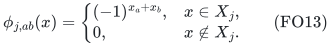
The parity is well-defined on the quotient by <code class="math">\mathbf1</code>. Translating within <code class="math">X_j</code> multiplies this whole scalar embedding by one common sign; it remains zero outside <code class="math">X_j</code>. Therefore the action preserves every item, including cross-orbit distances.

On two points inside <code class="math">X_j</code>, only that orbit's items contribute. Their distance is twice the corresponding parity-cut indicator. Every whole-item sparsifier must therefore induce a separate <code class="math">(1\pm\epsilon)</code> cut sparsifier of <code class="math">K_{s,B}</code> for each orbit. The complete-bipartite cut lower bound recorded as (EC15) in the companion exact-label-cut manuscript forces <code class="math">\Omega(v/\epsilon^2)</code> retained edges per copy, even with arbitrary nonnegative output weights. Hence the metric instance requires
<!-- math-display: 79fd9778da9363bf8b2c37e6
\Omega\!\left(\frac{kv}{\epsilon^2}\right)
 =
 \Omega\!\left(\frac{k\log(N/k)}{\epsilon^2}\right)
 \tag{FO14}
-->
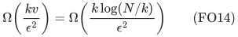
whole original items, where <code class="math">N=k2^{v-1}</code>.

This is a joint regime with
<!-- math-display: 43edc9417f048ba0f14a88b7
\log_2(N/k)+1\ge2\lceil\epsilon^{-2}\rceil.
-->
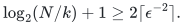
It gives the correct linear dependence on the number of these large orbits and matches the upper order in broad parameter ranges. It is not a sharpness claim for every <code class="math">k,N,\epsilon</code>; the completion's <code class="math">\log(k!)</code> term can leave a gap.

## 6. Sources and scope

The analytic theorem and construction contract are in [transitive-metrics-and-group-alignment.md](transitive-metrics-and-group-alignment.md); the Gaussian hereditary-section transfer is in [optimal-whole-subgroup-constraints.md](optimal-whole-subgroup-constraints.md). The new step here is the transitive tuple completion, its original-table implementation, and the orbit-dependent support consequence.

The unrestricted support comparison uses Basu--Brakensiek--Chen--Putterman--Reis--Zhang, *Optimal Sparsifiers for Minkowski Sums and Sums of Seminorms*, Theorem 1.2 (September 2026): <https://arxiv.org/pdf/2609.20238>. The partial-coloring backend is Reis--Rothvoss, Theorem 7 in the July 2026 version: <https://arxiv.org/html/2606.28147v2>. These published theorems are credited separately from this extension.

The result concerns sums of Hilbert distances. It does not replace distances by their squares, and a small number of action orbits alone does not remove the Hilbert-embedding requirement.
