# Optimal-support sparsification of whole subgroup constraints

**Abstract.** A weighted family of subgroup-complement predicates on a finite group <code class="math">G</code> admits a relative-error sparsifier on <code class="math">O(\log(2&#124;G&#124;)/\epsilon^2)</code> whole original items. We prove a hereditary one-sided Gaussian bound by comparison with a stationary coset process, establish a Gaussian coordinate-section symmetrization lemma, and apply the large-volume partial-coloring theorem. The same analysis applies to Euclidean orbit distances. Construction is randomized polynomial time in an explicitly supplied predicate table; the support bound is independent of that table's size.

*Section 5 extends the Gaussian comparison to sums of entire Euclidean orbit-distance metrics. The subgroup proof remains self-contained and does not depend on that extension.*

## 1. Statement and scope

Let <code class="math">G</code> be a finite group, <code class="math">N=&#124;G&#124;</code>, and let <code class="math">H_1,\ldots,H_m</code> be arbitrary subgroups, not necessarily normal. For positive weights <code class="math">w_e</code>, define
<!-- math-display: cf7e6c7bbc26a2365f8fb204
b_e(g)=\mathbf 1[g\notin H_e],
 \qquad
 W(g)=\sum_{e=1}^m w_e b_e(g).
 \tag{1}
-->
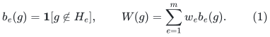

**Theorem 1.** For <code class="math">0&lt;\epsilon&lt;1</code>, there are nonnegative coefficients <code class="math">\omega_e</code>, supported on
<!-- math-display: dc96db71ef0d122fe39047a2
O\!\left(\min\{m,\epsilon^{-2}\log(2N)\}\right)
 \tag{2}
-->
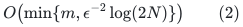
original indices, such that
<!-- math-display: cbe3a7f77536edae940162d4
(1-\epsilon)W(g)
 \le \sum_e\omega_e w_e b_e(g)
 \le (1+\epsilon)W(g)
 \qquad(g\in G).
 \tag{3}
-->
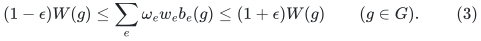
The same weights preserve the associated partition metric on every pair:
<!-- math-display: cdfc46c12b76611f211b3500
\sum_e w_e\mathbf 1[gH_e\ne hH_e]
 =W(h^{-1}g).
 \tag{4}
-->
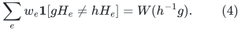
One can replace <code class="math">N</code> by the index of <code class="math">\bigcap_eH_e</code>; the coset field below has that many distinct locations. The simpler <code class="math">\log(2N)</code> form avoids degenerate notation.

The proof applies after every positive rescaling and every restriction to a subfamily. It never separates an original subgroup item into differently weighted character items.

**Finite-field whole-block corollary.** Let <code class="math">A_e</code> be arbitrary matrices over <code class="math">\mathbb F_q</code>, all with <code class="math">n</code> columns, and let
<!-- math-display: 9f53693eccd02a1e6e2c2578
W(x)=\sum_e w_e\mathbf 1[A_ex\ne0],\qquad x\in\mathbb F_q^n.
 \tag{5}
-->
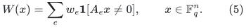
Then <code class="math">O(\min\{m,n\log(q)/\epsilon^2\})</code> whole original blocks suffice. The same statement holds for affine blocks after replacing <code class="math">x</code> by <code class="math">(x,1)</code>, at the cost of one dimension. More precisely, the exponent <code class="math">n</code> can be replaced by the dimension of the sum of the block row spaces in the homogeneous case.

This also applies to arbitrary matrices over <code class="math">\mathbb Z_q</code>, with <code class="math">q</code> composite and given in binary: use the finite additive group <code class="math">\mathbb Z_q^n</code>. The support bound does not require factoring <code class="math">q</code>. This last statement is about support existence; it does not assert a compact polynomial-time algorithm for the optimal bound.

**Arbitrary finite group codes.** Let <code class="math">A</code> be any finite group and let <code class="math">\mathcal C\le A^m</code> be a subgroup code. Apply Theorem 1 with ambient group <code class="math">\mathcal C</code> and the coordinate kernels
<!-- math-display: 90d06c78233d930811ccf1de
H_e=\{c\in\mathcal C:c_e=1_A\}.
-->
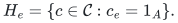
Then every weighted Hamming objective <code class="math">\sum_e w_e\mathbf 1[c_e\ne1_A]</code> has a sparsifier with <code class="math">O(\log(2&#124;\mathcal C&#124;)/\epsilon^2)</code> original coordinates, simultaneously for every codeword. Both the alphabet group and the code may be nonabelian. This sharpens the polylogarithmic-overhead public subgroup-code bounds described in Section 6.

**Arbitrary affine subgroup constraints.** The companion note
[affine-constraints-over-arbitrary-finite-groups.md](affine-constraints-over-arbitrary-finite-groups.md) extends (2)--(3) to
<code class="math">\mathbf1[g\notin a_eH_e]</code> for arbitrary cosets in arbitrary finite groups,
with the same <code class="math">O(\log(2&#124;G&#124;)/\epsilon^2)</code> order. It embeds all these cosets simultaneously into subgroups of
<code class="math">(G\times G)\rtimes C_2</code>, whose size is <code class="math">2&#124;G&#124;^2</code>, and restricts to queries <code class="math">(g,g^{-1})\tau</code>. No normality, commutativity, or common accepting query is required. The homogeneous proof in this manuscript remains independent of that extension.

At constant accuracy, the <code class="math">\log N</code> dependence is necessary: in <code class="math">G=\mathbb F_2^r</code>, the <code class="math">r</code> coordinate-kernel predicates must all be retained because a query can isolate each coordinate. Graph cut predicates form a further binary subgroup special case, so the usual graph-cut support lower bounds also apply in their standard accuracy range.

With the full <code class="math">N</code>-row predicate table explicitly available, the partial-coloring backend has a separation oracle obtained simply by scanning its linear inequalities. Its randomized implementation therefore runs in time polynomial in the table size and the usual accuracy/encoding parameters. In compact finite-field or modular input this table can have <code class="math">q^n</code> rows, and no efficient implicit separation oracle is supplied here.

There is a concrete obstacle to implementing this particular oracle compactly: the companion note *Exact separation for compact sparsification bodies* reduces MaxCut to membership even for scalar binary parity items. Thus an exact compact separation oracle for this route would imply <code class="math">P=NP</code>. This is a limitation of the separation-based implementation, not an impossibility theorem for other compact optimal sparsifier algorithms. The full reduction is kept separately in [../../obstruction-boundaries/manuscripts/exact-separation-for-compact-codes.md](../../obstruction-boundaries/manuscripts/exact-separation-for-compact-codes.md).

## 2. A hereditary one-sided Gaussian bound

We use the following form of Slepian comparison: centered Gaussian vectors with matching coordinate variances and larger off-diagonal covariances have larger probabilities of lying below a common threshold in every coordinate. Zero-variance coordinates may be deleted, and positive coordinate normalization handles unequal variances across coordinates.

**Lemma 2.** For independent standard Gaussian <code class="math">\xi_e</code>,
<!-- math-display: 7827a723599bc2f922d088b3
\Pr\!\left[
   \sum_e w_e\xi_e b_e(g)\le0
   \text{ for all }g\in G
 \right]\ge N^{-1}.
 \tag{6}
-->
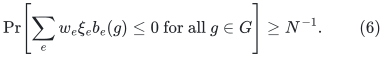
This holds for every real positive <code class="math">w_e</code>, including every restricted subfamily.

**Proof.** Independently for each item <code class="math">e</code> and each left coset <code class="math">C\in G/H_e</code>, sample a standard Gaussian <code class="math">T_{e,C}</code>. Define
<!-- math-display: c1e7d597f782d9438fd01def
F_g=\frac1{\sqrt2}\sum_e w_eT_{e,gH_e},
 \qquad
 Y_g=F_1-F_g,
 \qquad
 Z_g=\sum_e w_e\xi_e b_e(g).
 \tag{7}
-->
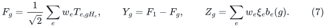
The process <code class="math">F_g</code> is invariant in distribution under left translation of <code class="math">g</code>, because that translation permutes the cosets for each item. Every sample has a minimum, and all <code class="math">N</code> locations have equal probabilities of being a minimum, so
<!-- math-display: 806521b4f5fff47ab08c9b82
\Pr[Y_g\le0\text{ for all }g]\ge 1/N.
 \tag{8}
-->
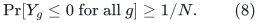
Ties only increase this probability.

For one item, if either <code class="math">g</code> or <code class="math">h</code> lies in <code class="math">H_e</code>, its contribution to both relevant covariances vanishes. If both lie outside <code class="math">H_e</code>, its covariance contribution to <code class="math">Y_g,Y_h</code> is
<!-- math-display: 1c98730db86e6b203c69c14a
\frac{w_e^2}{2}\bigl(1+\mathbf 1[gH_e=hH_e]\bigr)
 \le w_e^2,
 \tag{9}
-->
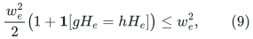
whereas its contribution to <code class="math">\mathrm{Cov}(Z_g,Z_h)</code> is <code class="math">w_e^2</code>. In particular, the coordinate variances match. Slepian comparison gives
<!-- math-display: d4bd65a87fbaf9dccf231767
\Pr[Z_g\le0\ \forall g]\ge
 \Pr[Y_g\le0\ \forall g]\ge1/N.
 \qquad\square
-->

The same proof works on any finite transitive space with invariant partitions. The group formulation is sufficient for the applications here.

## 3. Gaussian hereditary sections imply a large symmetric error body

Write <code class="math">\gamma_k</code> for standard Gaussian measure in <code class="math">\mathbb R^k</code>. For <code class="math">S\subseteq[m]</code>, define the coordinate section
<!-- math-display: 006852c127a74c834c967de0
K_S=\{x\in\mathbb R^S:(x,0)\in K\}.
-->
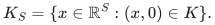

**Lemma 3 (Gaussian symmetrization).** There are absolute constants <code class="math">C_0,C_1</code> with the following property. Let <code class="math">0&lt;p\le1/2</code>, <code class="math">0&lt;a\le1/2</code>, and let <code class="math">K\subseteq\mathbb R^m</code> be a closed convex set containing <code class="math">a[-1,1]^m</code>. Suppose
<!-- math-display: ced3f8171196f3a8e96142bb
\gamma_{|S|}(K_S)\ge p
 \quad\text{for every }S\subseteq[m],
 \qquad
 m\ge C_0\frac{\log(2/p)}{a^2}.
 \tag{10}
-->
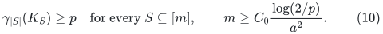
Then
<!-- math-display: 80085689872aff2ff00ec436
\gamma_m(K\cap(-K))\ge e^{-C_1m}.
 \tag{11}
-->
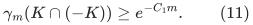
Consequently the symmetric body
<!-- math-display: af6d7425dc404006bc40aa93
Q=K\cap(-K)\cap[-1,1]^m
-->
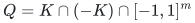
has Gaussian measure at least <code class="math">e^{-C_2m}</code> and volume at least <code class="math">c^m</code>, for absolute <code class="math">C_2</code> and <code class="math">c&gt;0</code>.

The argument follows the coordinate-section and separating-hyperplane organization of Reis--Rothvoss, but keeps Gaussian measure throughout. The reflection identity used below replaces their Lebesgue-volume reflection argument.

### 3.1 Every normal has a large section near the origin

Set
<!-- math-display: 0cf5adb443aef2258eb40080
\lambda=\sqrt{2\log(2/p)},
 \qquad
 r=10\lambda/\sqrt m.
 \tag{12}
-->
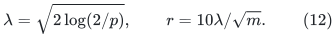
Taking <code class="math">C_0</code> sufficiently large ensures <code class="math">r\le a</code>. We first show that, for every <code class="math">v\in\mathbb R^m</code>,
<!-- math-display: e0cf8e76dffae3da9e047014
K(v):=K\cap\{x:\langle v,x\rangle\le r\|v\|_1\}
 \quad\text{satisfies}\quad
 \gamma_m(K(v))\ge e^{-C_3m}.
 \tag{13}
-->
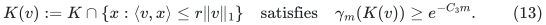

Order coordinates so that <code class="math">&#124;v_1&#124;\ge\cdots\ge&#124;v_m&#124;</code>. Put <code class="math">m_1=m</code>, <code class="math">m_{j+1}=\lfloor m_j/2\rfloor</code>, and stop at the first <code class="math">\ell</code> with <code class="math">m_\ell\le4\lambda^2</code>. Define
<!-- math-display: e7a5ac0b677e43216e33f211
I_j=(m_{j+1},m_j]\quad(j<\ell),
 \qquad I_\ell=[m_\ell].
-->
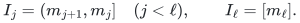
Thus early blocks contain the smaller coordinates and the last block contains the largest ones.

For <code class="math">j&lt;\ell</code>, let
<!-- math-display: 472e77fe2c735cd9478f3bcc
Q_j=K_{I_j}\cap
 \{x:\langle v_{I_j},x\rangle
              \le\lambda\|v_{I_j}\|_2\}.
-->
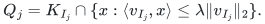
The standard Gaussian tail bound gives
<!-- math-display: 4ffaf5a78e4ad5f19d82898e
\gamma_{|I_j|}(Q_j)\ge p-e^{-\lambda^2/2}\ge p/2.
 \tag{14}
-->
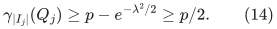
For the last block use <code class="math">Q_\ell=a[-1,1]^{I_\ell}\subseteq K_{I_\ell}</code>. Its measure is at least <code class="math">(a/2)^{m_\ell}</code>.

Consider the product set with coordinates in <code class="math">2^{-j}Q_j</code> for <code class="math">j&lt;\ell</code>, and in <code class="math">2^{-(\ell-1)}Q_\ell</code> on <code class="math">I_\ell</code>. The scaling coefficients sum to one, so convexity places this product inside <code class="math">K</code>.

For an early block, <code class="math">m_{j+1}\ge m_j/3</code> and
<!-- math-display: 300ddfd00a468aee510c6013
\|v_{I_j}\|_2
 \le \sqrt{m_j}\,\frac{\|v\|_1}{m_{j+1}}
 \le \frac{3\|v\|_1}{\sqrt{m_j}}
 \le\frac{3\cdot2^{j/2}}{\sqrt m}\|v\|_1.
-->
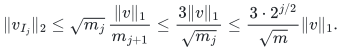
Hence the sum of the early-block contributions to <code class="math">\langle v,x\rangle</code> is at most
<!-- math-display: 7a46ac55fa2e4ccaef2240be
\frac{3\lambda\|v\|_1}{\sqrt m}
 \sum_{j\ge1}2^{-j/2}.
-->
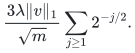
On the last block, <code class="math">a\le1/2\le\lambda/\sqrt{m_\ell}</code>, and
<!-- math-display: 331d3c33bcbed476da702cb7
\frac{2^{-(\ell-1)}}{\sqrt{m_\ell}}
 \le\frac{\sqrt2}{\sqrt m}.
-->
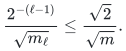
Its contribution is therefore at most <code class="math">\sqrt2\lambda\&#124;v\&#124;_1/\sqrt m</code>. Since
<code class="math">3\sum_{j\ge1}2^{-j/2}+\sqrt2&lt;10</code>, the product set lies in <code class="math">K(v)</code>.

For any measurable <code class="math">A\subseteq\mathbb R^s</code> and <code class="math">0&lt;t\le1</code>,
<!-- math-display: cceed211d3327a4d1c293c0d
\gamma_s(tA)\ge t^s\gamma_s(A).
 \tag{15}
-->
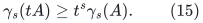
This follows directly by changing variables in the Gaussian density. The logarithm of the reciprocal product measure is thus at most
<!-- math-display: b5816dd765c56dff8102ec07
(\log2)
 \left(\sum_{j<\ell}j|I_j|+(\ell-1)m_\ell\right)
 +(\ell-1)\log(2/p)
 +m_\ell\log(2/a).
 \tag{16}
-->
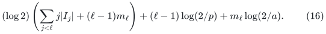
The first parenthesis equals <code class="math">\sum_{j&lt;\ell}m_j&lt;2m</code>. The second term is <code class="math">O(m)</code>, using
<code class="math">\ell-1\le1+\log_2(m/\lambda^2)</code> and
<code class="math">\lambda^2\log(m/\lambda^2)=O(m)</code>.
For the last term, <code class="math">m_\ell\le4\lambda^2</code>, while
<code class="math">\lambda^2=O(ma^2)</code> by (10), and
<code class="math">a^2\log(2/a)=O(1)</code>.
Thus (16) is <code class="math">O(m)</code>, proving (13).

### 3.2 A Gaussian reflection center

Define
<!-- math-display: 9c50b941ec7144f062364a9e
f_K(z)=
 \Pr_{Y\sim N(0,I_m/2)}[z+Y\in K,\ z-Y\in K].
 \tag{17}
-->
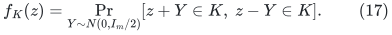
The integrand is log-concave jointly in <code class="math">z,Y</code>; integrating <code class="math">Y</code> preserves log-concavity by Prékopa's theorem. Thus every positive superlevel set of <code class="math">f_K</code> is convex. For closed <code class="math">K</code>, these superlevel sets are closed. A center with <code class="math">f_K(z)&gt;0</code> belongs to <code class="math">K</code>.

Let <code class="math">A</code> be any closed convex set. If <code class="math">X_1,X_2</code> are independent standard Gaussians, then
<!-- math-display: f4a1f55605bf4e577168050c
Z=(X_1+X_2)/2,\qquad Y=(X_1-X_2)/2
-->
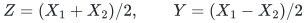
are independent <code class="math">N(0,I_m/2)</code> vectors. Therefore
<!-- math-display: ede4e370f0507aa6fe03ccf7
\gamma_m(A)^2=
 \mathbb E_{Z\sim N(0,I_m/2)} f_A(Z).
 \tag{18}
-->
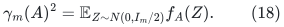
In particular, whenever <code class="math">\gamma_m(A)\ge q</code>, there is a <code class="math">z\in A</code> with
<code class="math">f_A(z)\ge q^2/2</code>. The factor <code class="math">1/2</code> avoids any supremum-attainment issue.

Apply this to every <code class="math">A=K(v)</code>, with the common lower bound <code class="math">q=e^{-C_3m}</code> from (13). The convex closed set
<!-- math-display: f99e9ee5b4b47aee19eb14ae
S=\{z:f_K(z)\ge q^2/2\}
-->
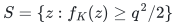
must meet <code class="math">r[-1,1]^m</code>. Otherwise a strict separating hyperplane would give some <code class="math">v</code> with
<!-- math-display: 31db3d75cb57a97e95c70051
\langle v,z\rangle>r\|v\|_1\quad(z\in S).
-->
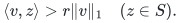
But (18), applied to <code class="math">K(v)</code>, supplies a center in <code class="math">K(v)</code> with <code class="math">f_K(z)\ge f_{K(v)}(z)\ge q^2/2</code>, a contradiction.

Choose such a center <code class="math">z</code>. Since <code class="math">\&#124;z\&#124;_\infty\le r\le a</code>, both <code class="math">z</code> and <code class="math">-z</code> belong to <code class="math">K</code>. Convexity then gives
<!-- math-display: d196bbc04145830c7a31de14
\frac12\bigl((K-z)\cap(z-K)\bigr)
 \subseteq K\cap(-K).
 \tag{19}
-->
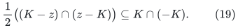
Converting the variance-<code class="math">1/2</code> measure in (17) to standard Gaussian measure and scaling by <code class="math">1/2</code> costs at most <code class="math">2^{3m/2}</code> in the reciprocal measure. Equations (17)--(19) prove (11).

Finally, <code class="math">K\cap(-K)</code> and the unit cube are symmetric convex sets. The Gaussian correlation inequality yields
<!-- math-display: 449d44591b177e187edab991
\gamma_m(Q)\ge
 \gamma_m(K\cap(-K))\,\gamma_1([-1,1])^m
 \ge e^{-C_2m}.
 \tag{20}
-->
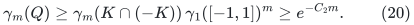
The standard Gaussian density is at most <code class="math">(2\pi)^{-m/2}</code>, so (20) also gives <code class="math">\mathrm{Vol}_m(Q)\ge c^m</code>. This proves Lemma 3. <code class="math">\square</code>

## 4. From Gaussian sections to sparsification

If <code class="math">N=1</code>, every predicate is identically zero and the empty output suffices. Assume <code class="math">N\ge2</code>.

For current positive weights <code class="math">w</code> and a parameter <code class="math">a</code>, define the unbounded one-sided perturbation body
<!-- math-display: ab2c98c4fb1b5b866c1be60f
K_a=\left\{
 z\in\mathbb R^m:
 \sum_e w_ez_e b_e(g)\le a W(g)
 \text{ for every }g\in G
 \right\}.
 \tag{21}
-->
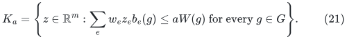
It contains <code class="math">a[-1,1]^m</code>. Every coordinate section contains its homogeneous one-sided cone. Lemma 2 therefore supplies the hereditary Gaussian lower bound <code class="math">p=1/N</code>.

Whenever <code class="math">m\ge C_0\log(2N)/a^2</code>, Lemma 3 gives volume at least <code class="math">c^m</code> for
<!-- math-display: a92569073b9c99c96dadc42d
Q_a=K_a\cap(-K_a)\cap[-1,1]^m
 =
 \left\{z\in[-1,1]^m:
 \left|\sum_e w_ez_e b_e(g)\right|\le aW(g)
 \ \forall g\right\}.
 \tag{22}
-->
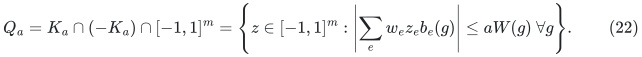

We use the standard large-volume partial-coloring theorem in exactly its dilated form: for a universal <code class="math">c&gt;0</code>, there is an absolute <code class="math">s=s(c)</code> such that every symmetric convex body <code class="math">Q\subseteq[-1,1]^m</code> of volume at least <code class="math">c^m</code> contains a vector
<!-- math-display: 6cbb9572986650d50f7ac34b
z\in sQ\cap[-1,1]^m
-->
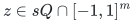
with at least <code class="math">m/2</code> coordinates in <code class="math">\{-1,1\}</code>. This is Theorem 7 in the July version of Reis--Rothvoss, based on their earlier Gaussian partial-coloring theorem. The constant dilation <code class="math">s</code> is necessary and is included in the error calculation.

Replace <code class="math">z</code> by <code class="math">-z</code> if needed so that at least <code class="math">m/4</code> coordinates equal <code class="math">-1</code>, and update
<!-- math-display: 68797492d94ef51c8150bf69
w'_e=w_e(1+z_e).
-->
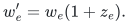
All weights remain nonnegative, support decreases by at least a factor <code class="math">3/4</code>, and every query value changes by a factor in <code class="math">[1-sa,1+sa]</code>.

At a stage with <code class="math">m_t</code> remaining items, take
<!-- math-display: fcdb0f140139177433ae21e9
a_t=\sqrt{C_0\log(2N)/m_t}.
 \tag{23}
-->
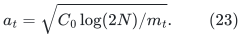
Stop when <code class="math">m_t\le M=C\log(2N)/\epsilon^2</code>, with a sufficiently large absolute <code class="math">C</code>. Earlier error parameters form a geometrically increasing sequence, since support decreases by a factor <code class="math">3/4</code>. In particular
<!-- math-display: 4a88fc89487d25225834e89f
\sum_{t:\,m_t>M} s a_t
 \le
 \frac{s\sqrt{C_0/C}}{1-\sqrt{3/4}}\,\epsilon.
 \tag{24}
-->
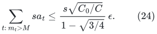
Choose <code class="math">C</code> so that this sum is at most <code class="math">\epsilon/4</code>, and so that every invoked <code class="math">a_t\le1/2</code>. Multiplying the one-stage inequalities then yields (3). Zero queries stay zero exactly because all coefficients and weights are nonnegative. Starting with <code class="math">m\le M</code> simply retains the input.

This closes the support proof. There is no need to establish a lower bound for the uniform-cube mass of the original homogeneous cone; the Gaussian symmetrization handles the missing bridge directly.

## 5. A broader transfer: entire Euclidean orbit-distance metrics

The Gaussian comparison is not specific to indicator predicates.

**Theorem 4.** Let <code class="math">\rho_e:G\to O(V_e)</code> be arbitrary real orthogonal representations of a finite group <code class="math">G</code>, and choose vectors <code class="math">v_e\in V_e</code>. Define
<!-- math-display: ba293a014fc797e173a62602
d_e(g,h)=\|\rho_e(g)v_e-\rho_e(h)v_e\|_2,
 \qquad
 D(g,h)=\sum_e w_e d_e(g,h).
 \tag{25}
-->
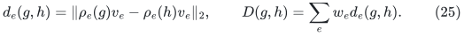
There are nonnegative common weights <code class="math">\omega_e</code>, supported on
<!-- math-display: 010565414c33c6897fcc3913
O(\min\{m,\log(2|G|)/\epsilon^2\})
-->
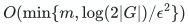
original metric items, for which
<!-- math-display: 08bd823962364f21878db649
(1-\epsilon)D(g,h)
 \le \sum_e\omega_e w_e d_e(g,h)
 \le (1+\epsilon)D(g,h)
 \quad\text{for every }g,h\in G.
 \tag{26}
-->
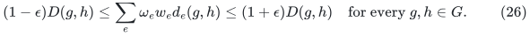
There is no dependence on the sum of the representation dimensions in the support count. An item can have a nontrivial kernel, so the individual <code class="math">d_e</code> and their sum may be pseudometrics.

**Proof of the required one-sided lemma.** Write
<!-- math-display: 7bf6c8b0e1775df4f5f58076
f_e(g)=d_e(1,g)=\|v_e-\rho_e(g)v_e\|_2,
 \qquad
 Z_g=\sum_e w_e\xi_e f_e(g).
-->
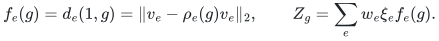
Independently sample standard Gaussian <code class="math">T_e\in V_e</code>, and put
<!-- math-display: db8f99eb0be9b9d1a6db8517
F_g=\sum_e w_e\langle T_e,\rho_e(g)v_e\rangle,
 \qquad Y_g=F_1-F_g.
 \tag{27}
-->
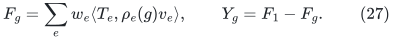
Left translation of <code class="math">g</code> rotates each <code class="math">T_e</code> orthogonally and therefore preserves the joint law of <code class="math">F</code>. Hence the identity is a minimum with probability at least <code class="math">1/&#124;G&#124;</code>. Moreover,
<!-- math-display: 8b61305feb58527a58af1e11
\mathrm{Var}(Y_g)=\sum_e w_e^2 f_e(g)^2
 =\mathrm{Var}(Z_g),
-->
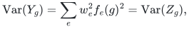
and Cauchy--Schwarz gives
<!-- math-display: f0a908ddeda431af24bf7168
\mathrm{Cov}(Y_g,Y_h)
 =
 \sum_e w_e^2
 \langle v_e-\rho_e(g)v_e,v_e-\rho_e(h)v_e\rangle
 \le\sum_e w_e^2 f_e(g)f_e(h)
 =\mathrm{Cov}(Z_g,Z_h).
 \tag{28}
-->
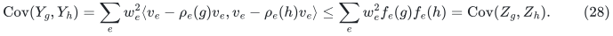
Slepian comparison proves the same hereditary lower bound (6), with <code class="math">b_e</code> replaced by <code class="math">f_e</code>. Their nonnegativity is the only other property used in Sections 3--4, so those sections give simultaneous preservation of <code class="math">\sum_e w_e f_e(g)</code>. Finally
<code class="math">d_e(g,h)=f_e(h^{-1}g)</code>, proving all-pairs preservation. <code class="math">\square</code>

For a subgroup <code class="math">H_e</code>, take its permutation representation on left cosets and <code class="math">v_e</code> equal to the indicator of the identity coset divided by <code class="math">\sqrt2</code>. Its orbit distance is exactly <code class="math">\mathbf 1[g\notin H_e]</code>. Thus this theorem contains the subgroup result, while the original proof of Lemma 2 makes that special case independently transparent.

A concrete class beyond whole OR predicates is
<!-- math-display: af543edd9acb699c0b4bbeee
f_e(x)=
 \sqrt{\sum_j c_{ej}\,
       \mathbf 1[\langle a_{ej},x\rangle=1]},
 \qquad
 a_{ej}\in\mathbb F_2^n,\quad c_{ej}\ge0.
 \tag{29}
-->
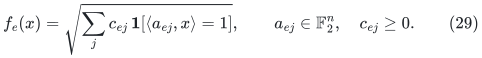
Choose a direct sum of the sign characters
<code class="math">\rho_e(x)_{jj}=(-1)^{\langle a_{ej},x\rangle}</code>, and vector coordinates
<code class="math">(v_e)_j=\sqrt{c_{ej}}/2</code>. Equation (29) is precisely its Euclidean orbit distance. Therefore <code class="math">O(n/\epsilon^2)</code> entire weighted parity-norm blocks preserve their sum for every <code class="math">x</code>, independently of the number of component parities in a block.

The square root in (25) and (29) is essential to the proof. General squared orbit distances have different Gaussian coordinate variances, so (28) does not prove the same statement for them. In particular, this is not an optimal spectral Cayley-generator theorem for arbitrary nonabelian groups. The optimal ordinary seminorm theorem also does not directly give (26): its ambient real dimension can be as large as the entire orbit span, whereas the support bound here depends only on the logarithm of the orbit size.

The companion note [transitive-metrics-and-group-alignment.md](transitive-metrics-and-group-alignment.md) proves the stronger <code class="math">N</code>-point formulation: whenever a common transitive action preserves each Hilbertian pseudometric individually, <code class="math">O(\log(2N)/\epsilon^2)</code> original metrics suffice. Centered Gram matrices supply the stationary Gaussian field, so the bound depends on the number of orbit points rather than the order of an unnecessarily large acting group. That note also gives a counterexample showing that transitivity of the total metric alone is insufficient.

The metric theorem is an existence claim. An explicitly supplied anchor-distance table provides a separation oracle in the corresponding real-arithmetic or value-oracle model; additional bit-complexity conclusions require an evaluation/precision contract for those distances. The binary subgroup theorem above has an exact rational predicate table and does not have this additional numerical issue.

## 6. Baselines and algorithmic limits

1. **Quanrud, _Quotient Sparsification for Submodular Functions_, SODA 2024.** Theorem 1.1 gives <code class="math">O(r\log(mr)/\epsilon^2)</code> support for real-valued monotone submodular functions of total value <code class="math">r</code>, normalized so every positive marginal is at least one, in randomized evaluation-oracle polynomial time. The rank function <code class="math">S\mapsto\dim\sum_{e\in S}\mathrm{row}(A_e)</code> shows that ordinary finite-field whole-block predicates are already included. More generally, **Corollary 1.7 on joint entropy directly includes all the subgroup predicates of this manuscript**, including nonnormal subgroups; the reduction is detailed below. The support/error part of adaptive repeated sparsification gives <code class="math">O(r\log(2r/\epsilon)/\epsilon^2)</code>, so the strongest checked subgroup baseline has only one remaining logarithm. This repeated-application consequence is not attributed as a verbatim theorem of Quanrud. For finite-field blocks one should also compare the ordinary dimension-rank version, which can be better when the field is large. <https://kentq.s3.amazonaws.com/submodular-sparsification.pdf>.

2. **Basu, Kothari, Meka, Tudose, _Optimal Sparsifiers for Abelian Cayley Graphs_, July 2026.** This proves optimal <code class="math">O(\log&#124;G&#124;/\epsilon^2)</code> support for individual abelian Cayley generators, using the Reis--Rothvoss framework. A whole subgroup item averages many characters with one shared coefficient. Sparsifying those characters separately does not retain whole original items, so their theorem is an antecedent rather than a direct invocation for (5). The present Gaussian comparison treats that shared coefficient explicitly. <https://arxiv.org/html/2607.08261v1>.

3. **Reis and Rothvoss, _Linear-size <code class="math">\ell_1</code> Sparsifiers_, July 2026 version.** Section 5 supplies the coordinate-section symmetrization strategy and Theorem 7 supplies the partial-coloring theorem with constant dilation. Their Theorem 22 assumes hereditary Lebesgue volume. Lemma 3 above is a Gaussian variant with an unbounded one-sided body, a midpoint reflection identity, and a final Gaussian-correlation intersection. The main ordinary <code class="math">\ell_1</code> theorem and the partial-coloring framework are not claimed here. <https://arxiv.org/html/2606.28147v2>.

4. **Basu, Brakensiek, Chen, Putterman, Reis, Zhang, _Optimal Sparsifiers for Minkowski Sums and Sums of Seminorms_, September 2026.** This already proves optimal ordinary seminorm, hypergraph-cut, and symmetric-submodular support, Arbitrary finite-field block predicates are periodic/discrete and are not automatically real seminorms in <code class="math">n</code> dimensions; no new ordinary hypergraph-cut result is asserted here. <https://arxiv.org/pdf/2609.20238>.

5. **Slepian, _The One-Sided Barrier Problem for Gaussian Noise_, Bell System Technical Journal 41 (1962).** The Gaussian comparison used in Lemma 2 is classical. <https://doi.org/10.1002/j.1538-7305.1962.tb02419.x>.

6. **Royen, _A Simple Proof of the Gaussian Correlation Conjecture Extended to Multivariate Gamma Distributions_ (2014).** Equation (20) uses this standard correlation theorem; it is not a new correlation inequality. <https://arxiv.org/abs/1408.1028>.

7. **Reis and Rothvoss, _Vector Balancing in Lebesgue Spaces_, Random Structures & Algorithms 62 (2023).** This is the constructive arbitrary-constant Gaussian-mass partial-coloring backend. <https://arxiv.org/abs/2007.05634>.

8. **Brakensiek and Guruswami, _Redundancy Is All You Need (for CSP Sparsification)_, STOC 2025, expanded May 2026 version.** Theorem 6.8 explicitly gives weighted subgroup-code sparsifiers for every <code class="math">\mathcal C\le A^m</code>, including nonabelian <code class="math">A</code>, of size <code class="math">O(\log&#124;\mathcal C&#124;\,\log^6m/\epsilon^2)</code>. Thus nonabelian group-code sparsification itself is a public model and theorem. The coordinate-kernel corollary above removes its overhead. The following chain-length theorem improves that explicit code bound, and the entropy reduction to Quanrud gives the still stronger single-logarithm baseline relevant here. The ordered-product word equations discussed in this literature can have zero sets that are not subgroups and are not automatically covered by Theorem 1. <https://arxiv.org/html/2411.03451v2>.

9. **Brakensiek, Guruswami, Putterman, _Multiplicative Error Set System Sparsification: A Simpler Proof via Chain Length Contraction_, ICALP 2026.** Theorem 1.2 gives, for arbitrary input weights and chain length <code class="math">d</code>, support
<!-- math-display: 1fb103ddb524e61a68cc3b8b
O\!\left(
 \frac{d\log^2(2d/\epsilon)
        [\log\log(4d/\epsilon)]^2}{\epsilon^2}
 \right),
-->
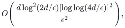
independent of the original number of items. For subgroup-complement predicates, the union of violation supports of a query set <code class="math">T</code> depends only on the subgroup <code class="math">\langle T\rangle</code>: an item is unviolated exactly when that subgroup lies in its acceptance subgroup. A strict union chain therefore forces strict increases of generated subgroups, each by index at least two; hence <code class="math">d\le O(\log&#124;G&#124;)</code>. For field block kernels, use the generated linear span to obtain <code class="math">d\le O(n)</code>. This is a broad general set-system baseline, but it is not the strongest support consequence for the subgroup model: the entropy reduction to Quanrud below leaves only one logarithm. Their theorem is not an efficient arbitrary-code construction. <https://arxiv.org/html/2605.01508v1>.

### 6.1 The entropy-quotient baseline for arbitrary subgroups

Let <code class="math">U</code> be uniform on <code class="math">G</code>, and let <code class="math">X_e=UH_e</code> be its left-coset random variable. For <code class="math">S\subseteq[m]</code>, write <code class="math">K_S=\bigcap_{e\in S}H_e</code>, with <code class="math">K_\varnothing=G</code>. Two elements of <code class="math">G</code> have the same joint coset tuple precisely when they lie in the same left coset of <code class="math">K_S</code>. Every fiber therefore has size <code class="math">&#124;K_S&#124;</code>, and
<!-- math-display: 4bbc3fe0e34c0d4b6b29d0c0
f(S)=H((X_e)_{e\in S})
     =\log_2[G:K_S].
 \tag{30}
-->
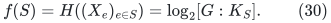
This is a normalized monotone submodular function by the standard joint-entropy inequality. Its marginal is
<!-- math-display: 778acd248caf29bbe7ebb8a8
f(S+e)-f(S)=\log_2[K_S:K_S\cap H_e],
 \tag{31}
-->
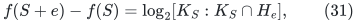
which is either zero or at least one. No normality assumption is used. Its total value
<!-- math-display: 5f5ebc1a54b5dc8b155cc7a8
r=f([m])=\log_2[G:\bigcap_eH_e]\le\log_2|G|
 \tag{32}
-->
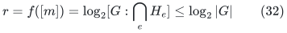
is exactly the normalized entropy parameter in Quanrud's Corollary 1.7.

For a query <code class="math">g</code>, let <code class="math">Z_g=\{e:g\in H_e\}</code>. If <code class="math">e\notin Z_g</code>, the element <code class="math">g</code> belongs to <code class="math">K_{Z_g}</code> but not to <code class="math">H_e</code>, so (31) is positive. Hence <code class="math">Z_g</code> is closed for <code class="math">f</code>, and its complement is a quotient. The same argument works after every restriction of the item set. Quanrud's weighted quotient theorem therefore preserves all the original subgroup-complement queries.

The restriction-closed repeated-application argument in [../../label-block-cut/manuscripts/adaptive-quotient-resparsification.md](../../label-block-cut/manuscripts/adaptive-quotient-resparsification.md) consequently yields the inherited support baseline
<!-- math-display: 78e7535f927ff882e5924325
O\!\left(\frac{r\log(2r/\epsilon)}{\epsilon^2}\right).
 \tag{33}
-->
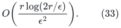
Its support and error calculation applies to the real-valued entropy function. The integer-rank bit-complexity implementation in that companion note does **not** automatically apply to logarithmic oracle values: an evaluation/comparison precision contract must be supplied for an algorithmic claim. Quanrud's own theorem explicitly uses an entropy evaluation oracle. Neither (33) nor this reduction silently supplies a compact polynomial-time subgroup-intersection entropy oracle.

The later companion [rational-quotient-ranks-from-weak-oracles.md](rational-quotient-ranks-from-weak-oracles.md) closes the logarithmic-value precision gap whenever the indices <code class="math">[G:K_S]</code> themselves have an exact polynomial-time integer oracle. Its canonical-key concave rounding produces an exact rational submodular surrogate with identical closure, unit positive-marginal gap, and rank <code class="math">O(r)</code>. This supplies a polynomial-bit quotient implementation under that index-oracle condition, without exact transcendental comparisons. The condition is not assumed for arbitrary succinct nonabelian group presentations.

For arbitrary coset predicates, the same baseline follows after the established common wreath-group reduction in [affine-constraints-over-arbitrary-finite-groups.md](affine-constraints-over-arbitrary-finite-groups.md), whose ambient group has size <code class="math">2&#124;G&#124;^2</code>. Thus the optimal subgroup and coset support theorem in this work removes the last support logarithm relative to the strongest checked entropy-quotient consequence. The entropy comparison isolates the final logarithmic factor removed by the Gaussian proof.

The mathematical contributions are the one-sided Gaussian comparisons, the Gaussian hereditary-section transfer in Lemma 3, and their whole-subgroup and orbit-distance sparsification consequences. In particular, no compact polynomial-time optimal block-code algorithm, deterministic optimal construction, or optimal spectral Cayley-generator theorem for general nonabelian groups follows from the argument.
